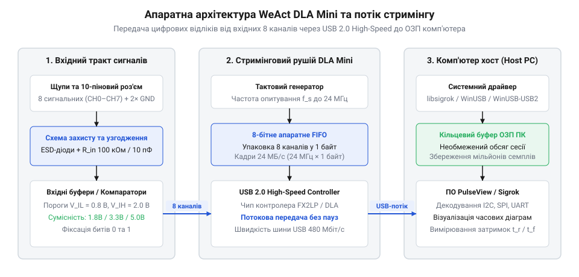
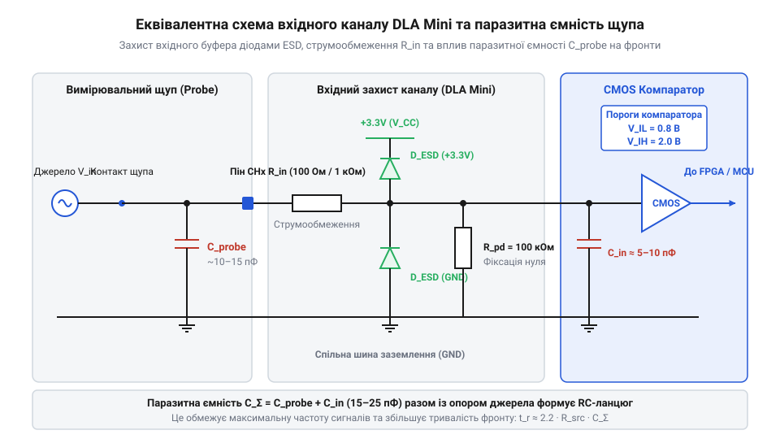
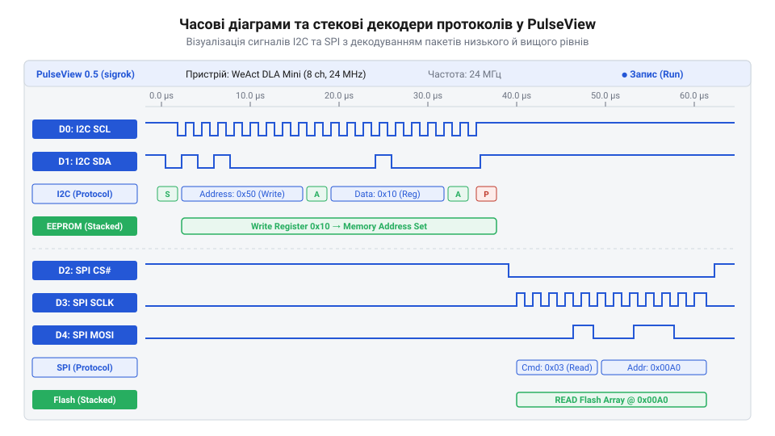

# WeAct DLA Mini — логічний аналізатор (24 МГц, 8 каналів)

<preknowlist>
- [FNIRSI 2C53T — осцилограф, генератор і мультиметр в одному](root:cat-hw-instruments/fnirsi-2c53t) — відмінності між аналоговим спостереженням амплітуди осцилографом та одночасною багатоканальною фіксацією логічних рівнів
- [Режим самописця Roll Mode у цифрових осцилографах](root:cat-hw-instruments/oscilloscope-roll-mode) — принцип безперервної потокової передачі вибірок без зупинки на наповнення апаратного буфера
</preknowlist>

## Обмеження осцилографа та логічний аналіз

Розсинхронізація послідовних шин у вбудованих системах спричиняє раптові збої без апаратних пошкоджень. Звичайний мультиметр показує лише наявність живлення, а [двоканальний осцилограф FNIRSI 2C53T](root:cat-hw-instruments/fnirsi-2c53t) не охоплює шини @@en|SPI@@ чи @@en|I2C@@, для аналізу яких потрібне одночасне спостереження 4–8 ліній. Найменший зсув сигналу @@en|SDA@@ відносно @@en|SCL@@ сприймається як хибна умова @@en|START@@ або @@en|STOP@@, що блокує обмін. Виклики друку в @@en|UART@@ додають затримки у сотні мікросекунд, що маскує гонки сигналів (англ. @@en|race condition@@).

Для локалізації таких збоїв застосовують [логічний аналізатор](root:cat-hw-instruments/logic-analyzer) (англ. @@en|logic analyzer@@). На відміну від аналогового осцилографа, компаратор приладу порівнює вхідну напругу з пороговими рівнями `V_IH` та `V_IL`, фіксуючи лише двійкові стани (`0` або `1`) по багатьох каналах одночасно. Смуга гістерезису (грец. *hysterēsis* — запізнення, англ. @@en|hysteresis@@) між порогами відсікає імпульсний шум і запобігає хибним спрацьвуванням.

## Архітектура стримінгу та межі дискретизації

Аналізатор WeAct DLA Mini застосовує концепцію потокового збору (англ. @@en|USB streaming analyzer@@), вивантажуючи вибірки в ОЗП комп'ютера.

*Структурна схема 8-канального логічного аналізатора DLA Mini та конвеєра стримінгу даних через USB 2.0.*

Контролер Cypress FX2LP зчитує 8 каналів на 24 МГц і передає дані в шину @@en|USB 2.0 High-Speed@@ у режимі (англ. @@en|Slave FIFO mode@@). Затримки ПК викликають переповнення буфера (англ. @@en|FIFO buffer@@) та втрату відліків (англ. @@en|buffer overflow@@). Принцип безперервного потоку деталізує [режим самописця Roll Mode](root:cat-hw-instruments/oscilloscope-roll-mode).

Частота `f_sample` має перевищувати частоту сигналу в 4–10 разів. Вимірювання сигналів понад 6 МГц при `f_sample = 24 МГц` спричиняє джиттер (англ. @@en|sampling jitter@@) до `±41.67 нс`, а понад 12 МГц — аліасинг (англ. @@en|aliasing@@).

## Вхідний захист та узгодження заземлення

Вхідні канали DLA Mini сумісні з рівнями КМОН (англ. @@en|CMOS@@) та @@en|TTL@@ (3.3 В і 5 В) з порогом перемикання 1.4 В і вхідним захистом від статики (англ. @@en|ESD protection@@).

*Принципова схема захисного вхідного тракту каналу DLA Mini та паразитна ємність вимірювального щупа.*

Вхідна ємність щупа `10–15 пФ` разом із підтяжкою шини @@en|I2C@@ утворює паразитний `RC`-фільтр, що затягує час наростання фронту (англ. @@en|rise time@@) і викликає фазовий зсув бітів.

Земляний контакт `GND` гальванічно з'єднаний із землею USB-порту ПК. Підключення `GND` до ненульового потенціалу утворює земляну петлю (англ. @@en|ground loop@@), вирівнювальний струм якої випалює доріжки плати й руйнує порт ПК.

## Декодування шин і пасивне трасування

Для зупинки збору даних за наростаючим чи спадаючим фронтом застосовують тригер (англ. @@en|trigger@@). Кільцевий буфер забезпечує передтригерну фіксацію (англ. @@en|pre-trigger buffer@@), показуючи стан шини до аномалії.

У середовищі [PulseView](root:sys-ide/sigrok-pulseview-ecosystem) каскадне декодування (англ. @@en|stacked decoders@@) розбирає фізичний рівень шин @@en|I2C@@, @@en|SPI@@ чи @@en|UART@@, а декодер верхнього рівня перетворює байти на прикладні команди.

*Відображення часових діаграм у PulseView із каскадним накладанням декодерів фізичного та прикладного рівнів.*

Для оцінки часового профілю застосовують пасивне трасування (англ. @@en|GPIO toggling@@): прямий однотактний запис у регістри `BSRR` не вносить затримок, на відміну від @@en|HAL@@, дозволяючи виміряти латентність переривань (англ. @@en|interrupt latency@@).
