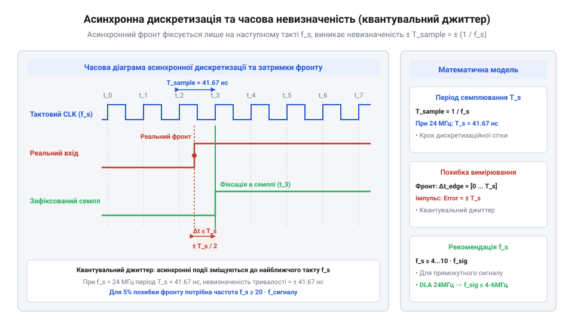

# Математика цифрової дискретизації, теорема Котельникова та часова роздільність

<preknowlist>
- [FNIRSI 2C53T — осцилограф, генератор і мультиметр в одному](root:cat-hw-instruments/fnirsi-2c53t) — розуміння відмінності між аналоговою оцифровкою осцилографом (ADC) та бінарним закріпленням логічних рівнів логічним аналізатором
- [Режим самописця Roll Mode у цифрових осцилографах](root:cat-hw-instruments/oscilloscope-roll-mode) — поняття безперервного потокового запису даних у пам'ять ПК проти буферизованої вибірки
</preknowlist>

## Викривлення фронтів при недостатній дискретизації

Спроба застосувати класичну теорему Котельникова-Шеннона (від нім. @@de|Abtasttheorem@@, теорема Котельникова, англ. @@en|Nyquist-Shannon sampling theorem@@) до цифрових прямокутних сигналів без урахування їхньої специфіки призводить до грубих вимірювальних помилок. Формулювання теореми стверджує, що аналоговий сигнал із обмеженим спектром (англ. @@en|band-limited signal@@) з максимальною частотою `f_max` можна повністю відновити, якщо частота дискретизації (англ. @@en|sampling rate@@) `f_s` перевищує подвоєне значення `2 · f_max`. Проте цифровий прямокутний імпульс (англ. @@en|square wave@@) не є обмеженим за частотою — його крутий фронт містить нескінченний спектр вищих гармонік.

Якщо налаштувати логічний аналізатор на частоту опитування `f_s`, що лише трохи перевищує подвійну основну частоту цифрової лінії `f_signal` (`f_s ≈ 2 · f_signal`), виникає явище ефекту накладання спектрів (англ. @@en|aliasing@@). Гармонічні складові сигналу з частотами `f_k = (2k - 1) · f_signal`, які перевищують частоту Найквіста (`f_k > f_s / 2`), дзеркально відображаються в базову область як хибні складові `f_alias = |f_k - m · f_s|`. Таке математичне розрізання спектра відтинає вищі непарні гармоніки, необхідні для формування чітких прямокутних переходів, та спотворює їхні фазові співвідношення. У результаті відтворені бінарні семпли отримують штучні фазові зсуви й викривлення крутизни фронтів, що перетворює прямокутний меандр на синусоїдоподібну послідовність або утворює хибні низькочастотні биття.

Математично виникнення хибних низькочастотних складових у двійковому кадрі пояснюється тим, що розрізання спектра переносить енергію вищих непарних гармонік у смугу Найквіста `[0, f_s / 2]`. Коли вища гармоніка прямокутного імпульсу `(2k - 1) · f_signal` опиняється поблизу частоти дискретизації `f_s`, різницева частота `f_beat = |(2k - 1) · f_signal - f_s|` утворює низькочастотні биття в масиві бінарних семплів. У зафіксованому часовому кадрі це проявляється як штучне розширення чи звуження тривалості імпульсів, де логічний рівень утримується довше за реальний такт шини, викривляючи часові інтервали даних.

Понад те, вузькі короткочасні сплески та імпульсні завади (глатчі, англ. @@en|glitch@@), тривалість яких коротша за період дискретизації `T_sample = 1 ÷ f_s`, повністю випадають із зафіксованого кадру, якщо вони потрапляють між двома сусідніми тактовими зрізами аналізатора. На відміну від аналогової оцифровки АЦП осцилографа, яку описує [FNIRSI 2C53T](root:cat-hw-instruments/fnirsi-2c53t), логічний аналізатор фіксує лише бінарні рівні на тактових засічках, тому збереження форми цифрового сигналу вимагає суттєво вищого запасу частоти опитування.

## Гармонічний склад імпульсу та вибір частоти

Для математичного розрахунку необхідної частоти дискретизації прямокутний сигнал періодом `T_period` та основною частотою `f_0 = 1 ÷ T_period` розкладають у ряд Фур'є (англ. @@en|Fourier series@@). Рівняння ідеального меандру становить нескінченну суму непарних гармонік:

s(t) = (4 ÷ π) · ∑ [sin((2k - 1) · 2π · f_0 · t) ÷ (2k - 1)]      [розклад прямокутного імпульсу в ряд Фур'є]

Форма прямокутного імпульсу формується сумою першої (основної) та вищих непарних гармонік (`3·f_0`, `5·f_0`, `7·f_0`). Зрізання спектра вище 3-ї гармоніки розмиває фронт, оскільки втрата високочастотних складників перетворює миттєвий перепад напруги на згладжену траєкторію з осциляціями на крутих переходах (феномен Гіббса, англ. @@en|Gibbs phenomenon@@), а нехтування 5-ю гармонікою створює викривлення тривалості імпульсу. Геометрично й фізично цей процес відповідає проходженню перепаду через еквівалентний аналоговий фільтр низьких частот (англ. @@en|low-pass filter@@) першого порядку з постійною часу `τ = R · C` (англ. @@en|time constant@@). Математично еволюція напруги описується експоненційною характеристикою `v(t) = V_0 · (1 - e^(-t / τ))`. Визначивши моменти досягнення 10 % амплітуди `t_1 = τ · ln(10 / 9)` та 90 % амплітуди `t_2 = τ · ln 10`, отримуємо час наростання фронту як `t_r = t_2 - t_1 = τ · (ln 10 - ln(10 / 9)) = τ · ln 9 ≈ 2.2 · τ`. Оскільки гранична частота зрізу фільтра за рівнем -3 дБ обчислюється з виразу `f_3dB = 1 ÷ (2π · τ)`, точна підстановка значення `τ = t_r ÷ ln 9` дає `f_3dB = ln 9 ÷ (2π · t_r) ≈ 2.197 ÷ (6.283 · t_r) ≈ 0.35 ÷ t_r`. Звідси ефективна смуга частот `B` (англ. @@en|bandwidth@@, Гц), необхідна для передачі крутизни фронту з часом наростання `t_r`, пов'язана співвідношенням:

B ≈ 0.35 ÷ t_r      [гранична частота спектра за часом наростання фронту]

Щоб логічний аналізатор зафіксував перехідний процес фронту з високою роздільністю й упіймав принаймні 4–5 семплів протягом тривалості `t_r`, частота дискретизації `f_s` має задовольняти нерівності:

f_s ≥ 4 ÷ t_r      [мінімальна частота дискретизації за часом фронту]

**Розрахунок частоти дискретизації для сигналу з фронтом t_r = 20 нс**

Обчислимо необхідні параметри опитування логічного аналізатора для цифрової шини з часом наростання фронту `t_r = 20 нс` (`20 · 10⁻⁹ с`):

B = 0.35 ÷ (20 · 10⁻⁹)
= 17500000 Гц = 17.5 МГц      [ефективна смуга частот сигналу]

f_s = 4 ÷ (20 · 10⁻⁹)
= 200000000 Гц = 200 МГц      [необхідна частота дискретизації аналізатора]

## Часова невизначеність та квантувальний джиттер

Логічний аналізатор здійснює асинхронну дискретизацію (англ. @@en|asynchronous sampling@@) вхідного сигналу за власним внутрішнім тактовим генератором. Момент реальної зміни логічного рівня на шині відбувається у довільну точку часу всередині інтервалу дискретизації `T_sample = 1 ÷ f_s`.

Зафіксований момент зміщення фронту прив'язується до найближчого тактового зрізу генератора, утворюючи похибку квантування часу. Часова невизначеність (квантувальний джиттер, англ. @@en|quantization jitter@@) `Δt` розподілена в діапазоні одного періоду дискретизації:

-T_sample ≤ Δt ≤ +T_sample      [інтервал часової невизначеності зафіксованого фронту]

*Схема асинхронної дискретизації прямокутного сигналу та виникнення часової невизначеності.*

При вимірюванні тривалості імпульсу або часової затримки (англ. @@en|propagation delay@@) між двома незалежними фронтами гранична абсолютна похибка `Δt_max` дорівнює сумі невизначеностей стартового й фінішного моментів. З огляду на ймовірнісний розподіл, похибка квантування окремого фронту описується рівномірним розподілом ймовірностей на інтервалі дискретизації шириною `T_sample`, де щільність ймовірності дорівнює `p(Δt) = 1 ÷ T_sample`. Середньоквадратичне значення (англ. @@en|root mean square@@) джиттеру одного фронту становить `σ_t = T_sample ÷ √12 ≈ 0.289 · T_sample`. Оскільки моменти появи стартового й фінішного фронтів є статистично незалежними випадковими величинами, їхні дисперсії додаються, що визначає сумарне середньоквадратичне відхилення виміряної тривалості `σ_total = T_sample ÷ √6 ≈ 0.408 · T_sample`, тоді як максимальна абсолютна похибка вимірювання часового інтервалу становить:

Δt_max = ± T_sample = ± (1 ÷ f_s)      [максимальна похибка вимірювання часового інтервалу]

Наприклад, при частоті дискретизації `f_s = 24 МГц` період `T_sample ≈ 41.67 нс`. Гранична похибка вимірювання тривалості імпульсу становить `±41.67 нс`, що вимагає підвищення `f_s` при аналізі швидких протоколів (SPI, UART).

## Пропускна здатність USB та граничні режими

При потоковому записі цифрових даних логічний аналізатор формує 8-канальні кадри. Кожен семпл об'єднує стани 8 цифрових ліній в 1 байт даних (`N_channels = 8 біт = 1 байт`). Швидкість генерування потоку даних `R_data` (англ. @@en|data generation rate@@, МБ/с) обчислюється як:

R_data = f_s · N_channels ÷ 8 = f_s · 1      [потік даних 8-канальних кадрів, МБ/с]

Для безперервної передачі даних на комп'ютер у реальному часі швидкість `R_data` не повинна перевищувати ефективну пропускну здатність контролера шини USB 2.0 High Speed `BW_usb` (англ. @@en|bus bandwidth@@). Повна фізична швидкість USB 2.0 становить 480 Мбіт/с (60 МБ/с), але через накладні витрати протоколу (англ. @@en|protocol overhead@@) реальна пропускна здатність потокового каналу становить `BW_usb ≈ 24–32 МБ/с`. Коли частота дискретизації перевищує поріг шини (наприклад, `f_s = 100–200 МГц`), аналізатор переходить у режим буферизованого накопичення у внутрішній статичній пам'яті (англ. @@en|SRAM buffer@@). У цьому режимі гранична тривалість запису кадру `t_capture_max` обмежується ємністю масиву `M_sram` за формулою `t_capture_max = M_sram ÷ f_s`: при об'ємі буфера `M_sram = 64 КБ` (65 536 байт) і частоті опитування `f_s = 100 МГц` пам'ять повністю заповнюється за `655.36 мкс`, після чого вибірка зупиняється й накопичений кадр передається на ПК.

Для безперервного запису без переповнення буфера гранична частота опитування обмежена умовою:

f_s ≤ BW_usb ÷ 1 байт/семпл ≈ 24 МГц      [гранична частота безперервної потокової дискретизації]

Робота на вищих частотах (наприклад, 100–200 МГц) можлива лише у короткочасному режимі накопичення у внутрішню оперативну пам'ять аналізатора. Режим потокової безперервної дискретизації прямо співвідноситься з концепцією, яку описує [Режим самописця Roll Mode у цифрових осцилографах](root:cat-hw-instruments/oscilloscope-roll-mode), коли обмеження шини вимагають узгодження швидкості вибірки з наявним каналом зв'язку.
