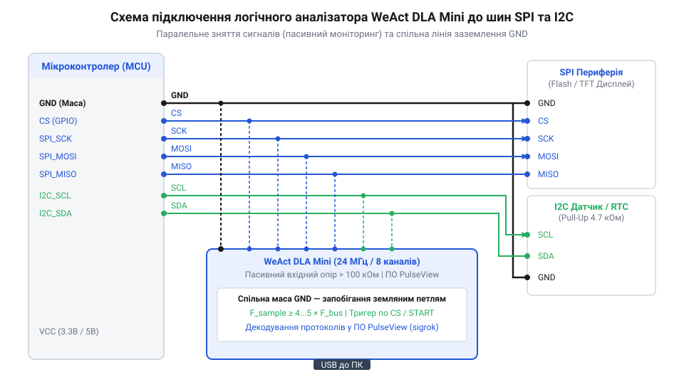

# Практичне налагодження шин SPI та I2C за допомогою DLA Mini та PulseView

<preknowlist>
- [FNIRSI 2C53T — осцилограф, генератор і мультиметр в одному](root:cat-hw-instruments/fnirsi-2c53t) — Принципи вимірювання напруги й обмеження двохканальних осцилографів при спостереженні послідовних шин.
</preknowlist>

## Проблема невидимості транзакцій послідовних шин

Під час налагодження мікроконтролерних систем розробники часто зіштовхуються із ситуацією, коли пристрій на шині @@en|I2C@@ (від @@en|Inter-Integrated Circuit@@) або @@en|SPI@@ (від @@en|Serial Peripheral Interface@@) перестає відповідати, а програма «зависає» у циклі очікування. Спроба виміряти напругу звичайним @@en|multimeter@@ (від лат. @@la|multum@@ — багато та грец. @@grc|μέτρον@@ — міра) показує стабільні 3.3 В або 0 В, оскільки вольтметр усереднює швидкі імпульси напруги й не здатен зафіксувати короткочасні пачки тактових сигналів.

Застосування двоканального цифрового осцилографа, такого як [FNIRSI 2C53T](root:cat-hw-instruments/fnirsi-2c53t), дозволяє побачити форму електричних фронтів та амплітуду напруги, але не виявляє прихованих логічних колізій шини. При аналізі повнодуплексного обміну @@en|SPI@@ потрібні щонайменше чотири лінії: тактова @@en|SCK@@, лінії даних @@en|MOSI@@ та @@en|MISO@@, а також сигнал вибору веденого @@en|CS@@, для чого двох каналів осцилографа катастрофічно бракує. На шині @@en|I2C@@ виникає інша критична проблема — апаратне заклинювання (від англ. @@en|bus lockup@@), коли ведений пристрій зависає посеред читання байта й неперервно утримує лінію @@en|SDA@@ у низькому стані (0 В). Майстер-контролер сприймає це як вічно зайнятий ефір і блокує наступні транзакції, а осцилограф показує лише пряму лінію нуля без підказки, на якому саме біті сталася відмова. Навіть увімкнувши [режим самописця](root:cat-hw-instruments/oscilloscope-roll-mode), розробник бачить лише статичний рівень напруги, але змушений вручну відраховувати тактові імпульси й вираховувати hex-значення байтів.

Для розв'язання задачі невидимості послідовних транзакцій використовують 8-канальний @@en|logic analyzer@@ (від дав.-гр. @@grc|λογικός@@ — логічний та @@grc|ἀνάλυσις@@ — розклад) @@en|WeAct DLA Mini@@. Цей пристрій непреривно реєструє логічні рівні (0 та 1) на всіх 8 входах з високою частотою дискретизації і передає часові діаграми в комп'ютерну програму @@en|PulseView@@. Завдяки цьому розробник бачить цілісну картину обміну в часі та може миттєво локалізувати проблему в коді чи схемі.

## Апаратне підключення DLA Mini та заземлення

Правильна комутація логічного аналізатора @@en|WeAct DLA Mini@@ до відлагоджувальної плати є запорукою отримання неспотворених цифрових сигналів. Аналізатор має 8 вхідних цифрових каналів (від @@en|CH0@@ до @@en|CH7@@) та виводи заземлення @@en|GND@@ (від @@en|Ground@@). Для одночасного моніторингу шин @@en|SPI@@ та @@en|I2C@@ лінії підключають за такою схемою:

- Канал @@en|CH0@@ — лінія @@en|I2C SCL@@ (тактування);
- Канал @@en|CH1@@ — лінія @@en|I2C SDA@@ (дані);
- Канал @@en|CH2@@ — лінія @@en|SPI SCK@@ (тактування);
- Канал @@en|CH3@@ — лінія @@en|SPI MOSI@@ (дані від майстра до веденого);
- Канал @@en|CH4@@ — лінія @@en|SPI MISO@@ (дані від веденого до майстра);
- Канал @@en|CH5@@ — лінія @@en|SPI CS@@ (вибір веденого пристрою).

Найпоширенішою помилкою під час підключення є відсутність або недостатньо якісне спільне заземлення. Без з'єднання виводу @@en|GND@@ аналізатора з землею мікроконтролера між пристроями виникає різниця опорних потенціалів. Це призводить до появи індукованих наводок, помилкових спрацьовувань тригерів та псування зчитаних байтів.


*Паралельне підключення каналів логічного аналізатора DLA Mini до ліній послідовних шин із обов'язковим спільним провідником заземлення GND.*

Крім заземлення, варто враховувати паразитна ємність (від лат. @@la|capacitas@@ — місткість) довгих гнучких шлейфів. Довгі провідники створюють ємнісне навантаження на лінії з підтягуючими резисторами (особливо на @@en|I2C SDA/SCL@@), що завалює крутість фронтів прямокутних імпульсів. З'єднувальні провідники мають бути максимально короткими.

Окремої уваги вимагає узгодження логічних рівнів напруги (3.3 В та 5 В) між цільовою платою та логічним аналізатором. Вхідні буфери @@en|WeAct DLA Mini@@ розраховані на толерантність до напруги 5 В (від англ. @@en|5V tolerant@@), а поріг розпізнавання логічної одиниці вхідної мікросхеми становить близько 2.0 В. Це дозволяє безпечно підключати канали аналізатора паралельно як до 3.3-вольтових мікроконтролерів (наприклад, @@en|ESP32@@ чи @@en|STM32@@), так і до 5-вольтових систем (зокрема @@en|Arduino Uno@@), не ризикуючи пошкодити вхідні кола аналізатора й не вимагаючи додаткових конвертерів рівнів (від англ. @@en|logic level shifter@@).

Для формування тестового трафіку на платі випробування використовують прошивку мікроконтролера, яка періодично відправляє тестові пакети по обох шинах.

:::tabs
@tab C (ESP-IDF)
:::code proj-logic-analyzer-spi-i2c-decoding-setup/c/main/CMakeLists.txt
:::code proj-logic-analyzer-spi-i2c-decoding-setup/c/main/main.c

@tab C++ (Arduino)
:::code proj-logic-analyzer-spi-i2c-decoding-setup/cpp/main.cpp
:::

## Налаштування дискретизації, буфера та тригерів захоплення

Після комутації заліза та підключення @@en|WeAct DLA Mini@@ через @@en|USB@@ до ПК у програмі @@en|PulseView@@ необхідно вибрати драйвер пристрою @@en|fx2lafw@@ (відкрита прошивка для мікросхем @@en|Cypress FX2@@). Наступним кроком є вибір частоти дискретизації (@@en|sample rate@@) та обсягу буфера пам'яті (@@en|sample depth@@). Дізнатися більше про внутрішню організацію та алгоритми передачі даних мікросхеми Cypress FX2 допоможе [архітектура відкритої прошивки fx2lafw](root:sys-fw/fx2lafw-firmware-architecture).

Згідно з теоремою Найквіста-Шеннона (від англ. @@en|Nyquist–Shannon sampling theorem@@), частота дискретизації має щонайменше вдвічі перевищувати максимальну частоту сигналу. Проте для точної фіксації цифрових часових інтервалів та коротких викидів практична частота дискретизації логічного аналізатора повинна у 4–10 разів перевищувати частоту тактування шини:

```
f_sample >= 4 * f_clock
```

Наприклад, якщо шина @@en|SPI@@ працює на частоті 4 МГц, частоту дискретизації у @@en|PulseView@@ встановлюють на рівні 24 МГц (максимальна межа для DLA Mini). Для шини @@en|I2C@@ з частотою 100 кГц цілком достатньо частоти 1 МГц або 2 МГц.

Обсяг буфера визначає тривалість безперервного запису. За частоти 24 МГц розмір буфера в 24 мільйони семплів (24 Msamples) забезпечує 1 секунду суцільного захоплення. Щоб не шукати потрібний пакет у величезному масиві даних, налаштовують тригери захоплення (@@en|trigger setup@@):

1. Для шини @@en|SPI@@ тригер ставлять на спадний фронт (@@en|falling edge@@) лінії @@en|CS@@ (канал @@en|CH5@@), оскільки активний низький рівень сповіщає про початок транзакції.
2. Для шини @@en|I2C@@ тригер ставлять на спадний фронт лінії @@en|SDA@@ (канал @@en|CH1@@) при високому рівні @@en|SCL@@ (умова @@en|START@@).

Після натискання кнопки «Run» програма переходить у стан очікування події та миттєво починає запис у момент виникнення транзакції.

## Декодування шин SPI та I2C у PulseView

Отримані сирі цифрові часові діаграми у вигляді прямокутних хвильових форм зручні для оцінки тривалості імпульсів, але важкі для зчитування байтових даних. Програма @@en|PulseView@@ містить потужний рушій декодерів протоколів (@@en|protocol decoders@@).

Щоб розшифрувати шину @@en|SPI@@, додають декодер «SPI» та призначають йому відповідні вхідні канали: @@en|CLK@@ -> @@en|CH2@@, @@en|MOSI@@ -> @@en|CH3@@, @@en|MISO@@ -> @@en|CH4@@, @@en|CS@@ -> @@en|CH5@@. У налаштуваннях вказують режим @@en|SPI Mode@@ (наприклад, @@en|CPOL=0, CPHA=0@@) та порядок бітів (@@en|MSB first@@). Після цього над хвильовими формами з'являються кольорові блоки з розшифрованими значеннями байтів (наприклад, `0xDE`, `0xAD`, `0xBE`, `0xEF`).

Аналогічно для шини @@en|I2C@@ додають декодер «I2C» і призначають @@en|SCL@@ -> @@en|CH0@@ та @@en|SDA@@ -> @@en|CH1@@. Декодер автоматично розпізнає стартові й стопові умови (@@en|START/STOP conditions@@), біт читання/запису (@@en|R/W bit@@), 7-бітну адресу пристрою (наприклад, `0x3C` або `0x68`) та підтвердження байтів (@@en|ACK/NACK@@).

Для перетворення послідовності байтів у зрозумілі команди застосовують стекові декодери (@@en|stacked decoders@@). Клацнувши на зелену мітку вже доданого декодера @@en|I2C@@ або @@en|SPI@@, можна накласти декодер вищого рівня — наприклад, для дисплеїв @@en|SSD1306@@, датчиків @@en|MPU6050@@ чи годинників @@en|DS3231@@. Стековий декодер автоматично агрегує побайтові транзакції у високорівневі текстові події, такі як «Write Register 0x10: 0xDEADBEEF», усуваючи потребу ручного розбору структури пакетів.
