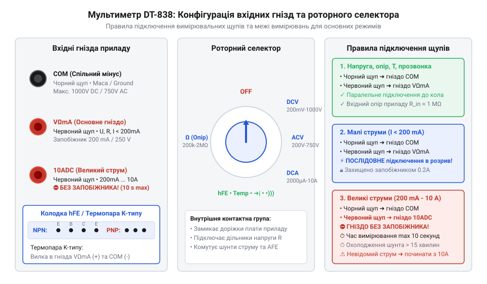
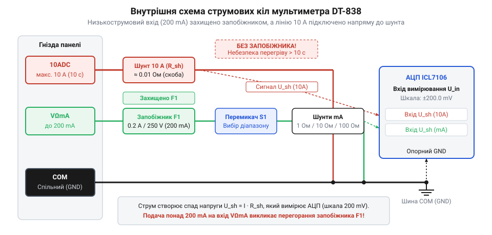

# Апаратний інтерфейс та комутація гнізд мультиметра DT-838

<preknowlist>
- [Щупи, гачки й затискачі «крокодил»](root:cat-hw-instruments/multimeter-probes-and-clips) — методику безпечного підключення щупів до вимірювальних гнізд та класифікацію ізольованих затискачів
</preknowlist>

## Фізичні вхідні гнізда та селектор діапазонів

Портативний цифровий мультиметр DT-838 оснащений панеллю з чотирьох вимірювальних точок та роторним галетним перемикачем режимів (від англ. @@en|rotary switch@@). Основу вимірювального інтерфейсу складають три 4-міліметрові штекерні гнізда типу «банан». Спільний вивід чорної полярності позначено як `COM` (від англ. @@en|Common@@ — спільна вимірювальна точка). Він є базовим потенціалом відліку для всіх видів вимірювань і підключається до витоку внутрішнього джерела живлення приладу. Для підключення червоного щупа зазвичай використовують комбіноване гніздо `VΩmA`, призначене для заміру постійної та змінної напруги, опору діелектриків і резисторів, перевірки діодів, а також малих струмів споживання у діапазоні до `200 мА`. Для безпечного [підключення щупів та затискачів](root:cat-hw-instruments/multimeter-probes-and-clips) до вимірювальних точок використовують ізольовані кабелі з відповідним колірним маркуванням.

Електричний опір латунних пелюсток 4-міліметрових гнізд у новому приладі становить у середньому від `0.05 Ом` до `0.1 Ом`. Проте при інтенсивній експлуатації повторне вставляння штекерів спричиняє механічне зношення пружних контактних розтрубів та накопичення оксидної плівки. Це викликає зростання перехідного опору контактів (від англ. @@en|contact resistance@@) до `0.5 Ом` і більше. Під час вимірювання малих опорів (менше `10 Ом`) цей додатковий паразитний опір гнізд підсумовується з опором щупів і вимірюваного компонента, суттєво завищуючи показання приладу та спотворюючи діагностичні висновки.

Конструктивно роторний селектор складається з пластикової роторної галети, на звороті якої зафіксовано пружні мідні контактори (від англ. @@en|sliding contacts@@). При обертанні ручки ці ковзаючі пелюстки переміщуються по концентричних кільцевих доріжках друкованої плати (від англ. @@en|printed circuit board@@ або @@en|PCB@@), вкритих захисним шаром оловування для зниження перехідного опору. Контактні групи плати розведені радіальними сегментами, що дозволяє у кожній із 20 фіксованих позицій селектора механічно замикати належну комбінацію ламелей, підключаючи відповідні дільники напруги або струмові шунти до вимірювального тракту.

У типовій діагностичній ситуації фахівець часто почергово перевіряє напругу живлення та струм споживання вузлів електронної плати. При цьому виникає поширена проблема: якщо після контролю напруги перемкнути роторний селектор у режим вимірювання струму, але залишити червоний щуп у гнізді `VΩmA` і випадково підключити прилад паралельно джерелу живлення, через внутрішнє вимірювальне коло пройде струм короткого замикання (від англ. @@en|short circuit@@). Інша проблема постає під час аналізу кіл із невідомим або динамічним споживанням, де струм навантаження може раптово перевищити межу `200 мА` комбінованого гнізда `VΩmA`, спричиняючи падіння напруги на внутрішньому запобіжникові чи вимірювальному провідникові та спотворення результатів. Тому для запобігання аварійним ситуаціям під час діагностики реальних схем вибір між гніздами `VΩmA` та `10ADC` диктується не лише родом величини, а й чітким оцінюванням очікуваного струму та топології підключення.

*Розташування вимірювальних гнізд, колодки hFE та роторного перемикача режимів мультиметра DT-838.*

Вимірювання силових струмів понад `200 мА` вимагає перестановки червоного щупа в окреме високострумове гніздо `10ADC`. Вибір режиму та діапазону здійснюється 20-позиційним поворотним селектором, який механічно комутує внутрішні контактні групи друкованої плати, підключаючи відповідні дільники або шунти до аналогово-цифрового перетворювача. На лицьовій панелі також розташовано 8-пінову колодку для тестування біполярних транзисторів та роз'єм для підключення температурного датчика.

## Схема внутрішньої комутації та запобіжник

Внутрішня апаратна топологія мультиметра розділяє слабострумові вимірювальні кола та високоамперну силову лінію. Гніздо `VΩmA` підключено до комутатора селектора через швидкісний плавкий запобіжник (від англ. @@en|fast-acting fuse@@) номіналом `F 200 mA / 250 V`. Запобіжник розташовано на внутрішній платі у скляному циліндричному корпусі розміром `5 × 20 мм`. Його призначення — розрив кола при випадковій подачі напруги у режимі вимірювання струму `DCA` або при перевищенні допустимого струму споживання навантаження понад `200 мА`.

Фізичний механізм спрацьовування швидкісного запобіжника ґрунтується на виділенні джоулевого тепла `P = I² · R_f` на тонкій плавкій нитці. При тривалому проходженні струмів, близьких до граничного значення (понад `150 мА`), накопичення тепла всередині замкненого скляного циліндра викликає поступове зростання температури провідника. Розігрів зменшує додатковий струм, необхідний для досягнення точки плавлення металу, що спричиняє температурне зниження номіналу (від англ. @@en|thermal derating@@). У результаті під час довготривалих вимірювань запобіжник може передчасно перегоріти навіть при струмі `180 мА – 190 мА` внаслідок теплової інерції корпусу.

Схемотехнічно запобіжник встановлюється в металеві пружинні тримачі (кліпси), які разом із тонкою плавкою ниткою мають власний паразитний опір у межах від `1 Ом` до `3 Ом`. При вимірюванні малих струмів у режимі `DCA` цей додатковий послідовний опір створює відчутне падіння напруги на вимірювальному приладі (від англ. @@en|burden voltage@@). У низьковольтних діагностичних колах (наприклад, із живленням `1.8 В` або `3.3 В`) така паразитна резистивність зсуває робочу точку досліджуваних компонентів, знижує струм споживання навантаження та вносить додаткову похибку у кінцеві показання мультиметра.

*Принципова схема розгалуження вимірювальних кіл струму, шунта 10A та захисного запобіжника.*

На відміну від слабострумового тракту, силовий вхід `10ADC` не має внутрішнього плавкого запобіжника. Вхідне гніздо `10ADC` з'єднане зі спільним виводом `COM` безпосередньо через прецизійний струмовимірювальний шунт (від англ. @@en|current shunt@@), виготовлений із товстого манганінового провідника опором `R_s ≈ 0.01 Ом`. Схемотехнічно аналогово-цифровий перетворювач обчислює струм шляхом зчитування прямо пропорційного спаду напруги `U_s = I · R_s` у мілівольтах з кінців шунта. Однак під час проходження великих струмів виникає інтенсивне джоулеве самонагрівання провідника з виділенням потужності `P = I² · R_s`, що спричиняє температурний дрейф опору манганіну та виникнення паразитної термо-ЕРС у вузлах пайки, викликаючи відхилення показань при тривалому вимірюванні. При спробі ж виміряти напругу джерела живлення щупами, підключеними до гнізда `10ADC`, у колі виникає струм короткого замикання `I_sc = U_source / R_s`, що призводить до дугового спалаху, розплавлення доріжок плати або руйнування вимірюваних кіл.

## Колодка hFE та термопара типу K

Для оцінки підсилювальних властивостей напівпровідникових приладів на передній панелі DT-838 передбачено спеціальну 8-пінову кругову розетку. Вона призначена для вимірювання статичного коефіцієнта передачі струму (від англ. @@en|hybrid forward current transfer ratio@@ або @@en|hFE@@) біполярних транзисторів прямої `PNP` та зворотної `NPN` структури у схемі зі спільним емітером. Колодка розділена на два сектори з чотирма отворами в кожному, позначеними літерами `E` (емітер), `B` (база), `C` (колектор), `E` (дубльований емітер для зручності цокольовки). Схемотехнічно внутрішнє джерело подає фіксований розрахунковий струм бази `I_B ≈ 10 мкА` через резистивний дільник при напрузі колектор-емітер `V_CE ≈ 2.8 В`, а прилад обчислює результуючий струм колектора `I_C` та відображає безрозмірне значення `hFE = I_C / I_B` у діапазоні від `0` до `1000`. Оскільки підсилювальні властивості напівпровідника мають виражену нелінійну залежність від величини робочого струму, таке вимірювання при фіксованому низькому `I_C` дає лише орієнтовну оцінку та може суттєво відрізнятися від реального `hFE` у потужних силових каскадах.

Температурні вимірювання у DT-838 реалізовано шляхом підключення зовнішньої хромель-алюмелевої термопари (від англ. @@en|K-type thermocouple@@). Термопара випускається у вигляді двох зварених на кінці провідників із вилкуватим адаптером або двох штекерів, які вставляють у гнізда `VΩmA` (позитивний полюс `+`) та `COM` (негативний полюс `-`). Роль датчика компенсації температури холодного спаю (від англ. @@en|cold junction compensation@@) виконує напівпровідниковий p-n діод, розташований на платі поруч із роз'ємами. Його фізична характеристика полягає в лінійному спаді прямої напруги зі швидкістю близько `-2.1 мВ/°C`. Завдяки заводському градуюванню підлаштувальним резистором цей спад точно зрівноважує зміну термо-ЕРС опорних кінців відповідно до кімнатної температури середовища, забезпечуючи вимірювання у діапазоні від `-20 °C` до `+1000 °C`.

## Правила безпеки та межі перевантаження

Мультиметр DT-838 спроєктовано за нормами категорії електричної безпеки (від англ. @@en|Measurement Category II@@ або @@en|CAT II 600V / CAT I 1000V@@). Гранично допустима напруга між вхідними гніздами та землею становить `1000 В` постійного струму (`DCV`) та `750 В` змінного струму (`ACV`). Конструктивно ці категорії визначають допустимий імпульсний випробувальний потенціал (до `2.5 кВ` для `CAT I` та `4 кВ` для `CAT II`) і мінімальну ширину повітряних ізоляційних зазорів між доріжками плати для гасіння імпульсних сплесків перенапруги. Перевищення робчих меж або поява високовольтних мережевих транзієнтів створює ризик дугового пробою через недостатній повітряний зазор між доріжками роторного селектора та чутливим входом АЦП.

Особливі вимоги безпеки висуваються до вимірювань у високострумовому режимі `10A`. Через відсутність запобіжника тривале проходження струму `10 А` через манганіновий шунт викликає його інтенсивний нагрів за законом Джоуля-Ленца `P = I² · R_s`. Нагрівання шунта змінює його опір, створюючи температурну похибку, і може розплавити пластиковий корпус. Максимально допустимий час вимірювання струму понад `5 А` становить не більше `10 секунд`, після чого прилад повинен охолоджуватися протягом щонайменше `15 хвилин`. Категорично заборонено вимірювати мережеву напругу при щупах, вставлених у гніздо `10ADC`, або перемикати роторний селектор під навантаженням. Фізика небезпеки комутації під навантаженням полягає в тому, що в момент розмикання механічних контактів розрив кола зі струмом створює високу напруженість електричного поля у вузькому зазорі. Це іонізує повітря й запалює електричну дугу (від англ. @@en|electric arc@@), яка руйнує мідні ламелі селектора, обвуглює гетинаксову плату та випускає розпечену плазму у внутрішній об'єм корпусу.
