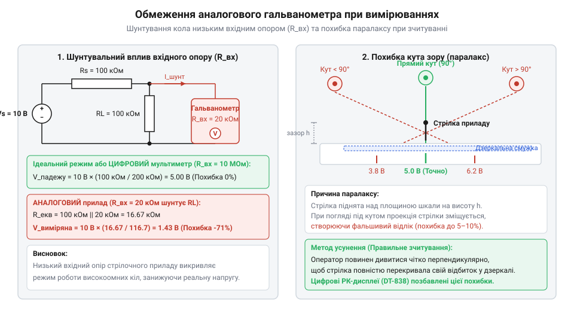
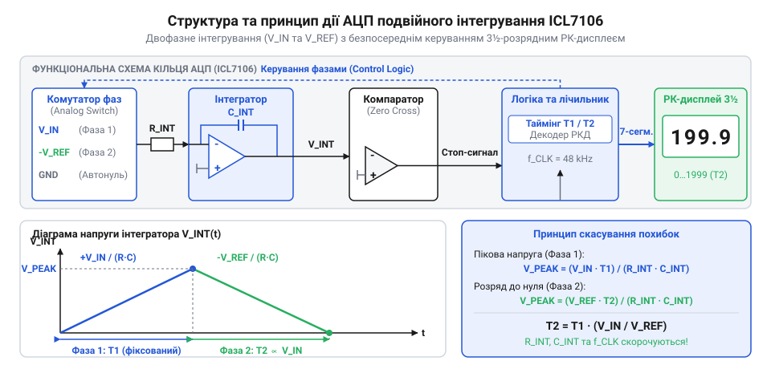

# Історія створення цифрових мультиметрів: від гальванометрів до серії 830/838

<preknowlist>
- [Щупи, гачки й затискачі «крокодил»](root:cat-hw-instruments/multimeter-probes-and-clips) — розуміння механічного та електричного підключення вимірювальних проводів до електричного кола.
</preknowlist>

## Обмеження стрілочних авометрів та гальванометрів

Вимірювання електричної величини на зорі радіотехніки вимагало відбирання потужності безпосередньо з досліджуваного кола. Перші вимірювальні прилади діяли на основі магнітоелектричного механізму: струм, що проходив крізь рухому котушку в полі постійного магніту, створював обертальний момент, якому протидіяла пружина. Такий інструмент дістав назву гальванометр (англ. @@en|galvanometer@@ від прізвища науковця Луїджі Гальвані та грец. @@grc|метрон@@ — вимірювати). Згодом шляхом об'єднання вимірювачів струму, напруги та опору в одному корпусі з'явився авометр (англ. @@en|AVO meter@@ — акронім від @@en|Ampere@@, @@en|Volt@@, @@en|Ohm@@).

Головним фізичним обмеженням стрілочних систем був низький вхідний опір (англ. @@en|input impedance@@). Для відхилення важкої механічної стрілки рамка котушки мусила споживати відчутний струм повного відхилення, що зазвичай становив десятки мікроампер. Щоб розширити межі вимірювання напруги, послідовно з котушкою вмикали ланцюг додаткових прецизійних резисторів: кожен вищий діапазон перемикача підключав більший послідовний опір для обмеження струму крізь рамку. Через це питомий вхідний опір аналогових вольтметрів визначався оберненою величиною струму рамки й рідко перевищував 20 кОм/В, а повний опір залишався жорстко прив'язаним до обраної межі. У високоомних колах — наприклад, у сіткових колах електронних ламп чи резистивних дільниках — підключення авометра створювало шунтувальний ефект. Вимірювальний прилад сам змінював режим роботи кола, суттєво знижуючи реальну напругу у вимірюваній точці. Наприклад, при вимірюванні на межі 10 В напруги 5 В на дільнику з двох опорів по 100 кОм вхідний опір вольтметра складає 200 кОм (20 кОм/В × 10 В). Підключення приладу створює паралельний еквівалент 66.7 кОм замість 100 кОм, виміряне значення падає до 4.0 В, а відносна похибка через шунтування досягає 20 %, що робить вимірювання некоректним.

*Вплив низького вхідного опору аналогового вимірювача на режим роботи кола та виникнення кутової похибки зчитування.*

Окрім електричного шунтування, стрілочні прилади мали низку механічних та експлуатаційних вад. Опори й підвіси котушки потерпали від тертя, а прилад вимагав суворого горизонтального або вертикального позиціонування. Будь-які механічні струси чи вібрації спричиняли коливання стрілки. Зчитування показників ускладнювала похибка паралаксу (грец. @@grc|параллаксис@@ — зміна, відхилення), коли погляд оператора під кутом до дзеркальної шкали зсував видиме положення стрілки відносно поділок. Крім того, у режимі омметра виснаження внутрішньої батареї вимагало постійного ручного виставляння нуля перед кожним заміром. Екстракція механічної енергії з кола виявилася тупиковою гілкою розвитку, що сформувало потребу у принципово новому електронному способі вимірювань.

Усвідомлення тупиковості механічного знімання енергії сформувало вимоги до концепції ідеального вимірювача. Головною умовою стало забезпечення нескінченно великого вхідного опору, аби під'єднані [вимірювальні щупи та затискачі](root:cat-hw-instruments/multimeter-probes-and-clips) не шунтували вимірювану схему навіть у високоомних вузлах. Відмова від рухомої котушки на користь електронного підсилення та цифрового перетворення відкривала шлях до автоматичного виставляння нуля й безальтернативного усунення суб'єктивних похибок оператора.

## Поява перших ламп і транзисторів

Першою спробою позбутися шунтувального впливу вимірювача став ламповий вольтметр (англ. @@en|vacuum tube voltmeter@@, VTVM). Застосування електронних ламп у ролі вхідного буферного підсилювача підняло вхідний опір приладу до десятків мегаом. Схемотехнічною основою цього буфера слугував тріод, увімкнений за схемою катодного повторювача (англ. @@en|cathode follower@@). Вхідний вимірюваний сигнал подавався безпосередньо на керувальну сітку лампи, яка практично не споживала струму й зберігала високий опір дільника, а вихідна напруга знімалася з катодного навантаження з низьким вихідним опором для керування стрілочним вимірювачем. Проте ці вимірювачі залишалися аналоговими: дрейф нуля в міру нагріву ламп та індикація за допомогою механічної стрілки зберегли більшість системних похибок.

Справжній крок до цифровізації відбувся у 1952 році, коли Ендрю Кей (англ. @@en|Andrew Kay@@), засновник компанії @@en|Non-Linear Systems@@ (NLS), розробив перший цифровий вольтметр (англ. @@en|digital voltmeter@@, DVM) модель NLS 481. У цьому приладі застосували кроковий шукач (англ. @@en|stepping switch@@) — електромеханічний перемикач із релейною схемою. Прилад працював за принципом покрокового зрівноважування: дискретний дільник напруги підбирав еталонний потенціал доти, доки він не зрівнювався з вхідним, а результат відображався за допомогою механічних барабанів з цифрами або газорозрядних індикаторів (англ. @@en|Nixie tube@@). Порівняно з пізнішими електронними розгортками (генератором лінійної напруги й компаратором), релейна схема NLS 481 забезпечувала високу точність вимірювання за рахунок стійких прецизійних опорів, але суттєво поступалася у швидкодії — механічна інерційність та клацання реле обмежували швидкість лише кількома вимірюваннями на секунду.

У 1960-х роках компанія @@en|Fluke Corporation@@ під керівництвом Джона Флюка (англ. @@en|John Fluke@@) перевела схемотехніку диференціальних вольтметрів на транзистори та напівпровідникові діоди. Це підвищило точність і стабільність вимірювань, проте перші цифрові вольтметри не могли замінити портативний авометр. Прилади містили сотні дискретних компонентів, споживали значну потужність, мали високу ціну у тисячі доларів і важили понад десять кілограмів. Навіть підключивши [вимірювальні щупи та затискачі](root:cat-hw-instruments/multimeter-probes-and-clips) до плати у полі, інженер мусив працювати з громіздким настільним блоком, під'єднаним до електромережі. Цифрові вимірювання залишалися привілеєм лабораторних стендів.

## Прорив чипа ICL7106 подвійного інтегрування

Справжній перелом у вимірювальних приладах відбувся у 1977 році, коли американська компанія @@en|Intersil@@ випустила монолітну мікросхему ICL7106. Вона об'єднала на одному силіцієвому кристалі повноцінний аналого-цифровий перетворювач (англ. @@en|analog-to-digital converter@@, АЦП) та схемотехніку керування індикатором.

В основу ICL7106 ліг принцип подвійного інтегрування (англ. @@en|dual-slope integration@@). Перетворення напруги в цифровий код відбувається у два послідовні етапи. На першому етапі вхідний сигнал `V_in` заряджає інтегрувальний конденсатор протягом фіксованого інтервалу часу `T₁`, який визначається лічильником тактових імпульсів. На другому етапі до конденсатора підключається опорна напруга протилежної полярності `V_ref`, і конденсатор розряджається до нуля за час `T₂`. Математичне співвідношення зарядного та розрядного етапів визначається рівністю накопиченого й скинутого заряду `V_in × T₁ = V_ref × T₂`, звідки випливає часова пропорційність `T₂ / T₁ = V_in / V_ref`. Час, необхідний для повного розряджання `T₂`, вимірюється тим же лічильником і є строго пропорційним вхідній напрузі `V_in`.

*Структурна архітектура ICL7106: два етапи інтегрування напруги та пряме керування сегментами рідкокристалічного індикатора.*

Схемотехніка подвійного інтегрування вирішила дві головні проблеми портативних вимірювань. По-перше, вибір тривалості першого етапу кратною періоду мережевої напруги (50 або 60 Гц) забезпечив автоматичне приглушення змінних завад електромережі без застосування складних аналогових фільтрів. По-друге, точність вимірювання перестала залежати від абсолютних значень і температурного дрейфу інтегрувальних резистора та конденсатора чи частоти тактового генератора. Фізико-математичний механізм цього скорочення полягає в тому, що під час першого етапу напруга на конденсаторі зростає до `ΔV = (V_in · T₁) ÷ (R · C)`, а на другому етапі спадає за законом `ΔV = (V_ref · T₂) ÷ (R · C)`. Прирівнюючи накопичений і знятий заряд, отримаємо рівняння `(V_in · T₁) ÷ (R · C) = (V_ref · T₂) ÷ (R · C)`, у якому добуток `R · C` присутній в обох частинах рівності та повністю скорочується, залишаючи чисто часове співвідношення `T₂ = T₁ · (V_in ÷ V_ref)`.

Крім того, ICL7106 була виготовлена за КМОН-технологією (англ. @@en|CMOS@@ — акронім від @@en|Complementary Metal-Oxide-Semiconductor@@), що зменшило її власне струмоспоживання до мікроамперних значень. Чип містив вбудований генератор і драйвер, що напряму керував сегментами рідкокристалічного дисплея (англ. @@en|liquid-crystal display@@, РК-дисплей) на 3½ розряди. Можливість живлення всього приладу від однієї 9-вольтової батареї («Крона») уможливила створення автономних портативних вимірювачів.

Об'єднання високоточного аналогового тракту, цифрової логіки й дисплейного драйвера на єдиному силіцієвому кристалі позбавило схемотехніку потреби в десятках дискретних транзисторів і громіздких джерелах живлення. Для побудови повноцінного цифрового вимірювача тепер вимагалося лише кілька пасивних обв'язувальних елементів та рідкокристалічний індикатор. Саме ця гранична інтеграція створила технологічне підґрунтя для масового здешевлення та компресії габаритів приладів, відкривши шлях до появи портативних кишенькових мультиметрів.

## Масовий феномен серії DT-830 та DT-838

У 1980–1990-х роках азійські виробники електроніки використали чип ICL7106 для створення легендарної серії портативних приладів. Так з'явився масовий цифровий мультиметр (англ. @@en|multimeter@@ від лат. @@lat|multus@@ — численний та грец. @@grc|метрон@@ — вимірювати) моделі DT-830, а згодом — його модифікація DT-838.

Конструктивний успіх серії базувався на граничній оптимізації та уніфікації виробництва. Замість дорожчих окремих кнопкових перемикачів інженери застосували галетний перемикач (англ. @@en|rotary switch@@), контактні доріжки якого витравлювали безпосередньо на друкованій платі. Рухомий селектор із підпружиненими контактами замикав потрібні ланцюги дільника напруги та шунтів. У моделі DT-838 до базової схеми додали вбудований підсилювач вимірювання температури, до якого підключалася зовнішня термопара (англ. @@en|thermocouple@@ від грец. @@grc|термос@@ — теплий та лат. @@lat|par@@ — пара) типу K. Мікровольтний сигнал, пропорційний різниці температур між гарячим робочим спаєм і клемним холодним спаєм, коригувався схемою компенсації навколишньої температури та масштабувався підсилювачем до співвідношення 1 мВ на 1 °C для подачі безпосередньо на АЦП. Стандартні гнізда на лицьовій панелі давали змогу швидко підключати [вимірювальні щупи та затискачі](root:cat-hw-instruments/multimeter-probes-and-clips) для будь-яких діапазонів вимірювань.

Поява серії DT-830 розвіяла поширений міф про те, що цифрові вимірювачі складніші й дорожчі у виробництві за аналогові стрілочні прилади. Тонка вища механіка гальванометра вимагала ручного складання й калібрування, тоді як монолітний чип і друкована плата виготовлялися повністю автоматизовано. Попри максимальне спрощення конструкції, захист вхідних кіл АЦП реалізували за допомогою послідовно ввімкненого терморезистора з позитивним температурним коефіцієнтом (англ. @@en|PTC thermistor@@ від @@en|positive temperature coefficient@@). У нормальному режимі PTC-резистор має низький опір і не впливає на вимірювання, однак при випадковій подачі високої напруги (наприклад, у режимі вимірювання опору) через нього протікає струм перевантаження, резистор миттєво розігрівається, його опір зростає на кілька порядків, і це надійно обмежує струм до безпечних мікроамперних значень, рятуючи вхідні аналогові ключі чипа. Інший міф про приналежність DT-830 до виключно лабораторного чи військового обладнання спростувала сама практика: зниження ціни до кількох доларів перетворило цифровий мультиметр на загальнодоступний масовий інструмент, що остаточно витіснив стрілочні авометри з повсякденної інженерної практики.
