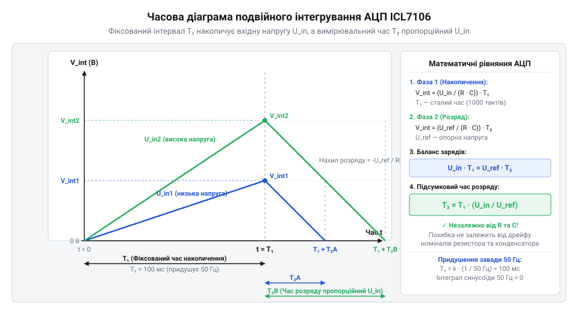

# Математична теорія АЦП подвійного інтегрування та оцінка похибок DT-838

<preknowlist>
- [Щупи, гачки й затискачі «крокодил»](root:cat-hw-instruments/multimeter-probes-and-clips) — Розуміння контактного опору щупів та вимірювального кола мультиметра
</preknowlist>

## Накопичення похибки прямого перетворення напруги

У простому вимірюванні напруги найпростіший метод перетворення аналогового сигналу в цифровий полягає в заряджанні конденсатора `C` через резистор `R` постійним струмом або напругою `U_in` і вимірюванні часу, за який напруга на конденсаторі досягне фіксованого порогу компаратора `U_th`. Вихідна напруга аналогового операційного інтегратора (від латинського @@en|integrator@@ — відновлювач) описується виразом:

U_out(t) = (1 / (R · C)) · ∫₀ᵗ U_in(τ) dτ

Якщо вхідна напруга `U_in` залишається постійною протягом часу вимірювання, вираз спрощується до прямолінійної залежності:

U_out(t) = (U_in · t) / (R · C)

Час `t_meas`, необхідний для досягнення порогу спрацьовування компаратора `U_th`, обчислюється з виразу:

t_meas = (U_th · R · C) / U_in

Головна фізична проблема цієї наївної схеми одноразового інтегрування полягає у прямій залежності виміряного часу `t_meas` від точних значень опору `R`, ємності `C` та опорного порогу `U_th`. У реальних вимірювальних приладах температурний дрейф номіналів резистора й конденсатора, їхнє часове старіння та нестабільність опорної напруги компаратора викликають постійну зміну коефіцієнта пропорційності. Зміна температури корпусу приладу на 10 °C спричиняє відхилення ємності конденсатора на 1-2 %, що призводить до аналогічної похибки вимірювання напруги.

Крім того, на вхідну постійну напругу завжди накладається мережева завада змінної напруги з частотою 50 Гц від електромережі живильної мережі: `U_noise(t) = U_m · sin(2 · π · 50 · t)`. При одноразовому або миттєвому квантуванні (від латинського @@en|quantization@@ — розбиття на порції) ця завада створює випадкові хаотичні стрибки показань на цифровому табло. Для побудови точного портативного мультиметра потрібен математичний метод перетворення, який принципово виключає величини `R` та `C` з підсумкового рівняння та повністю компенсує мережеві пульсації.

У вимірюваннях слабких сигналів ця проблема додатково ускладнюється паразитною ємністю вимірювальних провідників та нестабільністю опору виводів, через що надійний контакт забезпечують лише спеціалізовані [щупи та затискачі "крокодил"](root:cat-hw-instruments/multimeter-probes-and-clips). Якщо схема не здатна математично компенсувати власні паразитні опори й внутрішній дрейф, навіть найточніше контактне з'єднання не врятує показання приладу від спотворення на молодших розрядах.

## Математика двох фаз інтегрування ICL7106

Розв'язком проблеми дрейфу елементів став аналого-цифровий перетворювач подвійного інтегрування (@@en|Dual-Slope ADC@@), реалізований у базовій мікросхемі ICL7106 мультиметра DT-838. Принцип роботи полягає у послідовній реалізації двох часових фаз: прямого інтегрування невідомої напруги та розряджання інтегратора еталонною напругою.

*Часові фази прямого інтегрування вхідної напруги та розряджання еталонною напругою в АЦП.*

У першій фазі тривалістю `T_1` вхідний аналоговий комутатор підключає вимірювану напругу `U_in` до входу інтегратора. Внутрішній лічильник приладу відраховує фіксовану кількість тактових імпульсів `N_1` від внутрішнього генератора з частотою `f_clk`, тому час `T_1 = N_1 / f_clk` є суворо постійною величиною. Напруга на виході інтегратора наприкінці першої фази досягає значення:

U_int(T_1) = (1 / (R · C)) · U_in · T_1

У другій фазі комутатор відключає вхідну напругу й підключає до інтегратора еталонну опорну напругу `U_ref` протилежної полярності. Інтегратор починає розряджатися зі сталою швидкістю. Лічильник приладу підраховує кількість імпульсів `N_2` до моменту, коли компаратор зафіксує повернення напруги інтегратора до нульового рівня. Тривалість другої фази дорівнює `T_2 = N_2 / f_clk`. Зміна напруги на конденсаторі за час `T_2` описується виразом:

ΔU_int = (1 / (R · C)) · U_ref · T_2

Оскільки вихідна напруга інтегратора наприкінці другої фази повертається до нуля, прирівнюємо накопичений та знятий заряди:

(1 / (R · C)) · U_in · T_1
= (1 / (R · C)) · U_ref · T_2      [баланс зарядів на конденсаторі]
= U_in · T_1 = U_ref · T_2         [скорочення спільного множника 1/(R·C)]

Виражаємо тривалість другої фази `T_2` та відповідну кількість відліків лічильника `N_2`:

T_2
= T_1 · (|U_in| / U_ref)           [пропорційне співвідношення часів]

N_2
= N_1 · (|U_in| / U_ref)           [підстановка T_1 = N_1 / f_clk та T_2 = N_2 / f_clk]

Підсумковий математичний результат демонструє фундаментальну перевагу: кількість відліків `N_2` взагалі не залежить від опору `R`, ємності `C` та частоти генератора `f_clk`. Усі ці величини скорочуються в дрібному співвідношенні. Точність вимірювання визначається виключно стабільністю еталонного джерела `U_ref`.

## Механізм подавлення завади 50 Гц

Другою ключовою перевагою АЦП подвійного інтегрування є математичне придушення гармонічних завад електромережі з частотою 50 Гц без застосування громіздких аналогових фільтрів.

Якщо на вимірюваний постійний сигнал `U_in` накладається синусоїдальна завада мережі `U_noise(t) = U_m · sin(2 · π · f_grid · t + φ_0)`, де `f_grid = 50` Гц (період завади `T_grid = 1 / 50 = 0.02` с = 20 мс), то підсумкова вхідна напруга має вигляд:

U_total(t) = U_in + U_m · sin(2 · π · f_grid · t + φ_0)

Обчислимо інтеграл вхідної напруги за першу фазу інтегрування `T_1`:

∫₀^{T_1} U_total(t) dt
= ∫₀^{T_1} U_in dt + ∫₀^{T_1} U_m · sin(2 · π · f_grid · t + φ_0) dt      [лінійність інтеграла]
= U_in · T_1 + [ (U_m / (2 · π · f_grid)) · (cos(φ_0) - cos(2 · π · f_grid · T_1 + φ_0)) ]  [обчислення первісної]

Якщо час першої фази `T_1` обрано суворо кратним періоду мережевої завади `T_grid` (наприклад, `T_1 = k · T_grid`, де `k = 5` періодів, тобто `T_1 = 100` мс), то аргумент косинуса набуває значення:

2 · π · f_grid · (k · T_grid) + φ_0
= 2 · π · k + φ_0                  [оскільки f_grid · T_grid = 1]

Оскільки косинус є періодичною функцією з періодом `2 · π`, маємо `cos(2 · π · k + φ_0) = cos(φ_0)`. Різниця косинусів у формулі стає рівною нулю:

cos(φ_0) - cos(φ_0) = 0

Таким чином, інтегральний вклад гармонічної завади 50 Гц за інтервал `T_1` точно дорівнює нулю незалежно від початкової фази `φ_0` та амплітуди завади `U_m`. Інтегратор ICL7106 усереднює мережевий шум до нуля, забезпечуючи нескінченний коефіцієнт придушення завади нормального вигляду (@@en|Normal Mode Rejection Ratio@@).

## Розрахунок похибки вимірювань DT-838

При використанні цифрового мультиметра DT-838 підсумкова похибка вимірювання визначається не лише роздільною здатністю АЦП, але й паспортною точністю приладу. Паспортна похибка мультиметра записується формулою:

ΔU = ±(a % · U_meas + b · dgt)

де `a %` — відносна похибка виміряної величини (@@en|reading@@, % rdg), `U_meas` — виміряне значення на дисплеї, `b` — кількість одиниць найменшого розряду (@@en|digits@@, D dgt), `dgt` — ціна одиниці молодшого розряду на даній межі.

Фізично формула складається з двох компонентів:
1. Мультиплікативна похибка `a % · U_meas` враховує дрейф опорної напруги `U_ref` та допуск дільників напруги.
2. Аддитивна похибка `b · dgt` враховує похибку дискретизації АЦП (±1 відлік), зсув нуля компаратора та опір [щупів та затискачів "крокодил"](root:cat-hw-instruments/multimeter-probes-and-clips).

**Обчислення похибки на прикладі вимірювання напруги 12.00 В на межі 20 В DC.**
На цій межі роздільна здатність становить `0.01` В, а паспортна точність DT-838 дорівнює `±(0.5 % + 2 dgt)`.

Обчислимо мультиплікативну складову:

ΔU_rdg
= 12.00 · (0.5 / 100)
= 0.06 В                           [0.5 % від значення 12.00 В]

Обчислимо аддитивну складову для 2 одиниць молодшого розряду (ціна молодшого розряду `0.01` В):

ΔU_dgt
= 2 · 0.01
= 0.02 В                           [2 одиниці розряду]

Обчислимо сумарну абсолютну похибку `ΔU_total`:

ΔU_total
= 0.06 + 0.02
= 0.08 В                           [сума складників похибки]

Істинне значення напруги знаходиться в інтервалі:

11.92 В ≤ U_true ≤ 12.08 В         [12.00 В ± 0.08 В]

Обчислимо відносну похибку вимірювання `δ`:

δ
= (0.08 / 12.00) · 100 %
≈ 0.67 %                           [відносна похибка]

З розрахунку видно, що при вимірюванні малих напруг на занадто великій межі (наприклад, 0.5 В на межі 200 В) аддитивна складова `b · dgt` починає домінувати, істотно збільшуючи відносну похибку. Тому для мінімізації похибки слід завжди обирати найменшу межу вимірювання, яка перевищує вимірювану величину.
