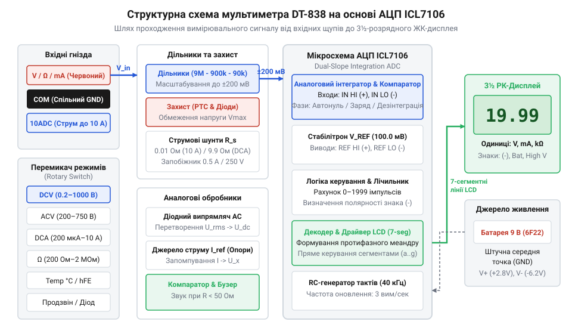
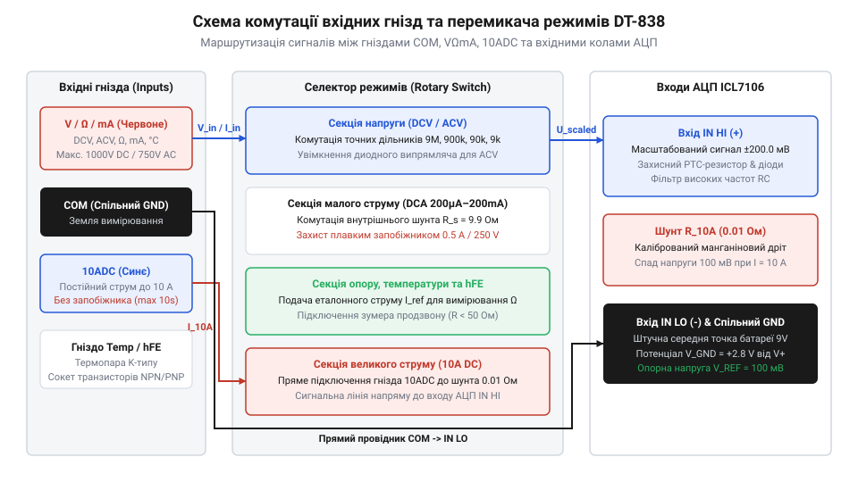

# Мультиметр DT-838

<preknowlist>
- [Щупи, гачки й затискачі «крокодил»](root:cat-hw-instruments/multimeter-probes-and-clips) — Знання про вплив власного опору та контактного опору щупів на вимірювання малих опорів і струмів.
</preknowlist>

## Потреба універсального цифрового контролю електричних кіл

Діагностика несправностей електронної апаратури вимагає точного визначення електричних параметрів у контрольних точках схеми. Візуальний огляд дає змогу виявити лише очевидні дефекти — обгорілі резистори, здуті конденсатори чи обірвані провідники. Однак більшість відмов (зміни опору, витік струму P-N переходу, просідання напруги живлення) не мають зовнішніх ознак. Класичні стрілочні аналогові мультиметри (від @@en|analog multimeter@@ — вимірювальний прилад зі стрілочним покажчиком) на основі магнітоелектричного гальванометра (від @@en|moving coil galvanometer@@ — вимірювач із рухомою котушкою в магнітному полі) створюють суттєві обмеження: низький вхідний опір у режимі вольтметра шунтує досліджуване коло, механічна інерція стрілки уповільнює відлік, а суб'єктивна похибка паралаксу при зчитуванні зі шкали знижує точність вимірювань.

Потреба у швидкій, високоточній та безпечній діагностиці зумовила створення компактних цифрових приладів, які об'єднують функції декількох інструментів у єдиному корпусі. Причина критичної переваги цифрового вимірювача полягає у фізиці узгодження вхідного опору: аналогові стрілочні прилади мають відносно низький вхідний опір (близько `20 кОм/В`), який при вимірюванні підключається паралельно до досліджуваної ділянки кола й утворює еквівалентний паралельний опір `R_parallel = (R_circuit · R_voltmeter) / (R_circuit + R_voltmeter)`. У високоомних колах (наприклад, у дільниках напруги з опором `100 кОм` і більше) такий low-impedance прилад відбирає значний струм, викликуючи штучне просідання напруги та суттєву похибку вимірювання. Цифровий мультиметр DT-838 має постійний високий вхідний опір `1 МОм` у режимі вимірювання постійної напруги, що зводить шунтувальний струм до мікроамперних рівнів і зберігає дійсний електричний режим схеми. Для розуміння еволюційного шляху від аналогових авометрів до сучасних напівпровідникових вимірювачів варто переглянути [історію розвитку вимірювальних приладів](root:cat-hw-instruments/multimeter-dt838/hist-multimeters-evolution.md). Мультиметр DT-838 став масовим стандартом робочого місця інженера завдяки поєднанню вимірювання постійної й змінної напруги, постійного струму, опору, тестування діодів, оцінки підсилення транзисторів, звукової прозвонки та прямого вимірювання температури за допомогою зовнішнього датчика.

Головна схемотехнічна проблема аналогових вимірювачів полягає у їхньому низькому власному вхідному опорі (від англ. @@en|input resistance@@), який у базових гальванометрах становить лише 10–20 кОм на вольт шкали. Під час вимірювання напруги у високоомних резистивних дільниках (наприклад, у колах із опорами 100 кОм і більше) паралельно підключений стрілочний вольтметр утворює шунтуючий опір, який кардинально зменшує еквівалентний опір вимірювального плеча кола. Через це струм джерела перерозподіляється через вимірювальний прилад, а шукана напруга штучно просідає в рази, створюючи величезну систематичну похибку вимірювання. Окрім схемотехнічних спотворень, аналогові прилади створюють суб'єктивну оптичну похибку паралаксу (від грец. *параллаξις* — зміщення; @@en|parallax error@@): якщо погляд оператора відхиляється від перпендикуляра до площини шкали, механічна стрілка візуально проектується на сусідні поділки, спотворюючи відлік. На відміну від аналогових попередників, цифровий мультиметр DT-838 повністю усуває людський чинник завдяки прямому виведенню дискретних чисел на рідкокристалічний дисплей і має постійний високий вхідний імпеданс близько 1 МОм у режимі вимірювання постійної напруги, що зводить шунтувальний вплив до мінімуму та дає змогу вимірювати дійсний потенціал точок схеми без спотворення її робочого режиму.

## Внутрішня схемотехніка та АЦП подвійного інтегрування

Основою схемотехніки мультиметра DT-838 є спеціалізована інтегральна мікросхема ICL7106 (від @@en|ICL7106@@ — КМОН аналого-цифровий перетворювач із прямим керуванням рідкокристалічним індикатором). Вона містить аналоговий блок та цифровий контролер, який перетворює вхідну напругу в діапазоні від `-199.9 мВ` до `+199.9 мВ` на керуючі сигнали 3.5-розрядного дисплея. Вимірювальний процес базується на способі подвійного інтегрування (від @@en|dual-slope ADC@@ — аналого-цифровий перетворювач із двома нахилами інтегрування). На першому етапі вхідна напруга подається на аналоговий інтегратор і накопичує заряд на зовнішньому прецизійному інтегрувальному конденсаторі (англ. @@en|integrating capacitor@@) протягом фіксованого інтервалу у 1000 тактів внутрішнього генератора. На другому етапі до конденсатора підключається опорна напруга протилежної полярності, і проводиться його розряд до нульового рівня, де час розряду пропорційний вхідній величині. Трьохфазну циклограму вимірювання доповнює обов'язкова фаза автонулювання (від англ. @@en|auto-zero phase@@ — автоматична компенсація зсуву нуля), під час якої входи коротко замикаються, а паразитна напруга зсуву операційних підсилювачів запам'ятовується на конденсаторі автонулювання та віднімається від результату, забезпечуючи високу стабільність нульових показань дисплея. Детальні виведення часових інтервалів та математичну модель похибок описано у [математичному аналізі АЦП](root:cat-hw-instruments/multimeter-dt838/math-icl7106-dual-slope-adc.md), а загальну теорію побудови таких чипів висвітлює [перетворювач подвійного інтегрування ICL7106](root:hw-analog/icl7106-dual-slope-adc).

*Структурна схема мультиметра DT-838: шлях сигналу через вхідний комутатор до АЦП ICL7106 та РК-дисплея.*

Для вимірювання високих напруг (до `1000 В` постійного струму та `750 В` змінного) застосовують вхідний резистивний дільник напруги (від @@en|voltage divider@@ — ланцюг зниження амплітуди сигналу) на базі послідовного ланцюжка точних резисторів. Поворотний селектор режимів (від @@en|rotary switch@@ — дисковий перемикач) механічно комутує контактні групи між відводами дільника, масштабуючи вхідну напругу будь-якого діапазону до базової шкали АЦП `200 мВ`. При вимірюванні струму коло розривають і підключають послідовно через прецизійний низькоомний струмовий шунт (від @@en|current shunt@@ — резистор вимірювання струму), спад напруги на якому подається на вхід АЦП. Захист низькострумового тракту (до `200 мА`) забезпечує внутрішній швидкодіючий запобіжник (від англ. @@en|fast-acting fuse@@ — захисний плавкий елемент із швидким розривом кола) на `0.5 А / 250 В`. Його роль полягає у розриві кола за мілісекунди при струмовому перевантаженні або помилковій подачі напруги у режимі амперметра, що запобігає термічному вигоранню шунтів та селектора. Вимірювання великих струмів до `10 А` виконується через окреме гніздо без запобіжника із застосуванням потужного низькоомного шунта (від @@en|manganin shunt@@ — вимірювальна жила зі сплаву міді, марганцю й нікелю). Цей шунт виготовлений у вигляді масивної П-подібної петлі з товстого манганінового дроту (опором близько `0.01 Ом`), який запаяно безпосередньо у плату. Завдяки близькому до нуля температурному коефіцієнту опору манганіну джоулевий розігрів при струмі `10 А` не викликає температурного дрейфу опору, що гарантує стабільність показань під час короткочасних вимірювальних імпульсів.

## Режими вимірювання та вхідні вимірювальні кола

Для роботи з різними електричними величинами мультиметр DT-838 комутує внутрішні кола відповідно до обраної позиції перемикача та підключення щупів. Вимірювання постійної напруги (`DCV`) виконується за високоомною схемою (вхідний опір становить `1 МОм`), що мінімізує вплив приладу на досліджуваний режим схеми. У режимі змінної напруги (`ACV`) послідовно з дільником вмикається випрямний діодний напівперіодний детектор, який перетворює середнє значення змінної напруги на постійний рівень, калібрований під середньоквадратичне значення синусоїдального сигналу.

*Перемикач режимів та схема комутації гнізд мультиметра DT-838.*

При вимірюванні опору (`OHM`) прилад подає у вимірюване коло фіксований калібрований струм `I_test` від джерела живлення `9 В` (тип `6F22` Крона) та вимірює сформований спад напруги `V_x = I_test · R_x`. Усічені показання дисплея пропорційні спаду напруги на резисторі, який внутрішній [аналого-цифровий перетворювач подвійного інтегрування ICL7106](root:hw-analog/icl7106-dual-slope-adc) порівнює з еталонним резистором обраного діапазону. На стандартних межах вимірювання опору тестова напруга навмисно обмежена рівнем до `0.3 В`, що дає змогу вимірювати опори безпосередньо у схемі без відпирання паралельно підключених напівпровідникових P-N переходів. Щоб захистити чутливі вхідні резистивні матриці від фатального пошкодження при випадковому підключенні щупів до зовнішньої мережі `220 В` у режимі `OHM`, послідовно із вимірювальним трактом установлено позистор (від англ. *Positive Temperature Coefficient*; @@en|PTC thermistor@@) та обмежувальні діоди. У разі подачі зовнішньої напруги аварійний струм миттєво розігріває позистор, через що його опір стрибкоподібно зростає від десятків ом до сотень кілоом, обмежуючи струм до безпечних мікроампер і рятуючи вхідні кола. Однак для нелінійних компонентів (діодів, стабілітронів та варисторів) опір залежить від прикладеної напруги: через нелінійність вольт-амперної характеристики вимірювання їхнього опору в режимі `OHM` дає спотворені показання. Для перевірки напівпровідників призначений окремий режим діодного тесту, у якому відкрита напруга збігає до `3 В` при обмеженні струму на рівні близько `1 мА`, виводячи на екран прямий спад напруги на P-N переході у мілівольтах. Режим прозвонки (від @@en|continuity test@@ — перевірка електричної цілісності) додатково вмикає звуковий генератор із п'єзодинаміком при опорі кола менше `50 Ом`, а при вимірюванні малих опорів важливо враховувати опір самих провідників, про що детально розповідають [вимірювальні щупи](root:cat-hw-instruments/multimeter-probes-and-clips).

Для визначення коефіцієнта підсилення за струмом `hFE` біполярних транзисторів використовують спеціальну 8-контактну колодку. Вона задає базовий струм `10 мкА` та вимірює колекторний струм транзисторів структур `NPN` та `PNP`. Відмінною рисою моделі DT-838 є наявність режиму вимірювання температури від `-20 °C` до `+1000 °C`. Для цього до гнізд приладу підключають зовнішній термоелектричний перетворювач — [термопару K-типу](root:hw-sensing/thermocouple) (від @@en|thermocouple@@ — термоелемент на основі сплавів хромель-алюмель). Оскільки термопара ґрунтується на ефекті Зеєбека й генерує напругу, пропорційну лише різниці температур між гарячим зондом та холодними клемами приладу, DT-838 застосовує схему компенсації холодного спаю (від англ. @@en|cold-junction compensation@@). Внутрішній NTC-терморезистор, розташований поруч із вхідними гніздами на платі мультиметра, вимірює поточну температуру кімнати та додає еквівалентний корегувальний спад напруги до сигналу термопари, що дозволяє АЦП виводити на екран абсолютну температуру вимірювального об'єкта в градусах Цельсія.

Повна технічна довідка про розташування гнізд `COM`, `VΩmA`, `10ADC` та граничні режими міститься у матеріалі про [комутацію вхідних гнізд](root:cat-hw-instruments/multimeter-dt838/api-dt838-hardware-interface-and-pinout.md), а конкретні інструкції з тестування радіодеталей викладено у посібнику про [практичну діагностику схем](root:cat-hw-instruments/multimeter-dt838/proj-dt838-circuit-diagnostics-and-testing.md).

## Джерела похибок та межі точності вимірювань

Будь-який вимірювальний прилад вносить у досліджуване коло власні спотворення. У цифровому мультиметрі DT-838 точність відліків визначається трьома основними чинниками: падінням напруги на вимірювальних провідниках, шунтувальним впливом вхідного опору та стабільністю опорної напруги живлення. При вимірюванні низьких опорів (одиниці Ом) та високих струмів суттєвий внесок робить [власний опір щупів](root:cat-hw-instruments/multimeter-probes-and-clips), який додається до опору досліджуваного компонента й спричиняє завищення результату.

При вимірюванні напруги у високоомних колах вхідний опір (від англ. @@en|input impedance@@ — еквівалентний реактивно-активний опір вхідного тракту) мультиметра DT-838, що становить близько `1 МОм`, утворює паралельне відгалуження. Якщо опір вимірюваного джерела `R_src` є сумірним із вхідним опором мультиметра `R_in`, підключення приладу шунтує схему й занижує напругу у вузлі. Співвідношення між виміряною напругою `U_meas` та неспотвореною напругою джерела `U_src` дозволяє обчислити відносну систематичну похибку шунтування (англ. @@en|loading error@@):

    U_meas = U_src · R_in ÷ (R_src + R_in)      [формула дільника напруги]
    γ_load = (U_meas - U_src) ÷ U_src           [означення відносної похибки]
           = -R_src ÷ (R_src + R_in)            [алгебраїчне спрощення]

З отриманого виразу видно, що при `R_src = 100 кОм` та `R_in = 1 МОм` заниження напруги становить `-9.09%`, а при `R_src = 1 МОм` екран покаже лише половину реальної напруги джерела. Іншим джерелом системного зсуву є розряд внутрішньої батареї живлення `9 В` (тип `6F22`). При падінні напруги батареї нижче `7 В` внутрішній опорний генератор АЦП втрачає стабілізацію, через що екран показує хибно завищені значення напруги та струму.

Точність мультиметра зазначається у форматі суми відсоткової похибки від зчитаної величини та фіксованої кількості одиниць молодшого розряду (англ. @@en|digits@@). Відсотковий складник враховує лінійні відхилення дільника напруги та струмового шунта, тоді як дигіти відображають сталу абсолютну похибку дискретизації й квантування внутрішнього [аналого-цифрового перетворювача](root:hw-analog/icl7106-dual-slope-adc) ICL7106. Для розуміння підсумкового відхилення розглянемо приклад вимірювання постійного струму `I_meas = 10.00 мА` на межі `20 мА`, де дискретність молодшого розряду становить `0.01 мА`, а паспортна точність приладу дорівнює `±(1.0% + 2 digits)`:

**Обчислення підсумкової похибки вимірювання струму:**

    ΔI_reading = 10.00 мА · 1.0 ÷ 100
               = 0.10 мА                     [відсотковий складник від показань]
    ΔI_digits  = 2 · 0.01 мА
               = 0.02 мА                     [абсолютна похибка двох одиниць молодшого розряду]
    ΔI_total   = ΔI_reading + ΔI_digits
               = 0.10 мА + 0.02 мА
               = 0.12 мА                     [підсумкова абсолютна похибка]
    γ_total    = (0.12 мА ÷ 10.00 мА) · 100%
               = 1.20%                       [підсумкова відносна похибка]

У результаті абсолютна похибка вимірювання становить `±0.12 мА`, що розширює діапазон дійсно можливого струму в колі від `9.88 мА` до `10.12 мА`. Оскільки фіксований внесок двох дигітів додає `0.02 мА` до відсоткового відхилення `0.10 мА`, реальна відносна похибка зростає з паспортних `1.0%` до `1.20%`. При вимірюванні малих струмів на початку шкали (наприклад, `1.00 мА` на тій самій межі `20 мА`) внесок дигітів залишається рівним `0.02 мА`, що піднімає відносну похибку до `3.0%` і демонструє важливість вибору мінімально можливого межового діапазону.

Практичним наслідком такого нормування є необхідність вибору оптимального вимірювального діапазону. При вимірюванні напруги `1.5 В` на занадто грубій межі `200 В` роздільна здатність становить `0.1 В`, і дисплей відобразить `01.5 В`, де невизначеність молодшого розряду створює суттєву відносну похибку. Перемикання на оптимальну межу `2 В` підвищує роздільну здатність до `0.001 В` (`1.500 В`), зменшуючи відносний внесок фіксованої похибки молодшого розряду майже на два порядки. Для отримання найвищої точності відліку вимірювання завжди починають із ширшого діапазону задля безпеки приладу, після чого селектор переводять на найменшу межу, яка покриває вимірюване значення.

## Захист від перевантаження та безпечна експлуатація

Робота з вимірювальними приладами у колах високої напруги чи великих струмів вимагає суворого дотримання правил безпеки для запобігання дуговому пробою та пошкодженню вхідних кіл. Головною небезпекою при вимірюванні мережевої напруги 220 В або 380 В є помилкова комутація щупа у струмове гніздо чи залишення поворотного перемикача в режимі вимірювання опору. У такому стані вхідний опір приладу прямує до нуля, спричиняючи міжфазне [коротке замикання](root:cat-hw-instruments/multimeter-probes-and-clips) (від англ. @@en|short circuit@@ — пряме з'єднання потенціалів з нульовим опором), що супроводжується електричною дугою та руйнуванням корпусу.

Для захисту малострумового тракту `VΩmA` у схемі приладу встановлено плавкий запобіжник (від англ. @@en|fuse@@ — замикальний елемент із захисним вигоранням при перевантаженні) на струм 200 мА або 500 мА. Проте високострумове гніздо `10ADC` не має внутрішнього запобіжника й підключене безпосередньо до манганінового шунта з опором близько `0.01 Ом`. При проходженні струму `10 А` на шунті згідно із законом Джоуля-Ленца розсіюється теплова потужність `P = I² · R_shunt = 1 Вт`, яка в обмеженому закритому об'ємі корпусу без обдуву швидко розігріває дріт і прилеглі друковані доріжки плати до температур понад `150 °C`. Якщо перевищити допустимий ліміт вимірювання у 10–15 секунд, локальний розігрів спричиняє термічну деструкцію епоксидної смоли плати FR-4: адгезійний шар деградує, викликаючи фізичне відшарування мідних фольгованих доріжок, а олов'яно-свинцевий припай точок монтажу досягає точки плавлення й розм'якшується. Подальший перегрів викликає вигорання друкованого монтажу та незворотну зміну калібрувального опору самого манганінового дроту через окиснення. Саме тому вимірювання струмів понад `5 А` вимагає обов'язкової паузи у 15 хвилин для охолодження шунта. Ще більшою небезпекою є спроба повертати селектор режимів під навантаженням: при розриві чи переключенні кола зі струмом між контактами перемикача виникає електрична дуга (від @@en|electric arc@@ — дуговий розряд при розриві струмового кола). Вона обвуглює текстоліт плати, утворює струмопровідний місток між ламелями та безповоротно випалює вхідні кола АЦП. Детальний розподіл максимальних напруг та режимів комутації наведено у праці [апаратний інтерфейс та комутація гнізд](root:cat-hw-instruments/multimeter-dt838/api-dt838-hardware-interface-and-pinout.md).

Не менш критичним є правило перемикання діапазонів: категорично забороняється повертати секторний перемикач під час перебування щупів під напругою. Перехідні рухомі контакти перемикача створюють короткочасні дугові перекриття між суміжними ламелями, що призводить до обгорання контактних доріжок та виходу з ладу АЦП. Для практичного освоєння безаварійних алгоритмів тестування мережевих пристроїв та P-N переходів користуйтеся матеріалом [практична діагностика електронних схем](root:cat-hw-instruments/multimeter-dt838/proj-dt838-circuit-diagnostics-and-testing.md).
