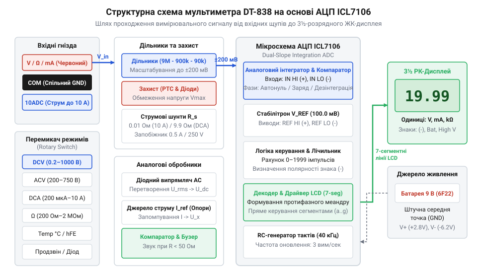
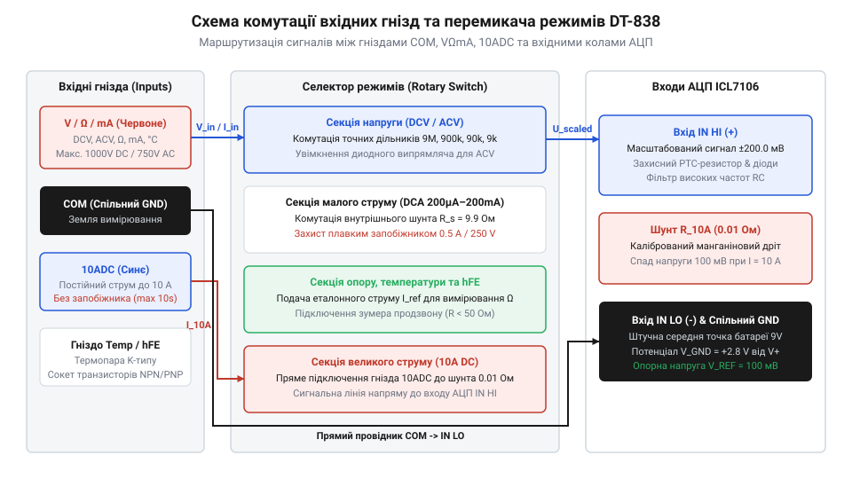

# Мультиметр DT-838

<preknowlist>
- [Щупи, гачки й затискачі «крокодил»](root:cat-hw-instruments/multimeter-probes-and-clips) — Розуміння підключення вимірювальних провідників та впливу контактного опору на вимірювання.
</preknowlist>

## Переваги цифрового вимірювача перед стрілочним

Діагностика електронних схем вимагає, щоб вимірювальний прилад не змінював режим роботи досліджуваного кола. Класичні аналогові авометри (від англ. @@en|analog multimeter@@) на основі гальванометра (від прізвища Л. Гальвані; @@en|galvanometer@@) мають низький вхідний опір `20 кОм/В`. У високоомних колах такий вольтметр шунтує схему, спричиняючи просідання напруги, а механічна стрілка створює похибку паралаксу (від грец. *παράλλαξις* — зміщення; @@en|parallax error@@).

Цифровий мультиметр DT-838 усуває ці недоліки завдяки постійному вхідному опору `1 МОм` у режимі вимірювання постійної напруги. Високий імпеданс зберігає дійсний режим схеми, а дискретне виведення чисел на рідкокристалічний дисплей ліквідує помилки зчитування. Для точної роботи важливо обирати відповідні [вимірювальні щупи та затискачі](root:cat-hw-instruments/multimeter-probes-and-clips).

## Принцип роботи АЦП подвійного інтегрування

Основу схемотехніки DT-838 складає мікросхема ICL7106 (від англ. @@en|ICL7106@@ — КМОН АЦП із прямим керуванням індикатором). Вона реалізує метод подвійного інтегрування (від англ. @@en|dual-slope ADC@@): вхідний сигнал заряджає конденсатор протягом фіксованого часу, після чого той розряджається опорною напругою до нуля, що приглушує мережеві завади.

*Структурна схема мультиметра DT-838: шлях сигналу через вхідний комутатор до АЦП ICL7106 та РК-дисплея.*

Вхідний резистивний дільник напруги (від англ. @@en|voltage divider@@) масштабує напругу до базової шкали АЦП `200 мВ`. При вимірюванні струмів використовуються низькоомні струмові шунти (від англ. @@en|current shunt@@), а тракт до `200 мА` захищає швидкодіючий плавкий запобіжник (від англ. @@en|fast-acting fuse@@) номіналом `0.5 А / 250 В`.

## Комутація кіл та режими вимірювань

Режими та межі комутує поворотний селектор (від англ. @@en|rotary switch@@). Чорний щуп підключають до спільного гнізда `COM` (від англ. @@en|Common@@), а червоний — до `VΩmA` (напруга, опір, струм до `200 мА`) або до окремого гнізда `10ADC` для силових струмів до `10 А`.

*Перемикач режимів та схема комутації гнізд мультиметра DT-838.*

У режимі опору вхід захищено позистором (від англ. *Positive Temperature Coefficient*; @@en|PTC thermistor@@). Для P-N переходів призначений режим діодного тесту й прозвонки (від англ. @@en|continuity test@@). Перевірку транзисторів `hFE` виконують через 8-контактну колодку, а температуру вимірюють термопарою K-типу (від англ. @@en|K-type thermocouple@@) із компенсацією холодного спаю (від англ. @@en|cold-junction compensation@@).

## Оцінка похибки та безпечна експлуатація

Точність мультиметра складається з відсоткової похибки зчитаної величини та одиниць молодшого розряду (від англ. @@en|digits@@). Відсотковий складник враховує відхилення дільників, а дигіти — абсолютну похибку квантування АЦП. Щоб зменшити відносний внесок дигітів, перемикач переводять на найменшу межу, яка покриває вимірювану величину.

Приклад обчислення підсумкової похибки вимірювання струму `I_meas = 10.00 мА` на межі `20 мА` з дискретністю `0.01 мА` та точністю `±(1.0% + 2 digits)`:

**Обчислення підсумкової похибки вимірювання струму:**

    ΔI_reading = 10.00 мА · 1.0 ÷ 100
               = 0.10 мА                     [відсотковий складник від показань]
    ΔI_digits  = 2 · 0.01 мА
               = 0.02 мА                     [абсолютна похибка двох одиниць молодшого розряду]
    ΔI_total   = ΔI_reading + ΔI_digits
               = 0.10 мА + 0.02 мА
               = 0.12 мА                     [підсумкова абсолютна похибка]
    γ_total    = (0.12 мА ÷ 10.00 мА) · 100%
               = 1.20%                       [підсумкова відносна похибка]

Оскільки гніздо `10ADC` позбавлене запобіжника, вимірювання напруги у ньому викликає коротке замикання (від англ. @@en|short circuit@@). Для захисту шунта струм понад `5 А` вимірюють до `10 секунд` з охолодженням `15 хвилин`. Перемикання під навантаженням заборонено через ризик виникнення дугового розряду (від англ. @@en|electric arc@@).
