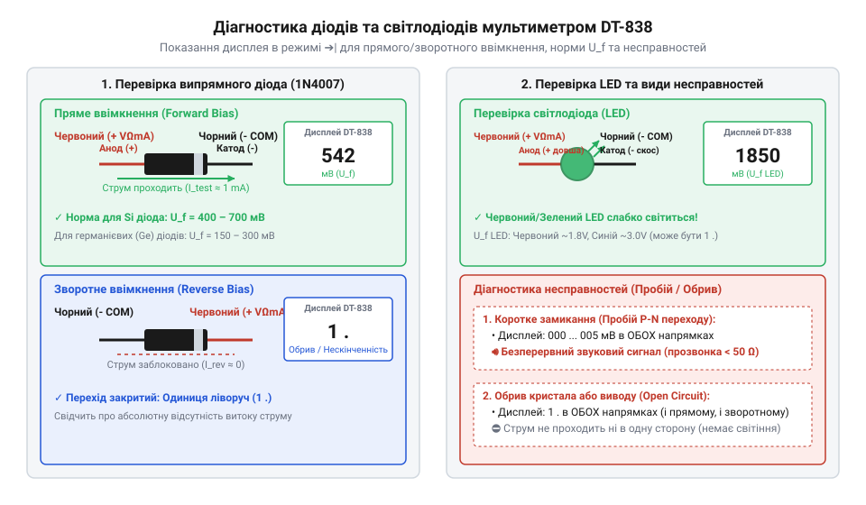
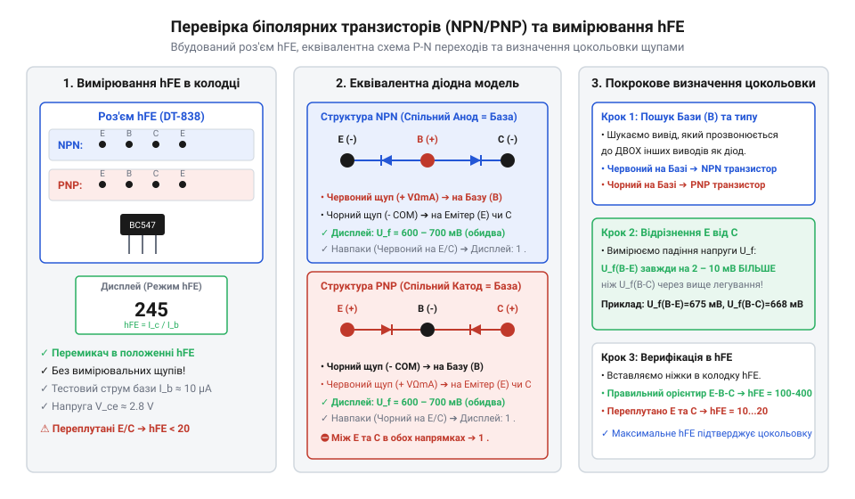

# Практична діагностика електронних схем та компонентів мультиметром DT-838

<preknowlist>
- [Щупи, гачки й затискачі «крокодил»](root:cat-hw-instruments/multimeter-probes-and-clips) — Призначення та правильне підключення вимірювальних щупів до вхідних гнізд мультиметра.
</preknowlist>

## Підготовка та безпечна прозвонка кіл

Спроба виміряти опір або перевірити цілісність провідника у схемі під напругою чи із зарядженими конденсаторами призводить до виходу з ладу вхідного дільника та вимірювального @@en|мультиметра DT-838@@ (від лат. *multus* — численний та грец. *μέτρον* — міра). Зовнішній потенціал джерела живлення протидіє власному тестовому струму приладу та випалює захисний запобіжник або аналогово-цифровий перетворювач ICL7106. Тому будь-якій перевірці обов'язково передує повне знеструмлення пристрою та розряджання ємностей. Детальні [технічні характеристики мультиметра](root:cat-hw-instruments/dt838-specifications-and-adc) та будова вхідного дільника розкривають внутрішні межі вимірювань та допустимі навантаження.

Щоб розпочати діагностику, необхідно правильно підключити [вимірювальні щупи приладу](root:cat-hw-instruments/multimeter-probes-and-clips) до вхідних гнізд, встановивши чорний провід у загальне гніздо COM, а червоний — у гніздо VΩmA. Перемикач режимів повертають у сектор звукової прозвонки, позначений символом @@grc|діода@@ (від грец. *δίς* — двічі та *ὁδός* — шлях) та акустичної хвилі. У цьому стані @@en|мультиметр@@ подає на вимірювальні кінці постійну напругу близько 2.8 В і вимірює спад напруги або опір між ними.

Якщо опір між кінцями щупів перевищує межу прозвонки, на рідкокристалічному дисплеї відображається одиниця в старшому розряді `1`, що вказує на розімкнене коло або @@en|обрив кола@@. Коли щупи замикають на суцільний провідник або доріжку друкованої плати з опором нижче 50 Ом, внутрішній @@de|зумер@@ (від нім. *Summer* — той, що дзижчить) видає безперервний звуковий сигнал, а екран показує падіння напруги в мілівольтах або опір близько нуля. Виявлення нульового опору між паралельними шинами живлення свідчить про @@en|коротке замикання@@, викликане пробитим конденсатором чи напівпровідником.

При діагностиці силових кіл зі змінною напругою 220 В або 380 В режим прозвонки суворо заборонений. Прилад перемикають у режим вимірювання змінної напруги ACV на межу 750 В, а руки утримують виключно за захисними обмежувальними отворами щупів, не торкаючись оголених металевих наконечників.

Якщо через помилку перемикання режимів вимірювальні кінці приладу підключили до джерела напруги у режимі прозвонки, спрацьовує внутрішній захист. Вхідний струм перевантаження випалює плавкий @@de|запобіжник@@ на 200 мА, захищаючи аналогово-цифровий перетворювач від незворотного руйнування. Для перевірки цілісності запобіжника щупи замикають між собою в режимі звукової прозвонки: якщо справний @@en|мультиметр DT-838@@ показує розімкнений стан `1` і не видає звуку @@de|зумера@@ при замиканні наконечників, це однозначно вказує на перегорання захисного елемента, який підлягає заміні всередині корпусу.

Програмний аналіз цілісності лінії та визначення стану звукового сигналу за виміряним значенням опору описується функціональним модулем аналізатора:

:::tabs
@tab c
:::code proj-dt838-circuit-diagnostics-and-testing/c/src/dt838_analyzer.c 34-52
@tab cpp
:::code proj-dt838-circuit-diagnostics-and-testing/cpp/src/dt838_processor.cpp 57-61
:::

## Перевірка діодів та світлодіодів

Звичайне вимірювання опору омметром не дозволяє достовірно оцінити стан напівпровідника, оскільки @@en|P-N перехід@@ має нелінійну вольт-амперну характеристику. Прикладення малого потенціалу розімкненого омметра недостатньо для відкриття потенційного бар'єра структури, тому прилад покаже нескінченний опір в обох напрямках. Для тестування напівпровідникових елементів у @@en|мультиметрі DT-838@@ передбачено спеціалізований режим діодного тесту, у якому джерело струму приладу формує вимірювальний струм близько 1 мА.

Під час підключення червоного щупа (позитивний потенціал) до виводу @@grc|анод@@ (від грец. *ἄνοδος* — шлях угору), а чорного (негативний потенціал) до виводу @@grc|катод@@ (від грец. *κάθοδος* — шлях вниз) виникає пряме зміщення. Дисплей приладу показує пряме падіння напруги на переході у мілівольтах (мВ). Для справного кремнієвого @@grc|діода@@ це значення становить від 450 до 850 мВ, а для германієвих компонентів або діодів Шотткі — від 150 до 400 мВ. При зворотному ввімкненні (червоний щуп на @@grc|катод@@, чорний на @@grc|анод@@) запертий @@en|P-N перехід@@ не пропускає струм, і прилад показує одиницю `1`.

Для напівпровідникових випромінювачів — таких як @@en|світлодіод@@ (LED) — пряме падіння напруги є вищим і становить від 1500 до 2800 мВ залежно від кольору світіння та матеріалу гетероструктури. Вимірювальної напруги @@en|мультиметра DT-838@@ достатньо, щоб у режимі перевірки @@grc|діодів@@ справний @@en|світлодіод@@ червоного чи зеленого кольору слабко світився під час вимірювання, що дає змогу одночасно підтвердити його працездатність та визначити полярність виводів. Проте при тестуванні потужних світлодіодів або збірок із кількома послідовно з'єднаними кристалами пряме падіння напруги перевищує 3.0 В. Оскільки максимальна напруга холостого ходу у режимі перевірки @@grc|діодів@@ обмежена значенням близько 2.8–3.0 В, вимірювального потенціалу приладу недостатньо для подолання бар'єра таких гетероструктур. У результаті справний потужний елемент не випромінює світла, а дисплей показує одиницю `1`, як при обриві, що вимагає застосування зовнішнього джерела живлення зі струмообмежувальним резистором.

Несправність компонента визначають за аномальними показаннями приладу в обох напрямках підключення. Якщо екран відображає падіння напруги менше 50 мВ і лунає звуковий @@de|зумер@@ при будь-якій полярності щупів, напівпровідникова структура має електричний пробій та @@en|коротке замикання@@. Показник `1` при прямому ввімкненні свідчить про внутрішній @@en|обрив кола@@ або вигорання кристала.


*На схемі показано підключення щупів DT-838 до діода та світлодіода в режимі перевірки P-N переходу з прямим та зворотним ввімкненням.*

Алгоритм класифікації типу напівпровідникового переходу за виміряним спадом напруги подано в програмному модулі:

:::tabs
@tab c
:::code proj-dt838-circuit-diagnostics-and-testing/c/src/dt838_analyzer.c 4-32
@tab cpp
:::code proj-dt838-circuit-diagnostics-and-testing/cpp/src/dt838_processor.cpp 99-126
:::

## Визначення цокольовки та hFE транзисторів

Біполярний @@en|транзистор@@ (від англ. *transfer resistor* — перехідний резистор) містить два внутрішніх @@en|P-N переходи@@ із спільною зоною, яка утворює вивід @@grc|база@@ (від грец. *βάσις* — основа). Структура NPN має @@grc|базу@@ P-типу, до якої підключені аноди обох переходів, а структура PNP — @@grc|базу@@ N-типу із спільними катодами. Для визначення невідомої цокольовки @@en|мультиметр DT-838@@ перемикають у режим діодного тесту й почергово шукають вивід, який показує прямий спад напруги 500–850 мВ до двох інших контактів. Якщо пряме падіння фіксується при підключенні червоного щупа до виводу, цей вивід є @@grc|базою@@, а @@en|транзистор@@ належить до типу NPN. Якщо ж спільним виводом є чорний щуп, @@en|транзистор@@ має структуру PNP.

Різниця між виводами @@la|колектор@@ (від лат. *collector* — збирач) та @@la|емітер@@ (від лат. *emittere* — випускати) виявляється через незначну асиметрію легування напівпровідникових шарів. Емітерний перехід легований сильніше за колекторний, тому пряме падіння напруги на переході @@grc|база@@-@@la|емітер@@ завжди перевищує падіння на переході @@grc|база@@-@@la|колектор@@ на 2–10 мВ. Вивід з більшим показанням напруги відповідає @@la|емітеру@@, а з меншим — @@la|колектору@@.


*На рисунку зображено розміщення виводів транзистора в роз'ємі hFE та схему перевірки P-N переходів база-емітер і база-колектор.*

Для вимірювання статичного коефіцієнта підсилення струму прилад оснащено 8-контактним роз'ємом `hFE`. Обчислимо статичний коефіцієнт підсилення струму `h_FE` біполярного @@en|транзистора@@ через відношення струму @@la|колектора@@ `I_C` до струму @@grc|бази@@ `I_B`:

```
h_FE
= I_C / I_B              [визначення коефіцієнта підсилення за струмом]
= 1500 мкА / 10 мкА      [підстановка виміряного струму колектора та фіксованого струму бази]
= 150                    [значення статичного коефіцієнта підсилення]
```

У цьому виразі `I_C` позначає струм @@la|колектора@@ в мікроамперах (мкА), а `I_B` — зафіксований тестовий струм @@grc|бази@@ величиною 10 мкА, що подається внутрішнім джерелом струму @@en|мультиметра DT-838@@ на контакт `B` роз'єму `hFE`. Значення 150 вказує, що @@en|транзистор@@ підсилює сигнал за струмом у 150 разів і перебуває в робочому стані. Однак зафіксований тестовий струм @@grc|бази@@ 10 мкА накладає суттєве обмеження при діагностиці потужних силових транзисторів. Для виходу у лінійний робочий режим силові напівпровідники потребують струму керування рівня міліампер, тому при мікроамперній заживці їхній коефіцієнт підсилення різко падає. У результаті прилад показує аномально занижені значення `h_FE` (близько 5–15 замість нормальних 40–100) або нуль, що робить вбудований роз'єм придатним лише для перевірки малопотужних сигнальних компонентів.

Встановлення ніжок елемента у відповідні отвори роз'єму `hFE` (E, B, C) згідно з визначеною структурою підтверджує цокольовку: якщо дисплей показує стабільний коефіцієнт у межах 100–400, елемент справний. Нульове значення або показання `1` свідчать про помилкове розпізнавання виводів або внутрішній @@en|обрив кола@@.

Обчислення та перевірку валідності параметра `h_FE` реалізовано в програмних модулях аналізу:

:::tabs
@tab c
:::code proj-dt838-circuit-diagnostics-and-testing/c/src/dt838_analyzer.c 55-75
@tab cpp
:::code proj-dt838-circuit-diagnostics-and-testing/cpp/include/dt838_processor.hpp 62-68
:::

## Внутрисхемна діагностика та термоконтроль

Перевірка елементів безпосередньо на друкованій платі без випаювання ускладнюється впливом @@en|паразитних кіл@@. Паралельно підключені резистори, шунтувальні обмотки трансформаторів, виводи мікросхем та згладжувальні конденсатори спотворюють тестовий струм, який подає @@en|мультиметр DT-838@@. Якщо виміряний опір резистора номіналом 10 кОм виявляється меншим за номінал, це може пояснюватися паралельним шунтом вільних доріжок. Проте виявлення опору, вищого за номінальне значення, однозначно вказує на дефект компонента або його внутрішній @@en|обрив кола@@. Для остаточного підтвердження несправності випаюють хоча б один вивід елемента з плати.

Виявлення дефектних силових ключів та стабілізаторів напруги виконують за допомогою температурного контролю. Для цього @@en|мультиметр DT-838@@ перемикають у режим вимірювання температури TEMP, а в гнізда COM та VΩmA підключають спеціалізований датчик — @@en|термопара K-типу@@ (від грец. *θερμός* — теплий та лат. *par* — пара). Скріплений вимірювальний спай хромель-алюмелевих провідників притискають до корпусу компонента або металевого @@en|радіатора@@ (від лат. *radiator* — той, що випромінює).

Для отримання точних показань поверхню контакту обов'язково готують, оскільки повітряні прошарки у мікрошорсткостях корпусу діють як теплоізолятор. Сухе притискання спаю датчика призводить до заниження виміряної температури на 15–30 °C через високий термічний опір межі розділу. Нанесення краплі теплопровідної @@en|термопасти@@ на вимірювальну голівку датчика витісняє мікробульбашки повітря та забезпечує стабільний тепловий контакт із мінімальним опором передачі тепла, що гарантує точну передачу температури кристала.

Датчик генерує термо-РС, пропорційну різниці температур між гарячим спаєм та термокомпенсованими контактами мультиметра. Обчислимо температуру `T` силового елемента за значенням вихідної напруги термопари `V_tc`, кімнатної температури `T_amb` та @@en|коефіцієнта Зеєбека@@ `S` для сплаву K-типу:

```
T
= T_amb + (V_tc / S)                    [обчислення температури з компенсацією холодного спаю]
= 22.5 °C + (2.35 мВ / 0.041 мВ/°C)     [підстановка температури довкілля та напруги термопари]
= 22.5 °C + 57.3 °C                     [обчислення температурного приросту]
= 79.8 °C                               [підсумкова температура вимірюваного елемента]
```

У цьому виразі `T_amb` відповідає температурі навколишнього середовища у градусах Цельсія (°C), `V_tc` — виміряній термо-РС у мілівольтах (мВ), а `S` — питомому коефіцієнту термо-РС, який для K-типу становить близько 0.041 мВ/°C (41 мкВ/°C). Отримане значення 79.8 °C сигналізує про критичний перегрів напівпровідника, що вимагає перевірки системи охолодження.

Оцінку температурного допуску та сигналізацію про вихід за безпечні межі реалізовано в кодовому модулі обробки даних:

:::tabs
@tab c
:::code proj-dt838-circuit-diagnostics-and-testing/c/src/dt838_analyzer.c 34-52
@tab cpp
:::code proj-dt838-circuit-diagnostics-and-testing/cpp/src/dt838_processor.cpp 136-171
:::

## Вимірювання високої напруги AC

Вимірювання високої змінної напруги побутової мережі 220 В та трифазних промислових мереж 380 В пов'язане з ризиком ураження електричним струмом і виникнення дугового пробою. Перед підключенням обов'язково перевіряють [ізольовані вимірювальні щупи](root:cat-hw-instruments/multimeter-probes-and-clips) на відсутність тріщин та пошкоджень ізоляції. Чорний провід встановлюють у гніздо COM, а червоний — у гніздо VΩmA. Підключення червоного щупа до гнізда 10A при вимірюванні напруги неприпустиме, оскільки це спричинить коротке замикання мережі через низькоомний шунт із вибухом і розплавленням контактів.

На перемикачі режимів @@en|мультиметра DT-838@@ обирають сектор ACV та встановлюють найбільшу межу вимірювання 750V~. Для однофазної мережі 220 В вимірювальні кінці приєднують між виводами @@en|фаза@@ (від грец. *φάσις* — поява) та нуль, а для трифазної мережі 380 В — між двома фазними провідниками. Руки під час вимірювання тримають виключно за захисними обмежувальними ребрами щупів, не торкаючись металевих наконечників.

Внутрішній детектор приладу випрямляє змінну напругу та відображає діюче среднеквадратичне значення синусоїдального сигналу на дисплеї. Після завершення вимірювань щупи першими від'єднують від мережевих контактів, а перемикач мультиметра повертають у положення OFF для запобігання випадковому розряджанню батареї.

Конвертація сирих відліків АЦП у значення змінної напруги для діапазонів 200V~ та 750V~ реалізована у вимірювальному модулі:

:::tabs
@tab c
:::code proj-dt838-circuit-diagnostics-and-testing/c/src/dt838_analyzer.c 10-21
@tab cpp
:::code proj-dt838-circuit-diagnostics-and-testing/cpp/src/dt838_processor.cpp 47-56
:::
