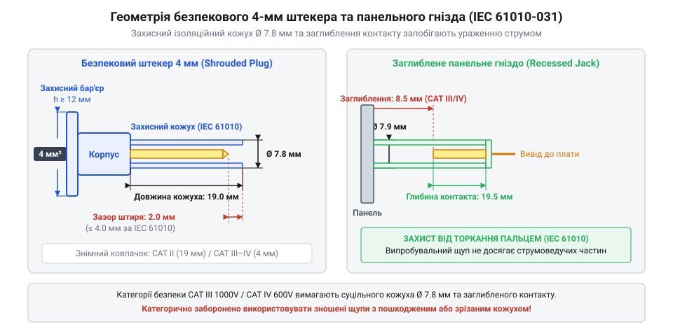
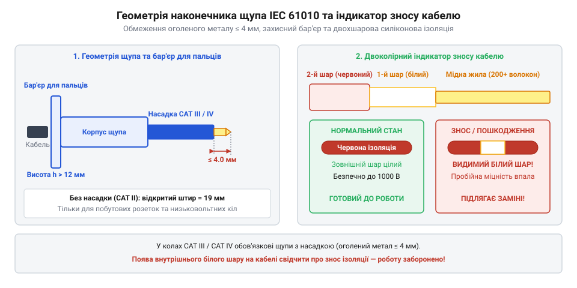

# Стандарти електробезпеки CAT та специфікація 4-мм роз'ємів

<preknowlist>
- [Мультиметр DT-838](root:cat-hw-instruments/multimeter-dt838) — Призначення вимірювальних гнізд мультиметра та базові правила безпеки.
</preknowlist>

## Призначення категорій перенапруги IEC 61010

Безпека вимірювань у силових та електронних колах визначається здатністю обладнання протистояти короткочасним високовольтним кидкам напруги. У реальних електромережах комутаційні процеси, вимкнення потужних індуктивних навантажень та блискавкові розряди викликають імпульсну перенапругу (англ. @@en|impulse voltage@@). Для забезпечення захисту операторів від ураження струмом та дугового спалаху Міжнародна електротехнічна комісія (англ. @@en|IEC@@ — акронім від @@en|International Electrotechnical Commission@@) розробила стандарт IEC 61010, який увів категорії перенапруги (англ. @@en|overvoltage category@@) від CAT I до CAT IV.

Головний фізичний чинник розмежування категорій — енергетичний потенціал точки підключення приладу та імпеданс джерела завади. Чим ближче вимірювальний вузол розташований до джерела живлення або первинного вводу в будівлю, тим менший еквівалентний активний опір (одиниці або десятки міліом) та погонна індуктивність (близько `0.5–1 мкГн/м`) мають лінії живлення. У міру віддалення вглиб будівлі власна індуктивність дротів створює реактивний опір високовольтним комутаційним імпульсам, викликаючи швидке згасання амплітуди перенапруги. З цієї причини можливий струм короткого замикання у ввідних мережах @@en|CAT IV@@ може досягати десятків кілоампер, а внутрішня дуга на вимірювальних щупах вивільняє колосальну енергію, здатну викликати вибух і розплавлення приладдя, тоді як у @@en|CAT I@@ енергія обмежена внутрішніми опорами схеми та розподіленою індуктивністю фідерного тракту.

Стандарт IEC 61010 встановлює чотири чіткі зони застосування:
- @@en|CAT I@@ — вторинні електронні кола з низькою енергією, захищені внутрішніми дільниками та стабілізаторами (автономне приладдя з батарейним живленням, друковані плати побутової техніки);
- @@en|CAT II@@ — однофазні кола споживачів, підключені до стандартних побутових розеток (побутові прилади, переносний електроінструмент);
- @@en|CAT III@@ — трифазні лінії та розподільчі мережі всередині будівель (розподільчі щити, фідерні лінії, шинопроводи, стаціонарні електродвигуни);
- @@en|CAT IV@@ — джерело первинного електропостачання та зовнішній ввід у будівлю (повітряні й підземні кабельні лінії, лічильники електроенергії, ввідні шафи захисту).

Правильний вибір категорії гарантує, що під час виникнення пікового імпульсу вимірювальний тракт і провідники витримають пробійну напругу без виникнення стійкого дугового замикання.

Для практичних вимірювань діє правило ієрархічної сумісності: прилад або щупи, сертифіковані для вищої категорії захисту (наприклад, @@en|CAT III@@ або @@en|CAT IV@@), дозволяється застосовувати у зонах із нижчими вимогами (@@en|CAT I@@ чи @@en|CAT II@@). Зворотне ж використання приладдя нижчої категорії — як-от підключення базового [мультиметра DT-838](root:cat-hw-instruments/multimeter-dt838) класу @@en|CAT II@@ до промислової трифазної лінії — є небезпечним порушенням, оскільки короткочасний комутаційний сплеск здатний пробити ізоляційний проміжок і викликати дуговий спалах. Фізику вибухового ураження та захисне екіпірування розкрито у матеріалі про [дуговий спалах та засоби](root:cat-hw-instruments/electric-arc-flash-safety) індивідуального захисту.

Окрім маркування самого приладу, підсумковий рівень безпеки визначається всіма елементами вимірювального тракту. Загальна категорія захисту установки завжди обмежується найслабшою ланкою: якщо мультиметр відповідає класу @@en|CAT III@@, але до нього підключено щупи чи адаптери категорії @@en|CAT II@@, увесь комплект дозволяється використовувати лише у межах вимог @@en|CAT II@@.

Окрім того, категорія безпеки завжди зазначається у поєднанні з робочою напругою (наприклад, `CAT III 600 V` або `CAT IV 1000 V`). Нехтування цією подвійною специфікацією та спроба оцінити захисні властивості обладнання за єдиним числом є поширеною помилкою, адже випробувальна високовольтна напруга розраховується саме для цієї конкретної комбінації параметра CAT та напруги мережі.

## Параметри випробувальних напруг CAT I-IV

Визначення категорії приладу або щупів базується на проведенні випробувань стандартизованими імпульсними високовольтними хвилями форми `1.2/50 мкс` (час наростання фронту 1.2 мкс, тривалість спаду до півамплітуди 50 мкс). Стандарт вимагає, щоб обладнання витримувало серію з кількох таких імпульсів обох полярностей без перекриття ізоляції чи виникнення дуги.

Кожна категорія захисту прив'язана до робочої напруги відносно землі (наприклад, 300 В, 600 В або 1000 В). Величина випробувальної напруги суттєво зростає зі збільшенням рівня CAT, оскільки джерело імпульсу у вищих категоріях має менший внутрішній опір: для @@en|CAT I@@ та @@en|CAT II@@ опір генератора становить 30 Ом або 12 Ом, тоді як для @@en|CAT III@@ та @@en|CAT IV@@ він знижується до 2 Ом. Зниження опору джерела до 2 Ом спричиняє зростання струмового піку короткого замикання під час високовольтного пробою до кількох кілоампер (наприклад, до 3–4 кА при випробувальному імпульсі 6–8 кВ). Такий високий струмовий сплеск вивільняє колосальну миттєву теплову й ударну енергію, що вимагає від приладдя вищих категорій високої дугостійкості та механічної міцності ізоляції.

Довідкові значення пікових випробувальних імпульсних напруг за IEC 61010 розподіляються за такими рівнями:
- Робоча напруга 300 В: CAT II — 1.5 кВ; CAT III — 2.5 кВ; CAT IV — 4.0 кВ;
- Робоча напруга 600 В: CAT II — 2.5 кВ; CAT III — 4.0 кВ; CAT IV — 6.0 кВ;
- Робоча напруга 1000 В: CAT II — 4.0 кВ; CAT III — 6.0 кВ; CAT IV — 8.0 кВ.

Критичною помилкою при виборі приладдя є оцінка захисту лише за робочою напругою у вольтах без урахування категорії. Наприклад, щупи з маркуванням `1000 V CAT II` випробовуються імпульсом 4.0 кВ, тоді як для вимірювань у промисловому щиті 600 В потрібна категорія `CAT III 600 V`, випробувальна напруга якої становить 6.0 кВ. Застосування щупів нижчої категорії в щитовій створює ризик дугового пробою навіть при меншій номінальній напрузі мережі.

## Геометрія та допуски 4-мм роз'ємів

Підключення вимірювальних проводів до приладів стандартизовано за допомогою безпекових з'єднувачів типу банановий штекер (англ. @@en|banana plug@@). На відміну від застарілих відкритих штекерів, сучасні безпекові роз'єми мають жорсткий або підпружинений ізоляційний кожух, який повністю закриває струмопровідний циліндричний контакт і запобігає випадковому торканню пальцями оператора.

*Геометрична специфікація безпекового 4-мм з'єднувача: конструкція заглибленого контакта та підпружиненого кожуха.*

Фізичні параметри та геометричні допуски 4-мм роз'ємів за стандартом IEC 61010 відповідають суворим межам:
- Номінальний діаметр штекера становить 4.0 мм з допуском ±0.05 мм, а контактна поверхня формується багатопелюстковою або розпірною пружиною з берилієвої бронзи з нікелевим покриттям, що забезпечує перехідний опір менше 2 мОм та нормоване зусилля сочленення в межах 10–25 Н для надійного фіксування контакту;
- Зовнішній діаметр ізоляційного кожуха штекера складає від 7.8 мм до 8.0 мм, а його довжина — 42.0 мм, що забезпечує перекриття металевого контакту по всій довжині;
- Глибина занурення контактного циліндра в панельному гнізді становить не менше 15.0 мм від лицьової поверхні, утворюючи глухий ізоляційний колодязь.

Завдяки стандартизованій геометрії 4-мм з'єднувачі забезпечують повну механічну й електричну сумісність. Коли вимірювальні провідники підключаються до приладу, наприклад такого як [мультиметр DT-838](root:cat-hw-instruments/multimeter-dt838), ізоляційний кожух штекера входить у заглиблене гніздо до того, як металеві контакти торкнуться один одного, унеможливлюючи ураження струмом під час комутації.

## Специфікація щупів та подвійної ізоляції

Вимірювальні щупи є першою лінією захисту оператора, тому стандарт IEC 61010 висуває суворі вимоги до їхньої конструкції. Головною небезпекою при вимірюваннях у щільних розподільчих щитах є випадкове перемикання оголеним металевим наконечником сусідніх фазних шин, що призводить до міжфазного короткого замикання та дугового вибуху.

*Вимоги до наконечників вимірювальних щупів IEC 61010: обмеження відкритого контакту та двошарова ізоляція кабелю.*

Для запобігання дуговим аваріям геометричні параметри наконечників нормуються залежно від категорії:
- У категоріях CAT III та CAT IV довжина відкритого металевого кінчика щупа обмежується до 4.0 мм (або до 2.0 мм у високоризикових зонах). Для цього використовуються знімні захисні ковпачки, які закривають 19-міліметровий наконечник, залишаючи відкритим лише самий кінчик;
- У категорії CAT II допускається довжина оголеного наконечника до 19.0 мм для зручності занурення в глибокі побутові розетки.

Гнучкі провідники щупів виготовляються з високоочищеної міді з високою щільністю жилок і покриваються ізоляцією з матеріалу силікон (англ. @@en|silicone@@ від лат. @@lat|silicium@@ — кремній), нормована електрична міцність якого становить від 20 000 до 30 000 В/мм (20–30 кВ/мм) товщини шару. Висока діелектрична міцність дозволяє гарантувати безпеку при невеликій товщині оболонки, а сама силіконова ізоляція зберігає гнучкість при від'ємних температурах і не плавиться при випадковому торканні гарячим паяльником. За стандартом кабель має подвійну ізоляцію з двоколірним маркуванням зносу: внутрішній шар виготовляється з білого або яскраво-жовтого силікону, а зовнішній — з чорного або червоного. Поява білого чи жовтого кольору крізь подряпини або порізи зовнішньої оболонки є сигналом про дефектовку кабелю та негайне вилучення щупів з експлуатації.
