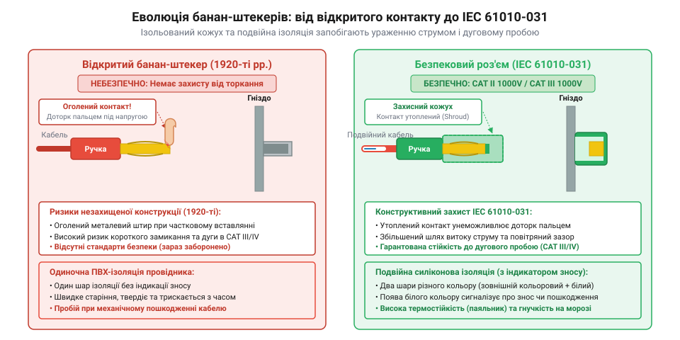
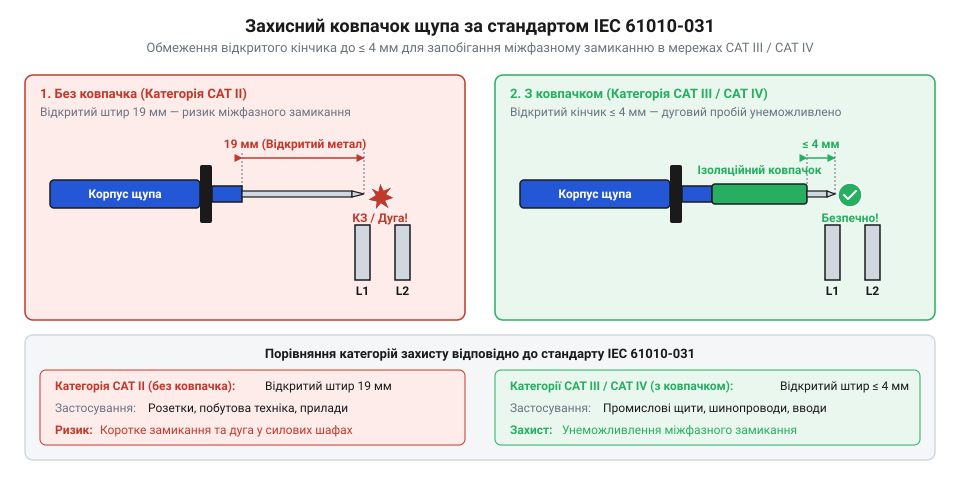

# Еволюція вимірювальних щупів та роз'ємів

<preknowlist>
- [Мультиметр DT-838](root:cat-hw-instruments/multimeter-dt838) — Розуміння загальної будови мультиметра та призначення вимірювальних гнізд для щупів.
</preknowlist>

## Незахищені штирі та перші банан-штекери

На початку XX століття вимірювання електричних величин супроводжувалося постійним ризиком короткого замикання та ураження струмом. Перші вимірювальні прилади підключали за допомогою звичайних мідних дротів, закріплених гвинтовими затискачами, або простих суцільних металевих штирів. Під час роботи на тісних клемних колодках вимірювальний щуп (від англійського @@en|test probe@@) із повністю відкритим металевим стержнем легко вислизав і закорочував сусідні фази, що призводило до виходу з ладу обладнання та травмування оператора.

У 1924 році німецький інженер Ріхард Гіршманн (@@de|Richard Hirschmann@@) запатентував пружний коннектор (від англійського @@en|connector@@) із поздовжніми пружинними пластинами. Винахід отримав назву «штекер-банан» (німецькою @@de|Büschelstecker@@, англійською @@en|banana plug@@) завдяки випуклій формі дугоподібних пелюсток із берилієвої бронзи або нікельованої латуні. Використання берилієвої бронзи забезпечувало високу межу пружності та стійкість до втоми металу: на відміну від звичайної латуні, яка при багаторазових вигинах залишково деформувалася і втрачала притискне зусилля, пелюстки з берилієвого сплаву відновлювали вихідну дугоподібну форму навіть після тисяч циклів підключення. При вставлянні в циліндричне гніздо ці пружні пелюстки радіально стискалися, створюючи рівномірний багаторазовий притискний контакт по всій довжині чотириміліметрового отвору, що усувало самовільне випадання штекера від вібрацій і забезпечувало стабільно низький перехідний опір без гвинтового затискання.

Попри зручність, перші штекери типу «банан» мали відкритий металевий корпус або лише короткі бакелітові муфти. Якщо оператор вставляв штекер у підключене до мережі гніздо, утримуючи його за корпус, він міг випадково торкнутися незахищеного металу під високим потенціалом. Більшість вимірювальних приладів кінця XX століття, зокрема портативний [мультиметр DT-838](root:cat-hw-instruments/multimeter-dt838), успадкували стандарт міжосьової відстані та діаметр гнізд 4 мм від цих ранніх розробок, проте безпека самого роз'єму вимагала кардинального перегляду конструкції.

Протягом 1930-х років провідні радіовиробники та лабораторії Європи й Північної Америки масово перейшли на стандартизовані чотириміліметрові гнізда для монтажу вимірювальних панелей і стендів. Єдина геометрія роз'ємів дала змогу уніфікувати з'єднувальні шнури між осцилографами, генераторами сигналів та аналоговими вольтметрами різних фабрик. Це прискорило випробування радіоапаратури, проте відсутність захисних бортиків навколо панельних гнізд залишала ризик випадкового торкання струмоведучих контактів під час оперативних переключень.

## Криза дугового пробою у промислових мережах

У другій половині XX століття стрімке зростання потужності промислових електромереж виявило критичну вразливість класичного щупа. Під час вимірювань у силових розподільних щитах із високим струмом короткого замикання звичайний вимірювальний наконечник завдовжки 19 мм створював смертельну небезпеку. При випадковому перекосі щупа між двома фазними шинами металевий кінчик виступав містком, викликаючи дуговий спалах (від англійського @@en|arc flash@@).

При міжфазному замиканні струм короткого замикання спричиняє миттєвий джоулів перегрів у точці контакту наконечника. Термічна іонізація розплавляє та випаровує мідь стержня, перетворюючи її на високопровідний плазмовий канал дугового розряду з температурою понад 5000–10000°C. Перехід металу у стан дугової плазми супроводжується вибуховим газодинамічним розширенням пари міді, об'єм якої миттєво зростає у десятки тисяч разів. У замкненому просторі розподільного щита таке стрімке розширення іонізованого металевого газу створює руйнівну вибухову ударну хвилю з різким стрибком локального тиску, яка вибиває захисні панелі й випорскує розплавлений метал. Крім того, частково витягнутий із приладу штекер залишав оголений 4-мм металевий палець під напругою, торкання до якого спричиняло важку електротравму.

Для запобігання випадковому контакту інженери розробили глухі ізоляційні кожухи навколо штекерів та заглиблені гнізда на панелях приладів. Наконечники щупів почали оснащувати пружними телескопічними оболонками або обмежувальними насадками.

Конструктивно захисні кожухи розділилися на два класи. Телескопічні підпружинені кожухи мали висувну пластикову гільзу, яка під дією внутрішньої пружини зсувалася всередину штекера лише при з'єднанні з гніздом, що забезпечувало зворотну сумісність із застарілими неізольованими роз'ємами. Натомість фіксовані глухі кожухи являли собою суцільний нерухомий циліндр із міцного діелектрика, що повністю закривав контакт і вимагав відповідного заглибленого гнізда у приладі — така безрухома конструкція виключила ризик заклинювання механізму й стала золотим стандартом надійності.

*Еволюція вимірювальних роз'ємів від відкритого штекера до захищеного глухим кожухом.*

## Стандарт IEC 61010-031 та категорії CAT

Масове впровадження захисних кожухів тривалий час залишалося ініціативою окремих виробників вимірювального приладдя. Ситуація змінилася у 2002 році з прийняттям міжнародного стандарту @@en|IEC 61010-031@@, який чітко нормував вимоги безпеки до ручних вимірювальних щупів. Стандарт розділив електричні кола на категорії перенапруги (англійською @@en|Category Rating@@): від низьковольтної електроніки CAT I до вводу электромережі в будівлю CAT IV.

Ключовим нововведенням стандарту стала сувора регламентація довжини оголеного металевого наконечника та електричної міцності ізоляції. Для робіт у високоенергетичних колах категорій CAT III та CAT IV відкрита частина металу не повинна перевищувати 4 мм, щоб унеможливити міжфазне замикання при перекосі щупа, а у середовищах CAT II дозволяється кінчик завдовжки до 19 мм. Окрім обмеження довжини штиря, нормування категорій CAT визначає мінімальні допустимі повітряні зазори (англійською @@en|clearance@@) та шляхи витоку струму по поверхні діелектрика (англійською @@en|creepage distance@@). Нормований повітряний зазор унеможливлює прямий іскровий пробій повітряного проміжку при високовольтних імпульсах, тоді як достатня довжина шляху витоку вздовж поверхні корпусу запобігає утворенню струмопровідних містків через вологий чи забруднений пилом діелектрик. Крім геометрії, стандарт встановив жорсткі пороги пробійної напруги: щупи категорій CAT III 1000V та CAT IV 600V мусять витримувати короткочасні випробувальні імпульси перенапруги до 8000 V без пробою ізоляції, а допустимий струм витоку через корпус і бар'єри обмежується безпечним рівнем до 0.5 mA.

Для забезпечення універсальності виробники почали випускати щупи зі знімними обмежувальними ковпачками (від англійського @@en|probe tip cap@@). Крім того, якісні провідники отримали подвійну силіконову ізоляцію (від англійського @@en|double insulation@@) із двома контрастними кольоровими шарами: поява внутрішнього білого шару сигналізує про знос і необхідність заміни щупа. Базові прилади, такі як [портативний мультиметр DT-838](root:cat-hw-instruments/multimeter-dt838), нерідко комплектують спрощеними щупами категорії CAT II, що вимагає їх обов'язкової заміни при роботі на вхідних щитах живлення.

Важливим практичним аспектом є розмежування електричних категорій перенапруги CAT та ступенів захисту корпусу IP (від англійського @@en|Ingress Protection Rating@@ за стандартом IEC 60529). Якщо маркування CAT I–IV регламентує пробійну міцність ізоляції, безпеку при дуговому спалаху та стійкість до імпульсних перенапруг у мережі, то класифікація IP визначає виключно механічну герметичність щупів та корпусу приладу проти проникнення пилу й вологи. Щуп із високим рівнем пиловологозахисту (наприклад, IP67) може бути розрахований лише на категорію CAT II 300V і виявитися непридатним для силових розподільчих щитів, де першочерговим є електричний захист CAT III або CAT IV.

*Конструкція вимірювального щупа із захисним ковпачком для категорій перенапруги CAT III та CAT IV.*

## Розвінчані міфи та сучасні безпекові щупи

Розвиток вимірювальних роз'ємів породив кілька стійких технічних міфів. Найпоширенішим є уявлення про повну взаємозамінність будь-яких чотириміліметрових роз'ємів. Насправді класичний відкритий штекер неможливо безпечно з'єднати із сучасним глухим гніздом, а зрізання захисного пластикового кожуха зі щупа заради сумісності зі старим приладом повністю нівелює захист оператора від імпульсної перенапруги (від англійського @@en|transient overvoltage@@).

Інший міф стосується походження штекера-банана, винахід якого в англомовній літературі часто хибно приписують американській компанії Pomona Electronics. Хоча Pomona дійсно популяризувала колірне маркування та з'єднувальні щупи у 1950-х роках, сам пружний чотириміліметровий контакт запатентовано в Німеччині ще у 1924 році.

Також помилковою є думка, що товщина кабелю щупа гарантує високу категорію захисту. Дешевші підробки часто використовують товсту зовнішню оболонку з гнучкого полівінілхлориду для імітації надійності, проте всередині містять тонкі жили без стійкості до розриву та без протидугових бар'єрів. Якісну двошарову ізоляцію перевіряють за термічною стійкістю силікону (високоякісна силіконова оболонка не плавиться при короткому дотику паяльника з температурою `300 °C` і зберігає гнучкість при `-20 °C`), а також за наявністю внутрішнього контрастного шар-маркера зносу. Випробування професійного приладдя за стандартом включають цикл вигинів під навантаженням (понад `10 000` вигинів у зоні захисної втулки без обриву мідних жилок) та перевірку діелектричної міцності високовольтним імпульсом до `10 кВ` без пробою ізоляції. Сучасний безпековий щуп оцінюють за відповідністю вимогам IEC 61010-031, наявністю захисних гардин для пальців та маркуванням категорії безпосередньо на корпусі.

Окрім ізоляції, важливим покажчиком якості приладдя є матеріал контактного покриття штекерів та наконечників. Поширене нікелеве покриття забезпечує високу механічну стійкість до стирання за низької ціни, проте має вищий перехідний опір. Сріблення гарантує найвищу провідність, але з часом окислюється під дією повітря, утворюючи плівку сульфіду. Тонке покриття з технічного золота виключає окислення та підтримує стабільний опір контакту нижче 2 мОм протягом тисяч циклів підключення, що є вирішальним при вимірюванні малих напруг та опорів, де перехідний опір неякісного нікелевого наконечника витворює суттєву похибку. Для надійного позолочення застосовують спеціальну гальванічну технологію із проміжним підшаром нікелю: нанесення покриття вимагає проміжного бар'єрного шару, оскільки без нього атоми міді з латунного стержня поступово дифундують крізь золото на поверхню й окислюються. Гальванічний підшар нікелю створює механічно міцний дифузійний бар'єр, який блокує взаємне проникнення металів і зберігає чистий золотий шар хімічно інертним упродовж усього терміну служби щупа.
