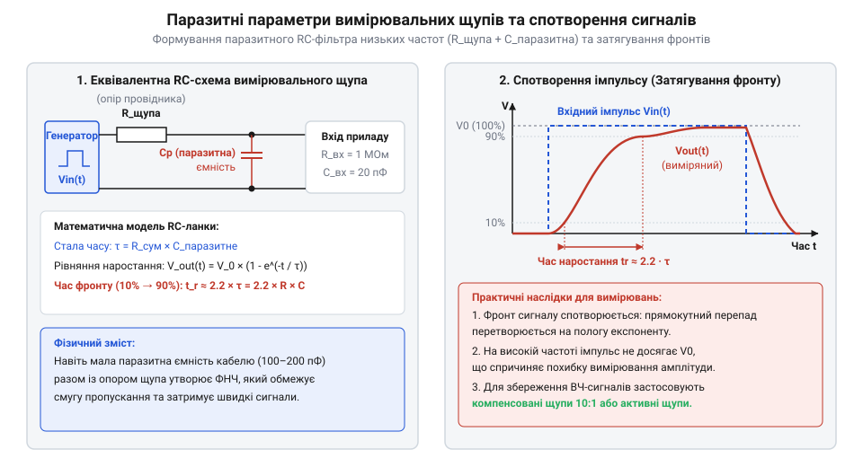

# Математика опору й ємності вимірювальних проводів

<preknowlist>
- [Мультиметр DT-838](root:cat-hw-instruments/multimeter-dt838) — Розуміння загальної схеми комутації щупів та вхідних кіл вимірювання опору й напруги.
</preknowlist>

## Власний опір вимірювальних провідників

Підключення вимірювальних щупів до електричного кола вносить у вимірювальний тракт додатковий резистивний елемент — власний опір металевої жили провідника та його контактних з'єднань. Хоча в ідеалізованих розрахунках провідники вважають надпровідними, у реальному мідному провіднику хаотичний рух вільних електронів зазнає опору через зіткнення з іонами кристалічної ґратки металу.

Власний опір `R_wire` однорідного провідника постійного перерізу прямо пропорційний його довжині `L`, питому опору матеріалу `ρ` та обернено пропорційний площі поперечного перерізу `S`. Цю залежність описує формула опору провідника:

    R_wire = ρ · L ÷ S

де `ρ` — питомий опір (англ. @@en|electrical resistivity@@) матеріалу жили (для електротехнічної міді `ρ ≈ 0.0175 Ом·мм²/м` при температурі `20 °C`), `L` — загальна довжина провідника в метрах, `S` — площа поперечного перерізу (англ. @@en|cross-sectional area@@) жили в квадратних міліметрах (`мм²`).

Для оцінки величини власного опору розглянемо паралельну пару стандартних вимірювальних щупів із загальною довжиною двох дротів `L = 1.6 м` (два шнури по `0.8 м`) та перерізом мідної жили `S = 0.2 мм²`:

**Обчислення власного опору мідної жили щупів:**

    R_wire = 0.0175 Ом·мм²/м · 1.6 м ÷ 0.2 мм²
           = 0.028 м·Ом·мм²/м ÷ 0.2 мм²          [множення питомого опору на довжину]
           = 0.14 Ом                            [ділення на площу перерізу]

Повний опір вимірювального провідника `R_probe` складається з опору мідного дроту `R_wire` та перехідного контактного опору `R_contact`, який виникає в місцях обтискання клем, штуцерів і механічного дотику кінчика щупа до досліджуваного виводу:

    R_probe = R_wire + R_contact

Оскільки контактний опір штекера в гнізді та вістря щупа зазвичай становить від `0.05 Ом` до `0.2 Ом`, підсумковий власний опір пари щупів реального вимірювача сягає `0.2–0.5 Ом`.

Крім статичного геометричного опору, опір мідної жили `R_wire` динамічно змінюється залежно від температури провідника через температурний коефіцієнт опору (англ. @@en|temperature coefficient of resistance@@) міді `α ≈ 0.00393 1/°C` (`0.393 %/°C`). При проходженні значного вимірювального струму або під дією зовнішнього нагріву робочої зони температура мідної жили зростає на `ΔT`, спричиняючи збільшення опору за залежністю `R_wire(T) = R_0 · (1 + α · ΔT)`. Наприклад, нагрівання щупів на `30 °C` під час вимірювань у силовій шафі додає ще близько `12 %` до власного опору мідної жили, що суттєво змінює початкове калібрування кола.

## Похибка при вимірюванні малих опорів

Під час вимірювання високоомних резисторів (наприклад, `10 кОм`) додатковий опір щупів `0.2 Ом` додає нехтовно малу частку (`0.002%`), яка повністю перекривається точністю приладу. Проте при вимірюванні низькоомних компонентів — струмових шунтів, обмоток трансформаторів чи коротких провідників — власний опір щупів додається послідовно до вимірюваного опору `R_x`:

    R_meas = R_x + R_probe

Це послідовне з'єднання створює систематичний зсув показань. Абсолютна похибка (англ. @@en|absolute error@@) `ΔR` дорівнює власному опору щупів:

    ΔR = R_meas - R_x
       = R_probe

Відносна похибка (англ. @@en|relative error@@) `γ_probe`, виражена у відсотках, визначається відношенням абсолютної похибки до істинного значення вимірюваного опору:

    γ_probe = (ΔR ÷ R_x) · 100%
            = (R_probe ÷ R_x) · 100%

Для оцінки масштабу спотворення розглянемо вимірювання прецизійного шунта з опором `R_x = 0.50 Ом` за допомогою пари щупів із власне вхідним опором `R_probe = 0.20 Ом`:

**Обчислення відносної похибки вимірювання низькоомного резистора:**

    R_meas  = 0.50 Ом + 0.20 Ом
            = 0.70 Ом                            [додавання послідовних опорів]
    ΔR      = 0.70 Ом - 0.50 Ом
            = 0.20 Ом                            [означення абсолютної похибки]
    γ_probe = (0.20 Ом ÷ 0.50 Ом) · 100%
            = 40.0%                              [обчислення відносної похибки]

Відносна похибка у `40%` робить пряме вимірювання непридатним для практичного використання. Для компенсації цього ефекту застосовують метод математичного віднімання початкового зсуву. Перед вимірюванням вістря щупів коротко замикають між собою та фіксують базове значення `R_probe` на дисплеї. Під час подальшого заміру підсумковий опір обчислюють за формулою різниці:

    R_x = R_meas - R_probe

Таке віднімання компенсує постійну резистивність щупів під час користування звичайним 2-провідним [мультиметром DT-838](root:cat-hw-instruments/multimeter-dt838).

Однак математичне віднімання за допомогою 2-провідної схеми втрачає точність при вимірюванні міліомних опорів (менше `0.1 Ом`). Головне обмеження полягає в нестабільності контактного опору `R_contact`: сила механічного притискання вістря щупа та наявність оксидної плівки змінюють опір контакту від заміру до заміру на `0.05–0.2 Ом`, роблячи постійне віднімання неточним. Для усунення впливу як опору дротів, так і плаваючого контактного опору застосовують чотирипровідне вимірювання за схемою Кельвіна (англ. @@en|Kelvin 4-wire sensing@@). У цій схемі струмова пара провідників подає вимірювальний струм `I_test` крізь досліджуваний резистор, а окрема потенціальна пара щупів із високим вхідним опором знімає спад напруги `V_x` безпосередньо з виводів компонента. Оскільки крізь потенціальні шнури струм практично не протікає, падіння напруги на їхньому власному опорі прямує до нуля (`V_sense_drop ≈ 0 В`), що дає змогу обчислити точний опір `R_x = V_x ÷ I_test` без похибки вимірювальної лінії.

## Паразитне RC-коло вимірювальної лінії

Окрім активного опору, два паралельні вимірювальні провідники, розділені діелектричною ізоляцією та повітряним проміжком, утворюють розподілений циліндричний конденсатор. Між провідниками виникає паразитна ємність (англ. @@en|parasitic capacitance@@) `C_parasitic`.

Значення паразитної ємності двох паралельних циліндричних провідників довжиною `L`, радіусом `r` та відстанню між осями `d` у середовищі з відносною діелектричною проникністю (англ. @@en|permittivity@@) `ε_r` обчислюють за наближеною формулою:

    C_parasitic ≈ (π · ε₀ · ε_r · L) ÷ ln(d ÷ r)

де `ε₀ ≈ 8.854 · 10⁻¹² Ф/м` — електрична стала. Для стандартної пари вимірювальних шнурів довжиною `1 м` паразитна ємність зазвичай становить від `50 пФ` до `150 пФ`.

Коли вимірювальну лінію підключають до джерела сигналу з власним вихідним опором `R_src`, паразитна ємність щупів разом із опором джерела утворює еквівалентний фільтр низьких частот:

*Еквівалентна схема вимірювальної лінії: вплив вихідного опору джерела R_src та паразитної ємності C_parasitic на час наростання імпульсного сигналу.*

Основною характеристикою такого кола є стала часу (англ. @@en|time constant@@) `τ`, яка визначає швидкість заряджання паразитної ємності через опір джерела:

    τ = R_src · C_parasitic

Під час подачі прямокутного імпульсу напруги вихідний сигнал наростає за експоненційним законом. Час наростання фронту `t_rise` від рівню `10%` до `90%` від амплітуди обчислюють через логарифмічний коефіціент:

    t_rise = ln(9) · τ
           ≈ 2.2 · R_src · C_parasitic

Розглянемо вимірювання сигналу у високоомному вузлі з опором джерела `R_src = 100 кОм` за допомогою щупів із паразитною ємністю `C_parasitic = 100 пФ`:

**Обчислення сталої часу та часу наростання фронту:**

    τ       = 100000 Ом · 100 · 10⁻¹² Ф
            = 10⁻⁵ с
            = 10 мкс                             [обчислення сталої часу]
    t_rise  = 2.2 · 10 мкс
            = 22 мкс                             [обчислення тривалості фронту імпульсу]

Тривалість фронту у `22 мкс` спричиняє закруглення гострих кутів імпульсів і обмежує частоту зрізу лінії `f_cutoff = 1 ÷ (2 · π · τ) ≈ 15.9 кГц`. Усі швидкозмінні компоненти сигналу вище цієї частоти суттєво послаблюються, що робить нерезистивні неекрановані щупи непридатними для високочастотних вимірювань.

Щоб оцінити спотворення гармонічного (синусоїдального) сигналу на частотах вище `f_cutoff`, застосовують формулу коефіцієнта передачі фільтра низьких частот `K(f)`, що показує відношення виміряної амплітуди до істинної. Амплітудне згасання (англ. @@en|amplitude attenuation@@) обчислюють за виразом:

    K(f) = 1 ÷ √(1 + (f ÷ f_cutoff)²)

де `f` — частота досліджуваного сигналу, а `f_cutoff` — частота зрізу лінії. Для синусоїди з частотою `f = 50 кГц` під час вимірювання щупами з частотою зрізу `f_cutoff = 15.9 кГц` розрахунок амплітудного зниження має такий вигляд:

**Обчислення амплітудного згасання гармонічного сигналу на частоті 50 кГц:**

    K(50 кГц) = 1 ÷ √(1 + (50 кГц ÷ 15.9 кГц)²)
              = 1 ÷ √(1 + 3.14²)                 [відношення частоти сигналу до частоти зрізу]
              = 1 ÷ √(1 + 9.86)                  [піднесення відношення до квадрата]
              = 1 ÷ √10.86                       [додавання підкореневих доданків]
              = 1 ÷ 3.30                         [добування квадратного кореня]
              = 0.303                            [обчислення коефіцієнта передачі]

Отриманий коефіцієнт `0.303` означає, що виміряна напруга на частоті `50 кГц` становить лише `30.3%` від реальної амплітуди джерела, тобто прилад занижує показники майже утричі через згасання в паразитному RC-колі.
