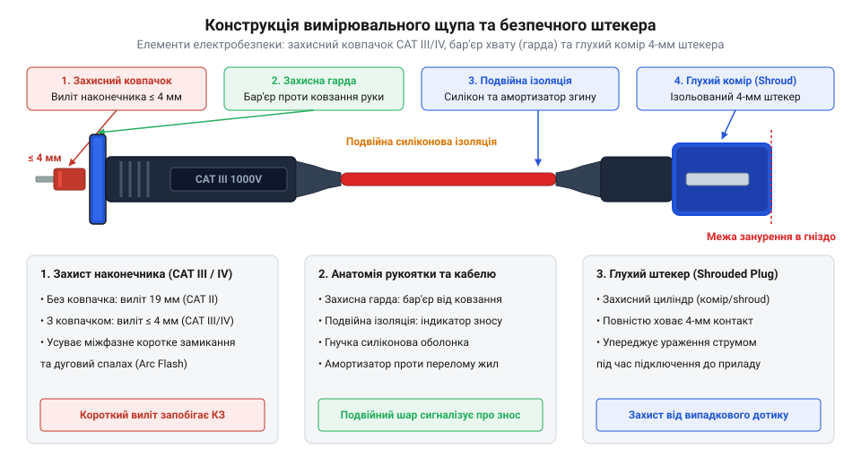
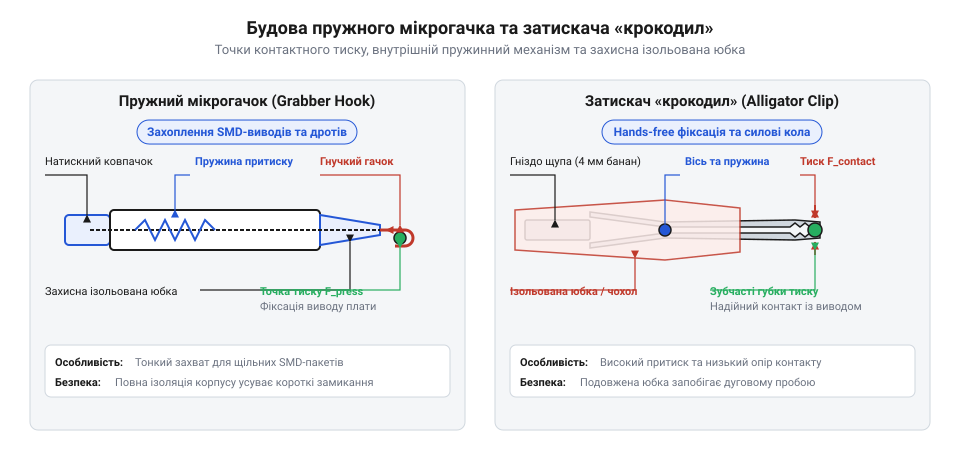

# Щупи, гачки й затискачі «крокодил»

<preknowlist>
- [Мультиметр DT-838](root:cat-hw-instruments/multimeter-dt838) — Базові принципи вимірювання напруги, струму й опору за допомогою цифрового мультиметра та призначення вимірювальних гнізд.
</preknowlist>

## Проблема контакту та анатомія щупів

Спроба виміряти напругу або сигнал на друкованій платі шляхом притискання звичайного оголеного дроту неминуче призводить до хибних показань і коротких замикань. Незахищена металева жила під час найменшого тремтіння руки ковзає поверхнею та перекриває сусідні контактні майданчики або виводи мікросхем. Якщо в низьковольтній цифровій лінії це загрожує спотворенням даних, то у силових колах виникає потужна дуга замикання. Крім того, прямий контакт незахищеного провідника з високою напругою становить смертельну небезпеку для оператора.

Щоб запобігти випадковому торканню струмоведучих частин і забезпечити стабільний електричний контакт, використовують спеціалізований вимірювальний щуп (від укр. *щупати* — торкатися; @@en|test probe@@). Сучасний щуп є складною конструктивною системою, розрахованою на механічне навантаження та електричну міцність ізоляції. За час розробки приладів вони пройшли шлях від відкритих штирів до повністю захищених конекторів; детальніше цей історичний розвиток показує [еволюція вимірювальних щупів](root:cat-hw-instruments/multimeter-probes-and-clips/hist-test-probes-evolution.md).

Зі сторони підключення до приладу щуп закінчується безпековим роз'ємом типу «банан» (від англ. *banana plug*; @@en|shrouded banana plug@@). На відміну від застарілих відкритих штекерів, безпековий 4-мм роз'єм має пружну підпружинену пелюсткову контактну гільзу, заховану всередині жорсткого пластикового кожуха (юбки). Ця юбка повністю перекриває металевий контакт до моменту його занурення в гніздо приладу, унеможливлюючи торкання пальцями під напругою. Стандартний 4-мм штекер розрахований на струми до `10–20 А` та високі категорії безпеки, однак у компактних діагностичних приладах, мікроконтролерних тестових платах та медичному обладнанні застосовують зменшені 2-мм штекери (від @@en|2mm banana plug@@ — мініатюрний банановий роз'єм). Завдяки подвійно меншому габариту 2-мм роз'єми дають змогу щільно компонувати багатоканальні вимірювальні панелі, проте через менші повітряні зазори та контактну площу вони обмежені низьковольтними колами зі струмами до `2–5 А`.


*Конструктивні елементи вимірювального щупа, що забезпечують електричну ізоляцію та захист від совання рук.*

Корпус щупа виготовляють із міцного діелектричного полімеру. У його передній частині розташована захисна гарда (від фр. *garde* — охорона; @@en|finger guard@@) — виступаючий упор, який фізично блокує пальці оператора від зсуву в бік гострого металевого наконечника. Сам наконечник виготовляють із загартованої сталі або латуні. Для підвищення безпеки під час роботи у високоенергетичних мережах наконечники оснащують знімними ізоляційними ковпачками, залишаючи відкритими лише 2–4 мм металу. Граничні випробувальні напруги та вимоги до геометрії щупів визначають [стандарти категорій безпеки](root:cat-hw-instruments/multimeter-probes-and-clips/api-iec-61010-safety-categories-and-pinouts.md) IEC 61010.

У місцях входу кабелю в корпус щупа та банановий штекер обов'язково встановлюють еластичний компенсатор натягу (@@en|strain relief@@). Він запобігає перегину мідних жил під гострим кутом і захищає провід від внутрішнього зламу при багаторазовому згинанні. Оцінити поточний стан провідників та виявити приховані обриви ізоляції допомагає [практика діагностики щупів](root:cat-hw-instruments/multimeter-probes-and-clips/proj-measuring-lead-resistance-and-cat-testing.md).

Випадкове зісковзування оголеного наконечника щупа в силових щитах створює миттєве коротке замикання (англ. @@en|short circuit@@) між фазними провідниками або фазою та заземленням. Через низький власний опір металу щупа у точці контакту виникає надвисокий струм короткого замикання, який за лічені мікросекунди розплавляє та випаровує край наконечника. Іонізоване металеве випаровування різко знижує діелектричну міцність повітряного проміжку, формуючи високотемпературний плазмовий канал і спричиняючи руйнівний дуговий спалах (англ. @@en|arc flash@@). Отриманий електричний дуговий розряд розширюється у вигляді вибухової хвилі з температурами до десятків тисяч градусів Цельсія, що викликає вивільнення розплавленого металу та створює загрозу важких опіків і баротравм для оператора навіть після розриву безпосереднього механічного контакту.

Саме для запобігання подібним катастрофічним аваріям сучасною нормою безпеки стала геометрія наконечників із суворо обмеженою довжиною відкритого металу. Застосування регульованих ізоляційних насадок-ковпачків, які залишають відкритими лише `2–4 мм` провідного кінчика, фізично унеможливлює одночасне перекриття двох сусідніх шин або фазних конекторів при випадковому відхиленні рукоятки. У поєднанні з високим бар'єром захисної гарди, що запобігає сованню пальців у зону дугоутворення, та глухими кожухами штекерів вимірювальний щуп перетворюється з потенційного джерела короткого замикання на надійний засіб електрозахисту оператора при роботі з [мультиметром DT-838](root:cat-hw-instruments/multimeter-dt838) або лабораторними вимірювальними приладами.

## Матеріали ізоляції та контактні наконечники

Надійність вимірювань і зручність використання щупів залежать від матеріалів, із яких виготовлено ізоляційне покриття кабелю та контактний наконечник. У бюджетних вимірювальних провідниках, як-от у комплектах для [мультиметра DT-838](root:cat-hw-instruments/multimeter-dt838), використовують ізоляцію з полівінілхлориду (від грец. *poly* — багато + лат. *vinum* — вино; @@en|polyvinyl chloride@@ або @@en|PVC@@). ПВХ-кабель має достатню діелектричну міцність, але стає жорстким на морозі й миттєво плавиться від випадкового торкання жалом паяльника при температурі понад 200 °C.

Професійні вимірювальні щупи оснащують кабелями із високогнучкою силіконовою ізоляцією (від лат. *silicium* — кремній; @@en|silicone@@). Силікон зберігає м'якість та еластичність у широкому діапазоні температур (від -50 °C до +200 °C) і не деформується при короткочасному контакті з розпеченим паяльником. Всередині силіконової оболонки розміщено дріт із сотень сплетених мікрожил із безкисневої міді, що забезпечує стійкість до втоми металу при багаторазовому вигинанні. Гнучкість провідника заданого калібру за американським стандартом (від @@en|American Wire Gauge@@ — калібр жил @@en|AWG@@) прямо залежить від діаметра та кількості окремих ниток: якщо стандартний дріт калібру `AWG 18` містить лише `19` відносно товстих жил, то вимірювальний кабель того ж перерізу виготовляють із `500–1000` надтонких мікрожил діаметром `0.05–0.08 мм`. Оскільки жорсткість на вигин пропорційна четвертому степеню діаметра окремої жилки, така багатожильна структура робить кабель винятково м'яким, позбавленим ефекту пам'яті вигину та стійким до зламу при багаторазовому зминанні.

Фізика контакту на вимірювальному вузлі визначається матеріалом покриття, формою наконечника та силою його механічного притиску до провідника. Більшість металевих контактів у повітрі миттєво вкриваються тонким оксидним шаром із високим питомим опором. Тверді сталеві наконечники потребують вищого зусилля притиску: гострий кінчик під дією механічного тиску фізично пробиває та зрізає міцну оксидну плівку на пайці, оголюючи чистий метал. Натомість м'яка позолочена поверхня не окиснюється і не потребує агресивного проколювання: навіть при мінімальному тиску золото пластично деформується у точці торкання, формуючи велику площу безпосереднього електричного контакту із низьким перехідним опором без ризику механічного пошкодження тонких доріжок плати.

* **Сталеві та нікельовані наконечники** (@@en|nickel-plated steel@@) — мають високу механічну міцність і зносостійкість. Проте нікелеве покриття з часом покривається тонкою оксидною плівкою, що збільшує перехідний опір (@@en|contact resistance@@).
* **Позолочені наконечники** (@@en|gold-plated probe tip@@) — золото не піддається окисненню на повітрі, забезпечуючи мінімальний та стабільний перехідний опір. Вони необхідні під час вимірювання малих напруг у мілівольтовому діапазоні.
* **Голчасті загострені наконечники** (@@en|needle probe tip@@) — мають радіус заокруглення кінчика менше ніж 0.5 мм. Завдяки високому точковому тиску голка легко проколює оксидну плівку на пайці або шар захисного лаку й надійно фіксується на дрібних елементах поверхневого монтажу (від англ. *Surface Mount Device*; @@en|SMD@@) без ризику ковзання.

Вимірювальний кабель також має власні електричні параметри — опір провідника та паразитну ємність між паралельними проводами. Власний опір жили `R_lead` прямо пропорційний її довжині й обернено пропорційний площі перерізу:

```
R_lead = (ρ · L) / S
       = (0.0175 · 1.0) / 0.75       [мідний дріт перерізом 0.75 мм², довжиною 1 м]
       ≈ 0.0233 Ом                   [власний опір однієї вимірювальної жили]
```

Для пари стандартних метрових щупів сумарний опір становить 0.05–0.15 Ом. При вимірюванні опорів у десятки або сотні ом ця величина створює помітну похибку. Детальні формули розрахунку ємності та індуктивності провідників описує [математика вимірювальних проводів](root:cat-hw-instruments/multimeter-probes-and-clips/math-probe-lead-resistance-and-capacitance.md).

Коли власний опір щупів стає критичним обмеженням, стандартну двопровідну схему замінюють на [чотирипровідний метод Кельвіна](root:cat-hw-instruments/four-wire-kelvin-resistance-measurement). Загальні принципи взаємодії щупів та вимірювального приладу визначають [режими вимірювання мультиметра](root:cat-hw-instruments/multimeter-basics).

## Затискачі "крокодил" та пружні гачки

Під час тривалої діагностики або налагодження схем утримувати два щупи руками незручно та небезпечно: оператор втрачає можливість одночасно перемикати режими приладу або регулювати джерело живлення. Для організації стабільного з'єднання без участі рук (від англ. *hands-free*; @@en|hands-free connection@@) застосовують знімні насадки — затискачі типу «крокодил» та пружні мікрогачки.

Затискач типу «крокодил» (від англ. *alligator clip*; @@en|alligator clip@@) складається з двох металевих важелів із зубчастими щелепами, з'єднаних шарніром і потужною пружиною. Зусилля пружини створює високий контактний тиск, що дозволяє зубцям продавлювати оксиди та надійно фіксуватися на струмопровідних шинах, виводах потужних компонентів або різьбових стійках заземлення.


*Внутрішні механізми фіксації затискача крокодил та пружного мікрогачка для надійного hands-free з'єднання.*

Металевий корпус безпекового затискача «крокодил» повністю покритий еластичною ізоляційною юбкою з ПВХ або силікону. Оголеними залишаються лише робочі поверхні зубців. Це унеможливлює випадкове коротке замикання на сусідні елементи плати, якщо затискач відхилиться під вагою кабелю.

Для роботи з дрібними виводами мікросхем та щільним поверхневим монтажем зубчасті затискачі не підходять через занадто великий розмір щелеп. У таких вузлах використовують пружні мікрогачки (від англ. *micrograbber* або *IC clip*; @@en|micrograbber@@).

Усередині вузького ізольованого корпусу мікрогачка розташований пружинний штовхач, з'єднаний із тонким подвійним гачком із берилієвої бронзи. При натисканні на підпружинену кнопку гачок висувається з торця корпусу й розкривається. Після зачеплення за вивід компонента кнопка відпускається, і пружина втягує гачок назад, міцно притискаючи ніжку мікросхеми до ізольованого торця насадки. Завдяки мінімальному зовнішньому діаметру корпусу мікрогачок надійно ізолює точка контакту від сусідніх виводів із кроком до 0.5 мм, запобігаючи коротким замиканням та механічному пошкодженню крихких виводів.

Окрім геометричних відмінностей, затискачі суттєво відрізняються допустимим струмовим навантаженням (від @@en|current capacity@@ — допустима сила струму). Через тонкий переріз внутрішнього дротяного гачка (близько `0.2 мм²`) та високий перехідний опір точкового контакту пружні мікрогачки розраховані лише на сигнальні кола зі струмом до `0.5–1 А`. Спроба пропустити крізь мікрогачок великий струм викликає інтенсивне виділення джоулевого тепла `P = I² · R`, що призводить до оплавлення пластикового штовхача та втрати пружності механізму. Натомість масивні металеві щелепи затискачів типу «крокодил» із великою площею контактного притиску впевнено витримують тривалі струми `5–10 А` (а для посилених моделей — до `20 А`), роблячи їх незамінними при вимірюванні струму споживання силових каскадів чи підключенні до високострумових гнізд [мультиметра DT-838](root:cat-hw-instruments/multimeter-dt838).

## Електричний опір та паразитна ємність

При спробі виміряти опір низькоомного шунта, первинної обмотки трансформатора чи струмопровідної доріжки друкованої плати значення на дисплеї часто виявляється суттєво вищим за розрахункове. Підключивши звичайний [мультиметр DT-838](root:cat-hw-instruments/multimeter-dt838) до резистора номіналом `0.2 Ом`, інженер може побачити показання `0.5 Ом` або навіть `0.7 Ом`. Причина такого відхилення полягає в тому, що прилад вимірює загальний опір вимірювальної петлі, де до шуканого значення додається власний опір провідника (від @@en|lead resistance@@ — опір вимірювального провідника) та контактний опір (від @@en|contact resistance@@ — опір на межі зіткнення) у точках дотику наконечника. Звичайні вимірювальні провідники з мідною жилою перерізом `0.2 мм²` або `0.5 мм²` і довжиною `1 м` додають до кола від `0.1 Ом` до `0.4 Ом` власного опору, що робить прямі двопровідні вимірювання малого опору вкрай неточними.

Для визначення підсумкової похибки використовують еквівалентну схему заміщення вимірювального кола, де опір жил та контактів з'єднаний послідовно з досліджуваним об'єктом. Математичний розрахунок внесеного відхилення та оцінка залежності опору від матеріалу жил наведені у матеріалі [математика опору й ємності](root:cat-hw-instruments/multimeter-probes-and-clips/math-probe-lead-resistance-and-capacitance.md). Додатковим джерелом похибок у низькоомних колах є термоелектрична рушійна сила (від @@en|thermal EMF@@ — термоелорс), яка виникає на межі зіткнення різнорідних металів (наприклад, мідного провідника, сталевого наконечника та олов'яно-свинцевого припою). При найменшому градієнті температур між точками контакту, спричиненому теплом рук або нагріванням плати, ефект Зеєбека генерує паразитну постійну напругу в кілька мікровольт, що викривляє показання приладу. Для усунення цих впливів у сучасних вимірювальних приладах застосовують функцію відносних вимірювань (від @@en|relative mode@@ — режим віднімання опорного значення), яка обнуляє показання при короткому замкненні щупів. У прецизійних лабораторних вимірюваннях застосовують спеціальний [чотирипровідний метод вимірювання опору Кельвіна](root:cat-hw-instruments/four-wire-kelvin-resistance-measurement), в якому струмові та потенційні лінії розділені, завдяки чому спад напруги на власних провідниках та термоелорс не потрапляють у вимірювальний тракт.

Окрім активного опору, вимірювальні провода вносять у досліджувану схему реактивні параметри — паразитну ємність (від @@en|parasitic capacitance@@ — міжпровідникова ємність) та паразитну індуктивність (від @@en|parasitic inductance@@ — власна індуктивність провідника). Двожильний вимірювальний кабель довжиною `1 м` має міжпровідникову ємність порядку `50 пФ`–`120 пФ`. Під підключенні до високочастотних цифрових шин чи чутливих аналогових вузлів ця ємність шунтує сигнал на землю та шунтує високочастотні гармоніки, викривляючи форму фронтів імпульсів. Водночас власна індуктивність довгих провідників (близько `1 мкГн/м`) викликає резонансні дзвіни та перерегулювання при швидких перехідних процесах. Для зниження реактивного впливу при вимірюванні високочастотних сигналів довжину провідників скорочують, а при вимірюванні опорів проводять процедуру компенсації, яку детально описує [практична перевірка опору щупів](root:cat-hw-instruments/multimeter-probes-and-clips/proj-measuring-lead-resistance-and-cat-testing.md).

## Категорії безпеки CAT та знос

Вимірювання параметрів у силових електромережах та промислових щитах пов'язане з ризиком виникнення дугового пробою та вибухового короткого замикання при короткочасних імпульсних перенапругах. Звичайний вимірювальний аксесуар без належного захисного виконання під дією високовольтного піку напруги може пробитися по ізоляції, спричинивши іонізацію повітря та дуговий спалах. Для запобігання травмам інженерів міжнародний стандарт [будова та режими вимірювання](root:cat-hw-instruments/multimeter-basics) та стандарт @@en|IEC 61010@@ регламентують категорії перенапруги (від @@en|overvoltage category@@ — рівень стійкості до високовольтних імпульсів), які визначають безпечні межі застосування вимірювальних провідників.

Історичний шлях розвитку вимірювальних з'єднувачів від незахищених штирів до глухих безпекових штекерів висвітлює [історія вимірювальних щупів](root:cat-hw-instruments/multimeter-probes-and-clips/hist-test-probes-evolution.md). Згідно із сучасними вимогами, обладнання поділяють на чотири категорії:
- `CAT I` — електронні прилади з внутрішніми захищеними колами та низьковольтні джерела живлення;
- `CAT II` — однофазні побутові розетки, переносні електроприлади та кола живлення побутової техніки;
- `CAT III` — розподільні щити, трифазні лінії живлення всередині будівель, стаціонарне промислове обладнання та шинопроводи;
- `CAT IV` — первинні вводи електромережі, лічильники електроенергії та зовнішні повітряні й кабельні лінії.

Для забезпечення відповідності стандартам `CAT III` та `CAT IV` конструкція наконечника має жорсткі обмеження: відкрита металева частина голки не повинна перевищувати `4 мм` (або `2 мм` у випробуваннях з високою щільністю), щоб унеможливити випадкове міжфазне коротке замикання при випадковому зсуві щупа. Довші металеві наконечники (до `19 мм`) припустимі лише у категорії `CAT II` і повинні оснащуватися знімними захисними насадками-ковпачками.

Окрім обмеження довжини металевого кінчика, категорії перенапруги регламентують здатність вимірювальних аксесуарів витримувати високі очікувані струми короткого замикання (від @@en|prospective short-circuit current@@ — розрахунковий струм замикання). У мережах `CAT III` струм короткого замикання в розподільних щитах досягає від `10 кА` до `25 кА`, тоді як у первинних вводів категорії `CAT IV` цей показник перевищує `50 кА` і може досягати `100 кА`. Щоб запобігти вибуху провідників під дією колосальної теплової та електродинамічної енергії замикання, безпекові щупи вищого класу виготовляють із вогнетривких термопластів, а в окремих моделях інтегрують високоамперні дугогасні запобіжники з високою вимикальною здатністю (від @@en|high-breaking-capacity fuse@@ — керамічний запобіжник із пісочним наповненням).

Вимоги до максимальних імпульсних напруг та табличні значення для кожного класу містить довідкова вставка [стандарти електробезпеки CAT](root:cat-hw-instruments/multimeter-probes-and-clips/api-iec-61010-safety-categories-and-pinouts.md). Надійність ізоляції визначається також її зносом. Якісні щупи виготовляють із двошаровою ізоляцією різного кольору: зовнішній шар має чорне або червоне забарвлення, а внутрішній сигнальний шар виконаний білим або жовтим кольором. Поява внутрішнього кольору крізь зношений зовнішній шар свідчить про критичний знос ізоляції та вимагає негайної заміни провідника. Окрім того, перед кожним високовольтним вимірюванням слід оглядати пружні захисні муфти біля роз'ємів на відсутність мікротріщин та перевіряти цілісність жил шляхом згинання провідника під час перевірки опору.
