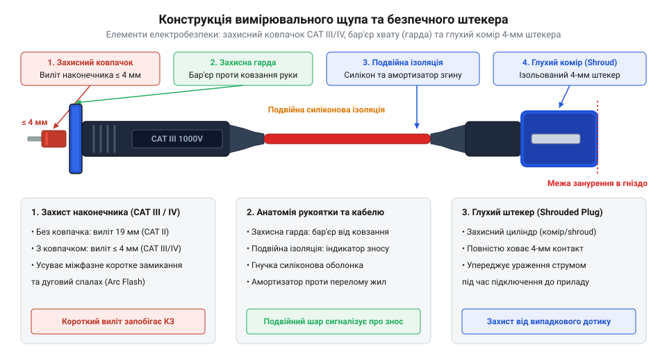
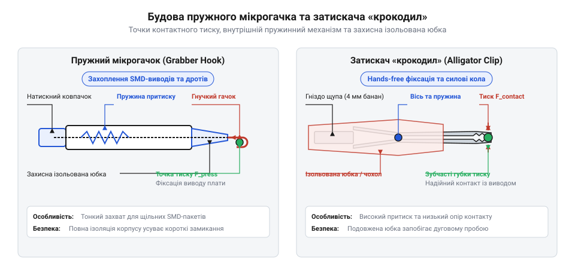

# Щупи, гачки й затискачі «крокодил»

<preknowlist>
- [Мультиметр DT-838](root:cat-hw-instruments/multimeter-dt838) — Знання режимів вимірювання напруги, струму й опору за допомогою цифрового мультиметра та призначення вимірювальних гнізд.
</preknowlist>

## Будова щупів та елементи захисту

Притискання ззвичайного оголеного дроту до контактних майданчиків плати спричиняє хибні показання та коротке замикання через найменше тремтіння руки. Для безпечного вимірювання використовують вимірювальний щуп — @@en|test probe@@ (від укр. *щупати* — торкатися).


*Конструктивні елементи вимірювального щупа, що забезпечують електричну ізоляцію та захист від совання рук.*

Для підключення до приладу, такого як [Мультиметр DT-838](root:cat-hw-instruments/multimeter-dt838), застосовують безпековий банановий штекер — @@en|shrouded banana plug@@ (від англ. *banana plug*). Його підпружинений контакт захований усередині жорсткої пластикової юбки, що унеможливлює випадкове торкання пальцями під напругою. Стандартний 4-мм штекер витримує струми до `10–20 А`, а мініатюрний 2-мм роз'єм — @@en|2mm banana plug@@ — застосовують у компактних тестових платах для струмів до `2–5 А`.

Діелектричний корпус щупа оснащено пальцевою гардою — @@en|finger guard@@ (від фр. *garde* — охорона), яка фізично блокує пальці від зісковзування на металевий наконечник. У місці входу кабелю в корпус розміщено амортизатор натягу жил — @@en|strain relief@@ (англ. *strain relief*), що запобігає перегину мідних жил. Знімні ковпачки обмежують виліт наконечника до `2–4 мм`, що унеможливлює міжфазне замикання та руйнівний дуговий спалах — @@en|arc flash@@ (англ. *arc flash*).

## Матеріали ізоляції та контактні наконечники

Якість вимірювального провідника визначається матеріалом його оболонки та кінчика. У бюджетних провідниках використовують полівінілхлорид — @@en|PVC@@ (від грец. *poly* — багато та лат. *vinum* — вино; @@en|polyvinyl chloride@@), який є твердим і плавиться від паяльника. Професійні кабелі виготовляють із силікону — @@en|silicone@@ (від лат. *silicium* — кремній), що зберігає гнучкість при температурах від -50 °C до +200 °C та містить сотні мікрожил із безкисневої міді.

Наконечники бувають трьох типів:
- **Сталеві та нікельовані** — @@en|nickel-plated steel@@ — міцні, але потребують зусилля притиску для пробивання оксидної плівки.
- **Позолочені** — @@en|gold-plated probe tip@@ — м'яке покриття з золота не окиснюється і забезпечує мінімальний перехідний опір — @@en|contact resistance@@ — без проколювання пайки.
- **Голчасті** — @@en|needle probe tip@@ — із радіусом заокруглення менше 0.5 мм надійно фіксуються на елементах поверхневого монтажу — @@en|SMD@@ (від англ. *Surface Mount Device*).

Кабель додає власний опір `R_lead`, який обчислюють за формулою:

```
R_lead = (ρ · L) / S
       = (0.0175 · 1.0) / 0.75       [мідний дріт перерізом 0.75 мм², довжиною 1 м]
       ≈ 0.0233 Ом                   [власний опір однієї вимірювальної жили]
```

Пара метрових ліній дає власний опір `0.05–0.15 Ом` та міжпровідникову паразитну ємність `50–120 пФ`, що викликає похибки в низькоомних і високочастотних колах.

## Затискачі крокодил та пружні мікрогачки

Для утримання контакту без участі рук — @@en|hands-free connection@@ (від англ. *hands-free*) — використовують знімні насадки.


*Внутрішні механізми фіксації затискача крокодил та пружного мікрогачка для надійного hands-free з'єднання.*

Затискач типу «крокодил» — @@en|alligator clip@@ (від англ. *alligator clip*) — має потужну пружину та зубчасті металеві щелепи, покриті ізоляційною юбкою. Він забезпечує високий контактний тиск і розрахований на струми `5–10 А` у силових колах [мультиметра DT-838](root:cat-hw-instruments/multimeter-dt838).

Для дрібних виводів мікросхем застосовують пружні мікрогачки — @@en|micrograbber@@. Пружинний штовхач висуває подвійний гачок із берилієвої бронзи, який зачіпає ніжку деталі й притискає її до торця насадки. Через тонкий переріз жил мікрогачки обмежені сигнальними струмами до `0.5–1 А`, адже більший струм призводить до перегріву та оплавлення пластику.
