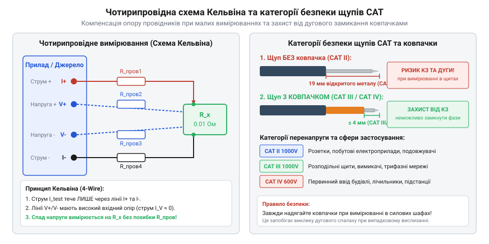

# Практична перевірка опору щупів та діагностика ізоляції

<preknowlist>
- [Мультиметр DT-838](root:cat-hw-instruments/multimeter-dt838) — Знання режимів вимірювання опору, звукової прозвонки та розташування гнізд приладу.
</preknowlist>

## Вимірювання та компенсація опору щупів

Під час вимірювання низькоомних резисторів, обмоток трансформаторів, дроселів чи струмовимірювальних шунтів результатом вимірювання нерідко стає хибне значення. Звичайний двохпровідний @@en|multimeter@@ (англ. *multimeter*, від лат. *multus* — численний та грец. *metron* — міра), як-от [Мультиметр DT-838](root:cat-hw-instruments/multimeter-dt838), підключається до об'єкта вимірювання двома провідниками, кожен з яких має власний опір. Цей опір складається з опору мідної жили кабелю, контактного опору бананових штекерів у гніздах приладу та перехідного опору між наконечником щупа й виводом деталі. У стандартних вимірювальних шнурах загальний власний опір двох ліній `R_leads` становить від 0.2 Ом до 1.5 Ом.

Коли вимірюваний опір `R_Rx` становить одиниці або частки Ома, власний опір ліній стає сумірним із величиною досліджуваного елемента або навіть перевищує його. За двохпровідної схеми струм вимірювача протікає крізь ті самі провідники, на яких вимірюється спад напруги, тому прилад фіксує сумарну величину:

```
R_measured = R_Rx + R_leads
R_Rx = R_measured - R_leads      [віднімання власного опору щупів]
```

Для усунення цієї похибки в цифрових приладах застосовують режим відносних вимірювань — @@en|Relative mode@@ (англ. *Relative mode*, від лат. *relativus* — відносний). Перед початком роботи наконечники щупів щільно замикають між собою та натискають кнопку Δ (REL). Прилад фіксує значення `R_leads` у пам'яті й автоматично віднімає його від усіх наступних показань, обнуляючи дисплей. Якщо прилад не має такої функції, віднімання `R_leads` виконують вручну за наведеною формулою.

Проте за двохпровідного підключення контактний опір у точці дотику наконечника щупа до виводу компонента залишається некомпенсованим і змінюється залежно від зусилля притискання. Для усунення цього обмеження використовують чотирипровідне підключення Кельвіна — @@en|Kelvin connection@@ (від імені шотландського фізика лорда Кельвіна, англ. *Lord Kelvin*).


*Чотирипровідна схема вимірювання Кельвіна для усунення похибки вимірювальних ліній та маркування знімних захисних ковпачків під вимоги категорій CAT III та CAT IV.*

У цій схемі струмові лінії (Force) подають калібрований струм від джерела крізь досліджуваний резистор, а потенціальні лінії (Sense) вимірюють спад напруги безпосередньо на виводах деталі. Оскільки вхідний опір вольтметра становить понад 10 МОм, струм у потенціальних провідниках прямує до нуля, а отже, спад напруги на їхньому власному опорі та контактних переходах дорівнює нулю.

## Виявлення прихованих обривів при згинанні

Вимірювальні шнури @@en|multimeter@@ зазнають постійних механічних згинань, скручувань та натягів під час щоденної експлуатації. Внутрішній струмоведучий провідник складається з десятків тонких мідних волокон для забезпечення гнучкості. Під дією циклічних механічних напружень у зонах найінтенсивнішого згину виникає втомне руйнування металу: мідні волокна поступово переломлюються одне за одним.

Небезпека цього дефекту полягає у виникненні плаваючого обриву. Зовнішня ізоляційна оболонка залишається цілою, а зламані кінці мідних жил торкаються один одного в стаціонарному стані, забезпечуючи електричний контакт. Однак під час руху щупа або зміни кута згину контакт періодично зникає. Це призводить до хаотичних стрибків показань на дисплеї @@en|multimeter@@ або помилкового висновку про несправність досліджуваної схеми.

Найвразливішими ділянками є зони переходу від жорсткої пластикової рукоятки щупа або корпуса штекера до гнучкого кабелю. Для захисту від гострого перегину в цих місцях конструктивно передбачено амортизатор натягу — @@en|strain relief@@ (англ. *strain relief*, від *strain* — натяг та *relief* — ослаблення).

Діагностику прихованих обривів виконують методологією стрес-тестування на згин:

1. Переводють @@en|multimeter@@ у режим звукової прозвонки (або режим вимірювання опору на найменшій межі).
2. Надійно фіксують наконечники щупів між собою або приєднують їх до короткозамкненого затискача.
3. Послідовно перегинають кабель із радіусом згину 10–15 мм уздовж усієї довжини, приділяючи особливу увагу зонам @@en|strain relief@@ біля рукояток та штекерів.

Якщо під час згинання звуковий сигнал прозвонки переривається, а в режимі омметра показання стрибають від 0.2 Ом до нескінченності `OL` (від англ. *Over Limit* — перевищення межі), вимірювальний провід має прихований обрив жил і підлягає негайній заміні.

## Діагностика зносу та цілісності ізоляції

Захисна оболонка вимірювальних щупів виконує функцію діелектричного бар'єра між оператором та вимірювальним колом. У промислово виготовлених щупах застосовують два основні типи матеріалів ізоляції: полівінілхлорид — @@en|PVC@@ (англ. *polyvinyl chloride*) та силікон — @@en|silicone@@ (англ. *silicone*).

Кабелі з @@en|PVC@@ є дешевшими та стійкими до стирання, але втрачають гнучкість на морозі й миттєво оплавляються при випадковому дотику гарячого паяльника. Силіконові кабелі — @@en|silicone@@ — зберігають високу еластичність у широкому діапазоні температур (від -50 °C до +200 °C) та не пошкоджуються від короткочасного контакту з розігрітим паяльним жалом.

Перевірка діелектричної цілісності включає візуальний та механічний контроль:

- **Пошук поверхневих пошкоджень:** кабель оглядають по всій довжині на наявність порізів, задирів, глибоких подряпин, термічних опіків від паяльника та мікротріщин, що виникають внаслідок старіння полімеру.
- **Контроль подвійної ізоляції:** якісні вимірювальні щупи виготовляють за технологією подвійної екструзії. Вони мають два шари ізоляції контрастних кольорів — зовнішній (червоний або чорний) та внутрішній індикаторний шар (білий або жовтий). Поява внутрішнього кольору крізь зношений зовнішній шар свідчить про критичний знос діелектрика та втрату захисних властивостей.
- **Перевірка опору ізоляції:** для вимірювальних ліній, що використовуються в колах з напругою понад 50 В, проводять випробування опору ізоляції. Для цього кабель щупа обгортають струмопровідною фольгою та вимірюють опір між центральною мідною жилою та фольгою за допомогою мегомметра — @@en|megohmmeter@@ (від грец. *megas* — великий, *Ohm* — Ом та *metron* — міра) при випробувальній напрузі 500 В або 1000 В. Значення опору має становити не менше 100 МОм.

Щупи з пошкодженим зовнішнім шаром або зниженим опором ізоляції категорично заборонено використовувати під час роботи в електроустановках.

## Оцінка відповідності категоріям безпеки CAT

Робота у силових електричних мережах супроводжується ризиком виникнення імпульсних перенапруг — @@en|transient overvoltage@@ (англ. *transient overvoltage*, від лат. *transiens* — перехідний), що виникають внаслідок комутації потужних навантажень або розрядів блискавки. Міжнародний стандарт IEC 61010-1 визначає чотири категорії перенапруги (CAT I – CAT IV), які регламентують вимоги до міцності ізоляції та конструкції вимірювальних приладів і щупів:

- **CAT I:** вимірювання в слабкострумових електронних колах, захищених малопотужними джерелами живлення.
- **CAT II:** вимірювання в однофазних електричних розетках, побутових приладах та переносному електроінструменті.
- **CAT III:** вимірювання у трифазних розподільних мережах, освітлювальних шинопроводах, силових щитах та стаціонарних електродвигунах.
- **CAT IV:** вимірювання на первинному вводі електроенергії в будівлю, лічильниках електроенергії та повітряних лініях.

Головною небезпекою під час вимірювань у колах CAT III та CAT IV є виникнення дугового пробою та дугового спалаху — @@en|arc flash@@ (англ. *arc flash*, від лат. *arcus* — дуга та англ. *flash* — спалах). Якщо наконечник щупа має довгу оголену металеву частину (стандартно 19 мм), випадковий зсув щупа може замкнути дві сусідні фази чи фазу й заземлений корпус. Висока енергія короткого замикання створює плазмову дугу з температурою в тисячі градусів, що призводить до вибуху та важких опіків оператора.

Для запобігання дуговому спалаху вимірювальні щупи категорій CAT III 1000V та CAT IV 600V обов'язково оснащують знімними захисними ковпачками — @@en|protective cap@@ (англ. *protective cap*). Згідно з вимогами IEC 61010-031, встановлений ковпачок зменшує довжину оголеного металевого наконечника до <= 4 мм, запобігаючи випадковому міжфазному короткому замиканню в щитовому обладнанні.

Чек-лист перевірки щупів перед роботою під напругою:

1. **Перевірка маркування:** переконатися, що на корпусі щупа та кабелі чітко нанесено маркування категорії безпеки, яке відповідає або перевищує категорію вимірювального кола (наприклад, CAT III 1000V / CAT IV 600V).
2. **Наявність захисних ковпачків:** під час виконання вимірювань у силових щитах (CAT III / CAT IV) перевірити наявність та надійну фіксацію захисних ковпачків @@en|protective cap@@.
3. **Обмежувальні бар'єри:** перевірити цілісність захисних бар'єрів для пальців — @@en|finger guard@@ (англ. *finger guard*). Вони запобігають випадковому ковзанню пальців оператора вперед на оголений металевий наконечник під час вимірювання.
