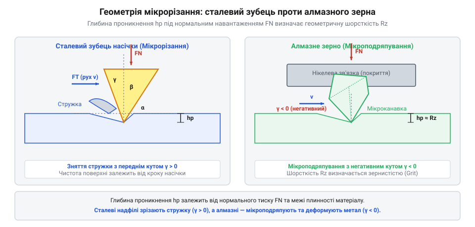

# Геометрія різання та розрахунок шорсткості поверхні при доводці надфілем

## Проблема непередбачуваної шорсткості при доводці

При доводці точних деталей слюсар часто стикається з появою глибоких поодиноких рисок або непередбачувано високої шорсткості поверхні. Спроба прискорити знімання металу за рахунок збільшення притискного зусилля на інструмент призводить до того, що різальні кромки заглиблюються понад розраховану висоту, а утворені стружкові канавки миттєво переповнюються. У результаті замість рівномірного мікрорізання (лат. *scindere* — розрізати, @@en|micro-cutting@@) відбувається пластичне відтискання металу та викришення кромки. Крім того, багаторазове деформування поверхневого шару викликає його механічний наклеп (нім. *Kaltverfestigung* — зміцнення при деформації, @@de|Kaltverfestigung@@): мікротвердість металу в зоні контакту зростає у кілька разів, перетворюючи пластичний матеріал на крихку зміцнену кірку. Натрапляючи на такий наклепаний шар, вершини сталевих зубців зазнають ударних перевантажень і стрімко викришуються, що ще більше погіршує чистоту обробки.

Спрощене уявлення про те, що швидкість знімання матеріалу прямо пропорційна прикладеній силі, ламається на геометрії контакту. Надфіль має скінченну кількість точок контакту на одиницю площі, і прикладене нормальне зусилля `Fₙ` розподіляється між усіма активними зубцями або абразивними зернами. Фактична кількість точок контакту залежить від геометричної площі дотикання `S` та кута перекосу інструмента відносно деталі: при найменшому відхиленні від паралельності робоча площа звужується до вузької смуги, через що все навантаження зосереджується лише на декількох крайніх зубцях. У результаті локальне зусилля на один зубець стрімко зростає, змінюючи режим роботи від чистого мікрорізання до глибинного зминання та викришення металу. Збільшення нормальної сили без урахування геометричної площі контакта та номера насічки (нім. *Hieb* — карб, насічка, @@de|Hieb@@) руйнує оброблювану поверхню. Для дотримання точного допуску необхідна математична модель, яка пов'язує геометричні параметри різального профілю, орієнтацію інструмента, зусилля притискання та підсумкові показники шорсткості.

## Механіка мікрорізання та глибина врізання

Глибина проникнення різального елемента в матеріал залежить від його геометрії, нормального зусилля `Fₙ`, кількості активних елементів `N` та твердості оброблюваної деталі за Віккерсом `HV` (англ. *hardness* — твердість, @@en|hardness@@). Сталевий надфіль має клиноподібні зубці з переднім кутом `γ` та кутом загострення `β`, тоді як алмазний надфіль містить виступаючі абразивні зерна, що моделюються сферичними сегментами радіуса `r`.


*Геометрія мікрорізання клиновим зубцем сталевого надфіля та сферичним алмазним зерном під дією нормального зусилля.*

Для клиноподібного зубця сталевого надфіля з кутом при вершині `θ` середня сила на один зубець дорівнює `fₙ = Fₙ / N`. Проекція площі відбитка визначається глибиною врізання `h`. Зв'язок між навантаженням на один зубець і глибиною врізання описується рівновагою сил опору пластичній деформації матеріалу з мікротвердістю `HV`. Геометрична форма клина задається переднім кутом `γ`, заднім кутом `α` та загальним кутом різання `δ = 90° - γ`, з яких кут загострення зубця `β` (що визначає кут при вершині `θ = β`) розраховується через вираз:

```
β
= 90° - (γ + α)            [аналітичний розрахунок кута загострення зубця]
```

Отриманий кут `β` прямо визначає геометрію клина та бокове відтискання металу при заглибленні.

```
fₙ
= Fₙ / N                  [розподіл загальної сили між активними зубцями]
= k · HV · h² · tan(θ / 2) [рівновага при втисканні клина з коефіцієнтом форми k]
```

Для сферичного алмазного зерна радіуса `r` площа проекції відбитка дорівнює `2 · π · r · h`. Звідси навантаження на поодиноке зерно обчислюється з виразу:

```
fₙ
= Fₙ / N                  [навантаження на одне зерно]
= 2 · π · r · h · HV      [опір пластичному втисканню сферичного сегмента]
```

Шляхом алгебричного перетворення для клинових зубців отримуємо глибину врізання `h` через нормальне зусилля та мікротвердість:

```
h
= √ ( Fₙ / ( N · k · HV · tan(θ / 2) ) )  [визначення глибини врізання сталевого зубця]
```

Знаючи кількість активних зубців `N`, яка залежить від номера @@de|Hieb@@ та площі контакту `S`, можна точно розрахувати глибину проникнення кромки під заданим навантаженням. Кількість активних елементів обчислюється через поверхневу густину зубців `n_s` (кількість різальних вершин на одиницю площі) та контактну площу `S`:

```
N
= n_s · S                 [обчислення загальної кількості контактних зубців]
= (1 / P²) · S            [вираження густини через крок насічки P]
```

Підставляючи отримане значення `N = S / P²` у виведений вираз глибини врізання `h`, одержуємо остаточну залежність глибини проникнення від питомого нормального тиску `pₙ = Fₙ / S` та геометричних параметрів насічки.

## Математичний розрахунок параметрів Ra та Rz

Профіль поверхні після доводки являє собою сукупність паралельних або перехресних мікроканавок від клинових зубців чи абразивних зерен. Найбільша висота профілю `Rz` (нім. *Rauheit* — шорсткість, @@de|Rauheit@@) у теоретичному наближенні дорівнює глибині врізання `h` плюс додаткова висота пластичного напливу металу на краях канавки. Для трикутного профілю мікроканавок із кроком насічки `P` (відстань між сусідніми зубцями) теоретичне середнє арифметичне відхилення профілю `Ra` обчислюється як четвертина від максимальної висоти нерівностей `Rz`. Кінематична шорсткість також залежить від схеми опилювання: при однопрохідному розточуванні канавки зберігають повну теоретичну висоту `Rz_single = Rz`, а при перехресному опилюванні під кутом перетину `φ` другого ходу відносно першого висота гребенів зменшується геометрично:

```
Rz_cross
= Rz · sin(φ / 2)         [зменшення висоти гребенів при перехресному опилюванні]
```

При куті перетину `φ = 60°` коефіцієнт становить `sin(30°) = 0.5`, що дає подвійне зниження кінематичної шорсткості `Rz_cross ≈ 0.5 · Rz` без зміни номера насічки інструмента.

```
Ra
= Rz / 4                  [співвідношення для трикутного симетричного профілю]
= h / 4                   [заміна максимальної висоти глибиною врізання]
```

Для сталевих надфілів крок насічки `P` прямо пов'язаний з номером насічки @@de|Hieb@@. Наприклад, надфіль № 0 має крок `P ≈ 0.4` мм (25 зубців/см), а № 5 — крок `P ≈ 0.12` мм (80 зубців/см). Для алмазного покриття розмір зерна `d` визначається показником зернистості (англ. *grit* — гравій, пісок, @@en|Grit@@). Середній діаметр зерна `d` у мікрометрах з наближенням визначається через номер зернистості `G`:

Для сталевих надфілів аналітична залежність кроку насічки `P` (у міліметрах) від номера насічки `H` (від 0 до 5) описується показниковим співвідношенням, за яким щільність зубців зростає із геометрією стандартизованого ряду:

```
P(H)
= 0.40 / 1.26ᴴ            [залежність кроку насічки в мм від номера насічки H]
```

За цією формулою для номера № 0 крок становить `P = 0.40` мм, для № 1 — `P ≈ 0.31` мм, для № 2 — `P ≈ 0.25` мм, для № 3 — `P ≈ 0.20` мм, для № 4 — `P ≈ 0.16` мм, а для фінішного № 5 — `P ≈ 0.12` мм, що дає змогу точно обчислювати висоту нерівностей `Rz` для будь-якого стандартного номера насічки.

```
d
= 15200 / G               [наближена залежність середнього діаметра зерна у мкм від Grit]
```

**Обчислення шорсткості для алмазного надфіля 400 Grit:**
Припустимо, використовується алмазний надфіль з зернистістю `G = 400` @@en|Grit@@ під навантаженням, що забезпечує глибину врізання `h = 1.2` мкм.
Розрахунок показника `Ra`:

```
Ra
= h / 4                   [теоретична формула для абразивного профілю]
= 1.2 / 4                 [підстановка значення глибини врізання]
= 0.3                     [значення середнього арифметичного відхилення профілю в мкм]
```

Отримане значення `Ra = 0.3` мкм відповідає високому класу чистоти обробки (8–9 клас), що дає змогу математично обґрунтовано добирати зернистість надфіля під вимоги креслення.

## Розрахунок припуску та фізичні обмеження

Для повного видалення рисок після доводки надфілем наступним інструментом (наприклад, полірувальною пастою чи дрібнозернистою шкіркою) мінімальний шар матеріалу, який необхідно зняти — технологічний припуск `Δz` (нім. *Zugabe* — додаток, припуск, @@de|Zugabe@@), — повинен перевищувати максимальну висоту мікронерівностей `Rz` з урахуванням деформованого підповерхневого шару `h_d`. Товщина наклепаного та деформованого підповерхневого шару `h_d` математично залежить від межі плинності оброблюваної сталі `σ_y` та питомого тиску контакту `p_n`:

```
h_d
= c · (p_n / σ_y) · h       [обчислення товщини деформованого шару через межу плинності]
```

Оскільки для м'яких сталей із низькою межею плинності `σ_y` пластичне деформування проникає глибше, ніж у загартованих сплавах, параметр `h_d` розраховується пропорційно тиску та може досягати `(0.3...0.5) · Rz`.

```
Δz
= Rz + h_d                [сума максимальної висоти рисок та глибини деформованого шару]
= 4 · Ra + 0.5 · Rz       [практичний розрахунок припуску через параметр Ra]
= 6 · Ra                  [підсумковий технологічний припуск під фінішне полірування]
```

Реальний процес @@en|micro-cutting@@ відхиляється від ідеальної геометричної моделі через три основні фізичні фактори. Першим є засалювання міжзубних западин стружкою (нім. *Zusetzen* — забивання, @@de|Zusetzen@@): коли об'єм знятого металу перевищує об'єм стружкової канавки `V_c`, надфіль припиняє різання й починає ковзати, створюючи припікання та наклеп. Другим фактором є абразивний знос: вершини зубців сталевого надфіля радіально згладжуються, збільшуючи радіус заокруглення `r_e`, що переводить мікрорізання в режим пластичного відтискання. Третім фактором є пружно-пластичне відновлення металу після проходження кромки, через що реальна глибина канавки становить `h_real ≈ (0.7...0.85) · h`.

Враховуючи ці обмеження, при розрахунку режиму доводки під точний розмір слід застосовувати поправковий коефіцієнт стану інструмента `k_w ≈ 1.2...1.3`, що гарантує надійне перекриття припуску при переході до фінішних операцій. Ключовим математичним критерієм настання засалювання є умова переповнення стружкової канавки, коли об'єм знятого матеріалу `V_m`, помножений на коефіцієнт ущільнення та розпушення стружки `K_c` (зазвичай `K_c ≈ 2.5...4.0`), досягає об'єму впадини між зубцями `V_c`:

```
V_c
≤ K_c · V_m               [критерій граничного переповнення стружкової канавки]
```

При виконанні цієї нерівності зрізана стружка повністю заклинюється у міжзубному просторі, що призводить до стрибкоподібного зростання нормальних сил та припинення процесу мікрорізання.
