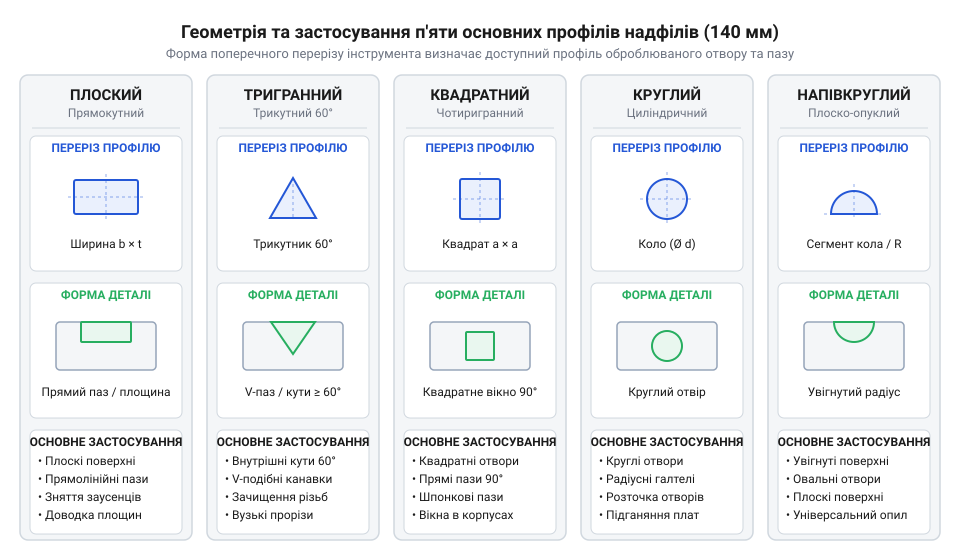
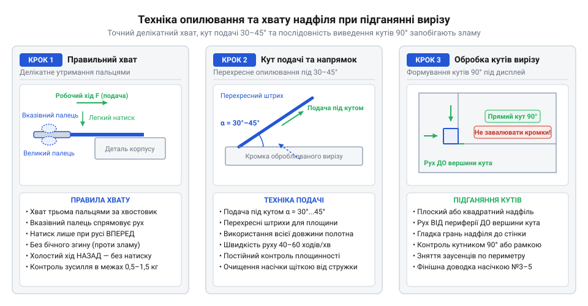

# Надфілі (140 мм)

<preknowlist>
- [Свердла по металу HSS (2.0–8.0 мм)](root:cat-hw-instruments/hss-drill-set) — Знання принципів попереднього свердління отворів перед їхнім подальшим опилюванням та розширенням надфілями.
- [Скальпелі й змінні леза](root:cat-hw-instruments/scalpel-set) — Прийоми попереднього зрізання великих заусенців та розмітки ліній різу на пластикових корпусах.
</preknowlist>

## Призначення та геометрія профілів надфілів

Спроба точно вивести прямокутний виріз під OLED-дисплей у пластиковому корпусі чи підігнати вузький внутрішній паз за допомогою звичайного слюсарного напилка неминуче призводить до браку. Масивний напилок має грубі зубці й значну товщину, через що він не здатний увійти в отвір діаметром менше ніж 5 мм або обробити гострий внутрішній кут. До того ж, намагання відразу глибоко занурити надфіль у матеріал без попередньої направляючої ризики створює ризик викривлення лінії різу через увід полотна вбік під натиском. Для знімання великого напливу пластику чи створення направляючого розпилу й первинної зрізки заусенців на отворах можна застосувати [гострий монтажний скальпель](root:cat-hw-instruments/scalpel-set), однак фінішне виведення точних геометричних розмірів вимагає спеціалізованого дрібного ріжучого інструменту.

Для прецизійної обробки дрібних деталей використовують надфіль (нім. *Nadelfeile*, від *Nadel* — голка та *Feile* — напилок; @@en|needle file@@) — мініатюрний напилок завдовжки 140 мм з потоншеним круглим хвостовиком. Робоча частина інструменту має довжину від 60 до 80 мм і вирізняється дрібним карбуванням або гальванічним покриттям. Завдяки невеликому перерізу надфіль дає змогу дозувати зусилля натиску пальцями та знімати матеріал мікронними шарами без ризику відколу країв або деформації тонких стінок корпусу.

Ефективність підганяння прямо залежить від відповідності форми робочого профілю надфіля геометрії оброблюваного елемента. У базовий комплект із 140 мм надфілів входять п'ять основних геометричних профілів:

1. Плоский тупоносий або загострений (@@en|flat needle file@@) — має дві широкі паралельні робочі площини та два бічних ребра. Тупоносий варіант зберігає однакову ширину по всій довжині для виведення рівних наскрізних пазів, тоді як загострений злегка звужується до носка, що дозволяє вводити інструмент у вузькі глухі пази та дрібні прямокутні отвори. Призначений для опилювання відкритих плоских поверхонь, зовнішніх пазів та вирівнювання прямих граней.
2. Тригранний (@@en|three-square file@@) — виконаний у формі рівностороннього трикутника з кутами 60°. Використовується для виведення гострих внутрішніх кутів, підганяння кутових пазів та обробки зубчастих елементів.
3. Квадратний (@@en|square needle file@@) — має чотири однакові робочі грані з кутами 90°. Слугує для розточування прямокутних і квадратних отворів, а також формування точних прямокутних внутрішніх кутів.
4. Круглий (@@en|round needle file@@) — циліндричний або злегка конічний профіль. Застосовується для калібрування й розширення дрібних круглих отворів, а також обробки внутрішніх радіусних жолобів.
5. Напівкруглий (@@en|half-round needle file@@) — поєднує плоску грань та випуклу радіусну грань. Плоска сторона працює як плоский надфіль, а опукла дає змогу обробляти увігнуті поверхні та круглі отвори більшого діаметра.

*Конструктивна схема п'яти основних профілів надфілів у поперечному перерізі та їхнє застосування для обробки пазів і отворів.*

Еволюція прецизійних надфілів сягає XVIII століття, коли швейцарські годинникарі (@@en|watchmaker@@) зіткнулися з потребою ручного підганяння трибів та деталей механізмів. Саме для них було розроблено систему швейцарської насічки (@@en|Swiss Cut@@) та стандартизовано розмірний ряд, серед якого 140-міліметровий інструмент став золотим стандартом через оптимальне співвідношення довжини робочого ходу та чутливості контролю зусилля. У середині XX століття технологічний стрибок у гальваностегії (@@en|electroplating@@) дозволив закріплювати мікроалмазне зерно на сталевому осерді, сформувавши дві сучасні категорії інструменту для матеріалів різної твердості.

Під час розширення або калібрування отвору, висвердленого [набором свердел HSS](root:cat-hw-instruments/hss-drill-set), круглий надфіль забезпечує рівномірне знімання припуска по всьому колу. Якщо ж необхідно перетворити круглий отвір на прямокутний віконний виріз, послідовно застосовують квадратний і плоский надфілі, виводячи прямокутні кути без закруглень.

Для складних фігурних отворів та комбінованих контурів інструмент обирають за внутрішнім радіусом кривини. Перед вибором напівкруглого надфіля кривину увігнутої поверхні вимірюють за допомогою металевого радіусного шаблона (@@en|radius gauge@@): випукла пластина шаблона повинна щільно прилягати до дуги отвору без зазорів. Якщо радіус дуги перевищує радіус кругленого профілю надфіля, напівкруглий надфіль працездатніший за круглий, оскільки його ширша випукла грань забезпечує більшу площу контакту й відсутність поздовжніх граней-сходинок. У випадках, коли внутрішні кути пазу є гострішими за 90° (наприклад, у ластівчиному хвості або зубах фіксаторів), застосовують тригранний надфіль з кутом 60°, що запобігає заклинюванню бічних граней при формуванні дна пазу.

## Сталеве карбування та алмазне напилення

Технологічна якість обробки та довговічність надфіля визначаються способом формування ріжучої поверхні. За цим принципом інструмент поділяють на сталеві надфілі з насічкою (@@en|steel cut@@) та надфілі з гальванічним алмазним напиленням (@@en|diamond needle file@@).

Сталевий надфіль виготовляють із високовуглецевої або хромистої інструментальної сталі з наступним гартуванням. Його ріжучий рельєф формують зубилами на спеціальних карбувальних верстатах. Кожен зубець діє як мікрорізець: при поступальному русі він врізається у матеріал і зрізає суцільну мікростружку. За щільністю розташування зубців насічки сталеві надфілі класифікують за номерами (@@en|Swiss Cut@@):

* № 0 та № 1 (драчова насічка, @@en|bastard cut@@) — 20–40 зубців на 10 мм довжини; застосовують для швидкого грубого знімання припуску (до 0.2–0.5 мм);
* № 2 та № 3 (особиста насічка, @@en|smooth cut@@) — 40–80 зубців на 10 мм; забезпечують точне підганяння розміру з чистотою поверхні;
* № 4, № 5 та № 6 (оксамитова насічка, @@en|dead smooth cut@@) — понад 80–120 зубців на 10 мм; слугують для фінішної доводки та полірування з точністю до мікронів.

За структурою насічка буває одинарною (простою, @@en|single cut@@) та подвійною (перехресною, @@en|double cut@@). Одинарну насікають під кутом 65°–70° до осі інструменту; її суцільні ріжучі кромки діють як широкі мікрорізці, формуючи гладку поверхню високої чистоти на м'яких кольорових металах та пластиках. Кут насікання 65°–70° створює оптимальний напрямок ковзання стружки вздовж канавки: м'яка стружка алюмінію чи міді не зминається в лобі зубця, а вільно виштовхується вбік під дією бічної складової ріжучого зусилля, підвищуючи коефіцієнт відведення стружки (@@en|chip evacuation coefficient@@) та запобігаючи передчасному засолюванню. Подвійна насічка поєднує основний карб (під кутом 45°–55°) та допоміжний перехресний карб (під кутом 70°–80°). Перетин цих канавок під різними кутами утворює ромбоподібні точкові зубці, які подрібнюють суцільну стружку на дрібні крихти, а кутовий зсув канавок спрямовує відведення ошурків убік під час поступального руху. Це запобігає забиванню канавок при обробці сталі та прискорює знімання матеріалу, хоч і залишає дещо вищу мікрошорсткість, ніж одинарна насічка.

Алмазні надфілі влаштовані інакше: на сталеву заготовку шляхом електролітичного осадження нікелю (@@en|nickel matrix@@) закріплюють шар зерен синтетичного алмазу (@@en|diamond grit@@). Алмазні зерна не ріжуть матеріал як різці, а працюють за принципом мікрошліфування, стираючи матеріал незалежно від напрямку руху інструменту. Фракція алмазного зерна вимірюється в мікронах (наприклад, 125/100 для грубої обробки або 50/40 для фінішної). Ресурс гальванічного покриття суттєво залежить від теплового режиму: сухе опилювання твердих матеріалів викликає локальний нагрів понад 200°C, що послаблює нікелеву матрицю й прискорює викришування зерен. Краплинне охолодження робочої зони водою відводить тертєве тепло, відмиває шліфувальний шлам та продовжує строк служби алмазного шару в кілька разів.

Головний критерій вибору між сталевим та алмазним надфілем — твердість та структура оброблюваного матеріалу. Сталевий надфіль чудово працює по в'язких і м'яких матеріалах (алюміній, мідь, латунь, м'які сталі, термопласти). На таких матеріалах алмазне напилення швидко забивається м'якою стружкою. Натомість при спробі обробити сталевим надфілем загартовану сталь, скло, кераміку або друковану плату зі склотекстоліту FR-4 (@@en|printed circuit board@@) сталеві зубці миттєво затуплюються або кришаться.

Алмазний надфіль є єдиним вибором для твердих і крихких матеріалів, оскільки алмазні зерна легко ріжуть скловолокно, загартовані деталі та керамічні субстрати без зносу насічки. Докладний математичний розрахунок шорсткості `R_a` та глибини різання залежно від фракції зерна наведено у [вставці геометрії різання](root:cat-hw-instruments/needle-files/math-needle-file-cutting-geometry.md). Практичні рекомендації з вибору між сталевим та алмазним покриттям під час обробки корпусу й склотекстоліту описано у [проєкті підганяння пазів](root:cat-hw-instruments/needle-files/proj-custom-enclosure-and-pcb-fitting.md).

## Техніка підганяння корпусів та плат

Навіть ідеально підібраний за профілем та покриттям надфіль зіпсує деталь, якщо опилювання виконувати невміло. При неконтрольованому натиску тонкий хвостовик інструменту згинається або ламається, а робочі грані виривають шматки пластику та залишають нависаючі заусенці (@@en|burr@@).

Основне правило безпечної та точної роботи надфілем — правильний хват, ритм і розподiл зусилля. Стрижень інструменту тримають трьома пальцями: вказівний палець лежить на верхній гранi робочої частини біля основання хвостовика (@@en|shoulder@@), контролюючи напрямок і натиск, а великий та середній пальці підтримують хвостовик знизу. Натиск спрямовують суворо вперед під час робочого ходу (@@en|forward stroke@@). Оптимальна частота становить 40–60 ходів на хвилину; більш часті гарячкові рухи викликають локальне тертя й перегрів, через що термопластикові корпуси (ABS, PLA) розм'якшуються і налипають на інструмент. Під час зворотного ходу (@@en|return stroke@@) надфіль повністю розвантажують і злегка піднімають над поверхнею. Якщо протягувати надфіль назад із натиском, зубці сталевого інструменту швидше тупляться, а гальванічна нікелева матриця алмазного напилення викришується від зворотного зсуву.

Для запобігання вібрації та утворенню хвилястих слідів (@@en|chatter mark@@) надфіль тримають під кутом 30°–45° до оброблюваного ребра деталі, а саму деталь надійно фіксують. Тонкостінні пластикові корпуси затискають у лещатах (@@en|bench vise@@) виключно через м'які накладки (@@en|soft jaws@@) із деревини, шкіри, текстурованого силікону чи 3D-друкованого поліуретану, розміщуючи лінію затиску якомога ближче до опилюваної межі (1–2 мм). Це гасить резонансні коливання стінки й захищає крихкий пластик від тріщин та вм'ятин від сталевих губок. При опилюванні прямокутного вирізу під екран у пластиковому чи алюмінієвому корпусі спочатку роблять попереднє свердління [набором свердел HSS](root:cat-hw-instruments/hss-drill-set) по периметру та зрізають великий припуск [гострим монтажним скальпелем](root:cat-hw-instruments/scalpel-set). Після цього виводять прямі лінії плоским надфілем, рухаючись від периферії до кутів, але не врізаючись у самі кути.

Виведення гострих внутрішніх кутів 90° виконують квадратним надфілем, одна з граней якого є гладкою (без насічки, @@en|safe edge@@). Гладка грань притискається до вже вирівняної стінки вікна і запобігає її випадковому поглибленню, поки суміжна рельєфна грань формує точний кут.

*Покрокова схема правильного хвату, кута подачі надфіля та обробки кутів прямокутного вирізу під дисплей.*

Окремої техніки вимагає обробка пазів і технологічних перемичок (@@en|mouse bites@@) на друкованих платах із склотекстоліту FR-4 (@@en|printed circuit board@@). Для FR-4 застосовують виключно алмазні надфілі, оскільки скловолокно (@@en|fiberglass@@) миттєво тупить сталеву насічку. Доводку виконують легкими короткими штрихами вздовж шару мідного фольгування, щоб не викликати розшарування (@@en|delamination@@) струмопровідних доріжок (@@en|copper trace@@). Детальний покроковий алгоритм розточування корпусів та зачистки плат наведено у [проєкті підганяння пазів](root:cat-hw-instruments/needle-files/proj-custom-enclosure-and-pcb-fitting.md).

Під час зачистки склотекстоліту та пластиків утворюється дрібнодисперсний пил, який є абразивним для шкіри й небезпечним для дихальних шляхів. Робочу зону слід очищати вологою серветкою або локальним пиловловлювачем, уникаючи здування ошурків ротом. Контроль геометрії вирізу виконують послідовними примірками безпосередньо з монтованим компонентом (дисплеєм, роз'ємом чи платою), зупиняючи опилювання щойно виріз дозволить встановити деталь без натягу та перекосів.

## Догляд за інструментом та чищення

У процесі опилювання м'яких кольорових металів (алюмінію, міді, латуні) або в'язких пластиків (ABS, PLA) дрібні канавки між зубцями сталевого надфіля швидко забиваються стружкою та розплавленою стружковим пилом. Це явище називають забиванням або засолюванням насічки (англ. *pinning*, від *pin* — застрягання стружки; @@en|pinning@@). Забитий надфіль втрачає ріжучу здатність: замість знімання матеріалу він ковзає по поверхні, викликаючи тертя, перегрів і псування деталі.

Для відновлення робочих властивостей сталевого надфіля застосовують механічное та хімічне чищення:

1. Механічне чищення мідною або латунною щіткою (@@en|brass brush@@). Щітку рухають суворо паралельно канавкам насічки, вичісуючи стружку. Сталеві дрітяні щітки використовувати суворо заборонено, оскільки твердий сталевий дріт затуплює гострі ріжучі кромки зубців.
2. Очищення мідною пластиною (@@en|copper carding strip@@). Загострений край мідної смужки проводять уздовж канавок насічки. Мідь, будучи м'якшою за інструментальну сталь, зминається за формою профілю канавки й ефективно виштовхує застряглі ошурки.
3. Хімічне видалення залишків пластику та металу. Налиплий ABS або PLA-пластик легко видаляють зануренням робочої частини надфіля в розчинник (@@en|acetone@@) на 10–15 хвилин. Для вилучення застряглого алюмінію сталевий надфіль занурюють у 10%-й розчин їдкого натру (@@en|sodium hydroxide@@), який розчиняє алюміній, не пошкоджуючи гартовану сталь. Хімічне чищення вимагає суворого дотримання правил безпеки: розчинники є летючими та легкозаймистими, тому підігрів рідини категорично заборонений, а всі роботи слід проводити під витяжкою або у добре вентильованому приміщенні з використанням захисних окулярів та рукавичок.

Чищення алмазних надфілів має суттєві відмінності. Для них металеві щітки чи пластини категорично протипоказані, оскільки вони відривають алмазні зерна від нікелевої зв'язки (@@en|nickel matrix@@). Алмазне покриття промивають теплою мильною водою за допомогою м'якої нейлонової щітки або очищають спеціальним абразивним гумовим бруском (@@en|abrasive eraser@@).

Правильне зберігання набору також є критичним фактором довговічності. При хаотичному зберіганні в загальному ящику з інструментами надфілі ударяються один об одного: від цього на сталевих зубцях утворюються відколи, а алмазне напилення стирається об тверді сусідні інструменти. Набір 140-мм надфілів слід зберігати у м'якому згортальному органайзері (@@en|file roll@@) або на дерев'яній підставці, де кожен інструмент зафіксований у власному гнізді. Окрім механічного захисту, приміщення для зберігання має підтримувати відносну вологість повітря (@@en|relative humidity@@) не вище 40–50%. Оскільки вуглецева інструментальна сталь надфілів дуже чутлива до міжзубцевої корозії (@@en|flash rust@@), у кейс або органайзер варто класти пакетики із силікагелем (@@en|silica gel@@) або злегка обробляти сталеві надфілі тонким шаром легованого антикорозійного мастила чи інгібітора корозії (@@en|corrosion inhibitor@@). Залежність швидкості зносу покриття від сили натиску та фракції детально аналізується у [вставці геометрії різання](root:cat-hw-instruments/needle-files/math-needle-file-cutting-geometry.md).
