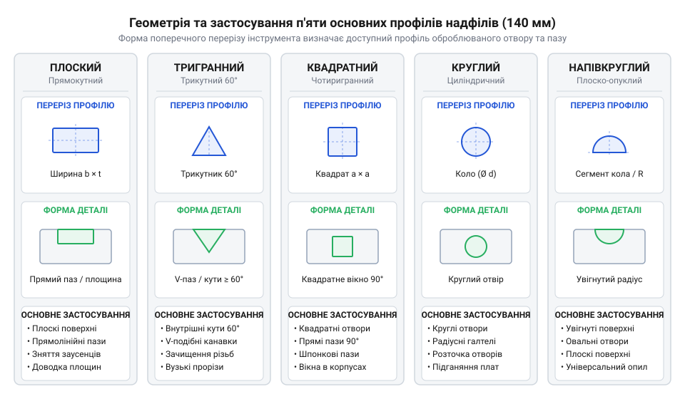
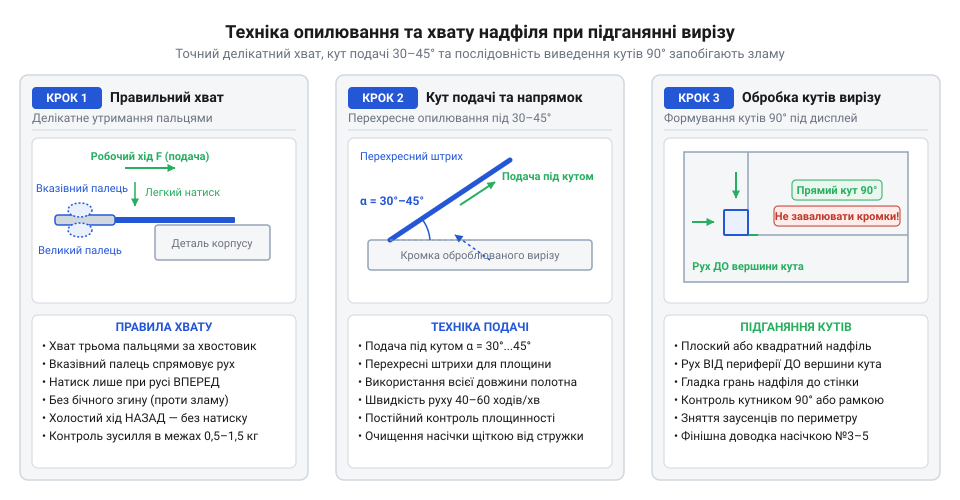

# Надфілі (140 мм)

<preknowlist>
- [Свердла по металу HSS (2.0–8.0 мм)](root:cat-hw-instruments/hss-drill-set) — Принципи попереднього свердління отворів перед їхнім подальшим опилюванням та розширенням надфілями
- [Скальпелі й змінні леза](root:cat-hw-instruments/scalpel-set) — Прийоми попереднього зрізання великих заусенців та розмітки ліній різу на пластикових корпусах
</preknowlist>

## Призначення та геометрія профілів надфілів

Спроба точно вивести прямокутний виріз під екран чи підігнати вузький внутрішній паз звичайним слюсарним напилком неминуче призводить до браку: масивне полотно не здатне увійти в отвір менше 5 мм або обробити гострий кут. Для первинної зрізки заусенців та напливів пластику застосовують [гострий монтажний скальпель](root:cat-hw-instruments/scalpel-set), проте фінішне виведення точних розмірів вимагає спеціалізованого ріжучого інструменту. Для прецизійної обробки деталей використовують надфіль (нім. *Nadelfeile*, від *Nadel* — голка та *Feile* — напилок; @@en|needle file@@) — мініатюрний напилок завдовжки 140 мм з тонким хвостовиком і робочою частиною 60–80 мм. Дрібний переріз дає змогу дозувати натиск пальцями та знімати матеріал мікронними шарами без відколу країв.

Форму робочого профілю обирають за геометрією елемента. Набір із 140-міліметрових надфілів містить п'ять основних профілів:
1. Плоский (@@en|flat needle file@@) — має паралельні робочі площини для опилювання відкритих поверхонь, прямих граней і зовнішніх пазів.
2. Тригранний (@@en|three-square file@@) — рівносторонній трикутник з кутами 60° для виведення гострих внутрішніх кутів.
3. Квадратний (@@en|square needle file@@) — чотири грані з кутами 90° для розточування прямокутних отворів та кутів.
4. Круглий (@@en|round needle file@@) — циліндричний або конічний профіль для калібрування отворів після [попереднього свердлення матеріалу](root:cat-hw-instruments/hss-drill-set) та обробки радіусних жолобів.
5. Напівкруглий (@@en|half-round needle file@@) — поєднує плоску й опуклу грані для опилювання увігнутих поверхонь великого радіуса.

*Конструктивна схема п'яти основних профілів надфілів у поперечному перерізі та їхнє застосування для обробки пазів і отворів.*

## Сталеве карбування та алмазне напилення

Спосіб формування ріжучої поверхні визначає сумісність інструменту з оброблюваним матеріалом. За цією ознакою надфілі поділяють на сталеві з карбувальною насічкою (@@en|steel cut@@) та надфілі з гальванічним алмазним напиленням (@@en|diamond needle file@@).

Сталеві надфілі виготовляють із загартованої інструментальної сталі, а їхні зубці діють як мікрорізці, що зрізають суцільну стружку. За щільністю карбування насічка буває драчовою (№ 0–1, для грубого знімання), особистою (№ 2–3, для точного підганяння) та оксамитовою (№ 4–6, для полірування). Одинарна насічка (під кутом 65°–70°) утворює суцільні кромки й краще відводить м'яку стружку алюмінію, міді чи пластику (ABS, PLA). Подвійна перехресна насічка подрібнює стружку й прискорює обробку сталі.

Алмазні надфілі влаштовані інакше: шар зерен синтетичного алмазу (@@en|diamond grit@@) закріплений на сталевому осерді через нікелеву матрицю (@@en|nickel matrix@@). Вони працюють за принципом мікрошліфування, стираючи матеріал у будь-якому напрямку руху. Сталеві надфілі чудово обробляють м'які й в'язкі метали та пластики, проте на склотекстоліті FR-4 (@@en|printed circuit board@@), склі чи загартованій сталі їхні зубці миттєво затуплюються. Для таких твердих і абразивних матеріалів застосовують виключно алмазний інструмент, забезпечуючи краплинне охолодження водою для захисту матриці від перегріву.

## Техніка підганяння деталей та чищення

Точна обробка вимагає дотримання контрольованого хвату й розподілу зусилля. Інструмент тримають трьома пальцями: вказівний палець лежить на верхній грані біля основання хвостовика (@@en|shoulder@@), спрямовуючи натиск вперед під час робочого ходу (@@en|forward stroke@@). Під час зворотного ходу (@@en|return stroke@@) надфіль повністю розвантажують і злегка піднімають, щоб запобігти зносу зубців або викришуванню алмазного шару. Частота рухів становить 40–60 ходів на хвилину — це запобігає розм'якшенню та налипанню пластику.

Щоб уникнути вібрацій і тріщин, деталь фіксують у лещатах через м'які накладки (@@en|soft jaws@@) із силікону, деревини чи поліуретану. Для формування точних кутів 90° використовують квадратний надфіль із гладкою гранню (без насічки, @@en|safe edge@@), яка захищає вже вирівняну стінку від випадкового поглиблення.

*Покрокова схема правильного хвату, кута подачі надфіля та обробки кутів прямокутного вирізу під дисплей.*

Налиплий м'який метал чи пластик викликає засолювання насічки (@@en|pinning@@). Сталеві надфілі очищають латунною щіткою (@@en|brass brush@@) вздовж канавок або витримують у розчиннику (@@en|acetone@@) чи розчині їдкого натру (@@en|sodium hydroxide@@). Алмазні надфілі миють теплою мильною водою з нейлоновою щіткою. Зберігають набір у м'якому органайзері (@@en|file roll@@) за відносної вологості повітря (@@en|relative humidity@@) до 40–50% із силікагелем (@@en|silica gel@@) для захисту від корозії (@@en|flash rust@@).
