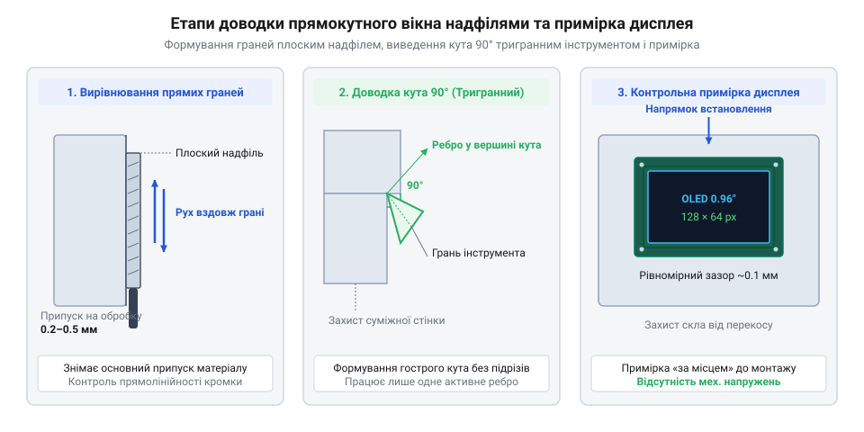

# Підганяння прямокутного вирізу під дисплей у корпусі та зачистка пазів друкованої плати

<preknowlist>
- [Свердла по металу HSS (2.0–8.0 мм)](root:cat-hw-instruments/hss-drill-set) — вибір діаметра та засвердлювання отворів для заведення полотна надфіля
- [Скальпелі й змінні леза](root:cat-hw-instruments/scalpel-set) — техніка первинного підрізання задирок та залишків облою
</preknowlist>

## Проблема геометричних похибок під час монтажу

Установка прямокутного модуля OLED-дисплея на передню панель приладу вимагає високої точності виготовлення посадкового вікна. Намагання вмонтувати тендітний скляний екран у непідготовлений або викривлений отвір призводить до нерівномірного розподілу механічного напруження. При затягуванні кріпильних гвинтів або натисканні на корпус локальний перекіс стінок спричиняє появу мікротріщин на скляній підкладці матриці чи розрив шлейфа виводів.

Концентрація механічних напружень у точках кріплення виникає через високу жорсткість скляної підкладки та відсутність у скла здатності до пластичної деформації. Якщо посадковий контур вирізу має задирки, перекоси граней або відхилення від компланарності, матриця спирається лише на окремі виступаючі ділянки замість рівномірного розподілу зусилля по всьому периметру. Під час затягування гвинтів точкові реактивні сили створюють локальні згинальні моменти, що викликають високі розтягувальні напруження на поверхні скла. Через чутливість крихкого матеріалу до мікродефектів саме в цих точках контакту виникають пікові значення напружень, які перевершують межу міцності й викликають розтріскування скла, а зсувні деформації перекошеного отвору спричиняють механічне відшарування та розрив струмопровідного шлейфа.

Спроби вирізати прямокутне вікно за допомогою невідповідного інструменту — великих слюсарних напилків, зубил чи лез — неминуче викликають дефекти поверхні. На пластикових панелях з ABS або полікарбонату грубий інструмент залишає глибокі подряпини, відколи та завали граней. При обробці алюмінієвих панелей виникають в'язкі задирки (англ. @@en|burr@@), а спроби виламування перемичок викривляють усю площину панелі. Для забезпечення точного посадкового допуску та збереження естетичного вигляду пристрою застосовують набір малогабаритних надфілів (англ. @@en|needle file@@, від німецького @@de|Nadelfeile@@) завдовжки 140 мм із різним номером насічки. Вибір типу насічки визначається властивостями матеріалу: для чорнового зняття припуску на в'язкому алюмінії чи м'якому пластику обирають особисту насічку (№ 2), дрібні канавки якої повільніше забиваються стружкою, а для остаточної чистової доводки граней і виведення кутів застосовують оксамитову насічку (№ 3–6). Оксамитовий надфіль здійснює мікроскопічний знімач матеріалу без ризику утворення тріщин у пластику та дозволяє сформувати строгі прямі кути 90°.

## Розмітка та чернова підготовка вікна

Формування охайного вирізу починається з захисту лицевої поверхні панелі. На ділянку обробки наклеюють смугу малярного скотчу, що запобігає появі подряпин від стружки та струбцин. За допомогою штангенциркуля та твердосплавного кресляра (англ. @@en|scriber@@, від латинського @@la|scribere@@ — писати) на скотч наносять точні контури видимої зони дисплея з урахуванням технічного зазору 0.2–0.3 мм на сторону.

Первинне підрізання залишкових плівок пластику та маркувального скотчу зручно виконувати [скальпелями й змінними лезами](root:cat-hw-instruments/scalpel-set). Для видалення масиву матеріалу всередині розміченого контуру застосовують [свердла по металу HSS](root:cat-hw-instruments/hss-drill-set). Уздовж внутрішніх меж вікна, відступивши 1.0–1.5 мм углиб від лінії розмітки, засвердлюють серію технологічних отворів діаметром 2.5–3.0 мм. Після цього перемички між отворами прорізають бокорізами або виламують, видаляючи центральний сегмент. На панелі залишається черновий отвір із зубчастими краями, підготовлений до чистової обробки надфілями.

Після видалення центральної частини на внутрішніх кромках вікна залишаються гострі задирки (англ. @@en|burr@@) та розплавлені напливи пластику або алюмінієва тирса. Спроба одразу тиснути надфілем по таких виступах призведе до совання інструмента та пошкодження лінії розмітки. Великі задирки та облой спочатку підрізають лезом скальпеля, утримуючи його під кутом 45° до грані, або знімають конічним зенкером (від нім. *Senker* — заглиблювач). Залишкові дрібні ошурки та пил з дна й стінок отвору змахують жорстким пензлем або видувають стисненим повітрям. Тільки після очищення внутрішнього простору від стружки кромки стають доступними для контрольного вимірювання штангенциркулем та чистового опилювання.

## Виведення плоских граней квадратним надфілем

Чистове вирівнювання поздовжніх та поперечних стінок вікна виконують плоским та квадратним надфілями. Інструмент утримують двома руками: черешок спирають на вказівний палець робочої руки, а кінчик полотна легким натиском спрямовують другою рукою. Робочий хід виконують плавно вперед, повністю контролюючи перпендикулярність полотна під кутом 90° до площини панелі.

Під час опилювання важливо уникати завалювання інструменту набік: хитання надфіля під час ходу створює конусність і бочкоподібність граней, через що екран не зможе сісти врівень із поверхнею. Перпендикулярність та площинність обробленої стінки перевіряють візуальним методом на світловий просвіт, прикладаючи вимірювальне лезо штангенциркуля або слюсарний косинець до внутрішньої грані: наявність точкової світлової щілини відразу викриває завали кута чи випуклість. Тактильно рівність поверхні оцінюють повільним проведенням торцевої крайки лінійки вздовж опиляного зрізу. Знімання матеріалу ведуть доти, доки грань не наблизиться впритул до розмічувальної лінії. Плоский надфіль формує гладку площину стінок, однак залишає радіусні заокруглення у кутах вирізу, радіус яких дорівнює товщині інструменту.

## Доводка кутів та контрольна примірка

Для формування прямих внутрішніх кутів 90° застосовують тригранний або квадратний надфіль, ребро якого збігається з вершиною кута.

*Етапи обробки прямокутного вікна включають вирівнювання стінок, виведення гострих кутів 90° та примірку екрана.*

Опилювання кута виконують короткими зворотно-поступальними рухами уздовж ребра, стежачи за тим, щоб суміжні плоскі грані не пошкоджувалися робочими гранями інструменту. Завдяки гострому куту тригранного надфіля радіус заокруглення у вершині зменшується до 0.1 мм, що забезпечує вільне входження прямокутних скляних кутів OLED-модуля.

Для захисту вже вирівняної суміжної стінки від випадкових засічок застосовують інструмент із так званим безпечним ребром (англ. @@en|safe edge@@) — гладенькою гранню без насічки. Фізика цього прийому полягає в тому, що гладке ребро вільно ковзає по готовій поверхні як механічний упор, не знімаючи матеріал, тоді як суміжна робоча грань із карбуванням опилює лише цільову стінку кута. Якщо у стандартному наборі надфілів гладке ребро відсутнє, його виготовляють самостійно, зашліфувавши одну з граней інструмента на дрібнозернистому бруску до повного зняття ріжучих зубців.

Після завершення опилювання виконують контрольне вимірювання штангенциркулем та тестову примірку дисплея «за місцем». Дисплей має входити у вікно вільно, без найменшого зусилля чи заклинювання. Для перевірки симетрії та центрування екрана відносно вирізу на дисплей виводять тестовий програмний шаблон — контурну рамку по крайніх пікселях матриці 128x64 та центральне перехрестя:

:::tabs
== C
:::code proj-custom-enclosure-and-pcb-fitting/c/main.c
:::code proj-custom-enclosure-and-pcb-fitting/c/oled.h
== C++
:::code proj-custom-enclosure-and-pcb-fitting/cpp/main.cpp
:::

Якщо крайній ряд пікселів контурної рамки ховається під краєм вирізу, відповідну грань вікна додатково підганяють плоским надфілем до повного відкриття всієї робочої зони матриці.

## Зачистка пазів та перемичок плати

Окрім підгонки вікон у корпусі, надфілі є незамінними при підготовці друкованих плат до остаточного монтажу. Після мультиплікування та фрезерування на контурі плати зі склотекстоліту FR-4 залишаються виступи технічних перемичок (англ. @@en|mouse-bites@@). Ці шорсткі задирки заважають встановленню плати у направляючі пази приладового корпусу.

Виступи перемичок обережно опилюють плоским надфілем, тримаючи полотно паралельно торцю плати. Для безпечного виконання робіт торці склотекстоліту `FR-4` або полотно інструмента злегка змочують водою чи ізопропіловим спиртом: така волога техніка обробки зв'язує скляні мікроволокна у вологу суспензію, запобігаючи утворенню й поширенню шкідливого пилу в повітрі. Рухи спрямовують уздовж контуру, щоб запобігти відшаруванню мідного фольгування чи пошкодженню крайніх доріжок та паяльної маски (англ. @@en|solder mask@@). Також плоским надфілем знімають легкі фаски `45°` на кутах плати, що полегшує її ковзання у направляючих пазах та унеможливлює заклинювання при збиранні приладу.
