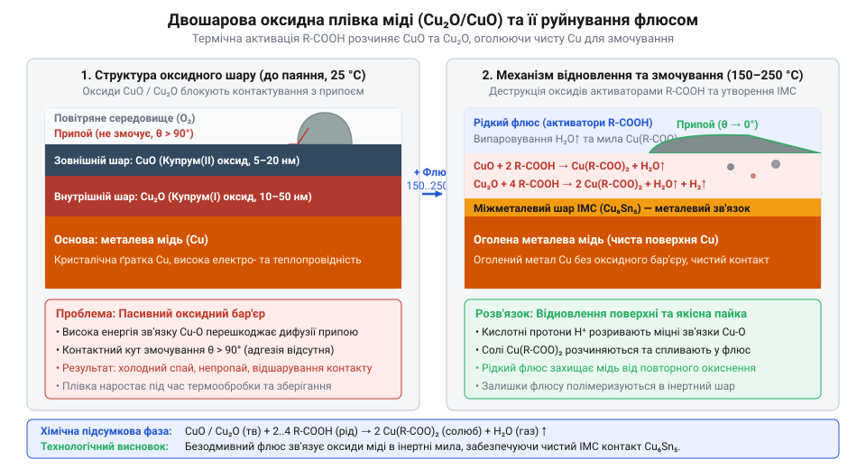
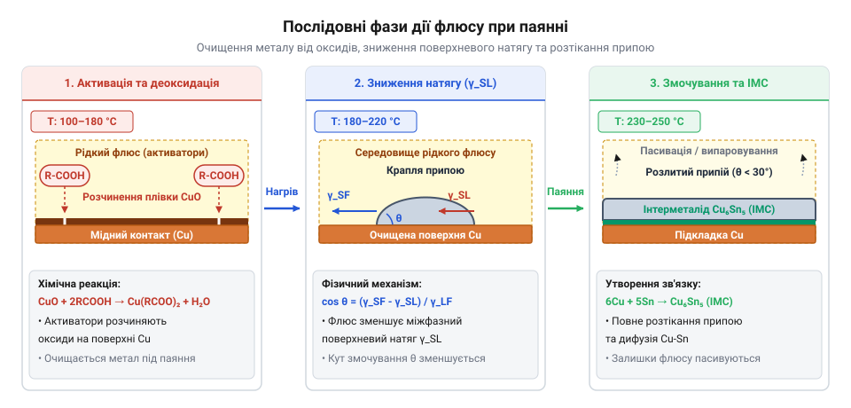
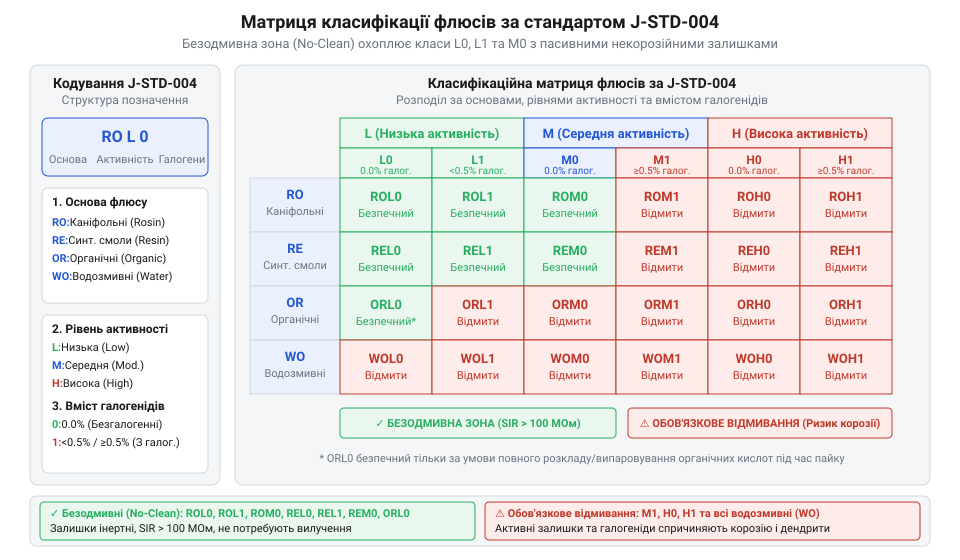
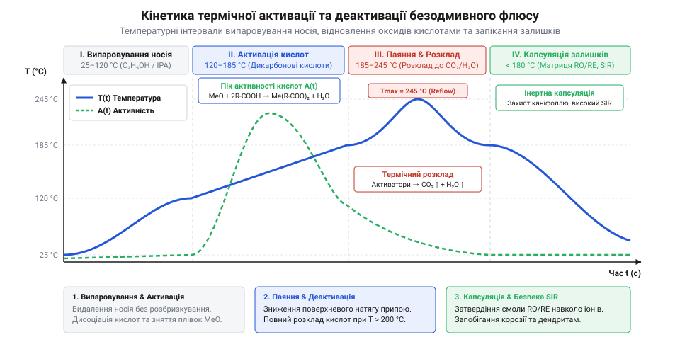
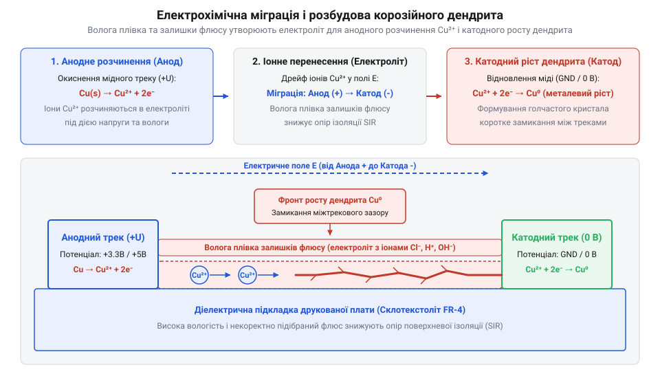

# Хімічна класифікація та механізм дії безвідмивних флюсів (RO, OR, RE)

<preknowlist>
- [Флюси та припої для монтажу електроніки](root:cat-hw-instruments/soldering-fluxes-and-solders) — Базове призначення флюсу у паянні, поняття змочування металів та роль припою у з'єднанні.
- [Властивості та термопрофілі трубчастих припоїв і припайних паст](root:cat-hw-instruments/solder-paste-and-lead-free-alloys-properties) — Структура температурного профілю паяння, температурні зони попереднього нагріву та оплавлення.
- [Флюс FVS-7 (безвідмивний)](root:cat-hw-instruments/flux-fvs7) — Базовий досвід застосування безодмивного рідкого флюсу під час ручного паяння.
</preknowlist>

## Окиснення міді та проблема корозійних залишків

У технології виготовлення та монтажу сучасних електронних вузлів мідь залишається неодмінним базовим матеріалом контактних площадок, міжшарових переходів та провідних доріжок завдяки високій питомій електричній провідності та технологічності. Проте хімічна природа міді робить її вразливою до впливу довкілля: при контакті з киснем повітря навіть за кімнатної температури поверхня металу пасивується, покриваючись тонкою плівкою — @@en|оксид міді@@ (англ. *copper oxide*, від грец. *oxys* — кислий). Цей оксидний шар є неоднорідним і складається з двох послідовних хімічних фаз: безпосередньо на металевій матриці формується первинний оксид міді(I) `Cu₂O` (куприт) з кубічною кристалічною ґраткою, а поверх нього утворюється оксид міді(II) `CuO` (тенарит) моноклінної структури.


*Схема двошарової оксидної плівки Cu2O та CuO на мідному провіднику ілюструє послідовне формування фаз куприту й тенариту та механізм їх руйнування при нагріванні.*

Коли друкований вузол піддається нагріванню під час паяння, швидкість дифузії кисню вглиб металу зростає експоненційно за законом Арреніуса. За лічені секунди перебування при температурі понад 150 °C товщина оксидної плівки збільшується в десятки разів, перетворюючись на суцільний діелектричний бар'єр. Оксиди міді володіють високою енергією міжатомних зв'язків і тануть лише при температурах понад 1200 °C, що робить їх термодинамічно стійкими у робочому діапазоні паяння. Якщо на таку пасивовану поверхню подати розплавлений @@en|припій та олово@@ (англ. *solder*, від лат. *solidare* — зміцнювати), міжатомне з'єднання не виникне взагалі. Рідкий метал має значний поверхневий натяг і не здатний вступити у хімічну взаємодію з оксидною граткою. Внаслідок цього рідкий припій згортається у сферичні краплі й відштовхується від мідного контакту.

Для руйнування та видалення оксидного бар'єра в електронній промисловості тривалий час використовували активні флюсові системи на основі соляної кислоти, хлориду амонію або каніфольних розчинів, збагачених агресивними активаторами. Основними діючими агентами в них виступали @@en|галогеніди@@ (англ. *halides*, від грец. *hals* — сіль) — йонні сполуки хлору `Cl⁻` або брому `Br⁻`. Гідрогенгалогенідні кислоти миттєво вступають у реакцію з оксидами міді, розчиняючи `Cu₂O` та `CuO` з утворенням легкоплавких солей, таких як хлорид міді(II) `CuCl₂`.

Проте застосування галогенідних активаторів породжує важку корозійну проблему. Після закінчення паяльного циклу на поверхні друкованої плати залишаються гігроскопічні продукти реакції та лишки розкладеної кислоти. У присутності навіть мікроскопічної вологості повітря ці солі дисоціюють на вільні йони `Cu²⁺` та `Cl⁻`, формуючи на поверхні текстоліту шар рідкого електроліту. Під дією постійної напруги між сусідніми провідниками починається електрохімічне розчинення міді:

Cu → Cu²⁺ + 2e⁻

Утворені йони міді під дією електричного поля мігрують до негативно зарядженого провідника, викликаючи роз'їдання мідних доріжок, стоншення провідників та катастрофічні витоки струму. У високоомних колах вимірювальної та високочастотної техніки такі залишки знижують опір ізоляції з початкових 10¹² Ом до 10⁶ Ом, що призводить до відмови апаратури. Докладний опис того, як електронна індустрія шукала вихід із цього корозійного глухого кута, наведено в [історії еволюції паяльних флюсів](root:cat-hw-instruments/no-clean-fluxes-chemistry-and-classification/hist-no-clean-flux-evolution.md).

Класичним методом боротьби з сольовою корозією було суворе вологе промивання змонтованих плат. Для цього застосовували промислове [обладнання та хімічні засоби](root:cat-hw-instruments/pcb-post-solder-cleaning-technologies-and-chemistry), де друковані вузли піддавали багаторазовому змиванню гарячою деіонізованою водою або озоноруйнівними фреоновими розчинниками. Однак стрімка мініатюризація електроніки та масове впровадження щільного поверхневого монтажу (SMD) зробили повну відмивку фізично неможливою. Під корпусами мікросхем у виконанні BGA, QFN та при монтажі чіп-компонентів зазори між корпусом і платою скоротилися до 20–50 мікрометрів. Мийний розчин затягується у такі вузькі капіляри за рахунок сил поверхневого натягу, але ефективно вимити звідти розчинені солі та прокачати свіжий розчинник стає технічно нереалізованим завданням.

У результаті вода й залишки солей застрягають у мікрощілинах під компонентами, викликаючи приховану корозію, яка проявляється вже під час експлуатації виробу. До того ж при виконанні ручного монтажу чи ремонтних робіт у польових умовах, коли застосовується портативний [паяльник USB](root:cat-hw-instruments/usb-soldering-iron) або ручний інструмент для [монтажу в отвори](root:cat-hw-instruments/through-hole-soldering-techniques), повноцінне хімічне відмивання плат взагалі недоступне.

Ці технологічні обмеження висунули жорстку вимогу до паяльних матеріалів: виникла потреба у створенні принципово нового класу реагентів, відомого як @@en|безвідмивний флюс@@ (англ. *no-clean flux*, від лат. *fluxus* — потік). Хімічна система такого флюсу повинна володіти високою відновною здатністю під час розігріву для видалення оксидів, але після закінчення паяльного циклу її залишки зобов'язані перетворюватися на абсолютно інертну, тверду, сухододібну матрицю. Ця матриця повинна забезпечувати високий @@en|опір поверхневої ізоляції@@ (англ. *surface insulation resistance*, SIR, від лат. *insula* — острів), не поглинати вологу з повітря, не виділяти вільних йонів і не вимагати видалення з поверхні протягом усього терміну служби виробу, відповідаючи вимогам [класифікації та випробувань](root:cat-hw-instruments/j-std-004-flux-classification-and-testing-methods).

## Фізико-хімічний механізм змочування та відновлення металу

Щоб поєднати ефективне хімічне очищення металу під час розігріву з повною безпекою залишків після охолодження, безодмивний флюс розробляється як термодинамічно керована багатокомпонентна система. Вона складається з трьох ключових функціональних частин: рідкого розчинника, термічно активованого хімічного відновника — @@en|активатор@@ (англ. *activator*, від лат. *activus* — дієвий), та плівкоутворювальної смоляної матриці. Розчинник (найчастіше високочистий ізопропіловий спирт, аліфатичні ефіри або деіонізована вода) слугує для розчинення твердих компонентів та забезпечення низької в'язкості рідкого флюсу. Під час нагрівання друкованої плати на етапі попереднього прогріву (в діапазоні 80–130 °C) розчинник повністю випаровується, залишаючи на контактних площадках суху однорідну плівку з активаторів і смоли.

Основними хімічними відновниками оксидів у безодмивних флюсах виступають слабодисоційовані @@en|дикарбонові кислоти@@ (англ. *dicarboxylic acids*, від грец. *dis* — двічі та *oxys* — кислий) — янтарна `HOOC-(CH₂)₂-COOH`, адипінова `HOOC-(CH₂)₄-COOH`, глутарова або себацинова кислоти. За кімнатної температури ці органічні сполуки перебувають у твердому стані й мають надзвичайно низьку константу дисоціації, тобто не виділяють вільних йонів гідрогену. Однак при досягненні температури активації (130–160 °C) дикарбонові кислоти розплавляються і вступають у хімічну реакцію з оксидами міді `Cu₂O` та `CuO`:

Cu₂O + 2 R-COOH → 2 R-COOCu + H₂O
CuO + 2 R-COOH → R-COO-Cu-OOC-R + H₂O

У результаті цієї взаємодії тверді нерозчинні оксиди перетворюються на металоорганічні солі (мідні мила дикарбонових кислот) та водяну пару, яка безслідно випаровується з зони паяння. Утворені органічні солі міді володіють високою розчинністю в розплавленій смоляній матриці флюсу, завдяки чому вони зв'язуються і виводяться з поверхні контакту, оголюючи ювелірно чисту металеву мідь `Cu`.

Хімічне очищення міді оголює атоми з високою поверхневою енергією, створюючи умови для міжфазного розтікання розплаву припою, наприклад при застосуванні [трубчастих припоїв з флюсом](root:cat-hw-instruments/solder-paste-and-lead-free-alloys-properties). Динаміка формування контакту описується законами @@en|змочування@@ (англ. *wetting*, від давн.-англ. *wǣtan* — зволожувати). *wæt* — вологий). Механічна рівновага міжфазних сил на лінії контакту трьох фаз — твердої мідної підкладки, рідкого припою та рідкого середовища флюсу — визначається рівнянням Юнга:

γ_SV = γ_SL + γ_LV · cos(θ)

де `γ_SV` — поверхнева енергія межі розділу тверда мідь–газ/флюс, `γ_SL` — міжфазний поверхневий натяг на межі тверда мідь–рідкий припій, `γ_LV` — @@en|поверхневий натяг@@ (англ. *surface tension*, від лат. *tensio* — натяг) рідкого припою в середовищі флюсу, а `θ` — @@en|кут змочування@@ (англ. *contact angle*, від лат. *angulus* — кут).

Для аналізу умов розтікання рідкого металу виразимо косинус кута змочування `cos(θ)` з рівняння Юнга:

cos(θ)
= (γ_SV - γ_SL) ÷ γ_LV      [рівняння Юнга для міжфазної рівноваги]

За наявності оксидного шару поверхнева енергія міді `γ_SV` вкрай мала (менш ніж 0.2 Дж/м²), а поверхневий натяг рідкого олова `γ_LV` є дуже високим (~480 мН/м), тому `cos(θ) < 0`, що відповідає куту змочування `θ > 90°` (крапля згортається). Коли безодмивний флюс видаляє оксидний шар, значення `γ_SV` стрибкоподібно зростає до 1.3–1.8 Дж/м². Одночасно поверхнево-активні речовини (ПАР) та розплавлена смола адсорбуються на поверхні розплавленого припою, зменшуючи міжфазні натяги `γ_LV` та `γ_SL`. В результаті `cos(θ)` прямує до 1, а кут змочування `θ` зменшується до значення менше ніж 15°, забезпечуючи миттєве розтікання рідкого металу по мідному контакту.


*Послідовні фізико-хімічні фази дії безодмивного флюсу в процесі паяння мідного контакту.*

За температур паяння (230–260 °C) очищена гаряча мідь вкрай схильна до повторного миттєвого окиснення киснем повітря. Для запобігання цьому розплавлена плівкоутворювальна матриця на основі природної @@en|каніфоль@@ (англ. *rosin*, від грец. *Kolophonia resina* — смола з міста Колофон) — основним компонентом якої є абієтинова кислота `C₁₉H₂₉COOH` — або її модифікованих синтетичних смол створює суцільний гідрофобний бар'єр. Під захистом цього рідкого покриття атоми олова й міді вступають у взаємну дифузію. На межі розділу формується шар з двох фаз — @@en|інтерметалід@@ (англ. *intermetallic*, від лат. *inter* — між та *metallum* — метал): прилеглого до міді шару `Cu₃Sn` (ε-фаза) та поверхневого шару `Cu₆Sn₅` (η-фаза) товщиною 1–3 мкм, які забезпечують високу механічну та електричну міцність паяного шва. Поглиблені обчислення кінетики цих реакцій наведено у [математичних моделях змочування](root:cat-hw-instruments/no-clean-fluxes-chemistry-and-classification/math-flux-surface-chemistry-kinetics.md).

При досягненні пікових температур паяльного профілю відбуваються заключні хімічні перетворення. Дикарбонові кислоти зазнають термодеструкції: наприклад, янтарна кислота під час нагрівання зневоднюється перетворюючись на леткий янтарний ангідрид та водяну пару:

HOOC-(CH₂)₂-COOH → C₄H₄O₃ + H₂O

Леткі продукти розкладу випаровуються, а рештки незадіятих кислот і металоорганічних солей піддаються процесу, який називається @@en|капсуляція@@ (англ. *encapsulation*, від лат. *capsula* — скринька). Під час охолодження смоляна матриця затвердевает, утворюючи тверду, склоподібне, негігроскопічне діелектричне покриття. Вона монолітно запікає всередині себе йони та залишки кислот, унеможливлюючи їхню взаємодію з вологою повітря. Це гарантує високий @@en|опір поверхневої ізоляції@@ (понад 10¹⁰ Ом) та повністю блокує @@en|електрохімічну міграцію@@ (англ. *electrochemical migration*, від грец. *elektron* та лат. *migratio* — переселення) йонів металу протягом усього терміну експлуатації електронного пристрою.

## Класифікація J-STD-004 за основою та активністю

Виробництво надійного електронного вузла вимагає від інженера точного розуміння хімічного складу флюсу та агресивності його залишків після паяння. Для стандартизації цих параметрів міжнародна асоціація @@en|IPC@@ розробила нормативний документ @@en|J-STD-004@@ (від англ. @@en|J-STD-004@@ — стандарт вимог до паяльних флюсів), який замінив застарілі військові специфікації США. Замість спрощеного поділу на «каніфольні» та «кислотні» флюси, сучасне маркування будується на трикомпонентній хімічній матриці: природознавчій основі, рівні корозійної активності та наявності галогенідних промоторів. Для інженерного добору матеріалів використовують нормативні регламенти, наведені у [детальній класифікації J-STD-004](root:cat-hw-instruments/j-std-004-flux-classification-and-testing-methods), яка визначає стандартизовані випробування залишків.

Перша пара літер у маркуванні визначає хімічну природу матриці-носія, яка розчиняє активатори, утримує їх на поверхні та покриває місце паяння:

*   **RO** (від англ. @@en|rosin@@, з лат. @@la|resina@@ — смола) — каніфольна основа, виготовлена на основі натуральної вивареної живиці хвойних дерев. Основним хімічним компонентом каніфолі є абієтинова кислота (`C19H29COOH`) та її структурні ізомери. При кімнатній температурі каніфоль становить тверду, склоподібну масу з низькою гігроскопічністю, яка надійно ізолює хімічні залишки від атмосферної вологи. *   **OR** (від англ. @@en|organic@@, з грец. @@el|organon@@ — інструмент) — органічна основа без вмісту природної каніфолі чи синтетичних смол. Її готують на базі спиртових або гліколевих розчинників із додаванням дикарбонових чи монокарбонових кислот. *   **RE** (від англ. @@en|resin@@, з лат. @@la|resina@@ — смола) — основа на базі синтетичних смол або модифікованих каніфольних ефірів. Вони мають вищу термічну стабільність, ніж природна каніфоль, не темніють при високотемпературному безсвинцевому паянні й забезпечують стабільну термопластичну матрицю. *   **IN** (від англ. @@en|inorganic@@ — неорганічний) — водорозчинна неорганічна або високоактивна основа, залишки якої завжди є гігроскопічними та корозійно небезпечними.

Історичний перехід електронної промисловості до безодмивних хімічних систем прискорився після підписання Монреальського протоколу 1987 року, що детально описано через [еволюцію паяльних флюсів](root:cat-hw-instruments/no-clean-fluxes-chemistry-and-classification/hist-no-clean-flux-evolution.md) та відмову від озоноруйнівних фреонових розчинників. Відмова від масового промивання друкованих плат агресивними хлорфторвуглецевими розчинами змусила розробників хімії створити флюси, залишки яких під дією паяльного тепла деактивуються й не потребують видалення.

Другий елемент маркування вказує на рівень активності залишків флюсу, який оцінюють за трьома лабораторними критеріями: випробуванням на мідне дзеркало, корозією мідного купона та опором поверхневої ізоляції:

*   **L** (від англ. @@en|low@@ — низька активність) — флюс із мінімальною хімічною агресивністю. Під час тесту на мідне дзеркало флюс не розчиняє тонке мідне напилення на склі, а його залишки після паяння демонструють нульову корозійність. *   **M** (від англ. @@en|medium@@ — середня активність) — помірно активний флюс. Може викликати часткове розчинення мідного дзеркала (до 50% площі) або незначну зміну кольору мідної пластини при тривалій витримці у вологій камері. *   **H** (від англ. @@en|high@@ — висока активність) — високоактивний флюс, який інтенсивно знімає товсті оксидні плівки, але повністю розчиняє мідне дзеркало. Його залишки є корозійноагресивними й обов'язково підлягають вимиванню.

Цифра наприкінці коду (0 або 1) показує присутність і кількість галогенідних активаторів (хлоридів, бромідів, фторидів):

*   **0** (від англ. @@en|halide-free@@ — безгалогенідний) — вміст галогенідних іонів у масі сухого залишку флюсу становить менше ніж 0.05% (менше ніж 500 ppm). *   **1** (від англ. @@en|halide-containing@@ — галогенідовмісний) — вміст галогенідів становить 0.05% або більше.


*Матриця класифікації J-STD-004 поділяє флюси за основою (RO, OR, RE, WO), активністю (L, M, H) та галогенідами (0, 1), де зеленим виділено безпечну безодмивну зону.*

Комбінація цих трьох параметрів дає підсумковий код матеріалу, наприклад `ROL0`, `ROM1` або `ORL0`. Безпечна безодмивна зона (англ. @@en|no-clean@@ — без очищення) охоплює насамперед класи **ROL0** та **REL0**. У таких флюсах низька концентрація органічних кислот без додавання галогенідів повністю компенсується капсулювальною здатністю смоляної матриці. Тверда каніфольна або синтетична плівка після охолодження ізолює незреаговані молекули від вологи та кисню. Типовим прикладом спирто-каніфольного хімічного складу з низькою активністю є [безодмивний флюс FVS-7](root:cat-hw-instruments/flux-fvs7), який часто застосовують при ручних паяльних операціях.

Використання флюсів класу **ORL0** як безодмивних вимагає суворого дотримання температурно-часового графіку. Оскільки органічна основа не містить смоли для капсулювання, всі дикарбонові кислоти мусять 100% розкластися або випаруватися під дією високої температури. Якщо внаслідок недогріву на друкованій платі лишаться незреаговані молекули `ORL0`, вони вбиратимуть вологу з повітря, утворюючи струмопровідні іонні розчини.

## Температурне вікно та кінетика деактивації активаторів

Робота безодмивної паяльної системи ґрунтується на суворо контрольованій термічній трансформації її хімічних компонентів уздовж паяльного профілю. Безодмивний флюс не є пасивним захисним покриттям — це динамічна реагентна суміш, яка повинна послідовно виконати зняття оксидів міді, забезпечення змочування припоєм та повну власну деактивацію за обмежений проміжок часу.


*Температурно-часовий профіль розкриває послідовні фази випаровування розчинника, хімічної активації та термічної деактивації безодмивного флюсу.*

Під час проходження технологічного циклу оплавлення флюсова система долає чотири послідовні температурні фази:

1. **Зона випаровування розчинника (80–130 °C).** На стадії попереднього нагріву легкі носії (ізопропіловий спирт чи етиленгліколь) повністю випаровуються. В’язкість флюсу зростає, утворюючи рівномірну плівку на контактних площадках. Якщо підйом температури відбувається занадто швидко (понад 2–3 °C/с), бурхливе кипіння розчинника викликає розбризкування кульок припою та появу мікропор у паяному шві. 2. **Зона хімічної активації (130–180 °C).** При досягненні температури плавлення дикарбонових кислот (глутарової при 95–98 °C, адипінової `HOOC-(CH2)4-COOH` при 152 °C, бурштинової `HOOC-(CH2)2-COOH` при 184 °C) активатори переходять у рідку фазу. Вони активно розчиняють оксидні плівки міді (`Cu2O` та `CuO`). Реакція перетворює нерозчинні оксиди на розчинні органічні солі (карбоксилати міді) та водяну пару:

    ```
    Cu2O + 2 R-COOH -> 2 R-COOCu + H2O
    ```

    Одночасно рідкий флюс знижує поверхневий натяг розплавленого припою на межі розподілу фаз, сприяючи швидкому розтіканню. Швидкість розплавлення та час перебування припою в рідкій фазі тісно пов'язані з [властивостями трубчастих припоїв](root:cat-hw-instruments/solder-paste-and-lead-free-alloys-properties) і безсвинцевих сплавів. 3. **Зона оплавлення та термічної деактивації (215–250 °C).** У піковій зоні оплавлення (англ. @@en|reflow@@) припій повністю розплавляється й реагує з міддю, формуючи інтерметалідний шар `Cu6Sn5`. Для безодмивного флюсу цей температурний інтервал є вирішальним: залишки незреагованих дикарбонових кислот зазнають термічного декарбоксилювання. Карбоксильні групи `-COOH` розпадаються з виділенням вуглекислого газу (`CO2`) та інертних летучих вуглеводнів, які випаровуються з зони паяння. 4. **Зона охолодження та капсулювання.** При зниженні температури розплавлена смоляна матриця затвердіває, перетворюючись на прозорий аморфний полімер. Цей склоподібний шар герметично капсулює (англ. @@en|encapsulation@@, від лат. @@la|capsula@@ — коробочка) дрібні нелетучі солі міді та залишки реагентів, виключаючи їхній контакт з атмосферною вологою.

Математичне моделювання швидкості розкладу дикарбонових кислот залежно від температури спирається на [моделі хімічної кінетики](root:cat-hw-instruments/no-clean-fluxes-chemistry-and-classification/math-flux-surface-chemistry-kinetics.md) та термічного розпаду молекул.

Для розрахунку константи швидкості термічної деструкції активатора `k(T)` застосовують класичне рівняння Арреніуса:

```
k(T) = A · exp(-Ea / (R · T))
= A · e^(-Ea / (R · T))      [залежність швидкості деактивації від температури]
```

Де `A` — передекспоненційний множник (частота соударінь молекул), `Ea` — енергія активації термічного розкладу кислоти (Дж/моль), `R` — універсальна газова стала (8.314 Дж/(моль·К)), а `T` — абсолютна температура в Кельвінах. З рівняння видно: якщо пікова температура `T` є недостатньою, константа швидкості `k(T)` експоненційно падає, внаслідок чого деактивація активатора зупиняється на півшляху.

Порушення розрахованого температурно-часового профілю призводить до двох типових технологічних аварій:

*   **Недогрів (недостатня температура або час витримки).** Якщо пікова температура є нижчою за поріг деструкції (менше ніж 215 °C для безсвинцевих сплавів) або витримка в піку триває менш як 30 секунд, дикарбонові кислоти не встигають розкластися. Вільні карбоксильні групи `-COOH` залишаються хімічно активними й гігроскопічними. Вони вбирають вологу з повітря, викликаючи дисоціацію на іони `H+` та `R-COO-`, що різко знижує опір поверхневої ізоляції (англ. @@en|surface insulation resistance@@, або @@en|SIR@@). *   **Перегрів (перевищення температури або часу).** Якщо температура оплавлення перевищує 260 °C або перебування у гарячій зоні триває понад 90 секунд, відбувається термічна деструкція самої смоляної матриці. Каніфоль обвуглюється, розтріскується й утрачає капсулювальні властивості. Через мікротріщини волога проникає до кислотних залишків.


*Електрохімічна міграція іонів міді між сусідніми провідниками виникає через незадеактивовані залишки флюсу у вологій атмосфері.*

При появі незадеактивованих іонних залишків у вологій атмосфері під дією постійної напруги виникає електрохімічна міграція (англ. @@en|electrochemical migration@@, від грец. @@el|elektron@@ та лат. @@la|migratio@@ — переселення, або @@en|ECM@@). Іони міді `Cu2+` розчиняються на позитивному аноді й під дією електричного поля рухаються до негативного катода, відновлюючись до металу. Це спричиняє [розвиток металевих дендритів](root:cat-hw-instruments/dendritic-growth-in-pcb-assemblies) (від грец. @@el|dendron@@ — дерево) — голчастих ниток, які проростають між провідниками, утворюючи короткі замикання.

Контроль відсутності витоків струму здійснюють шляхом лабораторних випробувань за допомогою [випробувань на опір ізоляції](root:cat-hw-instruments/no-clean-fluxes-chemistry-and-classification/proj-sir-and-residue-verification-testbed.md) у спеціалізованих кліматичних камерах. Грамотне налаштування температурно-часової кривої вимагає глибокої роботи з [оптимізацією паяльного термопрофілю](root:cat-hw-instruments/thermal-profiling-reflow-soldering-optimization) для досягнення повної деактивації активаторів. Якщо ж термопрофіль було порушено й на платі лишилися агресивні недопалені кислоти, виникає потреба скористатися [промивкою друкованих плат](root:cat-hw-instruments/pcb-post-solder-cleaning-technologies-and-chemistry) за допомогою спеціалізованих мийних засобів. Для локального видалення залишків припою та надлишків флюсу під час монтажних робіт застосовують [мідне плетіння](root:cat-hw-instruments/solder-wick) з просоченням.

## Електрохімічна міграція та падіння опору ізоляції

Після завершення паяльного циклу залишки флюсу опиняються в нерухомому стані на поверхні текстоліту між провідними треками та контактами компонентів. У сухому й знеструмленому стані тверда смоляна або каніфольна плівка поводиться як діелектрик і не проявляє хімічної активності. Проблема виникає тоді, коли зібраний вузол потрапляє в реальне середовище з відносною вологістю повітря вище 60–70% і на доріжки подається робоча напруга. Залишки флюсу — навіть ті, що належать до безодмивних класів — завжди містять мікроскопічні домішки гігроскопічних речовин: незв'язані молекули дикарбонових кислот, залишкові галогеніди або їхні металеві солі. Ці сполуки адсорбують водяну пару з навколишнього атмосфери, перетворюючи сухий залишок на тонке мікроскопічне покриття рідкого електроліту. У результаті між двома сусідніми провідниками під напругою виникає повноцінна гальванічна комірка, у якій починаються незворотні електрохімічні руйнівні процеси.

Під дією різниці потенціалів між анодом (провідником із позитивним потенціалом) та катодом (провідником із негативним потенціалом) створюється електричне поле, напрямлене крізь шар зволоженого флюсового залишку. Цей процес називається @@la|електрохімічна міграція@@ (від @@la|chemia@@ — хімія, та @@la|migratio@@ — переселення). На аноді під впливом електричного поля відбуваються реакції окиснення: атоми міді або олова втрачають електрони й переходять у шар електроліту у вигляді позитивно заряджених катіонів `Cu²⁺` або `Sn²⁺`. Катіони металу під дією електричного поля починають дрейфувати від анода в бік негативно зарядженого катода. Досягнувши катода, катіони отримують електрони назад і відновлюються до чистого металу `Cu⁰` чи `Sn⁰`. Проте осадження металу відбувається не у вигляді рівного дзеркального шару, а за принципом вибіркової кристалізації на мікронеровностях катода. На поверхні катода починає виростати голчастий кристалічний пагін — @@la|дендрит@@ (від @@gr|δένδρον@@ — дерево). Детальний хімічний опис процесів перенесення йонної маси металів під дією електричного поля викладено у статті про [механізми росту дендритів](root:cat-hw-instruments/pcb-dendrite-growth-mechanisms).


*Формування кристалічного металевого містка між сусідніми провідниками внаслідок анодного розчинення та катодного відновлення іонів металу.*

Дендритний нитчастий кристал росте назустріч векторному полю — від катода до анода. Швидкість зростання дендрита залежить від величини напруги, товщини плівки вологи та концентрації вільних іонів у залишках флюсу. У той момент, коли вістря дендрита торкається поверхні анода, між провідниками утворюється прямолінійний металевий місток з дуже малим опором. Виникає коротке замикання. Оскільки переріз дендрита становить лише кілька мікрометрів, високий струм короткого замикання миттєво розігріває й випаровує цей металевий місток за лічені мікросекунди. Замикання зникає, опір ізоляції тимчасово відновлюється, але на поверхні диелектрика залишається обвуглений іонізований слід із висадженого металу. При наступному підвищенні вологості процес росту повторюється. Це створює найпідступніший тип несправностей у радіоелектронній апаратурі — спорадичні плаваючі збої, які майже неможливо зафіксувати під час статичного вимірювання за допомогою мультиметра на лабораторному столі.

Стійкість друкованого вузла до описаних явищ оцінюють за показником, який називається @@en|опір поверхневої ізоляції@@ (від @@en|Surface Insulation Resistance@@ — @@en|SIR@@). Величина `R_SIR` вимірюється між двома сусідніми ізольованими провідниками на поверхні друкованої плати. Для чистого, повністю відмитого текстоліту за нормальних умов `R_SIR` перевищує `10¹² Ом` (1 ТГц). Наявність іонних залишків флюсу та вологи призводить до виникнення постійного провідного каналу, крізь який протікає паразитний @@en|струм витоку@@ `I_leak`.

Для розрахунку струму витоку крізь вологу плівку залишків флюсу використовують вираз, що пов'язує геометричні параметри зазору між доріжками та питому іонну провідність:

```
I_leak = U / R_SIR
       = U · σ_ion · (w · h / d)      [закон Ома для поверхневого шару електроліту]
```

де `U` — робоча напруга між провідниками в вольтах, `R_SIR` — опір поверхневої ізоляції в омах, `σ_ion` — питома іонна провідність зволоженого залишку флюсу в сименсах на метр, `w` — довжина паралельного зазору між доріжками в метрах, `h` — товщина зволоженої плівки залишку в метрах, `d` — відстань (зазор) між провідниками в метрах.

З формули випливає прямо пропорційна залежність струму витоку від питомої іонної провідності `σ_ion`. Якщо флюс містить галогеніди або незапломбовані органічні кислоти, значення `σ_ion` зростає на кілька порядків, що призводить до падіння `R_SIR` нижче допустимої межі в `10⁸ Ом`. Щоб завчасно передбачити кінетику виникнення струмів витоку, інженери застосовують [математичні розрахунки кінетики](root:cat-hw-instruments/no-clean-fluxes-chemistry-and-classification/math-flux-surface-chemistry-kinetics.md), які визначають граничні концентрації іонів для безпечної експлуатації.

У високоомних аналогових колах (наприклад, у колах зворотного зв'язку операційних підсилювачів із польовими транзисторами на вході, підсилювачах електрометрів, вимірювальних мостах та електродних датчиках) робочі струми мають порядок пікоампер чи наноампер. Якщо внаслідок зволоження залишків флюсу опір `R_SIR` падає з `10¹¹ Ом` до `10⁸ Ом`, струм витоку `I_leak` досягає мікроамперних значень. Цей паразитний струм стає сумірним або навіть більшим за корисний сигнал кола. В результаті виникає зміщення нульового рівня, дрейф показань датчиків, самозбудження підсилювальних каскадів та незворотна втрата точності вимірювального приладу.

У високочастотних (ВЧ) та надвисокочастотних (НВЧ) трактах залишки флюсу діють не лише як омічний резистор, а як діелектричне покриття з високим рівнем втрат. Безводний текстоліт FR-4 має відносну діелектричну проникність `ε_r ≈ 4.2` та тангенс кута втрат `tg δ ≈ 0.02`. Залишки флюсу, особливо зволожені органічні кислоти та каніфольні смоли, мають значно вищу відносну діелектричну проникність (`ε_r ≈ 3.0...5.5`) та високий тангенс кута втрат (`tg δ > 0.05`). Потрапляння залишків флюсу на мікросмужкові лінії, резонансні контури або міжконтактні зазори високочастотних SMD-компонентів спричиняє:
- Зміну ефективної діелектричної проникності середовища навколо мікросмужка, що призводить до розузгодження хвильового опору `Z₀` та зростання коефіцієнта стоячої хвилі (КСХ). - Додаткове згасання високочастотного сигналу через високі діелектричні втрати в шарі флюсу. - Розстроювання високодобротних фільтрів та задавальних генераторів за рахунок додавання паразитної поверхневої ємності `C_par`.

Для запобігання цим явищам у серійному виробництві кожен новий склад безодмивного флюсу піддають суворим лабораторним випробуванням. Інженери здійснюють [практичні випробування на опір SIR](root:cat-hw-instruments/no-clean-fluxes-chemistry-and-classification/proj-sir-and-residue-verification-testbed.md) на спеціальних тестових платах IPC-B-24 у кліматичних камерах протягом 168–500 годин при температурі 85 °C та відносній вологості 85% під постійною напругою зміщення.

## Критерії вибору та випадки примусового відмивання

Вибір безодмивного флюсу для конкретного монтажного процесу — це компроміс між технологічністю паяння та довготривалою надійністю готового виробу. Головним орієнтиром при виборі є класи надійності електронних модулів згідно зі стандартами IPC. За стандартом IPC-A-610 уся електроніка поділяється на три класи:
- **IPC Class 1 (загальна електроніка):** побутові прилади, іграшки, дешева споживча техніка з коротким терміном служби, де відмова виробу не становить критичного ризику. - **IPC Class 2 (сервісна та промислова техніка):** телекомунікаційне обладнання, комп'ютери, вимірювальні прилади, промислові контролери, де вимагається тривалий термін експлуатації без збоїв. - **IPC Class 3 (обладнання високої надійності):** медична техніка життєзабезпечення, авіоніка, військові системи, автомобільна електроніка безпеки, де відмова модуля може призвести до загрози життю або катастрофічних збитків.

Для виробів Class 1 допускається застосування широкого спектра безодмивних флюсів типів `ROL0`, `REL0` та `ORL0` без додаткових обмежень. Для Class 2 обов'язковим є використання флюсів із повністю нульовим вмістом галогенідів (`0.0%` галогенів за тестами розтріскування), що відповідають вимогам [стандарту J-STD-004](root:cat-hw-instruments/j-std-004-flux-classification-and-testing-methods). Для Class 3 залишати будь-які залишки флюсу на платі заборонено або дозволено лише за умови проходження розширеного комплексу випробувань SIR та вимірювання іонного забруднення.

Окрім класу надійності, тип флюсу добирають залежно від способу паяння та теплоємності плати. У разі використання автоматичного оплавлення припайних паст у багатозонних конвеєрних печах забезпечується суворе дотримання температурного профілю. За цих умов ідеально працюють флюси на основі синтетичних смол (`REL0`) та модифікованої каніфолі (`ROL0`). Їхні смоляні залишки після проходження зони оплавлення полімеризуються та утворюють тверду гідрофобну капсулу, яка надійно ізолює деактивовані залишки кислот від контакту з вологою. 

Якщо ж застосовується безканіфольний органічний флюс типу `ORL0` (на водоспиртовій або водній основі), його активатори повністю випаровуються й розкладаються на летючі гази лише при суворому витримуванні зони активації (`150–180 °C`). Якщо ж монтаж виконується вручну із застосуванням [портативних USB-паяльників](root:cat-hw-instruments/usb-soldering-iron) або [паяльних станцій гарячого повітря](root:cat-hw-instruments/hot-air-station-baku), виникає високий ризик недогріву рідкого флюсу на периферійних ділянках плати, що залишає небезпечні рідкі кислотні залишки.


*Послідовність оцінки критеріїв надійності, типу схеми та умов монтажу для прийняття рішення про примусове відмивання залишків.*

Маркування «безодмивний» (@@en|no-clean@@) у специфікації флюсу не є абсолютним дозволом залишати залишки на будь-якій платі. Існує п'ять чітко визначених інженерних винятків, коли відмивання залишків є обов'язковим незалежно від класу флюсу:

1. **Високочастотні (ВЧ/НВЧ) та високоомні прецизійні кола:** Як було доведено, навіть деактивовані каніфольні залишки мають відносну діелектричну проникність `ε_r ≈ 3.0` і виникають додаткові паразитні ємності та діелектричні втрати, які неприпустимі у ВЧ-трактах та електрометричних схемах. 2. **Нанесення конформного захисного покриття (лакування):** Якщо плата після паяння має покриватися вологозахисним акриловим, силіконовим або поліуретановим лаком, залишки флюсу різко знижують поверхневу енергію текстоліту. Лак втрачає адгезію до плати, утворюючи кратери, бульбашки та відшарування. Під відшарованими ділянками лаку накопичується волога, спричиняючи підлакову корозію. 3. **Оптичні датчики, електромеханічні реле та відкриті контакти:** Випари флюсу під час паяння або розбризкані мікрокраплі осідають на оптичних лінзах фотодіодів, фототранзисторів, відкритих контактних групах реле та мікроперемикачів, утворюючи високоелементну ізоляційну плівку, що викликає відмову контактів. 4. **Високовольтні вузли з напругою понад 100 В:** Під дією високої напруги на поверхні зволоженого залишку флюсу виникає висока напруженість електричного поля, що спричиняє поверхневе дугоутворення, пробій ізоляції та обвуглення текстоліту. 5. **Недотримання термопрофілю або ручний монтаж рідким флюсом:** Якщо під час ремонтних робіт чи допаювання THT-компонентів [безпечний безодмивний флюс FVS-7](root:cat-hw-instruments/flux-fvs7) розтікся по холодній ділянці плати й не прогрівся вище `150 °C`, активатори залишаються в хімічно агресивному стані і підлягають обов'язковому змиванню. Особливості хімічної сумісності залишків з лаками та технології їх нанесення описано в статті про [конформні покриття друкованих плат](root:cat-hw-instruments/conformal-coating-pcb-application-methods). Правила проектування безпечних зазорів і захисту від дугового трекінгу розглянуто в матеріалі про [високовольтні зазори та шляхи витоку](root:cat-hw-instruments/high-voltage-pcb-creepage-and-clearance).

Для видалення залишків флюсу у випадках, коли відмивання є обов'язковим, застосовують спеціалізовані [хімічні засоби відмивання плат](root:cat-hw-instruments/pcb-post-solder-cleaning-technologies-and-chemistry). Для каніфольних залишків `RO` та смоляних `RE` використовують промивні рідини на основі модифікованих спиртів чи промислових розчинників у струминних мийках або ультразвукових ваннах. Для органічних флюсів `OR` застосовують деіонізовану воду зі спеціальними опонентними промивними добавками. 

Історичні причини переходу від жорстких вимивних систем до безодмивних розкрито в хроніці [еволюції паяльних флюсів](root:cat-hw-instruments/no-clean-fluxes-chemistry-and-classification/hist-no-clean-flux-evolution.md). Для досягнення стабільного результату без необхідності відмивання ключовим завданням технологічної служби є [будівництво термопрофілю паяння](root:cat-hw-instruments/thermal-profiling-reflow-soldering-optimization), яке забезпечує повний розклад активаторів. Контроль чистоти після відмивання чи паяння здійснюють за допомогою [оптичного мікроскопа](root:cat-hw-instruments/optical-microscope-soldering) під збільшенням 10х–40х, а також шляхом лабораторного вимірювання іонного забруднення (метод ROSE).