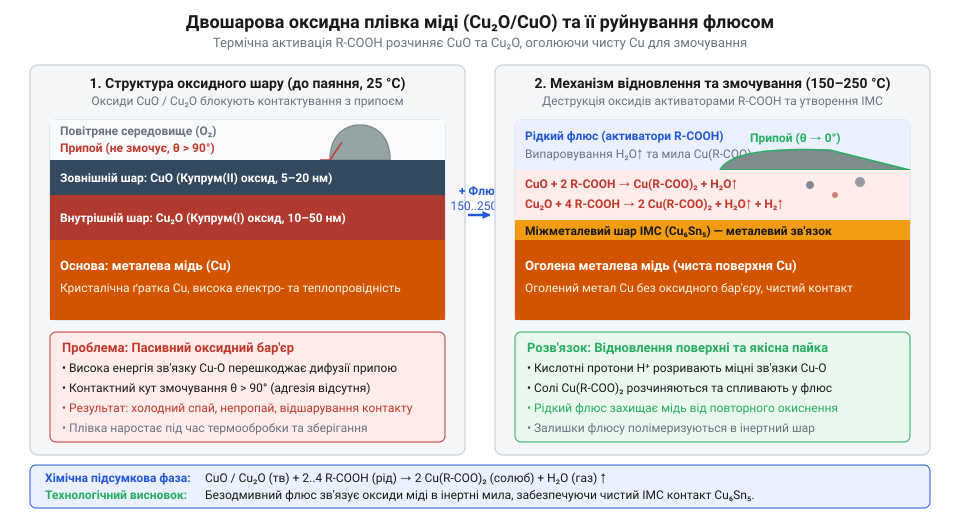
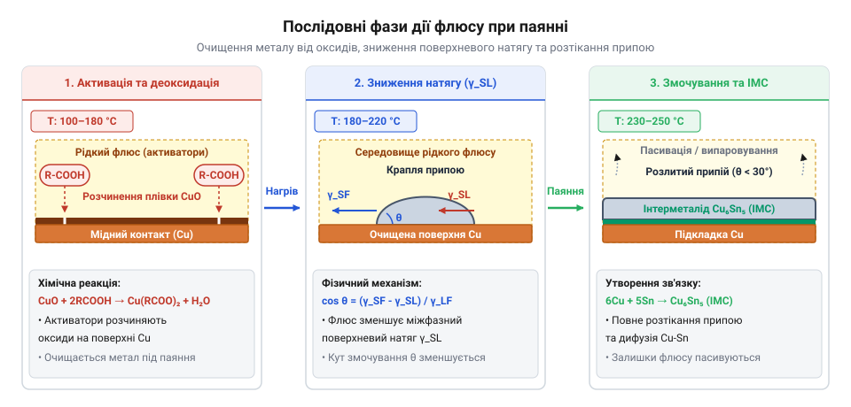
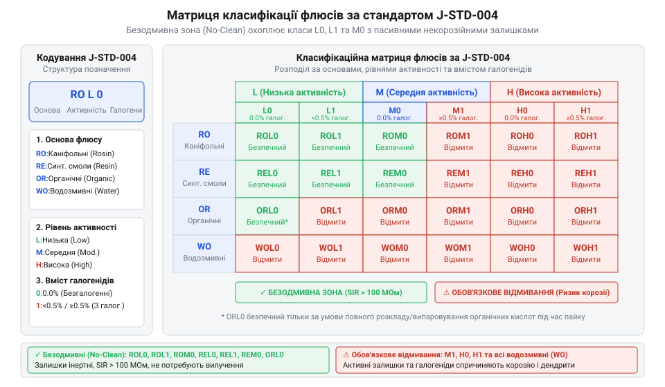
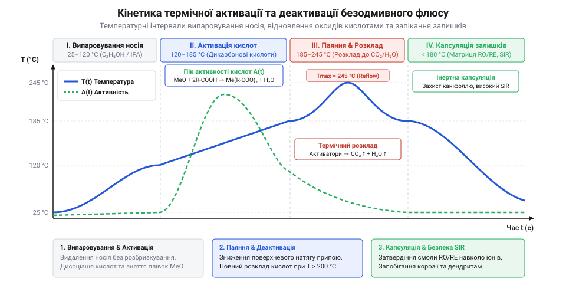

# Хімічна класифікація та механізм дії безвідмивних флюсів (RO, OR, RE)

<preknowlist>
- [Флюси та припої для монтажу електроніки](root:cat-hw-instruments/soldering-fluxes-and-solders) — базове призначення флюсу у паянні, поняття змочування металів та роль припою у з'єднанні
- [Властивості та термопрофілі трубчастих припоїв і припайних паст](root:cat-hw-instruments/solder-paste-and-lead-free-alloys-properties) — структура температурного профілю паяння, температурні зони попереднього нагріву та оплавлення
- [Флюс FVS-7 (безвідмивний)](root:cat-hw-instruments/flux-fvs7) — базовий досвід застосування безодмивного рідкого флюсу під час ручного паяння
</preknowlist>

## Окиснення міді та корозійні залишки

Під час атмосферного паяння друкованих вузлів оголена поверхня мідних контактних майданчиків миттєво реагує з киснем повітря при підвищеній температурі. На поверхні металу формується двошарова оксидна плівка, що складається з внутрішнього щільного шару куприту `Cu₂O` (оксиду міді(I)) та зовнішнього пухкого шару тенариту `CuO` (оксиду міді(II)). Цей діелектричний шар створює фізичний бар'єр, який блокує безпосередній атомний контакт між розплавленим припоєм і мідним провідником, абсолютно унеможливлюючи [змочування припоєм контактів](root:cat-hw-instruments/solder-paste-and-lead-free-alloys-properties).


*Двошарова структура оксидної плівки міді та утворення корозійнонебезпечних солей під дією галогенідних реагентів.*

Традиційний підхід до розчинення хімічно стійких оксидів полягав у застосуванні водорозчинних або спиртових флюсів із високою концентрацією галогенідних активаторів на основі іонів хлору `Cl⁻` та брому `Br⁻`. Незважаючи на високу швидкість очищення металу, агресивні іони галогенів реагують із міддю з утворенням гігроскопічних солей — хлориду міді `CuCl₂` та броміду міді `CuBr₂`. Вони активно адсорбують вологу з навколишнього середовища, викликаючи точкову корозію та хімічне руйнування провідників. Крім того, такі залишки випадають у вигляді сольових відкладень у мікроскопічних капілярних зазорах між корпусом SMD-компонентів та поверхнею друкованої плати, звідки їх практично неможливо видалити навіть за умов інтенсивного [відмивання друкованих плат](root:cat-hw-instruments/pcb-post-solder-cleaning-technologies-and-chemistry).

Усунення загрози прихованої сольової корозії без ускладнення технологічного циклу вимагало розробки реагентів із принципово іншим хімічним механізмом дії. Так виник @@en|безвідмивний флюс@@ (англ. @@en|no-clean flux@@, від лат. @@la|fluxus@@ — течія), сформований на основі слабких органічних кислот та смоляної матриці, тверді залишки якого після проходження нормативного температурного профілю не мають корозійної активності та не потребують примусового змивання.

## Механізм змочування та відновлення металу

Хімічна дія @@en|безвідмивного флюсу@@ базується на аліфатичних дикарбонових кислотах (від грец. @@el|dis@@ — двічі та лат. @@la|carbo@@ — вугілля): адипіновій `HOOC(CH₂)₄COOH`, бурштиновій `HOOC(CH₂)₂COOH` та глутаровій `HOOC(CH₂)₃COOH`. При 130–160 °C розплавлені кислоти нейтралізують оксиди міді з утворенням нестабільних дикарбоксилатів міді та пари води.

Очищення міді змінює міжфазну енергетику в системі, забезпечуючи [змочування припоєм контактів](root:cat-hw-instruments/solder-paste-and-lead-free-alloys-properties) та зменшення крайового кута змочування `θ`. Для розрахунку `cos(θ)` за поверхневою енергією меж розділу фаз застосовують рівняння Юнга:

```
γ_SV = γ_SL + γ_LV × cos(θ)      [рівняння міжфазної рівноваги Юнга]
= γ_SL + γ_LV × cos(θ)           [баланс поверхневих натягів фаз]
cos(θ) = (γ_SV - γ_SL) / γ_LV    [розрахунок косинуса кута змочування]
```

Тут `γ_SV` — питома енергія межі метал-газ, `γ_SL` — межі метал-припій, `γ_LV` — межі припій-флюс. Видалення оксиду підвищує `γ_SV`, а компоненти флюсу знижують `γ_LV`. Отже, `cos(θ)` прямує до 1, а кут `θ` зменшується до <15–20°, що забезпечує розтікання припою та формування інтерметаліду `Cu₆Sn₅`.


*Фізико-хімічні фази розчинення оксидного шару дикарбоновими кислотами, зміна кута змочування та формування інтерметаліду Cu6Sn5.*

Очищену мідь захищає каніфольна (англ. @@en|rosin@@, від лат. @@la|resina@@ — смола) або синтетична матриця. Молекули абієтинової кислоти `C₁₉H₂₉COOH` блокують доступ кисню, а при охолодженні смола твердне, капсулюючи залишки активаторів у негігроскопічний діелектричний матрикс.

## Класифікація J-STD-004 за основою та активністю

Для стандартизації матеріалів та точного передбачення безпечності їхніх залишків використовується класифікаційна матриця міжнародного стандарту @@en|J-STD-004@@, розробленого асоціацією @@en|IPC@@ (англ. @@en|Institute for Printed Circuits@@). Цей норматив групує паяльні флюси за трьома ключовими критеріями: хімічною основою, рівнем корозійної активності та наявністю галогенідів.

Коди хімічної основи поділяються на три основні групи:
1. `RO` (англ. @@en|Rosin@@) — природна каніфоль, отримана з смоли хвойних дерев. 2. `OR` (англ. @@en|Organic@@) — органічна основа на базі водорозчинних або спирторозчинних сполук без вмісту каніфольних смол. 3. `RE` (англ. @@en|Resin@@) — модифіковані або повністю синтетичні смоли, що мають підвищену термостійкість та прозорість.


*Класифікаційна матриця стандарту J-STD-004 за хімічною основою, активністю та вмістом галогенів.*

Рівень активності флюсу позначається літерами `L` (англ. @@en|Low@@ — низька), `M` (англ. @@en|Moderate@@ — середня) та `H` (англ. @@en|High@@ — висока). Останній символ коду вказує на наявність або відсутність галогенідів: `0` означає масовий вміст галогенідів менше 0.05% (що вважається відсутністю галогенідів), а `1` свідчить про вміст галогенідів понад 0.05%.

Згідно з вимогами [класифікації J-STD-004](root:cat-hw-instruments/j-std-004-flux-classification-and-testing-methods), статус справді безодмивних матеріалів гарантується для класів **ROL0** та **REL0**. Вони містять мінімальну кількість слабоорганічних кислот і повністю позбавлені галогенідів. Типовим прикладом рідкого реагенту цього класу є склад на основі [безодмивного флюсу FVS-7](root:cat-hw-instruments/flux-fvs7), залишків якого після паяння не потрібно видаляти із сухої поверхні плати. Флюси класів ROL1, ORL0 або ROM0 за певних умов також можуть вважатися безодмивними, проте вимагають суворого дотримання температурного профілю деактивації.

## Температурне вікно та кінетика деактивації

Дія @@en|безвідмивного флюсу@@ розгортається у трьох фазах: випаровування розчинника (100–130 °C), розчинення оксидів міді дикарбоновими кислотами (130–160 °C) та їх @@en|декарбоксилювання@@ у піку оплавлення (217–245 °C) до `CO₂`, `H₂O` й вуглеводнів.

Швидкість `k` розкладу описує @@en|закон кінетики Арреніуса@@:

```
k = A × exp(-E_a / (R × T))      [закон кінетики Арреніуса]
```

Тут `A` — передекспоненційний множник, `E_a` — енергія активації, `R` — газова стала (8.314 Дж/(моль·К)), `T` — температура в Кельвінах.


*Фази температурного профілю та кінетика термодеактивації активаторів під час паяння.*

Недогрів блокує @@en|декарбоксилювання@@ з ризиком корозії, а перегрів понад 260 °C зумовлює карбонізацію смоли й струмопровідні плями. Запобігти цьому дозволяє [оптимізація паяльного термопрофілю](root:cat-hw-instruments/thermal-profiling-reflow-soldering-optimization).

## Електрохімічна міграція та опір ізоляції

Якщо залишки @@en|безодмивного флюсу@@ не пройшли повного циклу деактивації або зазнали зволоження в умовах високої відносної вологості (понад 85%), вони стають причиною спорадичних відмов електронного вузла. Незадеактивовані дикарбонові кислоти утворюють тонкий гідрофільний шар, який адсорбує атмосферну воду з формуванням рідкої електролітичної плівки між сусідніми провідниками.

Під дією постійної електричної напруги в цьому електроліті розгортається процес @@en|електрохімічної міграції@@ (англ. @@en|electrochemical migration@@, @@en|ECM@@, від грец. @@el|elektron@@ — бурштин та лат. @@la|migratio@@ — переселення). На позитивно зарядженому аноді відбувається анодне розчинення міді:

```
Cu → Cu²⁺ + 2e⁻                  [анодне окиснення міді]
```

Гідратовані іони міді `Cu²⁺` під дією градієнта електричного поля мігрують крізь шар зволоженого залишку до негативно зарядженого катода. На катоді відбувається зворотне відновлення металу:

```
Cu²⁺ + 2e⁻ → Cu                  [катодне відновлення міді]
```


*Електрохімічний механізм формування іонів міді на аноді та катодного росту дендритних ниток.*

Осаджена мідь виростає з катода у напрямку анода у вигляді мікроскопічних кристалічних ниток згідно з [механізмами росту дендритів](root:cat-hw-instruments/pcb-dendrite-growth-mechanisms). Коли дендрит замикає міжелектродний зазор, виникає коротке замикання або різке падіння показнику @@en|опору поверхневої ізоляції@@ (англ. @@en|surface insulation resistance@@, @@en|SIR@@). Величина @@en|SIR@@ падає з номінальних 10¹² Ом до менш ніж 10⁶ Ом, що унеможливлює роботу високоомних кіл. Для перевірки стійкості матеріалів проводять серію [випробувань опору ізоляції](root:cat-hw-instruments/no-clean-fluxes-chemistry-and-classification/proj-sir-and-residue-verification-testbed) у кліматичних камерах під напругою.

## Критерії вибору та примусове відмивання

Добір маркування @@en|безодмивного флюсу@@ виконується з урахуванням класів надійності готових виробів відповідно до специфікацій асоціації @@en|IPC@@:
- **IPC Class 1** (загальна побутова електроніка): допускає залишення залишків більшості безодмивних флюсів класів ROL0, REL0 та ORL0. - **IPC Class 2** (промислова та телекомунікаційна апаратура): вимагає застосування строго сухих негігроскопічних складів ROL0 або REL0 із проведенням випробувань @@en|SIR@@. - **IPC Class 3** (критична електроніка: медичне, авіаційне та військове обладнання): передбачає обов'язковий суворий контроль залишків і часто вимагає примусового видалення навіть безодмивних матеріалів.

Маркування «безодмивний» є технологічною характеристикою залишків за умов стандартної експлуатації, а не універсальним дозволом залишати речовину на будь-якому друкованому вузлі.


*Дерево рішень для оцінки умов експлуатації та прийняття рішення про примусове відмивання залишків.*

Існує низка технологічних винятків, які вимагають обов'язкового примусового видалення залишків безодмивного флюсу:
1. **Високочастотні (ВЧ) та надвисокочастотні (НВЧ) тракти**: твердий залишок смоли має відносну діелектричну проникність `ε_r ≈ 2.5–3.2`, що викликає зміщення ємності мікросмужкових ліній та паразитне згасання сигналу на частотах понад 1 ГГц. 2. **Нанесення захисту**: залишки флюсу перешкоджають адгезії під час нанесення [конформних захисних покриттів](root:cat-hw-instruments/conformal-coating-pcb-application-methods), викликаючи відшарування лаку. 3. **Високовольтні кола та відкриті контакти**: ризик виникнення дугового пробою та забруднення контактних груп реле чи перемикачів.

Під час ручного монтажу чи локального ремонту надлишок твердого залишку флюсу прибирають шляхом видалення за допомогою [видалення залишків припою](root:cat-hw-instruments/solder-wick) та промивання ізопропіловим спиртом з подальшим здійсненням [контролю під мікроскопом](root:cat-hw-instruments/optical-microscope-soldering).