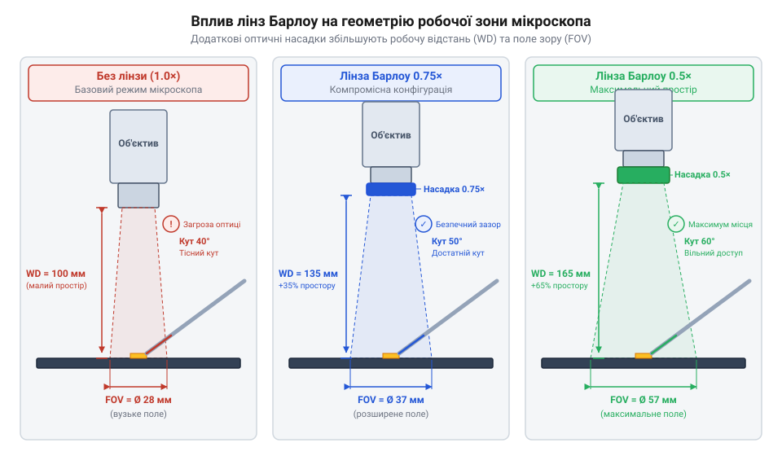
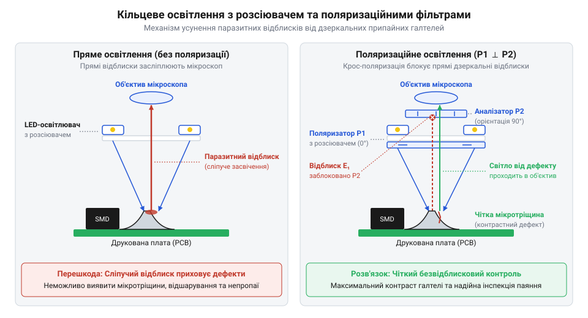
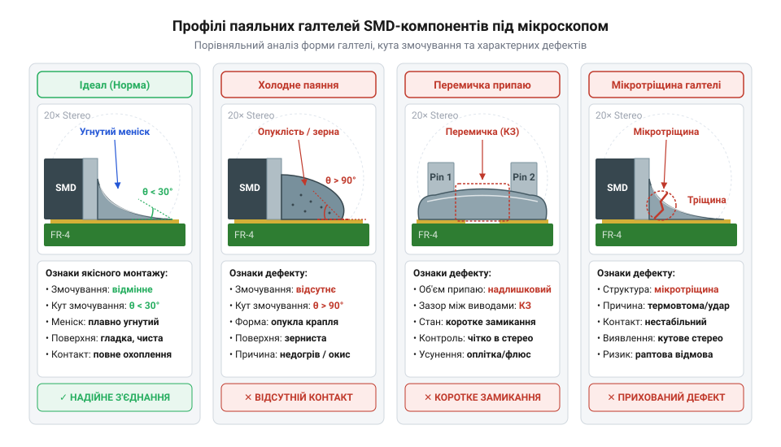

# Оптичний мікроскоп для паяння

<preknowlist>
- [Паяльні флюси та пасти для монтажу гарячим повітрям](root:cat-hw-instruments/smd-soldering-fluxes-and-pastes) — особливості формування галтелей та вигляду залишкового флюсу під час поверхневого монтажу
- [Властивості та термопрофілі трубчастих припоїв і припайних паст](root:cat-hw-instruments/solder-paste-and-lead-free-alloys-properties) — зовнішній вигляд та поверхневий натяг припайного сплаву в оплавленому стані
- [Антистатичний захист (ESD) при паянні чутливих компонентів](root:cat-hw-instruments/esd-safe-soldering-practices) — вимоги до заземлення та антистатичного виконання оптичних приладів під час роботи з чутливими напівпровідниками
</preknowlist>

## Обмеження зору при дрібному паянні

Зоровий апарат людини у найкращих оптичних умовах — на відстані робітничого зору `25 см` при освітленості `500–1000 lx` — має фізичну межу кутової роздільної здатності близько `1'` (однієї мінути). Це відповідає мінімальній відстані між двома помітними точками близько `0.07–0.10 мм` (`70–100 мкм`). У сучасній мікроелектроніці стандартні пасивні компоненти типорозміру 0402 мають фізичні габарити `1.0 × 0.5 мм`, а площа одного контактного виводу становить всього `0.25 × 0.5 мм`. Корпуси мікросхем типу @@en|QFN@@ (від англ. @@en|Quad Flat No-leads@@ — плоский квадратний корпус без виводів) або @@en|BGA@@ (від англ. @@en|Ball Grid Array@@ — масив кулькових виводів) мають крок між виводами `0.4–0.5 мм`, причому самі контактні площадки приховані під нижньою площиною корпусу або розташовані на товщині зрізу менше `0.15 мм`. При намаганні проконтролювати [поверхневий монтаж дрібних](root:cat-hw-instruments/smd-soldering-fluxes-and-pastes) компонентів неозброєним оком, контактний майданчик займає лише кілька фоторецепторів сітківки. Монтажник бачить лише загальну пляму [припаю](root:cat-hw-instruments/solder-tin), але спроможність оцінити якість формування метилевої галтелі — наявність увігнутого меніска змочування, появу мікропорожнеч, недопаїв чи мікроперемичок розплаву товщиною `10–20 мкм` — втрачається повністю.

Намагання вирішити проблему недостатнього збільшення за допомогою звичайної настільної лупи чи бінокулярного підсилювача з єдиною плоскою лінзою створює хибне враження комфорту. Звичайна лупа проектує на обидва ока майже ідентичні зображення з єдиного кута зору, позбавляючи зоровий апарат людини @@gr|стереоскопічного@@ (від грец. @@gr|стереоскопія@@: @@gr|stereos@@ — об'ємний, тілесний та @@gr|skopeo@@ — розглядаю) ефекту. При бінокулярному сприйнятті без збільшення око вимірює відстані та оцінює тривимірну форму за рахунок @@la|конвергенції@@ (від лат. @@la|convergo@@ — зближую) зорових осей та паралаксу. Дивлячись крізь плоску лінзу лупи, монтажник втрачає відчуття глибини поля. Сплав [олова та припайних матеріалів](root:cat-hw-instruments/solder-paste-and-lead-free-alloys-properties) виглядає плоскою блискучою плямою. Внаслідок цього неможливо візуально визначити, чи залипнув припай під корпус QFN, чи утворився піднятий вивід поверхневого компонента — феномен @@en|tombstoning@@ (від англ. @@en|tombstone@@ — надгробний камінь; вертикальне підняття одного кінця @@en|SMD@@-компонента через нерівномірний поверхневий натяг розплаву), або чи є між сусідніми ніжками мікроперемичка, схована в тіні корпусу.

Друга фундаментальна перешкода оптичних луп високої оптичної сили — це різке скорочення робочої відстані (фокусної відстані від нижньої поверхні лінзи до поверхні друкованої плати). Збільшення оптичної сили лінзи до `+8D` або `+12D` (що відповідає збільшенню `3×–4×`) зменшує робочу відстань до `8–10 см`, а при збільшенні `8×–10×` фокусна відстань падає до критичних `3–5 см`. У такий стиснутий простір фізично неможливо позиціонувати робочі інструменти: жало [USB-паяльника з регулюванням](root:cat-hw-instruments/usb-soldering-iron), сопло [термоповітряної паяльної станції](root:cat-hw-instruments/hot-air-station-baku) BAKU або стрічку [мідного плетіння для видалення припаю](root:cat-hw-instruments/solder-wick). Монтажник змушений тримати паяльний інструмент під критично гострим кутом до плати, що призводить до випадкового торкання гарячим жалом пластикових лінз лупи, обпікання корпусу приладу гарячим повітрям [термофена BAKU](root:cat-hw-instruments/baku-hot-air-stations-family) та затінення зони паяння самим інструментом.

Прості сферичні лінзи луп спричиняють високий рівень оптичних спотворень: хроматичну @@la|аберацію@@ (від лат. @@la|aberratio@@ — відхилення) — колірне розщеплення світла на межах контрастних контактів, та геометричну @@la|дисторсію@@ (від лат. @@la|distorsio@@ — викручування, спотворення), коли зображення по краях поля зору викривляється за формою подушки чи бочки. Під час тривалої маніпуляційної роботи війкові м'язи ока перебувають у стані постійного напруження, намагаючись компенсувати спотворення фокальної площини — відбувається процес @@la|акомодації@@ (від лат. @@la|accommodatio@@ — пристосування). Через 20–30 хвилин такої роботи виникає зоровий спазм, різь в очах, головний біль та зниження точності позиціонування жала паяльника. Детальні правила [захисту зору та комфортної](root:cat-hw-instruments/ergonomics-and-vision-protection-soldering) організації робочого місця висувають чітку вимогу: для маніпуляцій із мікроелектронікою необхідна оптична система з високим виносом зіниці, компенсацією аберацій та строго збереженим стереоскопічним базисом.

Для вирішення технологічних задач монтажу та інспекції в сучасній електроніці формуються наступні критерії до оптичного приладу:

1. Наявність двох окремих оптичних каналів із незалежним формуванням зображення під кутом конвергенції для збереження повноцінного стереоефекту. 2. Велика робоча відстань (не менше `100–110 мм` у базовій конфігурації) для вільного розміщення термофена, паяльника та системи підсвічування. 3. Глибина різко зображуваного простору (@@en|ГРЗП@@, від англ. @@en|depth of field@@) в межах `1–3 мм`, що дозволяє одночасно бачити контактний майданчик плати та верхню площину корпусу компонента. 4. Можливість плавної зміни збільшення (трансфокації / @@en|zoom@@) без втрати фокусування на об'єкті (властивість @@fr|парфокальності@@, від фр. @@fr|par@@ — рівний та лат. @@la|focus@@ — вогнище). 5. Повне дотримання вимог [антистатичного захисту при](root:cat-hw-instruments/esd-safe-soldering-practices) паянні чутливих напівпровідників.

## Оптичні системи Ґріну та CMO

Розвиток стереоскопічних оптичних приладів розпочався у другій половині XIX століття з розробки бінокулярної системи з подвійним об'єктивом американським дослідником Гораціо Ґріну (англ. @@en|Horatio S. Greenough@@). Згодом оптичні інженери створили альтернативну систему з паралельним ходом променів та єдиним великим об'єктивом (@@en|CMO@@, від англ. @@en|Common Main Objective@@ — спільний головний об'єктив). У другій половині XX століття стрімкий розвиток напівпровідникової промисловості та поява технології поверхневого монтажу висунули жорсткі вимоги до оптичного контролю макрооб'єктів і мікропаяння провідників. Оптичне оснащення паяльних місць пройшло еволюційний шлях від найпростіших настільних луп із підсвічуванням до професійних @@gr|пантографічних@@ (від грец. @@gr|пантограф@@: @@gr|pas@@ — усе та @@gr|grapho@@ — пишу) стереомікроскопів із @@la|бінокулярними@@ (від лат. @@la|bini@@ — по двоє та @@la|oculus@@ — око) та @@la|тринокулярними@@ (від лат. @@la|tres@@ — три та @@la|oculus@@ — око) оптичними головками. Це зумовило панування двох фундаментальних оптичних схем у сучасній сервісній електроніці та серійному виробництві.

Оптична система @@en|Ґріну@@ (від прізвища дослідника Гораціо Ґріну, англ. @@en|Greenough@@) побудована на використанні двох повністю симетричних і незалежних оптичних каналів. Кожен канал містить власний об'єктив, оборотну призмову систему та окуляр. Оптичні осі лівого й правого каналів перетинаються у фокальній площині під кутом стереоскопічності (кут конвергенції), який зазвичай становить `10°–12°`. Завдяки цьому кожне око бачить об'єкт під власним кутом, що повністю імітує природний стереоскопічний зір людини на близькій відстані.

Головною перевагою системи Ґріну є надзвичайно виражений стереоефект, висока контрастність та відносно велика глибина різкості при помірній вартості та компактних габаритах оптичної головки. Для монтажника це забезпечує ідеальне тактильно-зорове відчуття об'єму при позиціонуванні жала паяльника чи пінцета біля ніжок QFN. Проте схема Ґріну має оптичне обмеження: оскільки оптичні осі каналів нахилені до поверхні під кутом `5°–6°` від нормалі, фокальні площини лівого та правого каналів нахилені одна відносно одної. Зображення в центрі є строго різким, але на периферії спостерігається невеликий трапецеїдальний зсув фокуса. Крім того, при встановленні тринокулярного адаптера для камери світловий промінь відгалужується від одного з похилих каналів (зазвичай правого), через що зображення на моніторі камери має кутовий нахил та невелику трапецеїдальну дисторсію.

Оптична система CMO використовує один великий фронтальний об'єктив (план-апохромат) великого діаметра. Світлові промені від об'єкта, проходячи крізь цей об'єктив, виходять паралельним пучком. Далі паралельний світловий потік розділяється на два паралельні оптичні канали, які проходять крізь зум-системи циліндричних телескопів та надходять до окулярів. Відсутність кута між оптичними каналами всередині приладу до моменту фокусування створює строго плоске поле зображення (@@en|flat field@@) без трапецеїдальних спотворень.


*Порівняльна геометрична схема ходу променів у стереомікроскопах Ґріну (Greenough) та CMO (Common Main Objective).*

Завдяки паралельному ходу променів між головним об'єктивом та окулярним блоком у систему CMO можна легко вбудовувати додаткові проміжні оптичні блоки: подільники променя (@@en|beam splitters@@), коаксіальні ілюмінатори для дзеркальних поверхонь кремнієвих кристалів, вимірювальні сітки та безпосередньо тринокулярні адаптери цифрових камер. Зображення, яке передається на цифровий датчик через [апаратний довідник C-mount](root:cat-hw-instruments/optical-microscope-soldering/api-c-mount-interface-standards.md) оптичних інтерфейсів, є абсолютно перпендикулярним до плати і позбавленим трапецеїдальних викривлень. Програмна обробка та автоматизовані вимірювання за допомогою [програмного інтерфейсу SDK](root:cat-hw-instruments/optical-microscope-soldering/api-microscope-camera-sdk-interface.md) керування камери стають значно точнішими. Деталі побудови такого комплексу наведені в матеріалі про [організацію тринокулярної відеофіксації](root:cat-hw-instruments/optical-microscope-soldering/proj-camera-mount-inspection-system.md) інспекційного комплексу.

Сумарне оптичне збільшення стереомікроскопа `M_total` обчислюється як добуток базового збільшення об'єктива чи зум-системи `M_obj`, збільшення окулярів `M_eyepiece` та оптичного коефіцієнта [додаткової лінзи Барлоу](root:cat-hw-instruments/barlow-lens-optical-calculators) `M_Barlow`:

```
M_total = M_obj × M_eyepiece × M_Barlow
= 0.7 × 10 × 0.5            [множення мінімального зуму 0.7x, окуляра 10x та лінзи Барлоу 0.5x]
= 3.5                       [підсумкове оптичне збільшення мікроскопа]
```

Паралельно лінійний діаметр поля зору `FOV` визначається відношенням польового числа окуляра `FN` до підсумкового збільшення оптичної системи `M_system`:

```
FOV = FN ÷ M_system
= 20 ÷ 3.5                  [ділення польового числа окуляра FN=20 мм на підсумкове збільшення 3.5x]
= 5.71                      [лінійний діаметр поля зору в міліметрах]
```

Використання зменшувальної лінзи Барлоу `0.5×` розширює поле зору з `2.85 мм` до `5.71 мм` та подвоює робочу відстань з `100 мм` до `165–200 мм`, що забезпечує необхідний простір під фен та паяльник. Фізичні та математичні залежності освітленості й числової апертури детально викладені в [математичному описуванні оптичної](root:cat-hw-instruments/optical-microscope-soldering/math-optical-microscope-geometry.md) системи.

Порівняльний аналіз показує:

1. Для повсякденного ручного монтажу, паяння SMD 0402/0201, заміни BGA та ремонту друкованих плат найкращим рішенням за співвідношенням ціни, об'ємності сприйняття та ергономіки є стереомікроскоп **схеми Ґріну**. 2. Для лабораторій інспекційного контролю (@@en|quality control@@), мікрометрії, точних вимірювань геометричних параметрів доріжок та стаціонарної тринокулярної відеофіксації перевагу має **схема CMO**.

Покрокова методика механічного складання та юстування оптичної головки на штативі наведена у матеріалі про [налаштування паяльного оптичного](root:cat-hw-instruments/optical-microscope-soldering/proj-soldering-microscope-setup.md) мікроскопа. Для розширеного вивчення контролю плати використовують [методики оптичного контролю](root:hw-pcb/ohliad-platy-do-podachi-zhyvlennia) друкованих плат, а вибір альтернативних цифрових рішень без окулярів висвітлено в огляді на [цифрові USB-мікроскопи та](root:cat-hw-instruments/digital-usb-microscopes-for-soldering) відеозбільшувачі.

## Збільшення, поле зору та робоча відстань

Спроба паяти дрібні SMD-компоненти (такі як 0402 чи мікросхеми в корпусах QFN) під звичайним лабораторним мікроскопом швидко впирається в жорстку геометричну суперечність. Як тільки інженер підвищує збільшення оптики, щоб чітко роздивитися виводи з кроком 0.4 мм, лінза об'єктива наближається до друкованої плати майже впритул, а видна область звужується до кількох міліметрів. Фізичний проміжок між нижнім зрізом об'єктива та поверхнею плати — @@en|working distance@@ (від англ. *working distance* — робоча відстань, `WD`) — стає меншим за 30–40 мм. У такий вузький зазор неможливо ввести ані жало паяльника, коли використовуються [портативні паяльники з підігрівом](root:cat-hw-instruments/usb-soldering-iron), ані сопло, яке мають [термоповітряні паяльні станції](root:cat-hw-instruments/hot-air-station-baku). Гарячий струмінь повітря починає обпалювати фронтальне скло об'єктива, а випари флюсу, якщо враховувати [хімічну класифікацію флюсів](root:cat-hw-instruments/no-clean-fluxes-chemistry-and-classification), осідають на оптиці у вигляді каламутного нальоту.

Результуюче оптичне збільшення стереоскопічного мікроскопа `M_total` формується як добуток трьох послідовних оптичних компонентів системи:
- `M_obj` — кратність панкратичного (зум) об'єктива (від англ. *zoom objective* — об'єктив зі змінною фокусною відстанню, @@en|zoom objective@@), яка в більшості паяльних стереомікроскопів плавно регулюється в діапазоні від `0.7` до `4.5`;
- `M_eyepiece` — власне збільшення окулярів (від англ. *eyepiece* — окуляр, @@en|eyepiece@@), які встановлюються в окулярні трубки (найчастіше `10×`);
- `M_barlow` — оптичний кратний коефіцієнт додаткової насадної лінзи Барлоу (від прізвища британського фізика Пітера Барлоу, англ. *Barlow lens*, @@en|Barlow lens@@), що нагвинчується на нижнє різьблення об'єктива.

Співвідношення для підсумкового масштабу зображення має вигляд:

```
M_total = M_obj × M_eyepiece × M_barlow
```

Діаметр лінійного поля зору на об'єкті @@en|field of view@@ (від англ. *field of view* — поле зору, `FOV`), виражений у міліметрах, визначається числом поля окуляра @@en|Field Number@@ (від англ. *field number* — число поля, `FN`, що дорівнює внутрішньому діаметру польової діафрагми окуляра в міліметрах, зазвичай `20` мм або `22` мм) та сумарним збільшенням нижнього оптичного тракту:

```
FOV = FN ÷ (M_obj × M_barlow)
```

**Розрахунок масштабу та огляду для базової конфігурації з окулярами `10×` (`FN = 20` мм) без додаткової лінзи Барлоу (`M_barlow = 1.0`):**
```
M_min = 0.7 × 10 × 1.0
= 7×                   [мінімальне оптичне збільшення]

FOV_max = 20 ÷ (0.7 × 1.0)
= 28.57 мм             [максимальний діаметр поля зору]

M_max = 4.5 × 10 × 1.0
= 45×                  [максимальне оптичне збільшення]

FOV_min = 20 ÷ (4.5 × 1.0)
= 4.44 мм              [мінімальний діаметр поля зору]
```

При мінімальному зумі `7×` оператор бачить кругову ділянку плати діаметром `28.57` мм, що дозволяє легко орієнтувати плату й контролювати загальне розташування великих SMD-компонентів. Проте при максимальному зумі `45×` видима область звужується до `4.44` мм. Найменший зсув жала паяльника виводить інструмент із зони видимості. Більш детальний вивід апертурного кута, фізичної роздільної здатності та світлосили мікроскопа ви знайдете, якщо відкриєте [математичний опис геометрії оптики](root:cat-hw-instruments/optical-microscope-soldering/math-optical-microscope-geometry.md).

Паралельно зі звуженням поля зору виникає проблема глибини різкості — @@en|depth of field@@ (від англ. *depth of field* — глибина різкості, `DoF`). Це відстань уздовж оптичної осі, у межах якої деталі об'єкта залишаються фокусованими без переміщення оптичної головки. При збільшенні `45×` глибина різкості падає менше ніж до `0.2` мм. Якщо монтажник паяє високий вивідний конденсатор поруч із планарною мікросхемою, фокусування на верхньому зрізі виводу повністю розмиває доріжки на друкованій платі. Тому для ручного паяння оптимальним є помірний діапазон збільшення від `7×` до `15×`, який зберігає `FOV` у межах `15–28` мм та `DoF` близько `1.5–3` мм.

Щоб розширити фізичний робочий простір @@en|working distance@@ під об'єктивом без втрати стереоскопічного ефекту, застосовують насадні лінзи Барлоу @@en|Barlow lens@@. Вони змінюють еквівалентну фокусну відстань головної оптичної системи:

1. **Лінза Барлоу `0.5×`**: зменшує підсумкове збільшення вдвічі (робочий діапазон стає `3.5×`–`22.5×`), але збільшує робочу відстань @@en|working distance@@ зі стандартних `100` мм до `165–180` мм. Поле зору @@en|field of view@@ при мінімальному зумі розширюється до `57.14` мм. Це дає повну свободу маніпуляцій паяльником та термофеном, виключаючи ризик зачепити оптику інструментом. 2. **Лінза Барлоу `0.7×`**: знижує збільшення до `4.9×`–`31.5×` і розширює @@en|working distance@@ до `120–140` мм. Ця конфігурація є золотим стандартом для монтажу SMD-компонентів 0402 та QFN, коли потрібна висока деталізація галтелей припаю разом із безпечним зазором для фена. 3. **Лінза Барлоу `2.0×`**: подвоює збільшення (`14×`–`90×`), але скорочує @@en|working distance@@ до `30–40` мм. Вона непридатна для паяльних робіт і використовується виключно для стаціонарного контролю мікротріщин.


*Вплив насадних лінз Барлоу на збільшення фізичного проміжку між об'єктивом та друкованою платою для вільного використання маніпуляторів.*

Вибираючи оптичну конфігурацію, важливо зважати на розміри монтажного інструменту. Коли на робочому місці працюють [паяльники з USB Power Delivery](root:cat-hw-instruments/usb-pd-soldering-irons), лінза `0.7×` забезпечує ідеальний баланс чіткості й маневреності. Якщо ж треба зручно [розраховувати оптичні адаптери](root:cat-hw-instruments/barlow-lens-optical-calculators) під специфічні високі корпуси чи габаритні демонтажні насадки, встановлення лінзи `0.5×` стає єдиним технічно виправданим рішенням.

## Ергономічне налаштування та бестіньове підсвічування

Навіть ідеально розрахована оптична система швидко викличе втомлюваність зору, біль у шиї та головний біль, якщо бінокулярна головка не підігнана під фізіологічні особливості очей оператора. Більш того, специфіка паяних з'єднань полягає в тому, що оплавлений припій утворює дзеркальні металеві поверхні. Звичайне бокове освітлення створює глибокі тіні за виводами мікросхем та сліпучі відблиски, які приховують дефекти.

Налаштування оптичного тракту починають із регулювання міжзіничної відстані — @@en|interpupillary distance@@ (від лат. *inter* — між та *pupilla* — зіниця, англ. *interpupillary distance*, `IPD`), яка в дорослих людей становить від `52` до `75` мм. Оператор зводить або розводить окулярні трубки доти, доки два окремі зорові круги лівого та правого каналів не зливаються в єдину чітку стереоскопічну картинку без темних місяцеподібних тіней (віньєтування) по краях та без двоїння зображення — @@en|diplopia@@ (від грец. *diploos* — подвійний та *ops* — око, @@en|diplopia@@).

Наступний вирішальний крок — забезпечення парфокальності @@en|parfocal@@ (від грец. *para* — поруч та лат. *focus* — вогнище, @@en|parfocal@@) та діоптрійна корекція @@en|diopter adjustment@@ (від грец. *dioptra* — вимірювальний прилад, @@en|diopter adjustment@@). Властивість парфокальності означає, що об'єкт залишається різким при будь-якій зміні оптичного зуму від `0.7×` до `4.5×` без додаткового обертання ручок фокусування.

**Покрокова методика налаштування парфокальності та діоптрійної корекції:**
1. Встановіть регулятор зуму на максимальне збільшення `4.5×`. 2. Обертанням головних маховиків фокусування штатива наведіть чітку різкість на дрібне контрастне маркування мікросхеми або край паяльної площадки. 3. Переведіть регулятор зуму на мінімальне збільшення `0.7×`. Категорично заборонено торкатися маховиків головного фокусу! 4. Почергово заплющуючи ліве та праве око, обертайте кільця діоптрійного налаштування безпосередньо на лівій та правій окулярній трубці, поки зображення для кожного ока не стане максимально різким. 5. Поверніть зум на `4.5×` і перевірте чіткість. Тепер оптична система скоригована під індивідуальні особливості зору й залишатиметься парфокальною в усьому діапазоні збільшення.

Детальні інструкції щодо механічного збирання та вивіряння штатива містить [інструкція з юстування стереомікроскопа](root:cat-hw-instruments/optical-microscope-soldering/proj-soldering-microscope-setup.md). Грамотне регулювання оптики дозволяє тримати м'язи ока в розслабленому стані й зберегти [захист зору та ергономіку](root:cat-hw-instruments/ergonomics-and-vision-protection-soldering) під час багатогодинних монтажних змін.

Для усунення тіней у глибоких колодязях між SMD-компонентами застосовують бестіньове кільцеве освітлення — @@en|ring light@@ (від англ. *ring light* — кільцевий освітлювач). Світлодіодне кільце монтується на об'єктив і випромінює світло по всьому колу під кутом до оптичної осі. Це забезпечує рівномірне затоплювальне світло. Багатосегментні освітлювачі дозволяють вимикати окремі квадранти (наприклад, лівий чи верхній), щоб навмисно створити легку рельєфну тінь для оцінки кута змочування галтелі припаю.

Проте металевий припій, коли вивчають [властивості припайних паст](root:cat-hw-instruments/solder-paste-and-lead-free-alloys-properties), діє як дзеркало: прямолінійні промені світлодіодів відбиваються від галтелей безпосередньо в об'єктив, утворюючи сліпучі плями (паразитні відблиски). Вони засвічують матрицю та око оператора, маскуючи мікротріщини. Для боротьби з відблисками використовують систему хрестової поляризації — @@en|cross-polarization@@ (від англ. *cross-polarization* — хрестова поляризація):

- **Поляризатор** @@en|polarizer@@ (від грец. *polos* — вісь, @@en|polarizer@@): первинний поляризаційний фільтр встановлюється на кільцевий освітлювач. Він пропускає лише ті світлові хвилі, вектор електричного поля яких орієнтований в одному напрямку. - **Аналізатор** @@en|analyzer@@ (від грец. *analysis* — розкладання, @@en|analyzer@@): вторинний поляризаційний фільтр закріплюється на вхідній лінзі об'єктива й повертається під кутом `90°` відносно поляризатора.

Оскільки дзеркальне відбиття від металевого припаю зберігає лінійну поляризацію світла, ці промені повністю затримуються повернутим на `90°` аналізатором. Натомість дифузні поверхні — текстоліт друкованої плати, маска та залишки флюсу, коли застосовують [безвідмивні флюси FVS-7](root:cat-hw-instruments/flux-fvs7), — хаотично змінюють поляризацію світла при відбитті, і частина цього світла безперешкодно проходить крізь аналізатор. У результаті яскраві відблиски від припаю повністю зникають, а металеві галтелі набувають чіткої сірої текстури, на якій легко розрізнити найменші дефекти.


*Схема взаємного розташування поляризаційних фільтрів освітлювача й об'єктива для приглушення дзеркальних відблисків припаю.*

Під бестіньовим поляризованим освітленням інженер може впевнено проводити дефектоскопію паяних з'єднань і виявляти типові брак-фактори:
- **Припайний місток** @@en|solder bridge@@ (від англ. *solder bridge* — припайний місток): небажане замкнення між сусідніми виводами SMD-мікросхеми, для усунення якого застосовують [мідне плетіння для видалення](root:cat-hw-instruments/solder-wick) надлишків сплаву. - **Холодне паяння** @@en|cold solder joint@@ (від англ. *cold solder joint* — холодне паяльне з'єднання): зерниста, каламутна поверхня припаю через недогрів або зсув компонента під час кристалізації, де порушено [якісну форму галтелі](root:cat-hw-instruments/solder-tin). - **Мікротріщина** @@en|microcrack@@ (від англ. *microcrack* — мікроскопічна тріщина): тонка лінія розриву в масиві припаю, що виникає через термомеханічні напруження або вигин плати. - **Надгробний камінь** @@en|tombstoning@@ (від англ. *tombstone* — надгробний камінь, @@en|tombstoning@@): вертикальний підйом одного кінця chip-компонента 0402 внаслідок нерівномірного поверхневого натягу пасти. - **Осоплені залишки флюсу** @@en|flux residue@@ (від англ. *flux residue* — залишок флюсу): обвуглені органічні відкладення, які під дією вологи можуть спричиняти витік струму.


*Оптичні критерії виявлення дефектів монтажу: якісна галтель, перемичка припаю, холодне паяння та мікротріщина.*

Щоб систематизувати візуальний контроль на виробництві, варто спиратися на [методики дефектоскопії друкованих плат](root:hw-pcb/ohliad-platy-do-podachi-zhyvlennia). Якщо виникає потреба вивести зображення на зовнішній монітор або фотографувати дефекти для звітів IPC, стереомікроскоп оснащують тринокулярним портом із дільником світлового променя — @@en|beam splitter@@ (від англ. *beam splitter* — світлодільник). Деталі монтажу цифрових камер викладено під час [підключення C-mount камери](root:cat-hw-instruments/optical-microscope-soldering/proj-camera-mount-inspection-system.md). При цьому геометричне узгодження різби відповідає [стандартам оптичних інтерфейсів C-mount](root:cat-hw-instruments/optical-microscope-soldering/api-c-mount-interface-standards.md), а програмне зчитування кадрів здійснюється через [програмний SDK керування мікроскопною камерою](root:cat-hw-instruments/optical-microscope-soldering/api-microscope-camera-sdk-interface.md). Для порівняння з автономними цифровими системами можна переглянути [цифрові USB-мікроскопи](root:cat-hw-instruments/digital-usb-microscopes-for-soldering), які мають свої особливості передачі кольору й затримки відеосигналу.

## Методика оптичної інспекції паяних з'єднань

Друкована плата після автоматизованого поверхневого чи ручного монтажу може успішно проходити первинне електричне тестування на безперервність кіл, проте прихований дефект паяного контакту під впливом експлуатаційних вібрацій, термоциклювання або механічних навантажень неминуче призведе до відмови пристрою. Зі зменшенням габаритних розмірів радіокомпонентів до стандартів 0402 й 0201 та зменшенням кроку виводів мікросхем до 0,4 мм звичайна бінокулярна лупа чи неозброєне око більше не дають змоги відрізнити надійне з'єднання від потенційного шлюбу. Оптична інспекція під стереоскопічним мікроскопом перетворює візуальний огляд із суб'єктивної оцінки на системну дефектоскопію, де кожен тип дефекту має виражену тривимірну геометрію та характерний оптичний відгук на освітлення.

Основою аналізу якості паяного контакту є геометрія припайного меніска, або галтелі (@@en|solder fillet@@). Під час оплавлення рідкий сплав під дією сил поверхневого натягу змочує металізоване покриття контактного майданчика друкованої плати та вивід компонента. Якість утворення молекулярного зв'язку визначається кутом змочування (@@en|wetting angle@@) — кутом між дотичною площиною до поверхні припаю та поверхнею контактного майданчика. За належного температурного профілю й хімічної чистоти поверхні цей кут становить менше ніж 30°, формуючи плавну угнуту дугу з тонким краєм. Якщо кут змочування перевищує 90°, припій стягується в кулясту краплю, що свідчить про недогрів, окиснення металу або відсутність флюсування. Те, як поводяться [властивості та термопрофілі припоїв](root:cat-hw-instruments/solder-paste-and-lead-free-alloys-properties) під час кристалізації, безпосередньо визначає форму меніска й дзеркальну гладкість відбиваючої поверхні.


*Геометрія контактного меніска SMD-виводу й візуальні ознаки типових дефектоскопічних станів під похилим освітленням.*

При системному огляді контактних вузлів під стереомікроскопом оператор першочергово шукає ознаки деструкції або недостатньої термообробки сплаву. Холодне паяння (@@en|cold solder joint@@) виникає через занижену температуру паяльника чи термофена, а також унаслідок мікрозміщення виводу до моменту повної кристалізації припаю. Під стереоскопічним збільшенням таке з'єднання втрачає металевий блиск, набуває тьмяного, зернистого чи шорсткого вигляду з високою концентрацією мікропор. Іншим критичним дефектом є мікротріщини (@@en|microcrack@@), які виникають унаслідок різниці коефіцієнтів термічного розширення матеріалів під час швидкого охолодження. Виявити волосинкову мікротріщину під прямим освітленням майже неможливо, оскільки вона не відкидає вираженої тіні. Проте при використанні бокового кільцевого підсвічування або освітлення з хрестовою поляризацією тріщина виявляє себе як чітка темна або висококонтрастна світловідбивна лінія на межі між виводом компонента й припайною масою.

Наступним етапом інспекції є виявлення надлишку припаю та аномалій просторового позиціонування компонентів. При високій щільності монтажу надлишковий припій формує перемички припаю (@@en|solder bridge@@) між сусідніми виводами мікросхем у корпусах QFP, SOIC або SSOP. Завдяки стереоскопічній глибині сприйняття оператор чітко бачить, чи є перемичка лише поверхневою тонкою плівкою, чи вона утворює монолітне металеве замикання біля основи контактних майданчиків. Щодо двовивідних SMD-компонентів (резисторів та конденсаторів), нерівномірний поверхневий натяг припаю на протилежних полюсах викликає надгробний ефект (@@en|tombstoning@@), коли один кінець компонента відривається від плати й повертається вертикально. Стереомікроскоп дає змогу миттєво оцінити кут нахилу компонента та виявити можливе пошкодження або відрив металізованого шару від керамічного тіла деталі.

Вивчення стану поверхні плати довкола паяного контакту дає важливу інформацію про хімічну чистоту та дотримання технологічного процесу. У ході паяння залишки флюсу (@@en|flux residue@@) утворюють прозору, бурштинову або жовтаву плівку. Якщо використовується якісний безвідмивний флюс (@@en|no-clean flux@@), його залишки є діелектрично інертними й безпечними для плати. Однак при суттєвому перегріві флюс обвуглюється, утворюючи тверді темно-коричневі кірки, під якими накопичуються продукти деградації. Вивчаючи [хімічну класифікацію безвідмивних флюсів](root:cat-hw-instruments/no-clean-fluxes-chemistry-and-classification), важливо враховувати, що неповністю полімеризований органічний флюс у умовах підвищеної вологості викликає дендритну корозію та струми витоку між сусідніми доріжками. Під розсіяним світлом мікроскопа такі залишки виглядають як липкі, лискучі або лускаті плями, які вимагають додаткового очищення розчинниками.

Окрему складність становить контроль якості монтажу мікросхем із кульковими виводами BGA (@@en|ball grid array@@). Оскільки основний масив паяльних кульок прихований безпосередньо під корпусом елемента, пряме вертикальне оптичне спостереження центральних зон є неможливим і потребує рентгенівського аналізу. Проте периферійні ряди кульок піддаються ретельному стереоінспектуванню за допомогою похилих дзеркальних насадок або при повороті плати під кутом 45°. Оператор оцінює рівномірність просідання (@@en|collapsing ratio@@) BGA-корпусу над поверхнею плати, однаковість геометричного діаметра сформованих менісків кожної крайньої кульки, а також відсутність злипання або мікротріщин біля контактних майданчиків підкладки. Будь-яке відхилення у висоті просідання свідчит про перекіс мікросхеми, нерівномірне нанесення припайної пасти або наявність сторонніх часток під корпусом. Для детального вивчення конструкції 45-градусних дзеркальних насадок та оптичних систем бічного огляду кулькових виводів перегляньте матеріал про [оптичні адаптери та дзеркальні насадки для інспекції BGA-компонентів](root:cat-hw-instruments/bga-optical-inspection-adapters).

Після системного виявлення та класифікації дефектів оператор приймає обґрунтоване рішення щодо проведення ремонтних робіт (@@en|rework@@). Виявлені перемички або надлишки припаю видаляються за допомогою спеціальних матеріалів, таких як [мідне плетіння для видалення припаю](root:cat-hw-instruments/solder-wick), після чого на зону відновлення наноситься [безвідмивний флюс FVS-7](root:cat-hw-instruments/flux-fvs7) для повторного формування галтелі. Для локального прогріву BGA-компонентів чи SMD-масивів застосовують [термоповітряну паяльну станцію BAKU](root:cat-hw-instruments/baku-hot-air-stations-family), контролюючи візуально момент оплавлення й самовирівнювання деталі під оптичним збільшенням. Усі маніпуляції під мікроскопом здійснюються з суворим дотриманням правил, які описують [антистатичний захист ESD](root:cat-hw-instruments/esd-safe-soldering-practices), щоб заземлені інструменти та оптичні насадки не пошкодили чутливі напівпровідникові структури. Результати контролю фіксуються в цифровому вигляді, використовуючи [організацію тринокулярної відеофіксації](root:cat-hw-instruments/optical-microscope-soldering/proj-camera-mount-inspection-system.md) для документування протоколів якості, спираючись на регламентовані [методики оптичного контролю друкованих плат](root:hw-pcb/ohliad-platy-do-podachi-zhyvlennia).