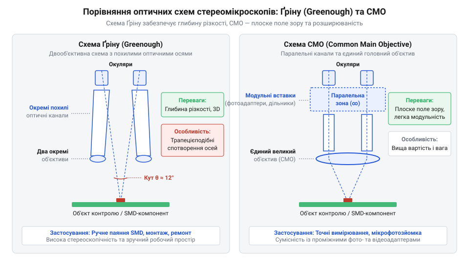
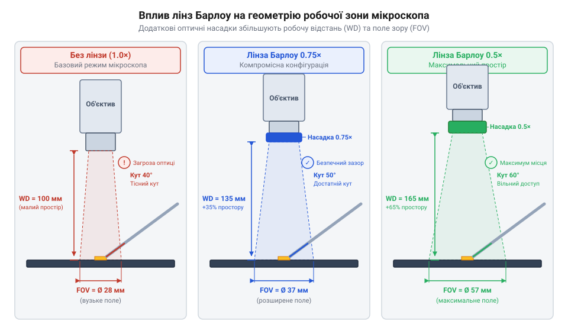
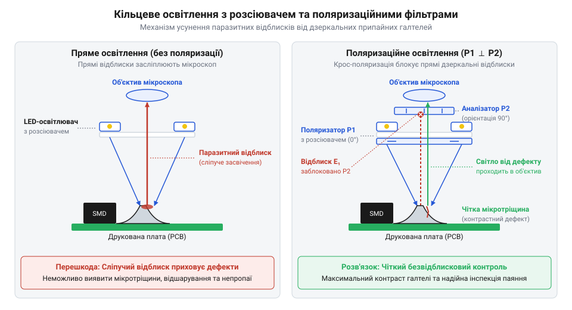

# Оптичний мікроскоп для паяння

<preknowlist>
- [Паяльні флюси та пасти для монтажу гарячим повітрям](root:cat-hw-instruments/smd-soldering-fluxes-and-pastes) — особливості формування галтелей та вигляду залишкового флюсу під час поверхневого монтажу
- [Властивості та термопрофілі трубчастих припоїв і припайних паст](root:cat-hw-instruments/solder-paste-and-lead-free-alloys-properties) — зовнішній вигляд та поверхневий натяг припайного сплаву в оплавленому стані
- [Антистатичний захист (ESD) при паянні чутливих компонентів](root:cat-hw-instruments/esd-safe-soldering-practices) — вимоги до заземлення та антистатичного виконання оптичних приладів під час роботи з чутливими напівпровідниками
</preknowlist>

## Обмеження зору при дрібному паянні

Роздільна здатність ока на відстані 25 см становить 0.07–0.1 мм. При монтажі компонентів 0402 чи QFN (крок 0.4 мм) розміри дефектів вимірюються десятками мікрометрів, що за межами зору.

Настільні лупи спотворюють периферію та виснажують @@en|акомодацію@@ (від лат. *accommodatio* — пристосування). Без окремих оптичних каналів зникає @@en|стереоскопічний ефект@@ (від грецьк. *stereos* — об'ємний, *skopeo* — дивлюся), відчуття глибини й координація рухів, спричиняючи @@en|астенопію@@ (від грецьк. *asthenes* — слабкий, *ops* — око).

Мала фокусна відстань луп (кілька сантиметрів) не дає ввести [паяльники з підтримкою USB PD](root:cat-hw-instruments/usb-pd-soldering-irons), термофен чи пінцет. Для роботи необхідний паяльний @@en|стереомікроскоп@@ із великою робочою відстанню та [антистатичний захист електроніки](root:cat-hw-instruments/esd-safe-soldering-practices).

## Оптичні схеми Ґріну та CMO

Схема Ґріну (@@en|Greenough@@) побудована на двох автономних каналах, нахилених під кутом 10–12° із власними об'єктивами. Сходження променів створює виражений тривимірний ефект, але спричиняє трапецеїдальне спотворення (@@en|keystone distortion@@) на периферії. Система є компактною та зручною для ручного монтажу.

Схема CMO (@@en|CMO@@, від англ. *Common Main Objective* — єдиний головний об'єктив) використовує один великий об'єктив із паралельними каналами. Це забезпечує плоске поле без викривлень та дозволяє легко вбудовувати дільники променя для тринокулярних камер. Схема є дорожчою й оптимальною для стаціонарної інспекції.


*Порівняння ходу світлових променів у стереомікроскопах схем Ґріну та CMO.*

Сукупне оптичне збільшення `M` та діаметр лінійного поля зору `D` розраховують за кратностями окулярів `M_eyepiece`, зум-блоку `Z`, насадної лінзи `M_barlow` та польовим числом `FN`:

```
M = M_eyepiece × Z × M_barlow
D = FN ÷ (Z × M_barlow)
```

Збільшення `M` зростає пропорційно Zoom-фактору, звужуючи поле зору `D`. Правильний вибір оптичної схеми визначає якість контролю, коли на плату нанесено [паяльні флюси та пасти](root:cat-hw-instruments/smd-soldering-fluxes-and-pastes).

## Збільшення, поле зору й відстань

Між оптичним збільшенням, полем зору та глибиною різкості існує обернена залежність. Підвищення кратності звужує оглядову область і стоншує фокальну площину, тож тремор рук ускладнює роботу.

Оптичні параметри коригують лінзами Барлоу (@@en|Barlow lens@@), що змінюють фокусну відстань об'єктива. Насадки 0.5x та 0.7x розширюють поле зору й збільшують робочу відстань зі 100 мм до 160–200 мм для вільного позиціонування [термофен BAKU BK-8033](root:cat-hw-instruments/hot-air-station-baku) чи паяльного жала.


*Залежність робочої відстані та поля зору від лінз Барлоу.*

Лінза 2.0x скорочує робочу відстань до 30–40 мм для виявлення мікротріщин. Для SMD-монтажу оптимальне збільшення 5x–15x із насадкою 0.5x, що балансує деталізацію та зазор інструмента.

## Ергономічне налаштування та поляризоване підсвічування

Налаштування починають із регулювання міжзіничної відстані (@@en|interpupillary distance@@) для злиття полів зору та @@en|діоптрійної корекції@@ (від грецьк. *dioptra* — інструмент) для компенсації різниці очей. Для збереження @@en|парфокальності@@ (від лат. *par* — рівний, *focus* — фокус) — чіткості зображення при зміні Zoom — фокус наводять макрогвинтом на максимальному збільшенні, а після переходу на мінімум підлаштовують діоптрійні кільця окулярів окремо для кожного ока.

Звичайне LED-підсвічування створює на спаях дзеркальні відблиски. Система хрестової поляризації (@@en|cross-polarization@@) усуває їх: фільтр освітлювача впорядковує світло в одній площині, а аналізатор на об'єктиві під кутом 90° блокує відбиті дзеркальні промені. До очей проходить лише дифузне світло від шорсткостей, проявляючи структуру спаю.


*Принцип відсікання дзеркальних відблисків від металевого розплаву за допомогою поляризатора та аналізатора.*

Поляризоване освітлення дозволяє класифікувати ключові мікродефекти монтажу:
- Містки припаю (@@en|solder bridge@@): перемички між виводами, які видаляють, [використовуючи мідне плетіння](root:cat-hw-instruments/solder-wick) та [безвідмивний флюс FVS-7](root:cat-hw-instruments/flux-fvs7). - Холодне паяння (@@en|cold solder joint@@): тьмяна зерниста поверхня від недогріву чи ворушіння при кристалізації. - Мікротріщини (@@en|microcrack@@): лінії розриву в галтелі від механічних напружень. - Надгробний ефект (@@en|tombstoning@@): підйом краю SMD-компонента через поверхневий натяг припою, чиї параметри визначають [властивості трубчастих припоїв](root:cat-hw-instruments/solder-paste-and-lead-free-alloys-properties).


*Характерні візуальні паттерни містків припаю, холодного паяння, мікротріщин та надгробного ефекту.*