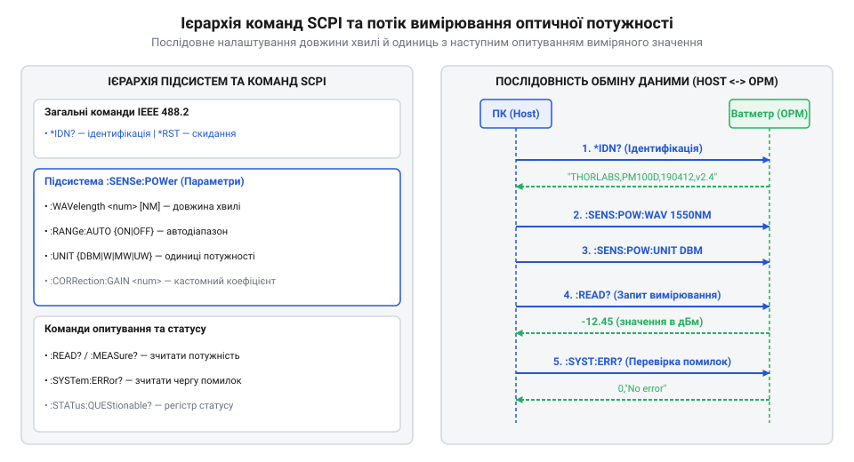

# Програмний інтерфейс SCPI для керування вимірювачем оптичної потужності

## Синтаксис SCPI та фізичне підключення

Автоматизація оптичних вимірювань вимагає надійного текстового протоколу керування приладом через послідовний порт USB, інтерфейс RS-232 чи мережевий сокет Ethernet (TCP/IP). Для цього використовують стандартний програмний інтерфейс вимірювальних приладів (англ. *Standard Commands for Programmable Instruments*; @@en|SCPI@@), який організовує команди у деревоподібну ієрархічну структуру з двоїкрапками між рівнями. Детальніше про загальні стандарти й правила побудови команд розповідає [протокол SCPI та його синтаксис](root:hw-sensing/scpi-protocol) для вимірювального обладнання.

Команди поділяють на команди установки (запису налаштувань) та запити (зчитування даних), що закінчуються знаком питання `?`. Для зменшення накладних витрат мережевого чи послідовного обміну кілька команд можна об'єднувати в один текстовий рядок через крапку з комою `;` (наприклад, `:SENS:POW:WAV 1550nm;:UNIT:POW DBM`), причому якщо наступна команда належить до того самого піддерева ієрархії, початкову двоїкрапку після крапки з комою можна опускати (`:SENS:POW:WAV 1550nm;RANG:AUTO 1`). Текстові рядки передають у кодуванні ASCII, а кожен виклик має завершуватися символом переведення рядка `\n` (LF, `0x0A`) або `\r\n` (CRLF). Запити на ідентифікацію приладу виконано у вигляді стандартних системних команд, що починаються зі зірочки:

```
*IDN?
```

У відповідь вимірювач повертає ASCII-рядок із чотирьох полів через кому: виробник, модель, серійний номер та версія мікропрограми (наприклад, `OPTICS-LAB,OPM-200,SN-984210,v2.4.1`).


*Схема командної ієрархії SCPI та послідовності передачі запитів налаштування й зчитування потужності через послідовний порт.*

Після успішного отримання відповіді на команду `*IDN?` керувальна програма вважає фізичне з'єднання встановленим та готовим до прийому вимірювальних команд. Оскільки SCPI є строковим протоколом без проміжних квитанцій підтвердження, кожна відправлена команда установки виконується приладом асинхронно, а для синхронізації тривалих вимірювальних операцій застосовують системний запит опитування прапорця завершення `*OPC?` (англ. *Operation Complete*; @@en|operation complete@@).

## Налаштування довжини хвилі та одиниць

Перед вимірюванням оптичної потужності фотодетектор вимірювача необхідно відкалібрувати під довжину хвилі джерела світла, оскільки спектральна чутливість напівпровідникового p-n переходу (InGaAs чи Si) суттєво змінюється залежно від довжини хвилі випромінювання. Команда вибору довжини хвилі входить до піддерева `SENSe`:

```
:SENSe:POWer:WAVelength <значення>
```

Параметр довжини хвилі передають у метрах або з зазначенням одиниці (`1550nm`, `1310nm`, `850nm` або в чистому числовому вигляді `1.55e-6`). Зчитування поточного калібрувального значення виконують відповідним запитом:

```
:SENSe:POWer:WAVelength?
```

Одиниці вимірювання оптичної потужності конфігурують через піддерево `UNIT`:

```
:UNIT:POWer <DBM|W|MW|UW>
```

Для вимірювання абсолютного рівня в логарифмічних одиницях вказують `DBM` (дБм), а для лінійних одиниць — `W` (Ват), `MW` (міліват) або `UW` (мікроват). Автоматичний вибір аналогового діапазону підсилення фотоструму вмикають командою:

```
:SENSe:POWer:RANGe:AUTO <ON|OFF|1|0>
```

У разі вимкнення автодіапазону фіксований ступінь підсилення аналогового трансімпедансного підсилювача задають числово через `:SENSe:POWer:RANGe <індекс_діапазону>`. Залежно від очікуваного оптичного сигналу обирають один із дискретних вимірювальних ступенів чутливості (наприклад, `0` відповідає найвищій чутливості від -70 до -50 дБм, `1` — від -50 до -30 дБм, `2` — від -30 до -10 дБм, а `3` — вимірюванню високої потужності від -10 до +10 дБм). Ручний вибір діапазону запобігає затримкам на перемикання реле під час циклічного опитування та усуває сплески шуму при вимірюванні швидкозмінних оптичних імпульсів.

## Зчитування потужності та обробка помилок

Отримання числових результатів вимірювання здійснюється за допомогою двох командних підходів. Команда негайного вимірювання підпорядкована піддереву `READ` та виконує запуск нового циклу оцифрування зі зчитуванням значення:

```
:READ:POWer?
```

Прилад повертає число у формі з плаваючою комою у науковому форматі (наприклад, `-12.45` для дБм або `5.68E-05` для Ват). У разі потреби розділення ініціалізації та зчитування застосовують команду запуску координованого вимірювання `:INITiate` з подальшим викликом `:FETCh:POWer?` для забрати результат із внутрішнього буфера без повторного оцифрування.

Якщо рівень оптичного сигналу перевищує лінійну межу фотоприймача або виходить нижче рівня власних шумів, вимірювач повертає спеціальне граничне значення (наприклад, `9.9E+37` при насиченні детектора чи `-9.9E+37` при відсутності світла).

Для перевірки коректності виконання команд та відловлювання синтаксичних помилок використовують системний запит зчитування черги помилок. Якщо у вимірювальному скрипті необхідно повністю очистити буфер помилок та скинути всі регістри статусу (включаючи регістр подій `*ESR?` та статус операції) перед початком нової серії вимірювань, застосовують стандартну системну команду скидання `*CLS` (англ. *Clear Status*; @@en|clear status@@). Після відправки `*CLS` черга помилок повністю очищається, а повторний виклик опитування повертає стандартне підтвердження відсутності збоїв.

```
:SYSTem:ERRor?
```

Відповідь містить числовий код помилки та її короткий текстовий опис, наприклад `0,"No error"` або `-113,"Undefined header"`. Зчитування буфера видаляє найстарішу помилку з черги. Запит статусу виконання команд `*ESR?` повертає значення регістру подій (Event Status Register; @@en|ESR@@), де біт 5 вказує на синтаксичну помилку командного рядка.
