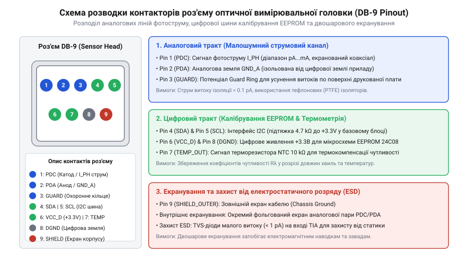
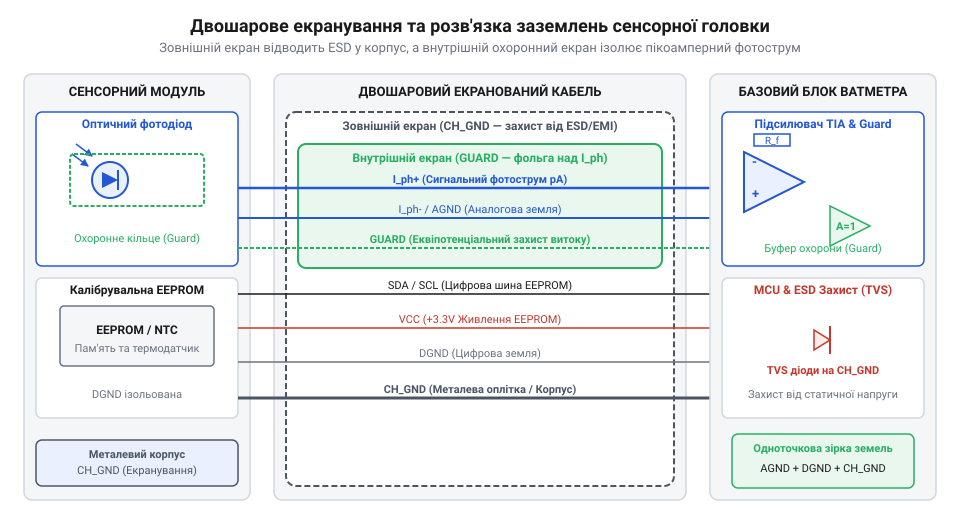

# Залізний інтерфейс підключення сенсорної головки оптичного ватметра

## Проблема наводка та надійності підключення

Вимірювання оптичної потужності вимагає реєстрації надзвичайно слабких струмів, які генерує фотоприймач при попаданні лазерного випромінювання на його активну поверхню. При потужності випромінювання на рівні піковатів (@@en|picowatt@@, пВт) вихідний фотострум фотодіода (@@en|photodiode@@) становить частки пікоампера. Наприклад, при спектральній чутливості кремнієвого сенсора 0.5 А/Вт оптичний сигнал потужністю 1 пВт створює струм всього 0.5 пА (тобто 5×10⁻¹³ А).

Винесення вимірювальної головки в окремий модуль, що підключається до базового блоку ватметра за допомогою знімного кабелю, створює серйозні схемотехнічні виклики. Будь-який знімний роз'єм та кабельне з'єднання стають джерелом трьох критичних дестабілізуючих факторів:

1. **Електромагнітні та електростатичні наводки.** Мережеві наведення частотою 50 Гц, радіочастотні завади та наведення від імпульсних джерел живлення наводять у незахищених провідниках струми мікроамперного діапазону, що на кілька порядків перевищує корисний вимірювальний сигнал.
2. **Паразитні струми витоку та термоЕРС.** Неідеальна ізоляція між контактами роз'єму, вологість і забруднення поверхні друкованої плати створюють опори витоку R_leak ≈ 10⁹–10¹⁰ Ом. Навіть при малій різниці потенціалів у кілька мілівольт це викликає паразитний струм, що спотворює показники. Крім того, контакт різнорідних металів у виводах роз'єму під дією градієнта температур створює термоелектричний ефект (термоЕРС), який викликає дрейф нульового рівня.
3. **Розсогласування калібрувальних даних.** Кожен фотодетектор має унікальну залежність спектральної чутливості від довжини хвилі та температури. Підключення сенсорної головки без автоматичного зчитування її індивідуальної калібрувальної матриці призводить до системної похибки вимірювання, що може перевищувати 30–50%.

Для подолання цих проблем розробляється стандартизований залізний інтерфейс (@@en|pinout@@, англ. *pin* + *out* — розпинування), який об'єднує екрановані аналогові лінії фотоструму, цифрову шину ідентифікації та калібрування, а також розмежовані контури заземлення.

Таке об'єднання в єдиному кабельному роз'ємі формує суворий апаратний кордон між вимірювальним головним вузлом та обробною електронікою базового блоку. Завдяки фізичному розмежуванню ліній корисний аналоговий сигнал не спотворюється цифровими перехідними процесами шини зчитування паспорта, а уніфікована конфігурація з'єднувача дозволяє оперативно підключати до одного ватметра сенсори різного спектрального діапазону та конструктивного виконання.

Важливою складовою механічного виконання роз'єму є надійний замок (байонетний або нарізний гвинтовий фіксатор), який виключає найменші мікрозміщення контактів та кабельного вводу при вібраціях. При вимірюванні струмів пікоамперного рівня механічні деформації та тертя діелектрика кабелю викликають трибоелектричний ефект (мікрофонний ефект), що створює імпульсні сплески паразитних зарядів, тому жорстка фіксація вилки роз'єму в гнізді базового блоку є обов'язковою умовою метрологічної стабільності.

## Розводка ніжок та призначення сигналів

Апаратний роз'єм підключення вимірювальної головки реалізується на базі малошумних промислових роз'ємів (наприклад, DB-9 або круглих багатополюсних роз'ємів серії M12/Hirose) із позолоченими контактами та ізоляторами з фторопласту (PTFE) або поліефірефіркетону (PEEK). Внутрішній опір ізоляції ізолятора між контактами повинен перевищувати 10¹² Ом.

Топологія розводки ніжок роз'єму розроблена так, щоб мінімізувати перехресні наводки між цифровими шинами та високочутливими аналоговими лініями.


*Принципова схема топології контактів роз'єму та схеми ізоляції аналогових і цифрових кіл.*

Наведена принципова схема ілюструє чітке функціональне призначення кожного з дев'яти контактів інтерфейсного роз'єму:

- **Pin 1 (ANODE / I_PD+):** Аналогова лінія анода фотодіода. Несе корисний фотострум позитивної полярності на вхід [трансімпедансного підсилювача](root:hw-analog/transimpedance-amplifier) (@@en|transimpedance amplifier@@).
- **Pin 2 (CATHODE / I_PD-):** Аналогова лінія катода фотодіода. Використовується для подачі зсуву або підключення до опорного потенціалу.
- **Pin 3 (GUARD / AGND_GUARD):** Активне охоронне кільце (@@en|guard ring@@). Вивід захисного провідника, який оточує лінію анода і підтримується під потенціалом віртуальної землі. Математична залежність поверхневого опору витоку друкованої плати R_surf від відносної вологості довкілля RH описується експоненціальною моделлю R_surf(RH) = R_0 · exp(-A · RH), де при вологості RH > 80% опір R_surf падає з 10¹² Ом до 10⁸ Ом, створюючи паразитний струм витоку I_leak = ΔV / R_surf(RH). Шляхом підтримки різниці потенціалів ΔV = V_anode - V_guard ≈ 0 В активне кільце Guard усуває струм I_leak незалежно від рівня вологості.
- **Pin 4 (TEMP_SENSE):** Аналогова лінія термодатчика (терморезистора NTC або датчика PT100), розташованого безпосередньо на корпусі фотодетектора.
- **Pin 5 (SDA / 1-Wire):** Цифрова лінія даних шини калібрування (@@en|I2C@@ або @@en|1-Wire@@).
- **Pin 6 (SCL):** Цифрова лінія тактування шини I2C.
- **Pin 7 (VCC_DIG):** Лінія живлення цифрової мікросхеми енергонезалежної пам'яті (@@en|EEPROM@@) напругою +3.3 В або +5 В.
- **Pin 8 (DGND):** Цифрова земля. Служить зворотним провідником для струмів цифрових шин і повністю ізольована від аналогової землі всередині головки.
- **Pin 9 / Shell (SHIELD):** Зовнішній металевий екран кабелю та корпус роз'єму, підключений до заземленого корпусу приладу.

## Цифровий шинний інтерфейс калібрування

Підключення вимірювальної головки до базового блоку супроводжується автоматичним зчитуванням паспорта сенсора через цифровий шинний інтерфейс. Усередині корпусу вимірювальної головки встановлюється мікросхема енергонезалежної пам'яті EEPROM (наприклад, 24LC16 або DS2431) обсягом від 1 до 16 Кілобіт.

Пам'ять містить критичні калібрувальні дані, без яких точне обчислення оптичної потужності неможливе:

- **Ідентифікаційні дані:** серійний номер, тип фотодетектора (Si, InGaAs, Ge), діаметр активного майданчика, дата останньої метрологічної перевірки.
- **Таблиця спектральної чутливості R(λ):** масив коефіцієнтів перетворення (А/Вт) із кроком 1–5 нм у робочому діапазоні довжин хвиль (наприклад, 800–1700 нм для InGaAs).
- **Температурні коефіцієнти:** коефіцієнт дрейфу темнового струму I_dark(T) та температурний коефіцієнт чутливості dR/dT.
- **Ослаблення фотометричної сфери K_att(λ):** спектральний коефіцієнт послаблення (якщо головка оснащена інтегрувальною сферою або послаблювачем).

Цифрова шина працює за [стандартом I2C](root:com-devices/i2c-bus) на тактовій частоті 100 кГц або за протоколом 1-Wire. Для забезпечення надійної передачі даних ухвалено такі електричні параметри:

```
Логічний нуль (V_IL):    0.0 V ... 0.8 V
Логічна одиниця (V_IH):  2.0 V ... VCC_DIG
Підтягувальні резистори: R_pullup = 4.7 кОм (на платі базового блоку)
Максимальна ємність:     C_bus < 400 пФ
```

При гарячому підключенні головки процесор базового блоку опитує фіксовану адресу I2C (наприклад, 0x50). Зчитаний масив перевіряється за допомогою контрольної суми (CRC-16). Якщо контрольна сума збігається, прилад автоматично застосовує таблицю R(λ) для обраної користувачем довжини хвилі.

## Екранування та захист від завад

Захист надчутливих аналогових сигналів вимагає суворого дотримання правил екранування та розділення заземлювальних контурів. Кабель сенсорної головки виготовляється за триаксіальною або двошаровою екранованою технологією.


*Схема двошарового екранування кабелю з виділеним активним зазищенням Guard та розділенням заземлень.*

На схемі продемонстровано концепцію активного захисту (@@en|guarding@@) та схему розведення заземлень:

1. **Активний екран Guard.** Центральна жила анода фотодіода оточена внутрішнім екраном Guard. Підсилювач базового блоку подає на екран Guard потенціал, що точно дорівнює потенціалу сигнальної жили (віртуальна земля, V_guard = V_in ≈ 0 В). Оскільки різниця потенціалів між жилою та екраном дорівнює нулю (ΔV = 0 В), струм витоку крізь діелектрик кабелю стає рівним нулю за законом Ома:
```
I_leak = ΔV / R_insulation = 0 / R_insulation = 0
```
2. **Зовнішній плетений екран (Shield).** Оточує всі провідники кабелю і підключається до металевого корпусу роз'єму та шасі базового блоку. Він замкнений на системне захисне заземлення (PE) і відводить зовнішні електромагнітні завади.
3. **Розділення земель.** Аналогова земля (AGND) та цифрова земля (DGND) прокладені окремими ізольованими провідниками і з'єднуються лише в одній точці на друкованій платі базового блоку біля аналогово-цифрового перетворювача (зіркове заземлення). Це запобігає протіканню імпульсних струмів цифрової шини по чутливих аналогових шинах.

Для захисту від електростатичного розряду (@@en|electrostatic discharge@@, ESD) на цифрові лінії SDA, SCL та VCC встановлюються низькоємнісні супресори (@@en|TVS diode@@) із допуском до 15 кВ. На аналогові лінії анода та катода звичайні захисні діоди не ставляться через їхній власний витік (до 1 нА). Замість них застосовуються спеціалізовані прецизійні діодні збірки з витоком менше 10 фемтоампер (fA) або обмежувальні резистори.

## Діагностика та монтаж з'єднання

Працездатність та метрологічна точність залізного інтерфейсу залежать від якості фізичного монтажу роз'єму та дотримання регламенту технічного обслуговування.

При монтажі та експлуатації роз'єму дотримуються таких правил:

- **Пайка та промивка.** Пайка контактів виконується безканіфольним припоєм. Після пайки плата роз'єму підлягає дворазовому ультразвуковому відмиванню в ізопропіловому спирті високої чистоти для видалення залишків флюсу. Залишки флюсу при високій вологості створюють провідні містки з опором менше 10⁸ Ом.
- **Герметизація.** Корпус роз'єму оснащується гумовим ущільнювачем та термоусадковою трубкою з клейовим шаром для відсікання зовнішнього вологого повітря.

Діагностика апаратного інтерфейсу включає чотири покрокові перевірки:

```
[Крок 1] Перевірка опору ізоляції
         Мегомметром напругою 50 В вимірюється опір між Pin 1 (ANODE) та Pin 3 (GUARD).
         Критерій: R_iso >= 10¹¹ Ом.

[Крок 2] Контроль темнового струму
         Сенсорна головка закривається світлонепроникним ковпачком.
         Вимірюється вихідний струм базовим блоком при T = 25 °C.
         Критерій: I_dark <= 2 пА (для кремнію) або <= 100 пА (для InGaAs).

[Крок 3] Тест цифрового зчитування EEPROM
         Опитується шина I2C, зчитується масив даних та обчислюється CRC-16.
         Критерій: збіг CRC-16 та відсутність помилок NACK на шині.

[Крок 4] Механічний тест згину кабелю
         При підключеному сенсорі проводиться згин кабелю біля роз'єму.
         Критерій: відсутність стрибків струму (трибоелектричний ефект в якісному кабелі < 0.5 пА).
```

Систематичний контроль опору ізоляції та чистоти контактної групи забезпечує стабільну роботу вимірювача оптичної потужності протягом усього терміну експлуатації.
