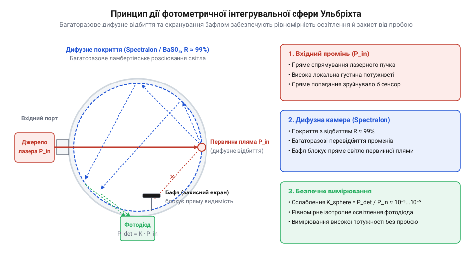
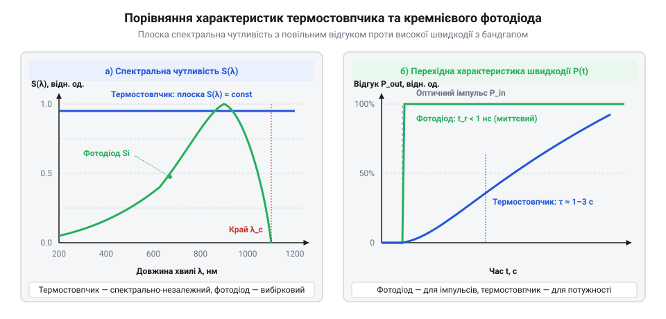

# Еволюція методів вимірювання оптичної та лазерної потужності

## Межі теплових датчиків XIX століття

Розвиток електричного освітлення на основі дугових ламп та астрономічні спостереження у другій половині XIX століття вимагали кількісної оцінки світлової енергії. У тогочасних зорових фотометрах (зокрема на оптичних скам'ях італійського винахідника Іньяціо Порро; @@it|Ignazio Porro@@) людина порівнювала яскравість випромінювання з полум'ям еталонної свічки, зміщуючи фотометричну призму чи джерело уздовж лінійки до візуального зрівняння двох півполів поля зору за законом обернених квадратів відстані. Проте такі суб'єктивні спостереження суттєво залежать від індивідуального спектрального сприйняття сітківки людського ока, зорової втоми та коливань полум'я свічки й не здатні виміряти об'єктивну абсолютну енергетичну потужність. Для об'єктивної радіометрії знадобилися прилади, що перетворюють поглинуте оптичне випромінювання на вимірюваний електричний сигнал.

Першими приймачами випромінювання стали термопари, засновані на @@de|термоелектричному ефекті Зеєбека@@ (від ім'я німецького фізика Томаса Зеєбека, Thomas Johann Seebeck, 1821 рік). Поглинання світла спаєм двох різнорідних металів спричиняє нагрівання й створює термо-ЕРС. У 1878 році американський астроном @@en|Семюел Пірпонт Ленглі@@ (Samuel Pierpont Langley) створив @@en|болометр@@ (від грецького *βολή* — промінь та *μέτρον* — вимірювання). Прилад складався з двох тонких платинових смужок, ввімкнених у мостову схему Уітстона. Одна зі смужок покривалася тонким шаром платинової почорні; поглинаючи оптичне випромінювання, вона нагрівалася, що змінювало її електричний опір і викликало розбаланс мосту.

Незважаючи на високу спектральну плоскість — здатність поглинати випромінювання різних довжин хвиль однаково ефективно, — перші теплові приймачі мали суттєві обмеження. Фізичний механізм вимірювання в болометрі Ленглі ґрунтувався на мостовій схемі Уітстона, де дві тонесенькі платинові смужки утворювали суміжні плечі. Поглинання оптичного випромінювання робочою смужкою, вкритою платиновою почорню, спричиняло її нагрівання на малу величину, що через температурний коефіцієнт опору платини збільшувало її електричний опір і порушувало рівновагу мосту. Цей розбаланс викликав протікання струму у вимірювальній діагоналі, який фіксувався гальванометром, тоді як друга затінена смужка компенсувала однакові для обох плечей фонові температурні коливання довкілля. Проте через відносно велику теплоємність металевої підкладки час відгуку болометрів і термоелементів становив від десятків мілісекунд до кількох секунд. Спроби підвищити чутливість шляхом подальшого зменшення товщини поглинача робили прилади надзвичайно крихкими й непридатними для вимірювання світлових потоків високої густини.

## Сфера Ульбріхта та просторове інтегрування

З появою складних оптичних систем та електричних ламп розжарювання постала проблема вимірювання повного оптичного потоку джерел із нерівномірною діаграмою спрямованості. Вимірювання інтенсивності в одній точці простору чи вузькому куті не давало уявлення про загальну випромінювану потужність, а сканування по всій сфері вимагало багато часу й спричиняло значні похибки.

У 1900 році німецький інженер @@de|Ріхард Ульбріхт@@ (Richard Ulbricht) запропонував розв'язок — @@de|інтегруючу сферу Ульбріхта@@. Вона являє собою порожнистую кулю, внутрішня поверхня якої покрита матеріалом із високим коефіцієнтом дифузного відбиття, таким як сірчанокислий барій чи сучасний фторопластовий матеріал @@en|спектралон@@.


*Схема інтегруючої сфери Ульбріхта, що ілюструє дифузне перевідбиття світла для безпечного вимірювання потужності.*

Світловий пучок потрапляє всередину сфери через вхідний порт і зазнає багаторазових розсіяних відбиттів від внутрішніх стінок. Завдяки геометричним властивостям сфери радіуса `R` із внутрішньою площею `A = 4·π·R²` та високим коефіцієнтом дифузного відбиття покриття `ρ`, освітленість стінок формується нескінченною сумою послідовних відбиттів. Підсумкову освітленість детектора `E` обчислюють з вхідного оптичного потоку `Ф_i`:

```
E = (Ф_i ÷ A) · (ρ ÷ (1 - ρ))      [сумування нескінченної геометричної прогресії відбиттів]
```

Множник `M = ρ ÷ (1 - ρ)` називають множником сфери; для високоякісних покриттів із `ρ ≈ 0.98` цей коефіцієнт підсилює розсіяну освітленість майже у 50 разів. Оскільки підсумкова освітленість у будь-якій точці внутрішньої поверхні прямо пропорційна повному вхідному оптичному потоку `Ф_i`, вимірювання стає незалежним від кутового розподілу чи модової структури пучка. Щоб прямі непрореаговані промені від вхідного порту не потрапляли безпосередньо на фотоприймач, перед ним встановлюють захисний екран — @@en|бафл@@ (від англійського *baffle* — перегородка).

Сфера Ульбріхта виконує не лише просторове інтегрування, але й суттєво послаблює густину випромінювання на поверхні датчика за рахунок багаторазового перерозподілу енергії по великій площі сфери. Ця властивість виявилася вирішальною для метрології випромінювання високої інтенсивності.

## Лазерний прорив та променева деградація

Винахід першого оптичного квантового генератора — рубінового лазера @@en|Теодором Мейманом@@ (Theodore Maiman) у 1960 році — спричинив справжню кризу у вимірювальній техніці. На відміну від класичних джерел світла, лазерне випромінювання характеризується високою монохроматичністю, когерентністю та надзвичайно малим кутовим розходженням. Це дозволило фокусувати енергію в пучки з густиною потужності, що сягала мегават на квадратний сантиметр.

Традиційні болометри та фотоелементи виявилися повністю непридатними для роботи з лазерним випромінюванням. Тонкі тонкоплівкові поглиначі й чорнені покриття миттєво випаровувалися під дією коротких лазерних імпульсів, а напівпровідникові й вакуумні фотокатоди зазнавали незворотної термічної та оптичної деградації. Постала гостра потреба у вимірювальних пристроях із високим порогом променевої руйнівності.

Особливо гостро ця проблема постала з появою промислових газових CO₂-лазерів безперервної дії, чия оптична потужність випромінювання на довжині хвилі 10.6 мкм сягала десятків кіловатів. Для їх вимірювання розробили проточні @@en|водоохолоджувані калориметри@@, у яких оптична енергія безпосередньо передається теплоносію. Лазерний пучок поглинається масивною мідною порожниною зі стійким антивідбивним покриттям, крізь сорочку якої під постійним тиском прокачують дистильовану воду. Вимірювання випромінюваної потужності ґрунтується на стаціонарній термодинамічній рівновазі: знаючи масову витрату води `m_dot` та вимірявши різницю температур `ΔT` на вході й виході за допомогою дифтермопари, абсолютну потужність обчислюють як `P = m_dot · c_p · ΔT`, де `c_p` — питома теплоємність води. Безперервний відвід тепла водним потоком зняв обмеження щодо накопиченої енергії та дозволив стабільно вимірювати кіловатно рівні випромінювання протягом тривалих технологічних циклів.

Для вирішення цієї проблеми у 1960–1970-х роках було розроблено @@en|об'ємні поглиначі@@ та масивні @@en|термостовпчики@@ (багатоелементні термобатареї). На відміну від тонкоплівкових поверхневих покриттів, які випаровуються вже при енергіях 0.1–0.5 Дж/см², об'ємні поглиначі виготовлялися з легованого іонами перехідних металів нейтрального фосфатного скла (зокрема марок NG-1 та NG-3) або високостійкої карбід-кремнієвої кераміки. У цих матеріалах оптичне випромінювання експоненційно згасає у товщі завглибшки 1–3 мм. Розподіл теплового навантаження по об'єму знижує поверхневий температурний стрибок і підвищує поріг променевого руйнування матеріалу до 10–30 Дж/см² у імпульсному режимі та понад 10 кВт/см² у безперервному, запобігаючи термічному розтріскуванню та плавленню скла при температурах понад 600 °C.

Для вимірювання потужних лазерних пучків також розробили конічні та клиноподібні калориметри. Конусна геометрія приймальної порожнини забезпечує багаторазове відбиття пучка під гострими кутами до поверхні, завдяки чому оптична енергія розподіляється по великій площі поглинача, а зворотне відбиття випромінювання зводять до мінімуму. Застосування об'ємних поглиначів та інтегруючих сфер дозволило створити перші надійні вимірювачі потужності для промислових та наукових лазерних систем.

## Квантові фотодіоди та компроміс вибірковості

Повторний технологічний стрибок у вимірюванні світла відбувся з розвитком напівпровідникової фізики у середині XX століття. На зміну двоступеневим тепловим перетворювачам прийшли @@en|напівпровідникові фотодіоди@@ на основі кремнію, германію, а згодом сполук індію й ґалію.

У фотодіодах використовується @@en|внутрішній фотоефект@@: фотон із енергією, що перевищує ширину забороненої зони напівпровідника, поглинається в кристалі й безпосередньо збуджує електронно-діркову пару. Під дією внутрішнього електричного поля p-n переходу носії заряду розділяються, генеруючи фотострум.


*Порівняння спектральної характеристики плоского теплового датчика й високошвидкісного фотодіода.*

Пряме квантове перетворення забезпечило колосальну перевагу у швидкодії. Час відгуку фотодіода становить від одиниць наносекунд до пікосекунд, що дозволило проводити осцилографування коротких лазерних імпульсів у реальному часі. Лінійний динамічний діапазон фотодіодів досягає семи-дев'яти порядків за потужністю.

Проте квантовий механізм створив новий вимірювальний компроміс — @@en|спектральну вибірковість@@. На відміну від «ахроматичних» чорних теплових сенсорів, спектральна чутливість фотодіода суттєво залежить від довжини хвилі випромінювання через фундаментальні фізичні обмеження напівпровідника. У довгохвильовій області спектра чутливість стрімко спадає до нуля, коли енергія фотона стає меншою за ширину забороненої зони кристала і світло проходить крізь кристал без поглинання. У короткохвильовій області, навпаки, коефіцієнт поглинання стає надто високим: фотони високої енергії поглинаються у тонкому приповерхневому шарі до p-n переходу, де фотозгенеровані носії заряду миттєво рекомбінують на поверхневих дефектах, не встигаючи створити фотострум. У результаті робочий діапазон фотодіода обмежений як спектральним піком, так і спадами обабіч нього, що вимагає точного калібрування фотометра під кожну довжину хвилі лазера й використання вбудованих таблиць коефіцієнтів перерахунку.

## Кріогенні еталони та хронологічні міфи

Застосування фотодіодів у наукових і промислових вимірювачах висунуло нові вимоги до точності первинних еталонів оптичної потужності. Залежність датчиків від довжини хвилі унеможливила відносне калібрування за стаціонарними еталонними лампами розжарювання через накопичення метрологічних похибок.

Розв'язанням стало створення еталонів первинного рівня на основі @@en|заміщення електричною потужністю@@ (@@en|принцип заміщення ЕСР@@, від англійського *Electrical Substitution Radiometry*). У таких приладах оптичне нагрівання поглинальної порожнини точно зрівноважується заміщувальною електричною потужністю струму, що протікає через вбудований прецизійний нагрівач.

У 1980-х роках Національна фізична лабораторія Великої Британії (NPL) та Національний інститут стандартів і технологій США (NIST) створили @@en|кріогенні радіометри@@. Конструктивно такий еталон містить поглинальну порожнину з високочистої міді у формі витягнутого конуса зі скошеним дном, покриту зсередини спеченим чорним шаром; багаторазові внутрішні відбиття лазерного променя забезпечують коефіцієнт поглинання понад 0.9999. За температур рідкого гелію (близько 4.2 K) теплоємність мідного поглинача падає майже на три порядки, а випромінювальні теплові втрати зникають. Метод електричного зрівноваження реалізують через термостатування порожнини прецизійним нагрівачем: під час перекриття оптичного пучка автоматична система підтримує постійну температуру теплового моста, вимірюючи компенсаційну електричну потужність `P_el = I · U`. Це дозволило вимірювати абсолютну оптичну потужність із непевності менше 0.01%.

Історія оптичної радіометрії багата й на характерні міфи. Найпоширенішим є плутанина між фотометричними (люмен, люкс) та радіометричними (ват, ват на квадратний метр) величинами: перші оцінюють світло крізь призму людського ока, тоді як другі вимірюють об'єктивну физичну енергію. Іншою помилкою є твердження, ніби поява фотодіодів повністю витіснила теплові термостовпчики. Насправді теплові сенсори лишаються єдиним незамінним інструментом для абсолютного ахроматичного вимірювання надпотужних технологічних лазерів, де напівпровідникові фотодіоди миттєво насичуються або зазнають деградації.
