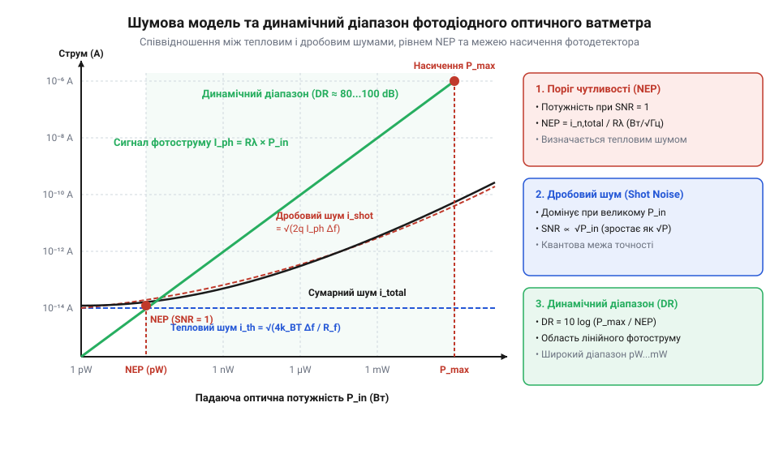

# Математичне моделювання вимірювачів оптичної потужності

## Проблема вимірювання світлової потужності

Пряме вимірювання потужності лазерного випромінювання (en. @@en|optical power measurement@@) видається простим: подати світло на напівпровідниковий фотодіод (en. @@en|photodiode@@) та зняти напругу з його виводів вольтметром або вбудованим АЦП. Проте така спрощена схема призводить до похибок у сотні відсотків і повного спотворення результатів.

По-перше, фотодіод є джерелом струму, а не напруги. У фотовольтаїчному режимі без підсилювача вихідна напруга залежить логарифмічно від падаючого світлового потоку та насичується вже при потужності в сотні мікроват.

По-друге, чутливість фотодетектора не є постійною величиною: вона суттєво змінюється залежно від довжини хвилі (en. @@en|wavelength@@) лазера через спектральну залежність поглинання в напівпровіднику.

По-третє, власні шуми компонента — темновий струм (en. @@en|dark current@@) та тепловий шум (en. @@en|thermal noise@@) — маскують слабкі оптичні сигнали.

Для отримання точних вимірювань у діапазоні від мікроват до ват необхідна математично обґрунтована модель фотоперетворення, яка враховує квантові параметри детектора, геометрію ослаблення та шумові межі аналогового тракту.

Крім того, додатковим джерелом вимірювальної похибки є температурний дрейф (en. @@en|temperature drift@@) фізичних параметрів напівпровідника. Зі зміною температури змінюється ширина забороненої зони (en. @@en|bandgap energy@@) кремнію `E_g(T)`, що призводить до зсуву довгохвильової межі поглинання `λ_c = (h · c) / E_g`. Внаслідок цього температурний коефіцієнт чутливості `(1 / R) · (dR / dT)` різко зростає у ближній інфрачервоній області (біля 1064 нм), досягаючи кількох відсотків на градус Цельсія та вимагаючи термостабілізації або програмної температурної компенсації.

Сукупність усіх цих фізичних обмежень — від спектральної та температурної нестабільності до просторової неоднорідності (en. @@en|spatial non-uniformity@@) фоточутливої площадки — робить пряме зчитування вихідного сигналу непридатним для прецизійного фотометричного аналізу. Без формалізованого математичного опису кожного етапу фотоперетворення неможливо відокремити корисний сигнал від систематичних і випадкових похибок. Саме тому побудова точного вимірювача оптичної потужності вимагає послідовного виведення рівнянь генерування фотоструму, геометричного ослаблення світлового потоку та розрахунку повного шумового бюджету вимірювального тракту.

## Модель фотоквантового перетворення

Основою математичного моделювання є фізико-квантове перетворення світлового потоку в електричний струм. Падаюче лазерне випромінювання потужністю `P_opt` складається з потоку фотонів (en. @@en|photons@@, від грец. @@el|phos@@ — світло). Кожен фотон з довжиною хвилі `λ` несе квант енергії `E_photon = (h · c) / λ`, де `h` — стала Планка (`6.626 · 10⁻³⁴` Дж·с), а `c` — швидкість світла у вакуумі (`2.998 · 10⁸` м/с).

При поглинанні фотона в p-n переході напівпровідника з імовірністю `η` (квантова ефективність, en. @@en|quantum efficiency@@) генерується одна пара електрон-дірка. Звідси випливає фундаментальне рівняння для генеруваного фотоструму `I_ph`:

```
I_ph = N_e · q
= (η · N_photon) · q                  [вираження кількості електронів через квантову ефективність]
= η · (P_opt / E_photon) · q           [підстановка потоку фотонів N_photon = P_opt / E_photon]
= P_opt · (η · q · λ) / (h · c)        [підстановка енергії фотона E_photon]
```

Коефіцієнт пропорційності між фотострумом `I_ph` (в амперах) та оптичною потужністю `P_opt` (у ватах) називають спектральною чутливістю (en. @@en|spectral responsivity@@) `R(λ)` з розмірністю А/Вт:

```
R(λ) = I_ph / P_opt
= (η · q · λ) / (h · c)                [формула спектральної чутливості]
```

Оскільки квантова ефективність `η` залежить від матеріалу (кремній Si, ґерманій Ge, InGaAs) та довжини хвилі `λ`, для обчислення невідомої потужності `P_opt` виміряний струм `I_ph` ділять на значення `R(λ)` з калібрувальної кривої. Поблизу краю фундаментального поглинання (en. @@en|fundamental absorption edge@@) температурне звуження забороненої зони `E_g(T) = E_g(0) - (α · T²) / (T + β)` описується аналітичною залежністю квантової ефективності `η(T) ≈ η_0 · (1 + γ · (T - T_0))`, де `γ` — температурний коефіцієнт виходу (1/К). Для довжин хвиль поблизу порогу (1060–1100 нм для кремнію) параметр `γ` досягає `0.005`–`0.01` 1/К, через що обчислення `P_opt = I_ph / R(λ, T)` вимагає обов'язкової програмної компенсації температури детектора.

```
P_opt = I_ph / R(λ)                   [перерахунок струму у потужність]
```

## Математична модель інтегрувальної сфери

Пряме вимірювання високопотужних лазерів (понад 100 мВт) призводить до оптичного насичення або термічного руйнування фотодіода. Для безпечного зниження щільності випромінювання застосовують фотометричну інтегрувальну сферу (en. @@en|integrating sphere@@, від лат. @@la|integrare@@ — відновлювати ціле).

По порожнистій сфері радіуса `r` з внутрішнім дифузним покриттям високого відбиття `ρ` (рефлектанс, en. @@en|reflectance@@, зазвичай 0.95–0.98) світло зазнає багаторазового перевідбиття. Вхідний порт площею `A_in` приймає лазерний пучок потужністю `P_in`, а на вихідному порту площею `A_out` встановлено фотодіод площею `A_det`. Детальніше про матеріали дифузних покриттів та оптичну конструкцію фотометричних камер читайте у матеріалі про [конструювання та матеріали інтегрувальних сфер](root:hw-sensing/integrating-sphere-design).

Загальна площа внутрішньої поверхні сфери становить `A_sphere = 4 · π · r²`. Частка загальної площі отворів позначається як `f_a = (A_in + A_out + A_other) / A_sphere`.

Коефіцієнт ослаблення (en. @@en|attenuation factor@@) сфери `K_sphere`, який визначає частку потужності `P_det`, що потрапляє на детектор, описується фотометричною моделлю Ульбрихта:

```
P_det = P_in · K_sphere
K_sphere = (A_det / A_sphere) · (ρ / (1 - ρ · (1 - f_a)))     [модель ослаблення сфери]
```

Множник `1 / (1 - ρ · (1 - f_a))` називають мультиплікатором сфери (en. @@en|sphere multiplier@@). Він враховує багаторазове дифузне змішування фотонів. Завдяки цьому падаюче випромінювання розподіляється рівномірно по поверхні, а потужність на детекторі `P_det` зменшується в `10³`–`10⁵` разів без спотворення спектрального складу.

Однак математична модель Ульбрихта припускає абсолютно рівномірне просторове освітлення стінок, що не виконується при первинному відбитті. Пряме попадання випромінювання з первинної плями (en. @@en|first-bounce spot@@) на вихідний порт створює просторову нерівномірність та призводить до похибки вимірювання до 20–30% залежно від кута входу лазерного пучка. Для усунення прямої видимості між первинною плямою та фотодіодом усередині сфери встановлюють екрануючу перегородку — бафл (en. @@en|baffle@@, від англ. @@en|baffle@@ — перешкода) з аналогічним дифузним покриттям, що гарантує надходження на детектор лише багатократно перевідбитого світлового потоку.

## Розрахунок енергії імпульсного випромінювання

При вимірюванні імпульсних лазерів (en. @@en|pulsed lasers@@) миттєва потужність `P(t)` змінюється у часі. Основною характеристикою окремого імпульсу є його повна енергія `E_p` (у джоулях), яка визначається інтегруванням часового профілю:

```
E_p = ∫ P(t) dt                        [інтеграл потужності по тривалості імпульсу]
```

Для прямокутного імпульсу з тривалістю `τ_p` пікова потужність (en. @@en|peak power@@) `P_peak` пов'язана з енергією простим співвідношенням `E_p = P_peak · τ_p`. Якщо ж імпульс має трикутну форму з лінійним наростанням та спадом потужності протягом загального часу `τ_p`, повна енергія обчислюється як площа трикутника:

```
E_p
= ∫₀ᵀ P(t) dt             [інтегрування лінійного профілю на інтервалі τ_p]
= (1 / 2) · P_peak · τ_p   [обчислення площі трикутника за основою та висотою]
```

Звідси пікова потужність для трикутного профілю виражається як подвоєне відношення енергії до тривалості `P_peak = 2 · (E_p / τ_p)`. Для узагальнення розрахунків для довільних профілів застосовують безрозмірний коефіцієнт форми (нім. *Formfaktor* — коефіцієнт форми, @@de|Formfaktor@@) `k_f`, який пов'язує пікову та середньоінтегральну потужність через співвідношення `P_peak = E_p / (k_f · τ_p)`. Для прямокутного профілю `k_f = 1`, для трикутного `k_f = 0.5`, а якщо профіль має гаусову форму, значення становить `k_f = √(π / (4 · ln 2)) ≈ 1.064`, звідки пікова потужність обчислюється через енергію та ефективну ширину:

```
P_peak
= E_p / (k_f · τ_p)                 [узагальнений розрахунок через коефіцієнт форми]
= E_p / (τ_p · √(π / (4 · ln 2)))    [точна формула для гаусового імпульсу]
≈ 0.94 · (E_p / τ_p)                 [наближений вираз для гаусового профілю]
```

```
P_peak = E_p / (τ_p · √(π / (4 · ln 2))) ≈ 0.94 · (E_p / τ_p)   [пікова потужність гаусового імпульсу]
```

При послідовності імпульсів із частотою повторення `f_rep` середня потужність `P_avg` та коефіцієнт заповнення (en. @@en|duty cycle@@) `D` визначаються рівняннями:

```
P_avg = E_p · f_rep                    [середня потужність через частоту]
D = τ_p · f_rep                        [коефіцієнт заповнення]
P_peak = P_avg / D                      [зв'язок пікової та середньої потужності]
```

Якщо смуга пропускання аналогового тракту є ширшою за частоту повторення імпульсів `f_rep`, але вужчою за `1 / τ_p`, вимірювач усереднює сигнал, показуючи `P_avg`. Для відновлення пікової потужності `P_peak` виміряну середню потужність ділять на коефіцієнт заповнення `D`.

## Оцінка шумового еквівалента та SNR

Мінімальна межа детектування вимірювача оптичної потужності визначається власними шумами системи. У трансімпедансному підсилювачі (TIA) основними флуктуаційними джерелами є дробовий шум (en. @@en|shot noise@@) фотоструму та темного струму, а також тепловий шум (en. @@en|thermal noise@@) резистора зворотного зв'язку `R_f`.

Середньоквадратичне значення дробового шуму струму `i_shot` у смузі частот `Δf` обчислюється за формулою Шотткі:

```
i_shot = √(2 · q · (I_ph + I_dark) · Δf)   [дробовий шум Шотткі]
```

Тепловий шум резистора `R_f` при абсолютній температурі `T` описується рівнянням Найквіста:

```
i_thermal = √((4 · k_B · T · Δf) / R_f)    [тепловий шум Найквіста]
```

Сумарний середньоквадратичний шум струму `i_noise` становить:

```
i_noise = √(i_shot² + i_thermal²)         [квадратурна сума шумів]
```

Еквівалентна потужність шуму (en. @@en|Noise Equivalent Power@@, NEP) визначає мінімальну оптичну потужність (у Вт/√Гц), при якій співвідношення сигнал/шум дорівнює одиниці:

```
NEP = i_noise / (R(λ) · √Δf)               [еквівалентна потужність шуму]
```


*Залежність спектральної щільності шуму та співвідношення сигнал/шум від оптичної потужності на виході трансімпедансного підсилювача.*

Співвідношення сигнал/шум (en. @@en|Signal-to-Noise Ratio@@, SNR) для падаючої потужності `P_opt` розраховується як відношення корисного фотоструму до сумарного шуму:

```
SNR = I_ph / i_noise
= (P_opt · R(λ)) / √(2 · q · (P_opt · R(λ) + I_dark) · Δf + (4 · k_B · T · Δf) / R_f)  [повне рівняння SNR]
```

При малій потужності `P_opt` домінує тепловий шум `i_thermal` та темновий струм `I_dark`, обмежуючи нижній поріг вимірювання. При великій потужності домінує дробовий шум `i_shot`, і `SNR` зростає пропорційно `√P_opt`, визначаючи верхню межу динамічного діапазону. Однак на низьких частотах модуляції (нижче 1 кГц) або при вимірюванні неперервного світла критичний внесок дає 1/f шум (флікер-шум, en. @@en|flicker noise@@, від англ. @@en|flicker@@ — миготіння) вхідного каскаду підсилювача. Його спектральна щільність `i_flicker = i_f0 · √(f_c / f)` зростає зі зниженням частоти `f`, через що для відновлення чутливості на рівні `NEP` застосовують оптичну модуляцію випромінювання обтюратором з наступним виділенням сигналу на носійній частоті. Для придушення впливу дрейфу нульового рівня та підвищення чутливості застосовують [схеми компенсації темнового струму фотодіодів](root:hw-sensing/photodiode-dark-current-compensation).
