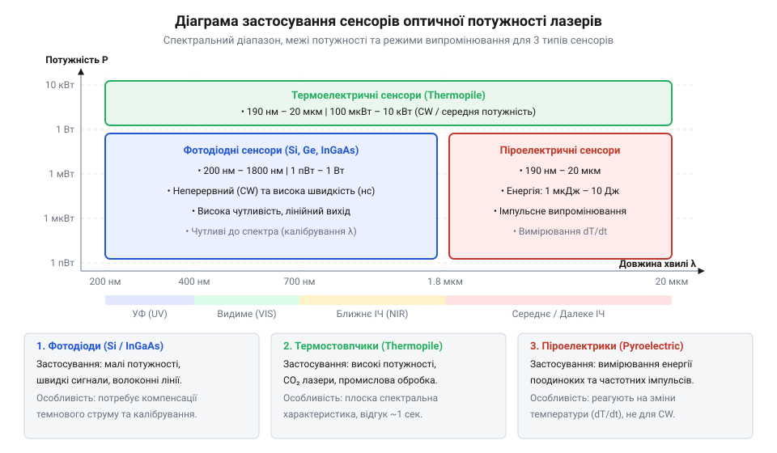
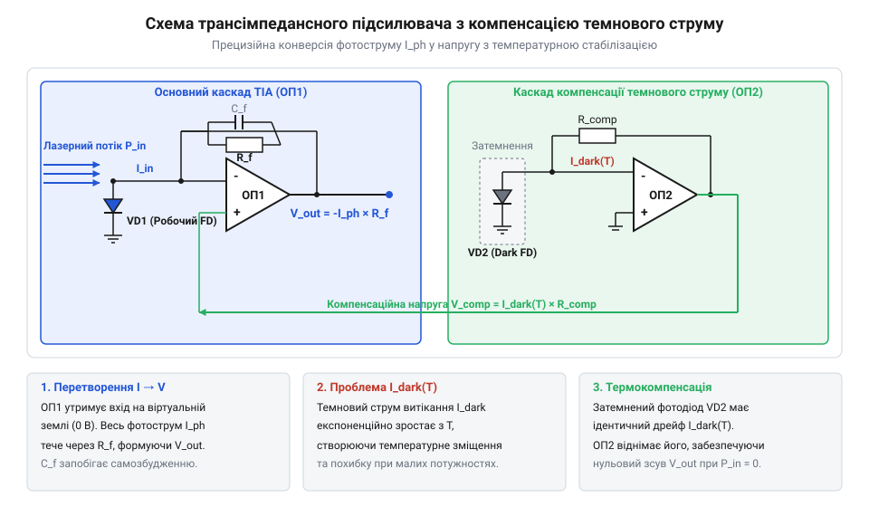
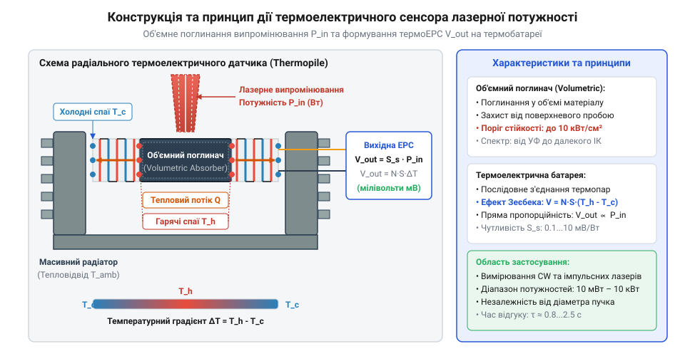
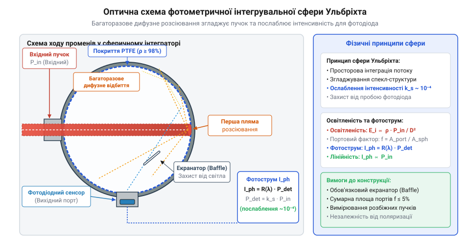

# Вимірювачі оптичної потужності лазерного випромінювання

## Фізичні проблеми вимірювання лазерної потужності

Вимірювання абсолютної потужності лазерного випромінювання принципово відрізняється від фотометрії класичних некогерентних джерел світла. Головна вимірювальна проблема полягає у винятково високій просторовій та спектральній концентрації оптичної енергії. Якщо звичайна лампа випромінює світло у просторовий кут 4π стерадіан у широкій смузі частот, то лазерний пучок сфокусовано у вузький промінь із високою енергетичною щільністю. При прямому попаданні такого пучка на вимірювальний приймач виникає ризик перевищення порогу оптичного руйнування (англ. @@en|laser-induced damage threshold@@, LIDT), що призводить до локального випаровування чи деградації поглинального покриття датчика. Висока монохроматичність та когерентність лазерного променя створює додаткову вимірювальну загрозу: паралельні грані захисного оптичного вікна товщиною `d_w` із показником заломлення `n` утворюють ненавмисний еталон Фабрі-Перо (англ. @@en|Fabry-Pérot etalon@@ від прізвищ фізиків Шарля Фабрі та Альфреда Перо). Багатопроменева інтерференція між відбиттями від передньої та задньої граней з набігом фази `δ = (4 · π · n · d_w · cos(θ_t)) ÷ λ` модулює коефіцієнт пропускання вікна `T_FP` від `T_min = (1 - R) ÷ (1 + R)` до `100%`. Найменша зміна температури вікна чи дрейф довжини хвилі `λ` змінює умови інтерференції й викликає флуктуації виміряної потужності амплітудою до `±4-8%`. Для усунення цієї похибки захисні вікна виготовляють із клиноподібним розходженням граней під кутом `0.5°-1°` (англ. @@en|wedged window@@) або наносять просвітлювальні покриття. Додаткове ускладнення виникає через лінійну поляризацію лазерного випромінювання. При падінні променя на захисне оптичне вікно під кутом `θ_i` коефіцієнти відбиття для s-поляризації `R_s` та p-поляризації `R_p` істотно відрізняються відповідно до формул Френеля:

```
R_s = (sin(θ_i - θ_t) ÷ sin(θ_i + θ_t))²      [відбиття перпендикулярно поляризованого світла]
R_p = (tan(θ_i - θ_t) ÷ tan(θ_i + θ_t))²      [відбиття паралельно поляризованого світла]
```

Де `θ_t` — кут заломлення у матеріалі вікна. Для p-поляризованого світла відбиття обнуляється при досягненні кута Брюстера `θ_B = arctan(n)`, тоді як для s-поляризації воно монотонно зростає. Ця асиметрія призводить до поляризаційної похибки вимірювання потужності до кількох відсотків при зміні орієнтації сенсора, що вимагає нормального падіння пучка (`θ_i ≈ 0°`) або використання просвітлювальних покриттів.

Другим інженерним викликом є гігантський динамічний діапазон вимірювань, що охоплює понад дванадцять порядків: від піковат (10⁻¹² Вт) у квантовій оптиці й волоконних лініях зв'язку до десятків кіловат (10⁴ Вт) у промислових лазерних різаках. Жоден фізичний детектор не здатний лінійно перетворювати світловий потік на електричний сигнал у такому діапазоні. Математичний механізм розрахунку щільності потужності випромінювання `E_p` визначається відношенням середньої оптичної потужності пучка `P_avg` до площі його поперечного перерізу `A = (π · d²) ÷ 4`, де `d` — діаметр променя, звідки отримуємо вираз `E_p = (4 · P_avg) ÷ (π · d²)`. Однак у реальному лазерному промені з ґаусовим профілем фундаментальної моди @@en|TEM₀₀@@ (англ. @@en|transverse electromagnetic mode@@) інтенсивність розподілена нерівномірно і спадає від центра за законом `I(r) = I_peak · e⁻²ʳ² ⁽ᵈⁱᵛ⁾ ʷ²`, де `w` — радіус пучка за рівнем `1/e²` (`d = 2 · w`). Інтегрування цього розподілу дає вдвічі вищу пікову щільність потужності в центрі плями `I_peak = (2 · P_avg) ÷ (π · w²) = (8 · P_avg) ÷ (π · d²) = 2 · E_p`. Наприклад, для лазера потужністю `P_avg = 1 Вт`, сфокусованого у пляму діаметром `d = 0.01 см` (100 мкм), середня щільність потужності складає `E_p ≈ 12.7 кВт/см²`, а пікова інтенсивність на оптичній осі досягає `I_peak ≈ 25.5 кВт/см²`, що подвоює локальне теплове навантаження й перевищує поріг руйнування стандартних фотодіодних датчиків. При імпульсному випромінюванні гранична стійкість оптичного покриття описується порогом оптичного руйнування `F_th` (Дж/см²). Фізичний механізм пошкодження визначається тепловою дифузією на глибину `d_th = √(4 · D · τ_p)`, де `D` — температурнопровідність матеріалу, а `τ_p` — тривалість імпульсу. Математичну залежність граничної енергетичної щільності `F_th` та пікової щільності потужності `E_peak` від тривалості імпульсу розраховують за формулою:

```
F_th = C · √τ_p                             [залежність енергетичного порогу від теплової дифузії]
E_peak = F_th ÷ τ_p                         [визначення пікової щільності потужності]
       = C ÷ √τ_p                           [підстановка закону дифузійного прогріву]
```

Де `C` — константа теплофізичних властивостей поглинача. З отриманого виразу видно, що при скороченні тривалості імпульсу `τ_p` допустима енергія `F_th` зменшується, оскільки тепло не встигає відводитися вглиб матеріалу. Це викликає локальний стрибок температури вище точки плавлення й призводить до термічного анулювання — вибухового випаровування й руйнування поглинального покриття. Для низьких потужностей критичним стає фліккер-шум та темновий струм сенсора, тоді як при високих рівнях випромінювання настає насичення фотопровідності або термічне перегрівання.


*Діаграма застосовності напівпровідникових фотодіодів, термоелементів та піроелектриків за довжиною хвилі й потужністю.*

Історично [еволюція методів вимірювання](root:cat-hw-instruments/optical-power-meter/hist-laser-power-meters-evolution.md) пройшла шлях від перших теплових болометрів до сучасних каліброваних напівпровідникових і термобатарейних головок. Для точного опрацювання розбіжних пучків або оцінки локальних гарячих плям вимірювальний тракт доповнюють аналізом [просторового профілю та діаметра](root:cat-hw-instruments/beam-profiler/math-laser-beam-propagation-and-iso11146-moments.md) лазерного променя. Будь-яка неточність у врахуванні апертури сенсора чи кута падіння променя призводить до значної систематичної похибки вимірювача оптичної потужності (англ. @@en|optical power meter@@, OPM).

## Фізика та схемотехніка фотодіодних сенсорів

Для вимірювання малих та середніх рівнів неперервного лазерного випромінювання (від піковат до сотень міліват) застосовують напівпровідникові фотодіоди (англ. @@en|photodiode@@ від грец. @@grc|фос@@ — світло та англ. @@en|diode@@). При поглинанні фотонів у p-n переході з енергією, що перевищує ширину забороненої зони напівпровідника `E_g`, генеруються електронно-діркові пари. Внутрішнє електричне поле переходу розділяє носії заряду, створюючи фотострум `I_pd`, що строго пропорційний падаючому світловому потоку.

Спектральний діапазон чутливості фотодіодного сенсора визначається матеріалом напівпровідникового кристала. Кремнієві (Si) фотодіоди покривають видимий та ближній ультрафіолетовий і інфрачервоний спектр (190–1100 нм). Для інфрачервоних лазерів телекомунікаційного діапазону (1310 нм та 1550 нм) використовують арсенід індію-галію (InGaAs, 800–1700 нм) або германій (Ge, 800–1800 нм). Кожен матеріал має власну характеристику спектральної чутливості `S(λ)` (А/Вт). На квантовому рівні фотострум визначається числом поглинутих фотонів, а чутливість виражається формулою `S(λ) = (η · q · λ) ÷ (h · c)`, де `η` — внутрішній квантовий вихід (англ. @@en|quantum efficiency@@), `q` — заряд електрона, `h` — стала Планка, а `c` — швидкість світла у вакуумі. Просторовий розподіл поглинання оптичного випромінювання у глибину напівпровідника `z` підпорядковується закону Бугера — Ламберта — Бера (англ. @@en|Beer-Lambert law@@ від прізвищ фізиків П'єра Бугера, Йоганна Ламберта та Августа Бера): `I(z) = I_0 · e⁻ᵃ⁽ˡᵃᵐᵇᵈᵃ⁾ ⁽ᵈⁱᵛ⁾ ᶻ`, де `α(λ)` — спектральний коефіцієнт поглинання матеріалу. Для коротких хвиль (УФ-діапазон) `α(λ)` надто великий, і світло поглинається у поверхневому мертвому шарі до p-n переходу, тоді як біля довгохвильової межі `λ_co = (h · c) ÷ E_g` поглинання `α(λ)` стрімко падає, і промінь проходить кристал наскрізь без генерації носіїв. При підвищенні температури ширина забороненої зони напівпровідника `E_g` звужується, що зміщує довгохвильову межу поглинання `λ_co` у бік довших хвиль. Це червоне зміщення призводить до того, що на крайніх довжинах хвиль (наприклад, понад 1000 нм для кремнію) спектральна чутливість `S(λ)` зростає з коефіцієнтом до 0.5–1.0 % на градус Цельсія, що вимагає застосування активної термостабілізації або програмної компенсації.

Щоб забезпечити максимальну лінійність перетворення й виключити темновий струм витоку, фотодіод підключають у фотогальванічному режимі із нульовою різницею потенціалів на аноді й катоді (`V_d = 0 В`). Первинним підсилювачем слугує прецизійний трансімпедансний підсилювач (англ. @@en|transimpedance amplifier@@, TIA) на операційному підсилювачі з ультранизьким вхідним струмом зсуву. Проте в реальних підсилювачах між входами існує ненульова вхідна напруга зсуву `V_os`, яка прикладається до виводів фотодіода. Через еквівалентний шунтувальний опір p-n переходу `R_sh` ця напруга викликає паразитний струм `I_err`, який підсилюється резистором зворотного зв'язку `R_f` і створює напругу помилки `V_err`:

```
I_err = V_os ÷ R_sh                         [паразитний струм через напругу зсуву та шунт]
V_err = I_err · R_f                         [перетворення паразитного струму в напругу помилки]
      = (V_os ÷ R_sh) · R_f                 [підстановка паразитного струму зсуву]
```

Оскільки шунтувальний опір напівпровідника `R_sh` експоненційно зменшується при нагріванні (приблизно вдвічі на кожні `8–10 °C`), дрейф напруги зсуву `V_os` призводить до температурної нестабільності темнового струму `I_err`, що обмежує мінімальну вимірювану потужність і вимагає застосування автонульових операційних підсилювачів або систем термостабілізації.


*Принципова схема аналогового тракту TIA з фотодіодом у фотогальванічному режимі та компенсацією зсуву.*

Вихідна напруга підсилювального тракту розраховується з фізичних параметрів фотодіода та опору резистора зворотного зв'язку `R_f`:

```
V_out = I_pd · R_f                       [перетворення фотоструму в напругу на опорі зворотного зв'язку]
      = P_in · S(λ) · R_f                      [підстановка залежності фотоструму від оптичної потужності]
```

Де `P_in` — абсолютна оптична потужність випромінювання на довжині хвилі `λ`, `S(λ)` — спектральна чутливість сенсора на цій довжині хвилі, а `R_f` — опір прецизійного резистора зворотного зв'язку. Однак великий опір `R_f` у поєднанні з власною ємністю p-n переходу фотодіода `C_j` та вхідною ємністю підсилювача `C_in` утворює полюс у петлі зворотного зв'язку, що зсуває фазу на 90° і викликає самозбудження TIA. Крім загрози генерації, сумарна вхідна ємність `C_d = C_j + C_in` викликає ефект високочастотного сплеску шумів (англ. @@en|noise gain peaking@@). Коефіцієнт підсилення власного шуму напруги ОП `e_n` (англ. @@en|noise gain@@) зростає з частотою від одиниці на постійному струмі до максимуму `A_n = 1 + (C_d ÷ C_f)` на високих частотах. Без компенсації цей підйом створює значний пік вихідного шуму біля граничної частоти. Для забезпечення частотної стабільності та обмеження сплеску шумів паралельно `R_f` підключають компенсаційний конденсатор `C_f`, значення якого для частоти одиничного підсилення ОП `f_GBW` вибирають за формулою:

```
C_f = √((C_d) ÷ (2 · π · R_f · f_GBW))         [умова оптимального запасу фази за Баттервортом]
f_-3dB = √((f_GBW) ÷ (2 · π · R_f · C_d))       [підсумкова смуга пропускання TIA]
```

Введення ємності `C_f` створює нуль у передавальній функції зворотного зв'язку та полюс у коефіцієнті підсилення шуму на частоті `f_p = 1 ÷ (2 · π · R_f · C_f)`, що обмежує шум на рівні `1 + (C_d ÷ C_f)`, відновлює запас стійкості по фазі до безпечних `45–60°` і запобігає високочастотному сплеску шуму в аналоговому тракті.

```
V_out = I_pd · R_f                       [перетворення фотоструму в напругу на опорі зворотного зв'язку]
      = P_in · S(λ) · R_f                      [підстановка залежності фотоструму від оптичної потужності]
```

Де `P_in` — абсолютна оптична потужність випромінювання на довжині хвилі `λ`, `S(λ)` — спектральна чутливість сенсора на цій довжині хвилі, а `R_f` — опір прецизійного резистора зворотного зв'язку. Однак великий опір `R_f` у поєднанні з власною ємністю p-n переходу фотодіода `C_j` та вхідною ємністю підсилювача `C_in` утворює полюс у петлі зворотного зв'язку, що зсуває фазу на 90° і викликає самозбудження TIA. Для забезпечення частотної стабільності паралельно `R_f` підключають компенсаційний конденсатор `C_f`, значення якого для сумарної ємності `C_d = C_j + C_in` та частоти одиничного підсилення ОП `f_GBW` вибирають за формулою:

```
C_f = √((C_d) ÷ (2 · π · R_f · f_GBW))         [умова оптимального запасу фази за Баттервортом]
f_-3dB = √((f_GBW) ÷ (2 · π · R_f · C_d))       [підсумкова смуга пропускання TIA]
```

Введення ємності `C_f` створює нуль у передавальній функції зворотного зв'язку, що відновлює запас стійкості по фазі до безпечних `45–60°` і запобігає високочастотній генерації аналогового тракту.

        V_out = I_pd · R_f                       [перетворення фотоструму в напругу на опорі зворотного зв'язку]
        = P_in · S(λ) · R_f                      [підстановка залежності фотоструму від оптичної потужності]

Де `P_in` — абсолютна оптична потужність випромінювання на довжині хвилі `λ`, `S(λ)` — спектральна чутливість сенсора на цій довжині хвилі, а `R_f` — опір прецизійного резистора зворотного зв'язку.

Для вимірювання мікровольтних сигналів у високоточних приладах виконують [математичне моделювання вимірювачів](root:cat-hw-instruments/optical-power-meter/math-optical-power-measurement-models.md) для врахування шумів еквівалентного опору шунтування `R_sh` та температурного дрейфу. Підключення змінних вимірювальних головок із вбудованою EEPROM калібрувальних коефіцієнтів забезпечує уніфікований [залізний інтерфейс підключення](root:cat-hw-instruments/optical-power-meter/api-optical-sensor-head-interface.md) до базованого на мікроконтролері вимірювального блока. Повний цикл проектирования аналогового тракту описує практична [розробка портативного вимірювача](root:cat-hw-instruments/optical-power-meter/proj-calibrated-laser-power-meter-module.md) лазерної потужності.

## Теплові та піроелектричні приймачі лазерної потужності

При вимірюванні лазерів високої потужності (від одиниць ват до десятків кіловат) напівпровідникові фотодіоди непридатні через фотоелектричне насичення та миттєве оптичне руйнування поверхні. Для роботи з високими рівнями випромінювання застосовують неселективні теплові вимірювачі, принцип дії яких базується на повному перетворенні поглинутої світлової енергії в теплоту з наступним вимірюванням температурного градієнта.

Основою термоелектричних датчиків є термобатарея (англ. @@en|thermopile@@ від грец. @@grc|терме@@ — тепло та англ. @@en|pile@@), що складається з послідовно з'єднаних напівпровідникових чи металевих термопар. Лазерне випромінювання падає на чорне поглинальне покриття лицевого боку дисків, а тильний бік охолоджується радіатором. Виникаючий радіальний або осьовий тепловий потік створює різницю температур `ΔT`, яка за ефектом Зеєбека перетворюється в електричну напругу `V_th`. Оскільки вихідний сигнал є відносно малим (порядку `10–100 мкВ/Вт`), вимірювальний тракт піддається термоелектричному зсуву нуля — появі паразитної термо-ЕРС у місцях з'єднання виводів сенсора з друкованою платою під дією зовнішніх температурних градієнтів та повітряних потоків. Для компенсації цього зсуву термоелектричний сенсор підключають за диференціальною схемою до прецизійного нановольтметра з чоперною стабілізацією (із періодичним обнуленням зсуву) та розташовують контактні спаї в єдиному ізотермічному корпусі, що запобігає дрейфу нуля й забезпечує точне зчитування мікровольтових напруг.


*Конструктивна схема термоелектричного датчика оптичної потужності із термобатареєю.*

Термоелектричні сенсори ділять на поверхневі та об'ємні поглиначі. Поверхневі графітові чи керамічні шари витримують неперервну щільність потужності до `2-5 кВт/см²`. Для коротких високоенергетичних імпульсів застосовують об'ємні скляні або керамічні фільтри, які поглинають світло у товщині матеріалу, запобігаючи поверхневому вибуху. У радіальній конфігурації диска товщиною `d_d` із коефіцієнтом теплопровідності `k_th` поглинута лазерна потужність `P_in` створює логарифмічний температурний градієнт `ΔT_rad` між внутрішнім радіусом `r_i` та зовнішнім колом радіатора `r_o`. Послідовне з'єднання `N_tp` радіально розташованих термопар з коефіцієнтом Зеєбека `S_Se` (англ. @@en|Seebeck coefficient@@ від прізвища фізика Томаса Зеєбека) ґенерує підсумкову термо-ЕРС `V_th`:

```
ΔT_rad = (P_in ÷ (2 · π · k_th · d_d)) · ln(r_o ÷ r_i)  [температурний градієнт радіального диска]
V_th = N_tp · S_Se · ΔT_rad                             [термо-ЕРС термобатареї за ефектом Зеєбека]
     = (N_tp · S_Se · ln(r_o ÷ r_i) ÷ (2 · π · k_th · d_d)) · P_in  [підстановка температурного градієнта]
```

Головним обмеженням термобатарей є теплова інерційність: зміна температури диска `ΔT(t)` описується рівнянням теплового балансу з постійною часу `τ_th = C_th ÷ G_th`, де `C_th` — теплоємність поглинача, а `G_th` — теплова провідність до радіатора. Перехідний процес нагрівання та алгоритм цифрового прогнозування стаціонарної потужності `P_pred(t)` виражають формулами:

```
ΔT(t) = (P_in ÷ G_th) · (1 - e⁻ᵗ ⁽ᵈⁱᵛ⁾ ᵀᵗʰ)     [перехідний процес нагрівання сенсора]
P_pred(t) = G_th · (ΔT(t) + τ_th · (d(ΔT) ÷ dt))  [цифрове прискорення відгуку]
```

Де `P_in` — вхідна оптична потужність. Оскільки фізичний час досягнення теплового балансу становить 1–5 секунд, мікропроцесор OPM аналізує швидкість наростання температури `d(ΔT) ÷ dt` і екстраполює вихідний сигнал, зменшуючи розрахунковий час вимірювання до сотень мілісекунд.

Для вимірювання енергії поодиноких та високочастотних імпульсів короткої тривалості (нано- та пікосекундних лазерів) використовують піроелектричні приймачі (англ. @@en|pyroelectric sensor@@ від грец. @@grc|пир@@ — вогонь). Вони базуються на кристалах сегнетоелектриків (наприклад, танталату літію `LiTaO₃`), у яких зміна температури `dT/dt` викликає швидку зміну спонтанної поляризації й генерує імпульсний заряд. Фізичний механізм полягає в тому, що генерований піроелектричний струм `I_pyro` пропорційний площі кристала `A`, піроелектричному коефіцієнту матеріалу `γ_p` та не самій температурі, а швидкості її зміни по часу `dT/dt`. Вихідний струм приймача розраховують за формулою:

```
I_pyro = dQ ÷ dt                            [визначення струму як похідної заряду по часу]
       = A · γ_p · (dT ÷ dt)                [підстановка залежності поляризації від температури]
```

Для визначення повної енергії поодинокого лазерного спалаху `E_in` вимірювальний тракт інтегрує імпульс струму `I_pyro` за часом поглинання, обчислюючи накопичений заряд `Q_total`:

```
Q_total = ∫ I_pyro dt                       [інтегрування струму імпульсу по часу]
        = A · γ_p · ∫ (dT ÷ dt) dt          [підстановка виразу піроелектричного струму]
        = A · γ_p · ΔT_max                  [приріст температури кристала в адіабатичному режимі]
        = (A · γ_p ÷ C_th) · E_in           [зв'язок заряду з поглинутою енергією імпульсу]
```

Де `C_th` — теплоємність сегнетоелектрика, а `ΔT_max` — стрибок температури за тривалість імпульсу `τ_p`, що значно менша за час теплового відведення (`τ_p ≪ τ_th`). Накопичений заряд `Q_total` створює на інтегрувальні ємності `C_int` вихідну пікову напругу `V_peak = Q_total ÷ C_int`, що строго пропорційна енергії лазерного спалаху.

```
I_pyro = dQ ÷ dt                            [визначення струму як похідної заряду по часу]
       = A · γ_p · (dT ÷ dt)                [підстановка залежності поляризації від температури]
```

Із цього рівняння випливає, що за стаціонарного лазерного випромінювання кристал досягає теплової рівноваги (`dT/dt = 0`), зв'язані заряди релаксують, і піроелектричний струм повністю зникає (`I_pyro = 0`). Тому для вимірювання неперервних лазерних пучків світловий потік обов'язково періодично переривають за допомогою оптичного модулятора (чопера), який перетворює неперервне світло у серію теплових імпульсів зі змінною температурою.

## Інтегрувальні сфери та оптимізація калібрування

Вимірювання потужності випромінювання світлодіодів, лазерних діодних лінійок та волоконних світловодів ускладнюється великим кутом розбіжності променя. Введення широкого пучка безпосередньо на плоский фотодіод спричиняє кутову похибку та віньєтування. Для розв'язання цієї проблеми застосовують [фотометричні сфери та вимірювання](root:hw-sensing/integrating-spheres-photometry) у сферичних порожнинах Ульбріхта.

Внутрішню поверхню порожнини покривають високодифузним матеріалом (наприклад, @@en|Spectralon@@ чи сульфатом барію `BaSO₄`) з коефіцієнтом відбиття `ρ > 0.98`. Багаторазове ламбертівське перевідбиття рівномірно розподіляє світловий потік по внутрішній поверхні, послаблюючи щільність випромінювання на фотодетекторі в сотні разів без порушення спектрального складу. Ослаблення випромінювання описують коефіцієнтом передачі сфери `K_m = P_det ÷ P_in`, який виражає відношення оптичної потужності на детекторі `P_det` до вхідної лазерної потужності `P_in`. Якщо сфера має внутрішню площу `A_s = 4 · π · R²`, вхідний порт площею `A_i` та вихідний порт площею `A_e`, відносна площа відкритих отворів становить `f = (A_i + A_e) ÷ A_s`, а ефективний коефіцієнт відбиття стінок з урахуванням витоку світла крізь порти дорівнює `ρ_eff = ρ · (1 - f)`. Ураховуючи внесок нескінченної серії перевідбиттів, коефіцієнт передачі `K_m` розраховують за формулою:

```
K_m = (A_e ÷ A_s) · ρ · (1 + ρ_eff + ρ_eff² + ...)
    = (A_e ÷ A_s) · ρ ÷ (1 - ρ_eff)                 [сума нескінченної геометричної прогресії]
    = (A_e ÷ A_s) · ρ ÷ (1 - ρ · (1 - f))            [підстановка ефективного відбиття ρ_eff]
```

Із цього виразу видно, що за високого коефіцієнта відбиття (`ρ ≈ 0.98`) знаменник `1 - ρ · (1 - f)` стає малим значенням, через що мультиплікатор сфери суттєво підсилює інтегрувальний ефект, але водночас робить коефіцієнт ослаблення чутливим до найменших деградацій покриття або зміни площі портів.


*Оптична схема інтегрувальної сфери Ульбріхта для вимірювання розбіжних та високоінтенсивних пучків.*

Точність вимірювання оптичної потужності залежить від систематичного калібрування вимірювача за первинними національними еталонами. Оскільки чутливість фотодіодів залежить від довжини хвилі та температури, мікропроцесор приладу автоматично множить виміряний фотострум на спектральний коефіцієнт із таблиці EEPROM. Серйозною причиною похибок є кутова асиметрія та пряме влучання первинного пучка на детектор. При введенні розбіжного променя під кутом `θ_i` без перегородження пряме відбиття створює кутову похибку `δ_θ = cos(θ_i) - 1`, яка для кутів `θ_i = 30°` сягає понад `-13.4%`. Для запобігання безпосередньому засвічуванню всередині сфери між вхідним портом і приймачем встановлюють непрозорий екран-бафл (англ. @@en|baffle@@), покритий тим самим дифузним матеріалом (`ρ > 0.98`). Бафл повністю перекриває лінію прямої видимості між плямистою зоною первинного відбиття та фотодіодом, примушуючи все світло здійснювати щонайменше одне додаткове ламбертівське перевідбиття й зменшуючи кутову похибку до рівня менше `0.1%`. Додаткова систематична похибка виникає через ефект самопоглинання: коли у вхідний порт сфери встановлюють темний корпус лазерного модуля чи волоконний адаптер, він поглинає частину перевідбитого світла, зменшуючи ефективний коефіцієнт відбиття стінок і знижуючи коефіцієнт передачі `K_m`. Для компенсації цього поглинання застосовують метод допоміжного джерела світла. Спочатку вимірюють сигнал допоміжного джерела для порожньої сфери `S_aux1`, а потім — із підключеним лазерним вимірюваним модулем `S_aux2`. Коефіцієнт корекції `α_corr` та скориговану абсолютну потужність `P_in` розраховують за формулами:

```
α_corr = S_aux1 ÷ S_aux2                    [розрахунок коефіцієнта поглинання зразка]
P_in = P_meas · α_corr                      [підстановка скоригованої оптичної потужності]
```

Де `P_meas` — первинно виміряна потужність. Множення на поправку `α_corr` повністю компенсує виток перевідбитої енергії на корпусі досліджуваного пристрою, усуваючи заниження виміряної потужності.

Окрім спектральної нелінійності, основними джерелами похибок є паразитна зворотна рефлексія в лазерний резонатор, поляризаційна чутливість оптичних вікон, стороннє фонове засвічування та спекл-шум (англ. @@en|speckle noise@@ від англ. @@en|speckle@@ — цятка). Для усунення зовнішнього фонового засвічування оптичний пучок модулюють чопером на опорній частоті `f_ref`. Отриманий змінний сигнал фотодіода `V_in(t) = V_s · sin(2 · π · f_ref · t + φ) + V_noise(t)` опрацьовують у синхронному підсилювачі (англ. @@en|lock-in amplifier@@). У фазочутливому детекторі сигнал перемножують із опорним прямокутним меандром `V_ref(t) = sin(2 · π · f_ref · t)`, що дає вираз `V_mult(t) = (V_s ÷ 2) · cos(φ) - (V_s ÷ 2) · cos(4 · π · f_ref · t + φ)`. Фільтр низьких частот зі смугою `f_c ≪ f_ref` виділяє постійну складову `V_out = (V_s ÷ 2) · cos(φ)`, повністю пригнічуючи несинхронний шум засвічення й фліккер-шум на 60–80 дБ. Висока когерентність лазерного випромінювання спричиняє інтерференцію світлових хвиль після багаторазових дифузних відбиттів від стінок сфери, утворюючи стаціонарну плямисту картину інтерференції. Оскільки розмір інтерференційної плями залежить від довжини хвилі, найменший дрейф частоти або вібрація викликає флуктуації локальної інтенсивності на фотодіоді. Контраст спекл-шуму `C_s` зменшують шляхом усереднення великої кількості плям `N_s ≈ A_e ÷ d_s²` на апертурі детектора `A_e`:

```
C_s = 1 ÷ √(N_s)                             [контраст спекл-шуму від кількості плям]
    = 1 ÷ √(A_e ÷ d_s²)                      [підстановка відношення площі детектора до плями]
```

Для приглушення цього шуму застосовують п'єзоелектричні вібратори сфери або рухомі розсіювальні екрани, які динамічно зміщують інтерференційну картину протягом часу інтегрування фотодетектора. Для усунення зовнішнього світла застосовують оптичні модулятори (чопери) із синхронним детектуванням на фіксованій частоті. Дистанційне опитування вимірювальних блоків та вибір довжини хвилі реалізують через стандартний [програмний інтерфейс SCPI](root:cat-hw-instruments/optical-power-meter/api-optical-power-meter-scpi-commands.md) по цифрових шинах управління.
