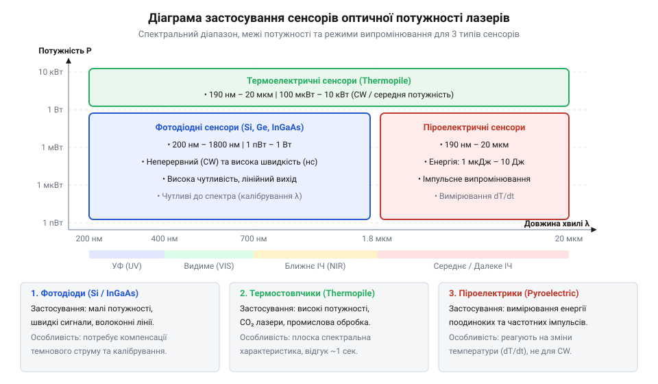

# Вимірювачі оптичної потужності лазерного випромінювання

<preknowlist>
- [Історія еволюції вимірювачів потужності](root:cat-hw-instruments/optical-power) — meter/hist-laser-power-meters-evolution.md — Еволюція теплових болометрів та фотодіодних головок
</preknowlist>

## Виклики вимірювання лазерного променя

Пряме вимірювання лазерного випромінювання кардинально відрізняється від роботи зі звичайним світлом через високу @@en|power density@@ (конденсацію енергії в вузькому пучку) та монохроматичність. Оптичний промінь здатний миттєво перегріти вимірювальний елемент або викликати оптичне руйнування (англ. @@en|laser-induced damage threshold@@, від @@en|threshold@@ — поріг). Якщо енергія перевищує межу @@en|LIDT@@, поверхня датчика випаровується чи деградує. Додатково паралельні плоскопаралельні захисні вікна створюють пастку: монохроматичне світло інтерферує між гранями вікна, створюючи паразитно модульований сигнал при найменшому зсуві довжини хвилі чи температури. Поляризація променя також змінює коефіцієнт відбиття під кутом. Тому пряме спрямування колімованого променя на вимірювач оптичної потужності (англ. @@en|optical power meter@@) без спеціалізованої вимірювальної головки призводить до руйнування приладу або хибних показань. Оцінити [еволюцію теплових болометрів](root:cat-hw-instruments/optical-power-meter/hist-laser-power-meters-evolution.md) можна у відповідному історичному огляді.

## Напівпровідникові фотодіодні вимірювачі

Для вимірювання малих потужностей від піковат до сотень міліват застосовують напівпровідниковий фотодіод (грец. @@el|photos@@ — світло + англ. @@en|diode@@), який працює у фотогальванічному режимі (англ. @@en|photovoltaic mode@@). Поглинуті фотони генерують фотострум `Iₚₕ`, пропорційний оптичній потужності `P`:

Iₚₕ = Rλ × P

де `Rλ` — спектральна чутливість у амперах на ват (А/Вт). Оскільки вихідний струм діода малий, його перетворює на напругу трансімпедансний підсилювач (англ. @@en|transimpedance amplifier@@, від trans- + impedance) на базі малошумного операційного підсилювача:

Uₒᵤₜ = - Iₚₕ × R_f      [перетворення струму в напругу на опорі зворотного зв'язку]

Вибір матеріалу фотодіода визначається довжиною хвилі випромінювання: кремній (Si) охоплює видимий і ближній інфрачервоний діапазон (300–1100 нм), германій (Ge) працює від 800 до 1800 нм, а індій-галій-арсенід (InGaAs) забезпечує високу чутливість і низький темновий струм в області оптичного волокна (800–1700 нм). При проектуванні високошвидкісних TIA складні ефекти, як-от [викиди коефіцієнта підсилення шуму](root:hw-analog/tia-noise-gain-peaking), вимагають додаткової компенсації.

## Теплові та піроелектричні сенсори

Високоінтенсивні та імпульсні лазери потребують сенсорів, стійких до оптичного пробою. Для неперервного випромінювання потужністю від міліват до десятків кіловат використовують термоелектричну термобатарею (англ. @@en|thermopile@@). Вона складається з поглинального покриття та масиву термопар, що використовують ефект Зеєбека (нім. @@de|Seebeck-Effekt@@): поглинене світло перетворюється на тепло, створюючи градієнт температури й радіальний тепловий потік до радіатора, що генерує пропорційну напругу. Для захисту від пробою застосовують поверхневі (для помірних густин) або об'ємні поглиначі (дифузне скло чи кераміку, що розподіляє енергію в товщі).

Для коротких наносекундних імпульсів термоелементи занадто повільні. Тут працює піроелектричний сенсор (грец. @@el|pyr@@ — вогонь) на основі кристалів (наприклад, LiTaO₃). Зміна температури `ΔT` від лазерного спалаху викликає швидку поляризацію кристала та вивільнення електричного заряду `Q`:

Q = p × A × ΔT

де `p` — піроелектричний коефіцієнт, `A` — площа. Інтегрування цього заряду дає точну енергію поодинокого імпульсу. Опрацювання слабких сигналів теплових датчиків часто потребує [нановольтметрів із чоперною стабілізацією](root:hw-analog/chopper-stabilized-nanovoltmeter).

*Діаграма висвітлює межі застосовності напівпровідникових, термоелектричних та піроелектричних сенсорів.*

## Інтегрувальні сфери та зменшення похибок

Коли лазерний пучок має високу розбіжність або надмірну потужність, застосовують фотометричну інтегрувальну сферу Ульбріхта (нім. @@de|Ulbricht-Kugel@@). Це порожниста куля з високорефлексивним дифузним внутрішнім покриттям (наприклад, Spectralon або BaSO₄). Світло, потрапляючи всередину через вхідний порт, зазнає багаторазових внутрішніх відбиттів і рівномірно розсіюється по всій площі поверхні, знижуючи густину потужності в тисячі разів без зміни спектрального складу.

Щоб запобігти прямому влучанню первинного чи першоразово відбитого променя на фотоприймач, усередині сфери встановлюють захисні екрани — бафли (англ. @@en|baffle@@). Для усунення похибок від фонового кімнатного освітлення промінь модулюють оптичним обтюратором (англ. @@en|optical chopper@@) і виділяють корисний сигнал синхронним підсилювачем. Організацію вимірювань регулюють відповідні [промислові стандарти ISO](root:hw-sensing/iso-laser-power-standards).
