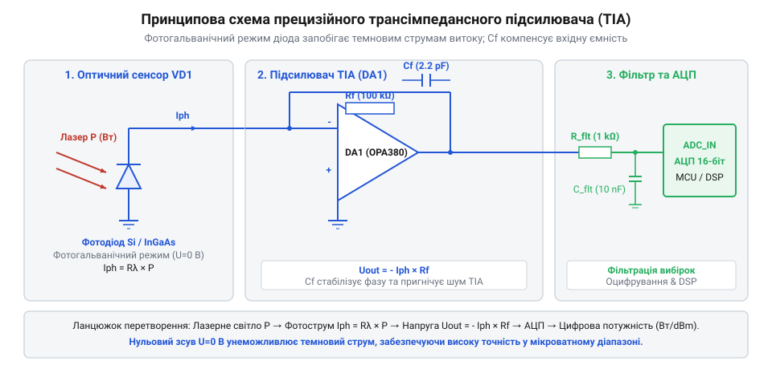

# Розробка портативного вимірювача лазерної потужності

## Проблема вимірювання фотоструму слабких сигналів

Вимірювання оптичної потужності непреривного лазерного випромінювання починається з перетворення світлового потоку в електричний сигнал. Для цього використовують фотодіод (від грец. *phōs* — світло, *dis* — двічі та *hodos* — шлях; @@en|photodiode@@) — напівпровідниковий прилад, у P-N переході якого під дією фотонів генеруються пари носіїв заряду. Падаюча оптична потужність створює пропорційний фотострум (@@en|photocurrent@@) `I_ph`. У мікроватному та міліватному діапазонах випромінювання цей струм має незначну величину — від кількох наноамперів до сотень мікроамперів.

Спроба виміряти цей струм шляхом прямого підключення фотодіода до аналогово-цифрового перетворювача (@@en|ADC@@) мікроконтролера через послідовний вимірювальний резистор `R_m` стикається з двома фундаментальними проблемами: низькою чутливістю та падінням лінійності. Якщо обрати опір `R_m` малим (наприклад, 100 Ом), то для фотоструму `I_ph` = 1 мкА вихідна напруга становитиме:

```
V_out = I_ph × R_m
= 1 × 10⁻⁶ А × 100 Ом
= 100 мкВ
```

Напруга 100 мкВ повністю губиться у власних шумах і дискретності 12-бітного АЦП із опорною напругою `V_ref` = 3.3 В, де ціна одного молодшого розряду (LSB) дорівнює:

```
V_LSB = V_ref / 4095
= 3.3 В / 4095
≈ 805.8 мкВ
```

Спроба збільшити опір `R_m` до 1 МОм для отримання помітної напруги викликає іншу біду: порушення лінійності через зсув робочої точки на вольт-амперній характеристиці P-N переходу. Повний струм освітленого фотодіода описується рівнянням Шоклі з урахуванням генерованого світлом фотоструму `I_ph`: `I_d = I_s · (e^(V_d / (n · φ_T)) - 1) - I_ph`, де `I_s` — струм насичення, `n` — коефіцієнт неідеальності переходу, а `φ_T = k_B · T / q ≈ 25.8` мВ — термічний потенціал при температурі 300 К. Коли фотодіод навантажений на великий опір `R_m`, фотострум створює на ньому спад напруги `V_out = I_net × R_m`, яка одночасно виступає прямою напругою зміщення `V_d > 0` на самому P-N переході. Зі зростанням `V_d` прямо пропорційно напрузі починає експоненційно зростати прямий струм витоку `I_f = I_s · (e^(V_d / (n · φ_T)) - 1)`, який віднімається від корисного фотоструму `I_ph`. У результаті результуючий вихідний струм `I_net = I_ph - I_f` перестає бути пропорційним оптичній потужності, а вихідна напруга замість лінійного зростання переходить у логарифмічне насичення `V_out ≈ n · φ_T · ln(I_ph / I_s + 1)`, викривляючи показання приладу у мікроамперній та міліватній областях.

Крім того, фотодіод володіє власним темновим струмом (@@en|dark current@@) `I_dark`, який протікає крізь P-N перехід навіть у повній темряві за рахунок термогенерації носіїв заряду. Оскільки вхідний опір АЦП мікроконтролера становить зазвичай від 10 кОм до 50 кОм, він шунтує вимірювальне коло і спотворює показання у сотні й тисячі разів. Для точного оцифрування необхідно підтримувати нульову напругу на виводах фотодіода та перетворювати його струм у напругу за допомогою спеціального підсилювального тракту.

## Трансімпедансний підсилювач на операційному підсилювачі

Для перетворення слабкого фотоструму у лінійну напругу без створення напруги зміщення на фотодіоді застосовують трансімпедансний підсилювач (від англ. *transimpedance* — наскрізний опір; @@en|transimpedance amplifier@@, або @@en|TIA@@) на операційному підсилювачі (ОП). Фотодіод підключають у фотогальванічному режимі (незміщений режим; @@en|photovoltaic mode@@) між інвертуючим входом та землею.

Завдяки віртуальному замиканню операційного підсилювача потенціал інвертуючого входу утримується рівним потенціалу неінвертуючого входу (землі). Оскільки потенціал на виводах фотодіода дорівнює 0 В, струм витоку P-N переходу відсутній, і увесь генерувальний фотострум `I_ph` тече виключно через резистор зворотного зв'язку `R_f`.


*Схема підключення фотодіода в фотогальванічному режимі до трансімпедансного підсилювача на ОП та АЦП.*

Вихідна напруга каскаду TIA визначається виразом:

```
V_out = I_ph × R_f
```

Для вимірювання лазерної потужності від 1 мкВт до 100 мВт із коефіцієнтом перетворення фотодіода 0.5 А/Вт фотострум змінюється в межах від 0.5 мкА до 50 мА. Обираючи `R_f` = 100 кОм, діапазон фотострумів до 33 мкА перетворюється у напругу від 0 до 3.3 В.

Однак фотодіод має власну бар'єрну ємність P-N переходу `C_j` (зазвичай від 10 до 100 пікофарад), яка разом із опором `R_f` утворює додатковий полюс у передавальній функції зворотного зв'язку. Це фазове зсунення призводить до втрати запасу стійкості каскаду та виникнення високочастотного самозбудження TIA. Для компенсації ємності `C_j` паралельно резистору `R_f` встановлюють корегувальний конденсатор `C_f`. Необхідну ємність компенсації розраховують за формулою:

```
C_f = √((C_j + C_in) / (2 × π × R_f × f_GBW))
```

де `C_in` — вхідна ємність операційного підсилювача, а `f_GBW` — добуток смуги пропускання на коефіцієнт підсилення (@@en|gain-bandwidth product@@) ОП. Для прецизійного TIA критично обирати ОП із польовими транзисторами на вході (FET або CMOS), які мають наднизькі вхідні струми витоку `I_bias` (менше 1–10 пікоампер).

## Компенсація темнового струму та зсуву

Навіть за відсутності оптичного випромінювання вихідна напруга трансімпедансного підсилювача не дорівнює суворому нулю. Реальну статичну похибку створюють три фактори: темновий струм фотодіода `I_dark`, напруга зсуву нуля ОП `V_os` та вхідний струм зміщення `I_bias`. Загальна напруга спокою (темновий зсув; @@en|dark offset voltage@@) на виході TIA визначається як:

```
V_dark = (I_dark + I_bias) × R_f + V_os × (1 + R_f / R_in)
```

Темновий струм фотодіода підпорядковується сильній температурній залежності і подвоюється приблизно кожні 8–10 °C підвищення температури навколишнього середовища. Оскільки для кремнієвого фотодіода `I_dark` може становити від 100 пА до 10 нА, при `R_f` = 100 кОм це створює фонову напругу від 10 мкВ до 1 мВ, що викривляє вимірювання у мікроватній області.

Для усунення цієї похибки застосовують процедуру нульового калібрування (@@en|zero calibration@@). Перед початком вимірювальної сесії оптичний вхід фотодетектора перекривають непрозорою заглушкою. Мікроконтролер зчитує `N` відліків АЦП і обчислює середнє значення напруги темнового зсуву:

```
V_dark = (1 / N) × ∑ (ADC_i / ADC_max) × V_ref
```

Отримане значення `V_dark` зберігається у оперативній пам'яті і надалі програмно віднімається від кожного виміряного значення напруги сигналу `V_raw`. Якщо виміряна напруга `V_raw` стає меншою за `V_dark` внаслідок температурного дрейфу чи шумів, програмний алгоритм обмежує корисний сигнал нулем, запобігаючи виникненню від'ємних значень розрахованої потужності.

## Оцифрування та спектральний перерахунок потужності

Вихід аналогового каскаду TIA підключають до аналогового входу АЦП мікроконтролера через низькочастотний RC-фільтр зрізу з часовою константою, що пригнічує високочастотні завади мережі 50 Гц та імпульсні наводки. Отриманий цифровий відлік АЦП перераховується у напругу сигналу з урахуванням темнового зсуву `V_dark`. Для зниження випадкового шуму застосовують алгоритм ковзного усереднення (@@en|moving average@@) на `M` вибірок:

```
V_sig = ((1 / M) × ∑ ADC_i / ADC_max) × V_ref - V_dark
```

Після обчислення чистої напруги корисного сигналу `V_sig` розраховують фотострум:

```
I_ph = V_sig / R_f
```

Перехід від електричного фотоструму `I_ph` до фізичної оптичної потужності `P_opt` вимагає врахування спектральної чутливості фотодіода `R(λ)` (@@en|responsivity@@), вимірюваної у А/Вт. Спектральна чутливість визначає, який струм генерується одним Ватом оптичної потужності на конкретній довжині хвилі `λ`:

```
P_opt = I_ph / R(λ)
= V_sig / (R_f × R(λ))
```

Для кремнієвих (Si) фотодіодів максимум чутливості припадає на ближній інфрачервоний діапазон (850–950 нм, де `R(λ)` ≈ 0.6 А/Вт), тоді як у фіолетовому діапазоні (405 нм) чутливість спадає до ≈ 0.15 А/Вт. Без урахування точної довжини хвилі випромінювання похибка вимірювання потужності може досягати 400%.

Нижче наведено лістинги реалізації драйвера обробки даних на мовах C та C++ з використанням кільцевого буфера фільтрації та розрахунку потужності в Ватах та децибел-міліватах (dBm):

:::tabs
@tab C
:::code proj-calibrated-laser-power-meter-module/c/include/opm_sensor.h
:::code proj-calibrated-laser-power-meter-module/c/src/opm_sensor.c
:::code proj-calibrated-laser-power-meter-module/c/src/main.c

@tab C++
:::code proj-calibrated-laser-power-meter-module/cpp/include/optical_power_meter.hpp
:::code proj-calibrated-laser-power-meter-module/cpp/src/optical_power_meter.cpp
:::code proj-calibrated-laser-power-meter-module/cpp/src/main.cpp
:::

## Практичне калібрування за еталонним джерелом

Спектральна чутливість `R(λ)`, вказана в загальному паспорті фотодіода, має технологічний розкид до ±10-15% для окремих екземплярів. Крім того, на чутливість зібраного модуля впливає пропускання захисного скла та геометрія падіння променя. Тому побудова точного вимірювача вимагає практичного еталонного калібрування.

Для виконання двохточкового калібрування використовують еталонний оптичний ватметр та лазерні джерела з фіксованими довжинами хвиль (наприклад, 405 нм, 532 нм, 650 нм, 850 нм, 1064 нм). Для кожної опорної довжини хвилі `λ_k` вимірюють точну вихідну напругу `V_sig` при падінні відомої еталонної потужності `P_ref`. Спектральний коефіцієнт обчислюють як:

```
R(λ_k) = V_sig / (R_f × P_ref)
```

На основі отриманих експериментальних точок будують калібрувальну таблицю. Якщо лазер працює на проміжній довжині хвилі `λ`, що лежить між двома опорними точками `λ₀` та `λ₁`, прошивка мікроконтролера виконує лінійну інтерполяцію чутливості:

```
R(λ) = R₀ + (R₁ - R₀) × (λ - λ₀) / (λ₁ - λ₀)
```

При роботі з високоінтенсивними лазерними променями важливо відстежувати межу оптичного руйнування (@@en|LIDT@@ — Laser-Induced Damage Threshold). Перевищення допустимої щільності потужності призводить до деградації або фізичного випаровування напівпровідникової кристалічної ґратки фотодіода. Програмний драйвер порівнює обчислене значення `P_opt` із граничним порогом `P_LIDT` і при його перевищенні генерує тривожний прапорець перевантаження.
