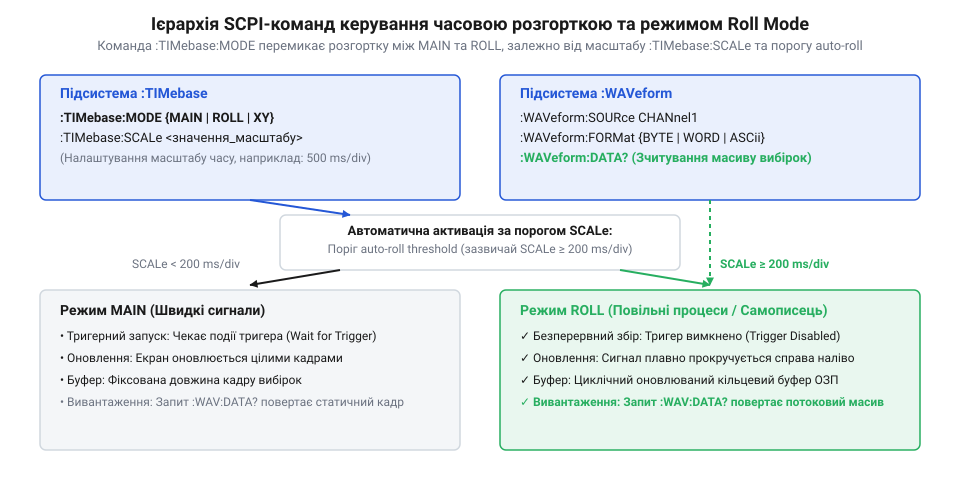
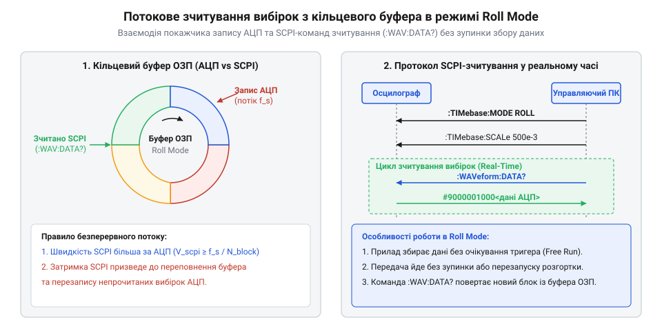

# SCPI-інтерфейс налаштування часової розгортки та режиму Roll Mode

<preknowlist>
- [FNIRSI 2C53T](root:cat-hw-instruments/fnirsi-2c53t) — Базове розуміння режимів роботи цифрового осцилографа та органу керування часовою розгорткою.
</preknowlist>

## Архітектура SCPI-підсистеми timebase осцилографа

Потреба віддаленого аналізу повільних фізичних процесів вимагає автоматизованого керування розгорткою без прямого натискання клавіш на передній панелі. Стандарт мови команд для програмованих приладів (англ. @@en|Standard Commands for Programmable Instruments@@, SCPI, від @@en|standard@@ — стандарт) забезпечує уніфіковану текстову ієрархію для налаштування системи збору даних через інтерфейси USB та LAN. Ієрархічна підсистема розгортки (англ. @@en|timebase@@) бере на себе керування часовим масштабом, затримкою та режимом оновлення зображення на екрані й у внутрішній пам'яті.

Командне дерево підсистеми розгортки починається з кореневого вузла `:TIMebase`. Залежно від вимірювальної задачі розгортка може працювати у декількох базісних режимах: основний екранний режим (англ. @@en|MAIN@@), режим додаткового вікна зумування (англ. @@en|WINDOW@@), двоканальний режим взаємного відображення виходів (англ. @@en|XY@@) та режим безперервної горизонтальної прокрутки (англ. @@en|ROLL@@). У стандартному режимі `MAIN` осцилограф очікує виконання умов тригера синхронізації: доки рівень сигналу не перетне порогове значення, вміст екрана не оновлюється. Для швидких періодичних сигналів це забезпечує нерухому картинку, але під час реєстрації повільного нагріву радіатора або розряду акумулятора прилад може заблокувати вивантаження вибірок на хвилини. Апаратний перехід між цими режимами здійснюється шляхом перезапису вмісту регістрів дільника тактової частоти (англ. @@en|clock divider register@@): у режимі `MAIN` генератор подає на аналого-цифровий перетворювач максимальну тактову частоту для швидкої буферизації кадрів, а при активації `ROLL` коефіцієнт апаратного предільника автоматично збільшується, адаптуючи частоту дискретизації `f_s` до швидкості зсуву екранної сітки без переповнення пам'яті.

Апаратна причина такого блокування криється в архітектурі системи збору даних: у режимі `MAIN` оцифрований сигнал постійно подається на цифровий компаратор (англ. @@en|comparator@@, від лат. @@en|comparare@@ — порівнювати) тригера, який очікує збігу умов для збереження завершеного кадру в оперативній пам'яті (англ. @@en|RAM@@). Допоки фронт сигналу не перетне поріг, цикл адресації ОЗП залишається заблокованим у стані очікування тригера. При перемиканні в режим `ROLL` схема компаратора апаратно відключається, а генератор тактової частоти переводить систему в режим безперервного циклу запису. Вказівник адреси пам'яті інкрементується з кожним новим відліком аналого-цифрового перетворювача, що перетворює буфер на потік вибірок, доступний для читання інтерфейсами зв'язку без прив'язки до подій синхронізації.

Режим `ROLL` усуває залежність збору даних від системи синхронізації. При його активації внутрішній цифровий тригер відключається, а нові відліки аналого-цифрового перетворювача безперервно записуються в пам'ять і зсувають графік справа наліво у реальному часі. Використання портативного цифрового приладу, такого як [осцилограф FNIRSI 2C53T](root:cat-hw-instruments/fnirsi-2c53t), демонструє, що режим прокрутки принципово змінює логіку обробки часової бази. Розуміння цієї архітектури дає змогу програмісту правильно будувати вимірювальний цикл і уникнути ситуацій, коли очікування тригера призводить до зависання керувальної програми.

## Конфігурація масштабу часу та режимів Roll Mode

Вибір режиму розгортки та тривалості часової сітки виконується за допомогою команд підсистеми `:TIMebase`. Для перемикання режиму роботи використовують команду `:TIMebase:MODE <mode>`, де параметром виступає одне зі значень `MAIN`, `WINDOW`, `XY` або `ROLL`. Налаштування масштабу осі часу (тривалості одного поділу сітки в секундах) здійснюється командою `:TIMebase:SCALe <value>`.


*Схема ієрархії SCPI-команд ілюструє взаємодію вузлів налаштування розгортки та режиму безперервної прокрутки.*

У більшості сучасних осцилографів реалізовано як примусовий, так і автоматичний перехід у режим прокрутки. Якщо режим налаштовано як `MAIN`, але користувач установлює великий масштаб часу (наприклад, `:TIMebase:SCALe 0.5` — 500 мс/поділ або більше), прилад порівнює розрахований час повного заповнення сітки екрана з внутрішнім порогом автоматичної прокрутки (англ. @@en|auto-roll threshold@@). Поріг автопрокрутки залежить від класу приладу: у бюджетних портативних моделях він становить `50 мс/поділ`, тоді як у настільних осцилографах вищого класу прокрутка активується при досягненні `100 мс/поділ` або `200 мс/поділ`. Граничні значення часової розгортки при цьому визначаються апаратною пам'яттю: від мінімальних `1 нс/поділ` до верхньої межі `50 с/поділ` (або `100 с/поділ`), де повна тривалість кадру сягає 500–1000 секунд. Алгоритм обчислює загальний час заповнення кадру `T_frame` як добуток кількості горизонтальних поділів екрана `N_div` (зазвичай 10 або 14 поділок) на значення `SCALe`. Якщо розраховане значення `T_frame` перевищує встановлений поріг, мікроконтролер апаратно перемикає розгортку в режим прокрутки, запобігаючи тривалому очікуванню кадрів та замиранню екрана. Запит поточного стану розгортки за допомогою опитувальної команди `:TIMebase:MODE?` повертає фактично активне значення `ROLL`, навіть якщо в конфігураціях записано режим `MAIN`.

| SCPI-команда | Допустимі значення | Призначення та функція |
| :--- | :--- | :--- |
| `:TIMebase:MODE` | `MAIN`, `WINDOW`, `XY`, `ROLL` | Встановлює режим роботи часової розгортки осцилографа |
| `:TIMebase:MODE?` | — | Повертає поточний активний режим розгортки приладу |
| `:TIMebase:SCALe` | Від `1e-9` до `50.0` (сек/под) | Задає тривалість одного поділу часової сітки в секундах |
| `:TIMebase:SCALe?` | — | Запитує поточний масштаб часової розгортки в секундах |
| `:TIMebase:OFFSet` | Число у секундах (с) | Встановлює часовий зсув (затримку) відносно опорної точки |

Примусове встановлення `:TIMebase:MODE ROLL` гарантує, що прилад працюватиме в режимі прокрутки навіть при відносно малих масштабах часу (наприклад, 100 мс/поділ), забезпечуючи детерміновану передачу даних на ПК.

## Вивантаження вибірок із кільцевого буфера

При роботі в режимі прокрутки оновлення даних у пам'яті осцилографа відбувається безперервно за принципом кільцевого буфера (англ. @@en|circular buffer@@). Покажчик запису постійно циркулює в ОЗП приладу, заміщуючи найстаріші відліки найновішими. Вивантаження оцифрованих сигналів на комп'ютер виконується за допомогою підсистеми `:WAVeform`.


*Потік вибірок відображає зчитування відліків із кільцевого буфера ОЗП без зупинки збору сигналів.*

Перед зчитуванням даних необхідно зафіксувати канал джерела командою `:WAVeform:SOURce CHANnel1` та встановити формат вивантаження `:WAVeform:FORMat BYTE` (або `WORD` / `ASCII`). Команда запиту `:WAVeform:DATA?` повертає двійковий блок вибірок у форматі IEEE 488.2. Для паралельного порівняння логічних сигналів із диференційними напругами корисно залучати [логічний аналізатор WeAct DLA Mini](root:cat-hw-instruments/logic-analyzer-dla-mini), який також використовує безперервну буферизацію.

Двійкова відповідь осцилографа у стандарті IEEE 488.2 починається із двійкового заголовка фіксованої довжини (англ. @@en|definite length block@@) вигляду `#N<довжина><дані>`, де символ `#` сигналізує про початок блоку, цифра `N` задає кількість наступних цифр у полі довжини, а сама довжина показує обсяг даних у байтах. Для 8-розрядного АЦП (англ. @@en|analog-to-digital converter@@, АЦП) у форматі `BYTE` кожен відлік займає один байт, тож байтова довжина в заголовку точно дорівнює кількості запрошених точок. Проте у разі використання приладів із підвищеною розрядністю АЦП (10, 12 чи 14 біт) обирають формат `WORD`, у якому кожен відлік пакується у 16-бітове двобайтове слово. У такому разі заголовок IEEE 488.2 повертає байтовий обсяг, що вдвічі перевищує кількість відліків, а молодші або старші біти двобайтового контейнера доповнюються нулями відповідно до обраного байтового порядку (англ. @@en|byte order@@) приладу.

| Команда `:WAVeform` | Опис та параметр | Роль у процесі зчитування |
| :--- | :--- | :--- |
| `:WAVeform:SOURce` | `CHANnel1` .. `CHANnel4` | Обирає канал джерела для вивантаження масиву даних |
| `:WAVeform:FORMat` | `BYTE`, `WORD`, `ASCii` | Встановлює формат кодування вибірок у відповіді |
| `:WAVeform:POINts` | Ціле число (наприклад, `1000`) | Задає кількість відліків для одного запиту даних |
| `:WAVeform:DATA?` | — | Запитує поточний масив вибірок із кільцевого буфера |

Для розрахунку фізичної напруги з сирих відліків використовують коефіцієнти масштабування:

```
U_volts = (code - YORigin) × YINCrement + YREFerence
```

де `YINCrement` — ціна молодшого розряду АЦП у вольтах (`:WAVeform:YINCrement?`), `YORigin` — зсув сітки (`:WAVeform:YORigin?`), а `YREFerence` — опорне значення.

## Обробка тайм-аутів та статусних регістрів

Специфіка безперервного запиту даних у режимі `ROLL` полягає у ризику виникнення тайм-аутів керувальної шини USB чи Ethernet (LAN). Якщо програма надсилає запит `:WAVeform:DATA?` у момент, коли буфер ще не поповнився необхідною кількістю нових вибірок, осцилограф затримує відповідь, що може призвести до помилки обриву зв'язку (англ. @@en|timeout error@@) на боці ПК.

Для запобігання блокуванням шини застосовують систему статусних регістрів SCPI. Стан виконання операцій контролюють за допомогою регістру подій (англ. @@en|Standard Event Register@@, `*ESR?`) та регістру байта стану (англ. @@en|Status Byte Register@@, `*STB?`). Команда `:STATus:OPERation:CONDition?` дає змогу дізнатися, чи перебуває прилад у стані збору даних, а біт `OPC` (англ. @@en|Operation Complete@@, `*OPC?`) підтверджує завершення попередніх конфігураційних дій. Для надійної роботи перед запуском опитування виконують очищення статусних регістрів за допомогою команди `*CLS` (англ. @@en|Clear Status@@). Вона скидає всі накопичені біти подій у `*ESR?`, спорожняє чергу помилок та забезпечує відкидання застарілого прапорця `MAV`, який міг залишитися в байті стану від попередніх невичитаних відповідей і спровокувати помилкове зчитування старих даних з вихідного буфера.

```
+-------------------------------------------------------------+
|               Регістр байта стану (*STB?)                   |
|  Bit 7: OPER (Operation Summary) -> Збір даних / Roll       |
|  Bit 6: MSS/RQS (Master Summary Status)                      |
|  Bit 5: ESB (Event Summary Bit) -> Регістр подій *ESR       |
|  Bit 4: MAV (Message Available) -> Відповідь готова у буфері  |
+-------------------------------------------------------------+
```

Перевірка біта `MAV` (англ. @@en|Message Available@@, біт 4 в `*STB?`) перед читанням відповіді гарантує, що прилад уже сформував блок даних у своєму вихідному буфері. Це унеможливлює зависання програми та забезпечує надійний моніторинг.

## Автоматизований SCPI-скрипт тривалого моніторингу

Практична реалізація віддаленого збору даних у режимі Roll Mode вимагає послідовної ініціалізації осцилографа, налаштування розгортки та циклічного опитування. Нижче наведено завершений приклад вимірювального скрипту мовою Python із використанням бібліотеки PyVISA (англ. @@en|PyVISA@@, від @@en|VISA@@ — @@en|Virtual Instrument Software Architecture@@).

Під час тривалого моніторингу у режимі безперервної прокрутки фізична шина USB або Ethernet може стикатися з тимчасовими збоями, переповненням буферів або перевищенням ліміту часу очікування даних. Для запобігання аварійному перериванню скрипту виклики читання огортають у блок обробки винятків `try...except`, перехоплюючи таймаут-помилку (від англ. @@en|timeout error@@) бібліотеки @@en|PyVISA@@ — `pyvisa.errors.VisaIOError`. При виникненні тайм-ауту або втраті пакета скрипт не припиняє роботу, а виконує скидання статусних регістрів приладу командою `*CLS`, очищує вхідні й вихідні буфери шини викликом `scope.clear()` та повторно ініціалізує процедуру запиту вибірок після невеликої паузи, відновлюючи стабільний потік вимірювань.

:::code api-scpi-oscilloscope-timebase-and-roll-mode/py/pyvisa/snippet-1.py

Цей скрипт переключає прилад у режим `ROLL`, вичитує сирі бінарні відліки з кільцевого буфера та масштабує їх у фізичні вольти без блокування вимірювальної шини.
