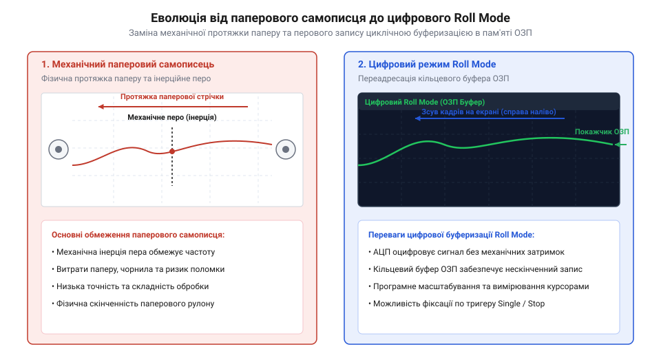
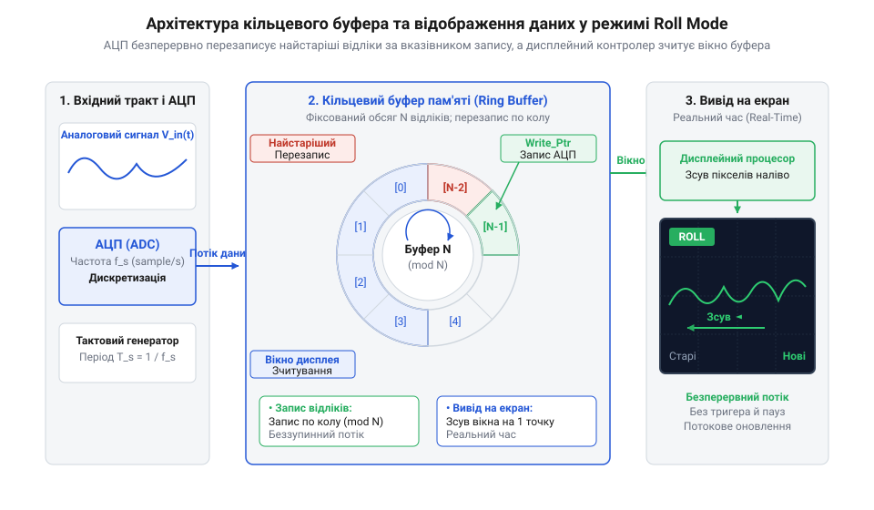

# Історія від паперових самописців до цифрового режиму Roll Mode

<preknowlist>
- [FNIRSI 2C53T](root:cat-hw-instruments/fnirsi-2c53t) — Базове розуміння будови та режимів роботи сучасного цифрового осцилографа.
- [WeAct DLA Mini](root:cat-hw-instruments/logic-analyzer-dla-mini) — Уявлення про принципи безперервного цифрового збору сигналів та буферизацію.
</preknowlist>

## Обмеження паперових реєстраторів і самописців

Тривалий час єдиним засобом спостереження та фіксації повільних фізичних процесів — таких як температурні коливання, сейсмічні коливання чи електрокардіограми — слугував електромеханічний паперовий самописець (en. @@en|strip-chart recorder@@, від англ. *strip* — смуга та *chart* — діаграма). Принцип його роботи полягав у постійному механічному протягуванні паперової стрічки за допомогою прецизійного годинникового анкерного механізму або синхронного електродвигуна з редуктором, що забезпечували стабільну швидкість руху носія через перфоровані барабани. Вимірювальна голка чи перо з чорнилом відхилялися пропорційно вхідній напрузі, викреслюючи безпосередньо в реальному часі суцільну криву на папері з попередньо нанесеною калібрувальною шкалою, де поздовжні лінії задавали часовий інтервал, а поперечні — масштаб амплітуди. За такої схеми графік утворював неперервний паперовий архів, що дозволяв зчитувати фізичні величини безпосередньо з міліметрової сітки без додаткових цифрових обчислювачів.

Проте експлуатація паперових реєстраторів зіштовхнулася зі суворими фізичними та економічними обмеженнями. Головною вадою була механічна інерція (en. @@en|inertia@@, від лат. *inertia* — бездіяльність) рухомого пера та гальванометра: маса механічних вузлів обмежувала верхню граничну частоту реєстрованих процесів значеннями до кількох десятків герц. Для тривалого цілодобового моніторингу вимагалися кілометри дорогого каліброваного паперу, що створювало значні матеріальні витрати та вимагало регулярного обслуговування — заправки чорнила, чищення забитих капілярів або заміни термочутливих голок. Крім того, отриманий паперовий графік не піддавався оперативному масштабуванню, автоматизованій цифровій обробці чи швидкому пошуку потрібного фрагмента.

*_Принципова відмінність між електромеханічним записом на папір та кільцевим збереженням відліків у пам'яті._*

Потреба відмовитися від рулонного паперу та зберегти можливість стеження за повільними процесів без втрати інформації стимулювала інженерний пошук електронних замінників паперового носія.

Перспективним напрямом розв'язання цієї проблеми стало використання безінерційних електронно-променевих систем. Заміна важкого механічного пера на електронний промінь миттєво знімала граничні частотні обмеження гальванометра, дозволяючи відображати зміни напруги у реальному часі. Однак свічення стандартного аналогового екрана згасало за частки секунди, що поставило перед розробниками нове завдання — створення електронних систем із довготривалою пам'яттю зображення.

## Аналогові запам'ятовувальні електронно-променеві трубки

Першою спробою позбутися витратних матеріалів і механічних обмежень у 1960-х роках стало застосування електронно-променевих трубок (ЕПТ). Звичайні аналогові осцилографи мали високу смугу пропускання, однак флуоресценція (en. @@en|fluorescence@@, від лат. *fluor* — течія) стандартного люмінофора екранного покриття згасала за частки секунди. Для спостереження процесів із періодом у кілька хвилин або годин такий екран не підходив, оскільки світлова пляма зникала значно швидше, ніж перо встигало зобразити повний цикл сигналу.

Для розв'язання цієї проблеми в 1963 році компанія Tektronix під керівництвом інженера Говарда Волума (en. @@en|Howard Vollum@@) розробила бістабільну запам'ятовувальну трубку прямого бачення (en. @@en|direct-view storage tube@@, DVST). У таких приладах додаткові електронні гармати (допоміжні електронні прожектори) постійно опромінювали діелектричну сітку екрана, підтримуючи заряджений променем люмінофор у світіючому стані годинами. Це давало змогу «заморозити» осцилограму на екрані без використання паперу.

Конструктивно така трубка містила дві окремі електронні системи: високошвидкісну записувальну гармату та низьковольтні прожектори заливального струму (en. @@en|flood guns@@), підігрівачі (en. @@en|heaters@@) яких постійно випромінювали рівномірну хмару повільних електронів. Чутливий елемент складався із прозорого струмопровідного колектора на скляній лицьовій панелі та змонтованої перед ним діелектричної мішені (en. @@en|storage target@@) із дрібносітчастого люмінофора. Коли гострий записувальний промінь вибивав із поверхні мішені вторинні електрони (en. @@en|secondary electron emission@@), збуджена точка діелектрика набувала позитивного заряду. Повільні електрони від підігрівачів заливальних гармат відштовхувалися від незаряджених ділянок екрана, проте безперервно прискорювалися до позитивно заряджених точок мішені, підтримуючи їхній стабільний люмінесцентний стан без повторного проходження основного променя.

Однак запам'ятовувальні ЕПТ виявилися непридатними для спостереження безперервного потоку даних. Кадр аналогового екрана був статичним: коли промінь доходив до правого краю, спостереження зупинялося, а для відновлення запису вимагалося повне стирання екрана (en. @@en|screen erasure@@), що супроводжувалося яскравим спалахом і тимчасовою втратою інформації. Зсувати зображення праворуч або ліворуч плавним потоком аналогова електронно-променева система принципово не вміла, що робило її лише частковою заміною паперового самописця.

## Цифрова революція та поява перших DSO

Справжній технологічний прорив відбувся на початку 1970-х років завдяки розвитку напівпровідникових аналогово-цифрових перетворювачів (АЦП) та оперативної пам'яті (ОЗП). У 1971–1972 роках американська корпорація Nicolet Instrument Corporation під керівництвом Роберта Шуманна (en. @@en|Robert Schumann@@) створила прилад Nicolet 1090 — один із перших комерційних цифрових осцилографів із пам'яттю (en. @@en|digital storage oscilloscope@@, DSO). Замість нанесення чорнила на папір чи підтримання заряду на діелектричній сітці, прецизійний 12-розрядний АЦП осцилографа оцифровував вхідну напругу з роздільною здатністю 4096 рівнів (0.025%), а отримані числові відліки безперервно записувалися у феритовий ОЗП обсягом 4096 слів (4K 12-бітових комірок). Використання магнітних феритових сердечників гарантувало повне збереження захопленої осцилограми навіть після вимкнення живлення, а висока 12-бітова амплітудна точність уперше дозволила детально досліджувати мікровольтові шуми та тонкі фрагменти повільних фізичних сигналів.

Ключовим апаратним рішенням для відтворення поведінки паперового самописця стала організація ОЗП за принципом кільцевого буфера (en. @@en|circular buffer@@). АЦП безперервно записував нові відліки у комірки пам'яті за коловим вказівником, перезаписуючи найстаріші дані. Одночасно дисплейний контролер зчитував масив і послідовно виводив його на екран. Коли прилад перемикали у режим прокрутки (en. @@en|roll mode@@), зображення сигналу починало плавно переміщатися справа наліво: нові дані з'являлися біля правого краю екрана, а старі зникали за лівою межею, утворюючи повний аналог паперової стрічки без жодних механічних вузлів.

*_Функціональна архітектура кільцевого буфера ОЗП та логіки прокрутки сигналу у режимі Roll Mode._*

У 1980 році компанія Tektronix випустила серію DSO 468, остаточно затвердивши режим Roll Mode як стандартний інструмент для спостереження низькочастотних процесів у лабораторній практиці. Наразі подібна [безперервна буферизація сигналів](root:cat-hw-instruments/logic-analyzer-dla-mini) застосовується в найрізноманітніших цифровізованих вимірювачах, а будь-який сучасний [портативний цифровий осцилограф](root:cat-hw-instruments/fnirsi-2c53t) виконує цю функцію за допомогою спеціалізованих мікроконтролерів чи ПЛІС.

## Створення Roll Mode та кільцевого буфера

Технічний прорив у реалізації безперервного відображення повільнозмінних сигналів відбувся наприкінці 1970-х років завдяки впровадженню архітектури двопортового кільцевого буфера пам'яті (@@en|circular buffer@@, від англ. *circular* — кільцевий, круглий) в оперативно-запам'ятовувальних пристроях. У класичному режимі збору даних цифровий осцилограф (@@en|digital storage oscilloscope@@, DSO) чекав виконання умови тригера, записував послідовний масив відліків у пам'ять і лише після повного заповнення кадру виводив його на екран. Для повільних процесів із тривалістю розгортки в десятки секунд це створювало великі часові паузи, під час яких екран залишався статичним.

Щоб відтворити ефект безперервного паперового стрічкового самописця (@@en|strip-chart recorder@@), інженери компаній Nicolet Instruments та Tektronix розробили спеціальну логіку адресації оперативної пам'яті — режим прокрутки Roll Mode (@@en|Roll Mode@@). У цьому режимі аналогово-цифровий перетворювач працює без зупинки, а покажчик запису (@@en|write pointer@@) циклічно переходить від останньої адреси буфера до першої. Одночасно контролер дисплея зчитує з ОЗП поточний зріз відліків, зміщений на довжину екранного кадру, і зсуває графічний вектор на один растровий стовпчик ліворуч при надходженні кожного нового значення.

Для усунення графічних артефактів та мерехтіння зображення під час постійного зчитування даних контролером растру застосували алгоритм подвійної буферизації (@@en|double buffering@@, від англ. *double* — подвійний та *buffer* — буфер). Безперервний асинхронний зсув точок на растровому дисплеї без подвійного буфера призводив до конфліктів шини пам'яті, коли процесор відображення зчитував комірку в момент її оновлення АЦП. Інженери розділили відеопам'ять на дві сторінки — активний фронтальний буфер кадру та тіньовий буфер оновлення: поки перший безперервно виводив осцилограму на електронний екран, другий у фоновому режимі накопичував нові відліки АЦП. Синхронна зміна вказівників сторінок під час кадрового гасильного імпульсу забезпечила абсолютно плавний зсув графіків без розривів сигналу та миготіння екрана.

Головна схемотехнічна відмінність Roll Mode від стандартного чекання тригера полягає в повній відмові від апаратного блока синхронізації під час збору даних. Осцилограф перестає шукати перетин порогу напруги для запуску розгортки, а замість цього формує суцільний потік часових відліків. У разі надходження команди зупинки або зовнішнього тригера прилад просто фіксує поточний стан покажчика запису у кільцевому буфері, зберігаючи точну передісторію сигналу до моменту події. Такий підхід став основою для сучасних приладів безперервного збору даних, що реалізовані зокрема у [портативному осцилографі FNIRSI 2C53T](root:cat-hw-instruments/fnirsi-2c53t).

## Розвінчання міфів пріоритету та еволюція

Історія створення цифрових осцилографів та режиму Roll Mode супроводжується поширеними міфами щодо пріоритету винаходу. У популярній технічній літературі концепцію цифрового збереження форм хвиль нерідко повністю приписують корпорації Tektronix через масштабний комерційний успіх її моделей Tektronix 468 та серії 2200 у 1980-х роках. Проте архівні матеріали та патентні документи свідчать про колективний характер науково-технічного прогресу у вимірювальному приладобудуванні.

Першість у створенні цифрового запам'ятовувального осцилографа належить американській компанії Nicolet Instrument Corporation. Засновники компанії Дональд Газельгорст (@@en|Donald Haselhorst@@) та Річард Голл (@@en|Richard Hall@@) ще у 1971–1972 роках випустили цифровий реєстратор Nicolet Model 1070, а у 1974 році — легендарну модель Nicolet 1090. Саме в цих приладах уперше в історії було застосовано напівпровідникову оперативну пам'ять для збереження відліків АЦП та реалізовано початкові варіанти безперервного виводу даних на електронно-променеву трубку без очікування перезапуску розгортки.

Паралельно розробки у галузі високошвидкісного цифрового запису вела фірма Biomation під керівництвом Дональда Нельсона (@@en|Donald Nelson@@), яка у 1971 році створила перший цифровий транзієнтний реєстратор Biomation 8100. Згодом, у першій половині 1980-х років, режим Roll Mode було стандартизовано у світовому приладобудуванні як обов'язкову функцію цифрових осцилографів для реєстрації повільних медичних, сейсмічних та технологічних процесів. Сьогодні алгоритми безперервної буферизації Roll Mode пройшли шлях від дискретної логіки до інтегральних ПЛІС і реалізуються як в інструментальних осцилографах, так і в цифрових пристроях збору сигналів на кшталт [компактного логічного аналізатора WeAct DLA Mini](root:cat-hw-instruments/logic-analyzer-dla-mini).
