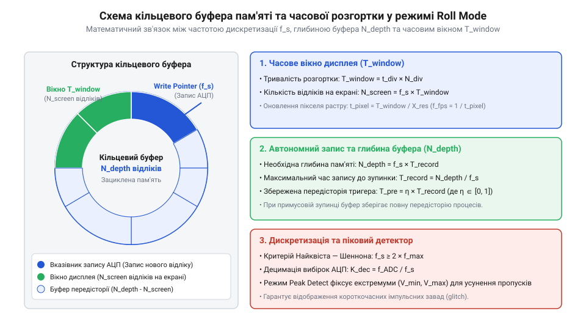

# Математичний розрахунок частоти дискретизації та глибини пам'яті у режимі Roll Mode

<preknowlist>
- [FNIRSI 2C53T](root:cat-hw-instruments/fnirsi-2c53t) — принцип побудови портативного цифрового осцилографа та організація буфера пам'яті
</preknowlist>

## Фізична проблема спостереження повільних процесів

Вимірювання сигналів із тривалими періодами — таких як розряд акумулятора, температурний дрейф або низькочастотні пульсації джерел живлення — створює серйозний виклик для класичної схеми роботи цифрового осцилографа. У стандартному режимі чекання тригера (@@en|triggered mode@@) прилад збирає повний масив відліків у буфер пам'яті, чекає виконання умови синхронізації, після чого одноразово оновлює весь кадр на екрані. Якщо тривалість однієї горизонтальної клітинки (@@en|time division@@) становить 10 секунд, а повний екран містить 10 поділок, загальне часове вікно розгортки дорівнює 100 секундам. У такому режимі оператор змушений спостерігати порожній або застиглий екран протягом понад півтора хвилини, оскільки нові дані стають видимими лише після завершення всього циклу збору кадру.

Коли прилад працює за принципом періодичного чекання тригера, між завершенням відображення поточного кадру та підготовкою до наступного виникає сліпе вікно вимірювання (@@en|blind window@@). Під час цього інтервалу осцилограф перезапускає тракт збору, через що будь-які короткочасні аномалії, сплески чи збої сигналу втрачаються безповоротно. Для повільних процесів така переривність є неприпустимою, оскільки форма хвилі розривається на окремі незв'язані фрагменти, унеможливлюючи безперервний моніторинг динаміки системи.

Розв'язанням цієї проблеми є режим безперервної прокрутки — Roll Mode (@@en|Roll Mode@@, від англ. *roll* — прокручувати). У цьому режимі осцилограф відключає механізм чекання тригера та починає безперервно виводити кожен новий відлік АЦП на праву крайку екрана, зсуваючи попередньо записану осцилограму ліворуч. За своїм фізичним принципом Roll Mode повністю імітує роботу класичного механічного паперового самописця (@@en|strip-chart recorder@@), де паперова стрічка протягується під нерухомим пером. Лінійна швидкість прокрутки графічного зображення на фізичному дисплеї `v_scroll` (в мм/с) прямо залежить від фізичної ширини активної зони екрана `W_screen` (у мм) та повного часу часового вікна `T_window = t_div × N_div`:

v_scroll
= W_screen / T_window       [визначення швидкості прокрутки зображення]
= w_div / t_div             [спрощення через ширину однієї клітинки]

де `w_div` — фізична ширина однієї горизонтальної поділки екрана (в мм). Наприклад, для дисплея з шириною поділки `w_div = 10` мм при розгортці `t_div = 10` с/под швидкість фізичного зсуву становить `v_scroll = 10 / 10 = 1` мм/с. Такий підхід у сучасних цифрових приладах, як-от у [портативному приладі FNIRSI 2C53T](root:cat-hw-instruments/fnirsi-2c53t), забезпечує візуальну безперервність сигналу та формує вимогу до спеціальної організації кільцевої буферизації даних.

## Дискретизація та запобігання аліасингу в Roll Mode

Математичний опис режиму Roll Mode базується на жорсткому зв'язку між часовим вікном відображення `T_window`, встановленим масштабом розгортки `t_div` та кількістю горизонтальних поділок екрана `N_div`:

```
T_window = t_div × N_div
```

Якщо крок дискретизації аналогово-цифрового перетворювача дорівнює `Δt`, то частота дискретизації `f_s` (@@en|sampling rate@@) визначається як обернена величина до інтервалу збору:

```
f_s = 1 / Δt
```

Для запобігання ефекту накладання частот — аліасингу (@@en|aliasing@@, від англ. *alias* — несправжнє ім'я), при якому високочастотні завади маскуються під низькочастотний корисний сигнал, має виконуватися теорема Найквіста — Шеннона. Якщо максимальна частотна компонента в спектрі вимірюваного сигналу дорівнює `f_max`, мінімальна частота збору відліків обчислюється так:

```
f_s
≥ 2 × f_max            [критерій Найквіста — Шеннона]
```

Оскільки апаратний АЦП осцилографа працює з високою власною частотою `f_ADC` (наприклад, 100 МГц), а для прокрутки повільного екрана потрібна значно менша частота відліків `f_s`, прилад застосовує проріджування даних — децимацію (@@en|decimation@@, від лат. *decimatio* — зменшення на десяту частину). Коефіцієнт децимації `K_dec` визначає відношення частот:

```
K_dec = f_ADC / f_s
```

При простій децимації з кожного блоку в `K_dec` відліків вибирається лише один, що може призвести до пропуску вузьких імпульсних завад. Щоб усунути цей недолік, у режимі Roll Mode використовують алгоритм пикового детектування (@@en|Peak Detect@@). На кожному інтервалі децимації прилад знаходить абсолютний мінімум `V_min` та максимум `V_max` напруги і записує їх у буфер. Це гарантує, що навіть при повільній прокрутці екрана жоден високочастотний сплеск не зникне з осцилограми.

Для наочності розглянемо порівняння обох режимів при вимірюванні повільного процесу тривалістю 100 секунд з інтервалом децимації `K_dec = 10000`, якщо в сигналі виникає поодинокий короткий голчастий імпульс (@@en|glitch@@) тривалістю 10 нс. При звичайному проріджуванні відліків (@@en|Sample mode@@) осцилограф вибирає лише кожен 10-тисячний відлік, через що ймовірність потрапляння вузького сплеску у вибірку становить менше `0.01%`, і артефакт зникає з екрана. Натомість при увімкненому режимі @@en|Peak Detect@@ аналогово-цифровий перетворювач безперервно фіксує екстремуми на повній частоті `f_ADC = 100` МГц, тому значення амплітуди `V_max` голчастого імпульсу заноситься до буфера й відображається на екрані як вертикальний сплеск навіть при мінімальній швидкості прокрутки.

## Розрахунок глибини буфера та часу автономного запису

Організація збереження даних у режимі Roll Mode спирається на кільцевий буфер (@@en|circular buffer@@). Природна властивість кільцевого буфера полягає в тому, що після заповнення останньої комірки пам'яті нові відліки АЦП починають циклічно переписувати найстаріші дані за першою адресою.


*Принципова схема зв'язку частоти дискретизації f_s, глибини буфера N та часового вікна T_window у режимі Roll Mode.*

Необхідна глибина пам'яті `N_depth` (@@en|memory depth@@) для забезпечення безперервного запису протягом часу `T_record` при заданій частоті дискретизації `f_s` обчислюється через прямий добуток:

```
N_depth
= f_s × T_record            [визначення необхідної кількості відліків]
```

Звідси максимальний тривалість автономного запису `T_record`, який може зберегти осцилограф до моменту примусової зупнки за допомогою тригера, визначається шляхом інверсії рівняння:

```
T_record
= N_depth / f_s             [інверсія рівняння для часу автономного запису]
```

Якщо оператор налаштовує зупинку приладу за тригером із часткою передісторії `η` (де `η` змінюється від 0 до 1, наприклад `η = 0.5` відповідає 50% передісторії в середині екрана), тривалість збереженого інтервалу до моменту події `T_pre` становить:

```
T_pre
= η × T_record              [тривалість збереженої передісторії]
= η × (N_depth / f_s)       [підстановка виразу автономного часу]
```

Для плавної прокрутки осцилограми на дисплеї із горизонтальною роздільною здатністю `X_res` пікселів, крок часу оновлення одного растрового стовпчика `t_pixel` дорівнює:

Виходячи з часового інтервалу зсуву `t_pixel`, частота оновлення кадрів дисплея `f_fps` (@@en|FPS@@, від англ. *frames per second* — кадрів за секунду) при попіксельному рендерингу визначається як обернена величина до часу оновлення одного растрового стовпчика:

```
f_fps
= 1 / t_pixel               [визначення частоти кадрів через інтервал оновлення пікселя]
= X_res / (t_div × N_div)   [підстановка виразу часового вікна]
```

З отриманого рівняння видно, що при збільшенні тривалості розгортки `t_div` частота оновлення кадрів `f_fps` зменшується, тому для збереження візуальної плавності руху графічний процесор осцилографа може групувати зсув на декілька пікселів за один кадр.

```
t_pixel
= T_window / X_res          [інтервал переміщення растру на один піксель]
= (t_div × N_div) / X_res   [підстановка тривалості повного вікна]
```

Принципи безперервної суцільної буферизації потоку даних без втрат відліків також активно застосовуються при розробці [логічного аналізатора WeAct DLA Mini](root:cat-hw-instruments/logic-analyzer-dla-mini), де кільцеві масиви дозволяють зберігати тривалі послідовності цифрових станів.

## Практичний розрахунок параметрів для низькочастотних осцилограм

Розглянемо практичну задачу математичного обґрунтування налаштувань осцилографа в режимі Roll Mode для спостереження повільного температурного перехідного процесу в електронному блоці.

**Умова задачі:** Необхідно зареєструвати тривалість температурного вибігу протягом часового вікна `T_window = 100` секунд на дисплеї з `N_div = 10` поділок (шкала `t_div = 10` с/под). Спектральний аналіз показує, що найвища частота завад у каналі становить `f_max = 50` Гц. Необхідно забезпечити автономне збереження передісторії протягом `T_record = 10` хвилин (600 секунд) до моменту натискання кнопки зупинки.

**Крок 1. Розрахунок мінімальної частоти дискретизації.**
За критерієм Найквіста — Шеннона обчислюємо мінімально припустиму частоту збору відліків:

```
f_s
= 2 × f_max                 [теорема Найквіста — Шеннона]
= 2 × 50                    [підстановка максимальної частоти 50 Гц]
= 100                       [мінімальна частота дискретизації 100 Гц]
```

**Крок 2. Розрахунок кількості відліків на один екран.**
Кількість точок `N_screen`, які одночасно знаходяться на екрані при тривалості вікна 100 секунд:

```
N_screen
= f_s × T_window            [обчислення кількості відліків екрана]
= 100 × 100                 [підстановка частоти 100 Гц та вікна 100 с]
= 10000                     [необхідно 10 000 відліків на екран]
```

**Крок 3. Розрахунок необхідної глибини буфера пам'яті.**
Для забезпечення автономного запису тривалістю `T_record = 600` секунд обчислюємо потрібний об'єм буфера пам'яті:

```
N_depth
= f_s × T_record            [розрахунок повного об'єму пам'яті]
= 100 × 600                 [підстановка значення частоти та часу]
= 60000                     [необхідний об'єм буфера 60 000 відліків]
```

**Висновок:** Для точної реєстрації даного процесу без аліасингу та з можливістю збереження 10 хвилин передісторії осцилограф у режимі Roll Mode повинен мати встановлену частоту дискретизації не менше 100 Гц та глибину буфера пам'яті не менше 60 кВідліків (kS). Якщо прилад має менший апаратний об'єм пам'яті, доведеться зменшити частоту дискретизації з обов'язковим увімкненням режиму Peak Detect для збереження піків завад.
