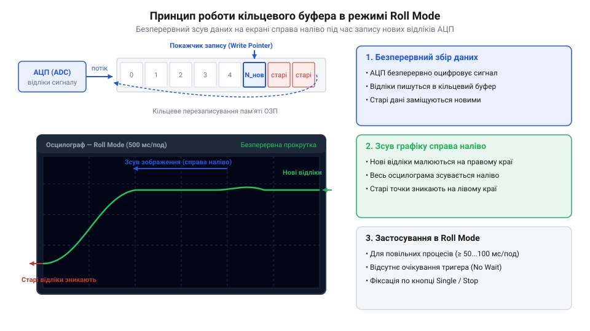
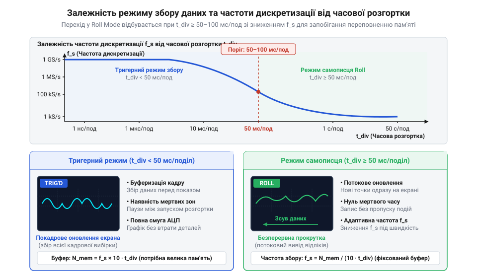

# Режим самописця Roll Mode у цифрових осцилографах

<preknowlist>
- [FNIRSI 2C53T](root:cat-hw-instruments/fnirsi-2c53t) — загальні принципи роботи цифрового осцилографа, базове налаштування входів та часової розгортки
</preknowlist>

## Потреба у спостереженні повільних процесів

Під час діагностики електронних схем розробники часто стикаються з вимірювальними задачами, де електричні величини змінюються дуже повільно. Прикладами таких процесів є вихід на робочий режим джерел живлення, повільне падіння напруги при розрядці акумулятора, температурний дрейф номіналів компонентів або зміна освітленості фотодатчика. При спробі дослідити подібний процес за допомогою цифрового запам'ятовувального осцилографа у стандартному чекаючому режимі розгортки (від англ. @@en|triggered sweep mode@@) виникає суттєва незручність.

У звичайному режимі осцилограф очікує виконання тригерної умови, після чого послідовно заповнює свій буфер пам'яті відліками АЦП (від англ. @@en|analog-to-digital converter@@ або @@en|ADC@@) і лише після повного завершення циклу збору оновлює кадр на екрані. На швидких розгортках (мікросекунди або мілісекунди на поділок) це відбувається непомітно для ока — екран оновлюється десятки разів на секунду. Проте якщо збільшити тривалість розгортки, повний час заповнення екранного кадру `T_frame` визначається як добуток масштабу часу `S_div` на кількість горизонтальних поділок сітки `N_div` (`T_frame = S_div × N_div`). При стандартній сітці з 14 поділок для розгортки `1 с/поділ` кадр формуватиметься `14 секунд`, а для `5 с/поділ` тривалість очікування зростає до `70 секунд`. Упродовж усього цього часу екран приладу лишається «замороженим» зі старим зображенням або взагалі порожнім. Оператор стає «сліпим» до подій у колі: якщо під час тривалого накопичення станеться короткочасне відхилення напруги, фахівець дізнається про нього лише через хвилину, коли прилад нарешті малює весь кадр.

Небезпека цієї «сліпої» паузи полягає у тому, що фізичні процеси в досліджуваному колі тривають безперервно, незалежно від готовності вимірювального приладу. Під час накопичення відліків або очікування тригера в схемах живлення можуть відбуватися локальні пробої, короткочасні падіння напруги під навантаженням або теплові сплески компонентів. Крім того, тривалий розігрів напівпровідникових вузлів спричиняє температурний дрейф номіналів (від англ. @@en|thermal drift@@). Фізичний механізм цього дрейфу полягає в тому, що при постійному протіканні струму температура кристала напівпровідника зростає, викликаючи зміну термочутливих параметрів p-n переходу (від англ. @@en|p-n junction@@): падіння напруги на базі біполярного транзистора знижується зі швидкістю близько −2 мВ/°C, а опір відкритого каналу польового транзистора зростає. Упродовж багатьох секунд «сліпого» інтервалу ця температурна деформація поступово зміщує робочу точку (від англ. @@en|operating point@@) схеми, через що виміряні рівні напруги на початку і в кінці паузи суттєво відрізняються. Оскільки стандартний осцилограф у тригерному режимі не реєструє такі проміжні динамічні стани між оновленнями кадрів, інженер втрачає можливість відокремити власні коливання сигналу від теплового дрейфу, сприймаючи цілісний перехідний процес як серію розрізнених статичних знімків.

Для вимірювання повільних процесів історично використовували електромеханічні паперові самописці (від англ. @@en|strip-chart recorder@@), де паперова стрічка протягувалася під пером з постійною швидкістю. Про те, як цифрові прилади замінили паперову стрічку безперервним зацикленим буфером, можна прочитати в [історії від паперових самописців до цифрового режиму Roll Mode](root:cat-hw-instruments/oscilloscope-roll-mode/hist-oscilloscope-strip-chart-to-roll-mode.md). У сучасних цифрових осцилографах, як-от універсальному приладі [FNIRSI 2C53T](root:cat-hw-instruments/fnirsi-2c53t), проблему відсутності оперативного відгуку вирішує режим безперервної прокрутки (від англ. @@en|roll mode@@).

## Апаратний механізм кільцевого буфера Roll Mode

Головна відмінність режиму Roll Mode від класичного тригерного збору даних полягає у відмові від очікування тригера для оновлення кадру. Замість того щоб накопичувати повний масив відліків у пам'яті й малювати графік зліва направо за один захід, осцилограф переходить у режим безперервного потокового відображення.

Апаратна реалізація Roll Mode спирається на кільцевий буфер пам'яті (від англ. @@en|ring buffer@@ або @@en|circular buffer@@). Аналогово-цифровий перетворювач постійно оцифровує вхідний сигнал і записує нові значення у пам'ять за зацикленою адресою, яку задає апаратний вказівник запису (від англ. @@en|write pointer@@). При кожному новому вимірюванні логіка адресної шини (від англ. @@en|address bus@@) виконує інкремент поточної комірки пам'яті. Обробка переповнення буфера здійснюється за принципом модульної адресації: досягши верхньої межі відведеного масиву, адреса запису автоматично скидається до початкової базової адреси, заміщаючи найстаріші відліки новими даними. Одночасно з цим графічний контролер опитує буфер за допомогою окремого вказівника читання (від англ. @@en|read pointer@@), зміщеного відносно вказівника запису на фіксовану кількість точок екранної розгортки. Апаратна синхронізація цих двох вказівників гарантує, що найновіші відліки формують правий край зображення на дисплеї, а вся попередня осцилограма безперервно зсувається ліворуч без перезапуску кадрів чи розриву графічної лінії.

*Принцип дії кільцевого буфера та безперервного зсуву кадру на екрані осцилографа у режимі Roll Mode.*

Завдяки такій організації графіка оператор бачить зміну сигналу в реальному часі без жодних паузи чи очікувань. Поведінка осцилограми повністю імітує рух паперової стрічки в самописці: графік «запливає» на екран справа та повільно зсувається ліворуч, зникаючи за лівою межею дисплея після проходження усієї часової розгортки.

З точки зору апаратури відображення, графічний контролер (від англ. @@en|display controller@@) перераховує амплітудні значення відліків у вертикальні координати пікселів растра. Отримуючи числові коди напруги з кільцевого буфера, апаратна логіка масштабує їх відповідно до вибраного коефіцієнта відхилення та вертикального зсуву, після чого обчислює координати пікселів і виконує вертикальну інтерполяцію для з'єднання сусідніх відліків суцільною графічною лінією. Під час збору даних у режимі прокрутки контролер не перебудовує весь кадр дисплея з нуля при кожному новому вимірюванні. Замість цього апаратна логіка мапування пікселів (від англ. @@en|pixel mapping@@) формує новий вертикальний стовпчик точок, записує його в крайню праву колонку відеобуфера (від англ. @@en|frame buffer@@) у відео-ОЗП (від англ. @@en|video RAM@@) і зсуває графічний масив на один крок ліворуч шляхом модифікації адресоутворення або апаратного перенесення блоків пам'яті. Таке апаратне оновлення графічної пам'яті повністю розвантажує центральний процесор приладу й забезпечує плавну візуалізацію сигналу без затримок та кадрових розривів.

З точки зору апаратури відображення, графічний контролер (від англ. @@en|display controller@@) перераховує амплітудні значення відліків у вертикальні координати пікселів растра. Під час збору даних у режимі прокрутки контролер не перебудовує весь кадр дисплея з нуля при кожному новому вимірюванні. Замість цього апаратна логіка мапування пікселів (від англ. @@en|pixel mapping@@) формує новий вертикальний стовпчик точок на правому краї відеобуфера й зсуває графічний масив на один крок ліворуч. Таке апаратне оновлення графічної пам'яті повністю розвантажує центральний процесор приладу й забезпечує плавну візуалізацію сигналу без затримок та кадрових розривів.

Для гнучкого керування осцилографом у цьому режимі можна настроювати параметри синхронізації та зупинки збору даних. Докладніше про налаштування стандартних та безперервних режимів розгортки можна дізнатися з [опису режимів тригеризації осцилографа](root:cat-hw-instruments/oscilloscope-triggering-modes). При програмній автоматизації лабораторних стендів виклик режиму прокрутки здійснюється спеціальними командами; відповідні SCPI-інструкції наведено в [довідникові SCPI-команд налаштування часової розгортки](root:cat-hw-instruments/oscilloscope-roll-mode/api-scpi-oscilloscope-timebase-and-roll-mode.md).

## Порогові параметри часової розгортки та пам'яті

Автоматичне увімкнення режиму Roll Mode у більшості цифрових осцилографів прив'язане до налаштувань горизонтальної часової розгортки (від англ. @@en|timebase@@). На швидких розгортках прилад працює у звичайному тригерному режимі, оскільки екран оновлюється без відчутних затримок. Коли ж оператор збільшує тривалість масштабу часу до порогового значення (від англ. @@en|threshold value@@) — зазвичай `50 мс/поділ` або `100 мс/поділ` і повільніше, — осцилограф автоматично комутує свій графічний конвеєр у режим безперервної прокрутки.

*Залежність режиму збору даних та частоти дискретизації від значення часової розгортки.*

Перехід на повільні розгортки безпосередньо впливає на частоту дискретизації (від англ. @@en|sampling rate@@). Оскільки АЦП приладу оцифровує сигнал від постійного опорного генератора з максимальною швидкістю `f_adc`, логіка в ПЛІС (від англ. @@en|FPGA@@) застосовує апаратне ділення частотного потоку. На основі вибраного тривалого вікна відображення керуючий контролер обчислює цілочисельний коефіцієнт децимації (від англ. @@en|decimation factor@@) за співвідношенням `K_dec = f_adc / f_s`. Апаратний лічильник-дільник всередині FPGA відраховує кожні `K_dec` тактових імпульсів і пропускає у кільцеву пам'ять лише один фіксований відлік, знижуючи частоту вибірки до значення `f_s`. Залежність тривалості безперервного запису `T_total` від глибини пам'яті `N_mem` та ефективної частоти вибірки `f_s` визначається виразом:

        T_total = N_mem / f_s                   [формула розрахунку часу запису]

Оскільки обсяг зацикленого буфера пам'яті осцилографа обмежений (наприклад, `1 Мб` або `10 Мб`), прилад не може здійснювати вибірку з максимальною швидкістю у кілька гігавибірок за секунду при тривалості кадру в десятки секунд, адже пам'ять вичерпалася б за частки мілісекунди. Для синхронізації швидкості оцифрування з розміром буфера апаратний контролер автоматично обчислює коефіцієнт децимації (від англ. @@en|decimation factor@@), який зменшує початкову частоту вибірки АЦП у розраховане число разів `K_dec`. Дециматор пропускає через себе апаратний потік і зберігає у кільцеву пам'ять лише кожен `K_dec`-й відлік, пропорційно знижуючи частоту дискретизації до кілогерцового чи герцового діапазону. Це дозволяє розтягнути безперервне часове вікно запису до кількох хвилин, хоч і ціною зменшення часової роздільної здатності між сусідніми точками.

Зниження частоти дискретизації створює ризик спотворення швидкозмінних імпульсів та появою ефекту аліасингу (від англ. @@en|aliasing effect@@), коли високочастотна перешкода відображається як хибний низькочастотний сигнал. Для запобігання пропуску короткочасних сплесків напруги у режимі прокрутки застосовують апаратний піковий детектор (від англ. @@en|peak detector@@). Його апаратний механізм полягає у тому, що АЦП продовжує працювати на своїй максимальній частоті оцифрування (наприклад, 1 ГГц), а вхідний паралельний потік відліків аналізується швидкісною логічною матрицею (FPGA) або цифровим компаратором. У межах кожного проміжку децимації компаратор порівнює кожен новий відлік із двома регістрами — мінімуму та максимуму. Замість усереднення чи відкидання точок, у кільцеву пам'ять записується отримана пара екстремумів, яка відповідає найвищій та найнижчій амплітуді спалаху (від англ. @@en|glitch pulse@@). На екрані ця пара відображається у вигляді суцільного вертикального відрізка напруги, що дозволяє надійно зафіксувати навіть вузькі мікросекундні й наносекундні завади на тлі тривалого низькочастотного перехідного процесу. Детально про усунення подібних викривлень можна прочитати в [описі ефекту аліасингу та режиму Peak Detect](root:cat-hw-instruments/oscilloscope-aliasing-and-peak-detect).

Розрахувати точний час запису та мінімально необхідну частоту вибірки під конкретну задачу допоможе [математичний розрахунок частоти дискретизації та глибини пам'яті у режимі Roll Mode](root:cat-hw-instruments/oscilloscope-roll-mode/math-roll-mode-sampling-rate-and-memory-depth.md).

## Практичне застосування та тригерна зупинка

Основною сферою застосування Roll Mode є контроль повільних перехідних процесів (від англ. @@en|transient process@@). При випробуванні силових перетворювачів напруги оператор бачить плавну зміну рівня на виході приладу під час включення. При аналізі джерел автономного живлення режим прокрутки дозволяє відстежувати просідання потенціалу під навантаженням протягом кількох хвилин.

Якщо для аналізу багатоканальних цифрових протоколів зручніше використовувати спеціалізовані прилади на зразок [WeAct DLA Mini](root:cat-hw-instruments/logic-analyzer-dla-mini), то для спостереження безперервних аналогових рівнів у реальному часі незамінним залишається саме Roll Mode.

Важливою функцією режиму є можливість зафіксувати зібрану діаграму на екрані. Коли на графіку з'являється шукане відхилення чи аварійний сплеск, оператор натискає клавішу `Single` або `Stop`. При цьому запис у кільцевий буфер припиняється, і всі накопичені відліки заповнюють екран, дозволяючи спокійно виміряти параметри сигналу курсорами.

Специфіка курсорних вимірювань після заморожування буфера Roll Mode полягає в тому, що всі відліки в пам'яті прив'язані до точних часових міток відносно моменту зупинки. Оператор може встановити віртуальні курсори на будь-яку ділянку протяжного зафіксованого сигналу для точного обчислення інтервалу часу `Δt` між двома подіями (наприклад, тривалістю наростання напруги живлення) та різниці амплітуд `ΔV`. Оскільки у звичайному прокручуваному стані екран динамічно зсувається, саме режим тригерної зупинки перетворює безперервний самописець на стаціонарний аналітичний інструмент, даючи змогу детально вивчити кожну мікросекундну аномалію на багатогодинній часовій шкалі. Для збереження повного масиву вибірок підключають USB-флешнакопичувач (від англ. @@en|USB flash drive@@), переходять у системне меню `Save/Recall` та обирають пункт експорту даних осцилограми. При виборі текстового CSV-файлу (від англ. @@en|comma-separated values@@) осцилограф формує таблицю, де кожному виміряному відліку відповідає індивідуальна часова мітка (від англ. @@en|timestamp@@) та точне значення напруги в вольтах для кожного каналу, тоді як бінарний дамп (від англ. @@en|binary dump@@) забезпечує компактне збереження мільйонів точок без втрати точності. Отриманий файл дозволяє здійснювати подальший спектральний та статистичний аналіз записаного профілю в спеціалізованих пакетах обробки даних.

Покрокове керівництво з налаштування осцилографа для фіксації кривих пуску та розряду викладено в [практичному моніторингу повільних перехідних процесів живлення у режимі Roll Mode](root:cat-hw-instruments/oscilloscope-roll-mode/proj-monitoring-power-supply-startup-transients.md).

Використання Roll Mode дає інженеру повний контроль над низькочастотною динамікою схеми, усуваючи «сліпі» зони та забезпечуючи безперервне спостереження за станом досліджуваного пристрою.

Для уловлювання рідкісних або нерегулярних аномалій зручно комбінувати режим прокрутки з поодиноким тригерним запуском (від англ. @@en|single trigger mode@@). У цьому стані осцилограф продовжує безперервно заповнювати кільцевий буфер у режимі самописця до тих пір, поки амплітуда сигналу не перетине заданий пороговий рівень тригера. Щойно аварійний сплеск виникає, логіка приладу дозаписує післятригерну частину буфера й автоматично переводить пристрій у режим зупинки. Завдяки цьому інженер отримує повну предісторію сигналу до моменту збою та стан схеми після нього, що звільняє від необхідності ручного чергування біля приладу.
