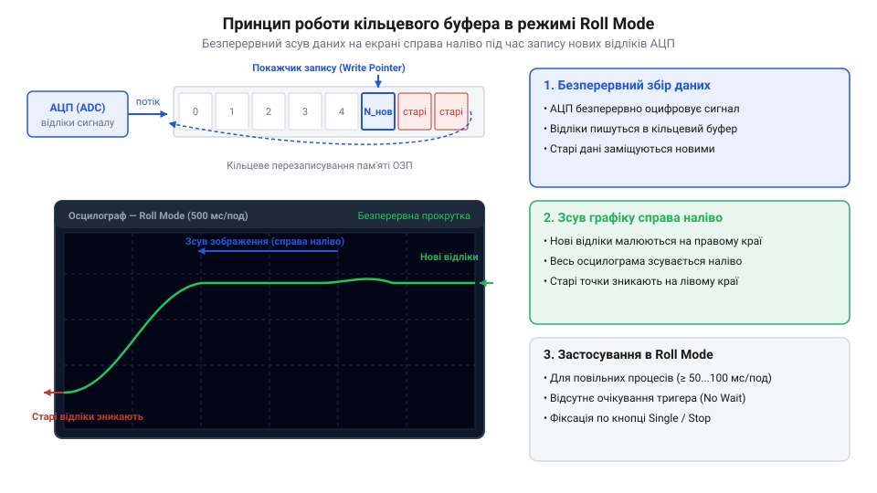
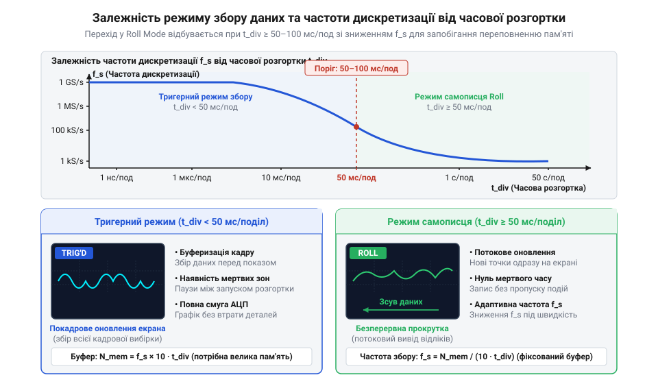

# Режим самописця Roll Mode у цифрових осцилографах

<preknowlist>
- [FNIRSI 2C53T](root:cat-hw-instruments/fnirsi-2c53t) — загальні принципи роботи цифрового осцилографа, базове налаштування входів та часової розгортки
</preknowlist>

## Потреба у спостереженні повільних процесів

Вимірювання повільних процесів — розрядки акумуляторів чи теплового дрейфу (від англ. @@en|thermal drift@@) — у тригерному режимі розгортки (від англ. @@en|triggered sweep mode@@) спричиняє затримку відображення. Цифровий осцилограф оновлює екран лише після повного заповнення буфера відліками АЦП (від англ. @@en|analog-to-digital converter@@ або @@en|ADC@@).

Повний час накопичення кадру `T_frame` обчислюють за масштабом `S_div` і кількістю поділок `N_div`:

        T_frame = S_div × N_div
        = 1 с/поділ × 14 поділок     [обчислення для масштабу 1 с/поділ]
        = 14 с                        [тривалість формування одного кадру]

Екран лишається заблокованим протягом тривалої паузи, через що інженер втрачає динаміку перехідного процесу. Щоб усунути ці затримки, в осцилографах, як-от [FNIRSI 2C53T](root:cat-hw-instruments/fnirsi-2c53t), застосовують режим прокрутки (від англ. @@en|roll mode@@).

## Кільцевий буфер та прокрутка кадру

Головна відмінність режиму @@en|roll mode@@ полягає у повній відмові від очікування тригера. Замість накопичення окремих кадрів осцилограф переходить у режим безперервного потокового відображення сигналу.

Апаратним фундаментом цього режиму є кільцевий буфер пам'яті (від англ. @@en|ring buffer@@ або @@en|circular buffer@@). АЦП постійно оцифровує сигнал і записує відліки в пам'ять за зацикленою адресою, яку контролює апаратний вказівник запису (від англ. @@en|write pointer@@). Досягнувши межі масиву, адреса запису автоматично скидається до початку за принципом модульної адресації, заміщаючи найстаріші відліки новими. Одночасно з цим графічний контролер опитує пам'ять за допомогою вказівника читання (від англ. @@en|read pointer@@).

*Принцип дії кільцевого буфера пам'яті та плавної прокрутки кадру в режимі Roll Mode.*

Завдяки такій синхронізації найновіші відліки з'являються на правому краї дисплея, а вся осцилограма безперервно зсувається ліворуч без розривів чи кадрових пауз.

## Порогові параметри розгортки та децимація

Перехід осцилографа в режим прокрутки відбувається автоматично, коли тривалість горизонтальної часової розгортки (від англ. @@en|timebase@@) досягає порогового значення (від англ. @@en|threshold value@@) — зазвичай `50 мс/поділ` або `100 мс/поділ` і повільніше.

*Залежність режиму збору даних та частоти дискретизації від значення часової розгортки.*

Оскільки обсяг кільцевого буфера обмежений, прилад не може здійснювати вибірку з максимальною частотою АЦП `f_adc` при тривалості кадру в десятки секунд. Керуючий контролер застосовує апаратне ділення частоти — децимацію (від англ. @@en|decimation@@). Коефіцієнт децимації `K_dec` зменшує частоту вибірки до ефективного значення `f_s`. Залежність тривалості запису `T_total` від глибини пам'яті `N_mem` та частоти `f_s` описується виразом:

        T_total = N_mem / f_s

Зниження частоти дискретизації (від англ. @@en|sampling rate@@) викликає ризик пропуску коротких сплесків та виникнення ефекту аліасингу (від англ. @@en|aliasing effect@@). Для усунення цієї проблеми застосовують апаратний піковий детектор (від англ. @@en|peak detector@@). Він аналізує потік АЦП на повній швидкості й зберігає в буфер пару екстремумів (мінімум і максимум) для кожного інтервалу децимації, гарантуючи фіксацію вузьких завад (від англ. @@en|glitch pulse@@).

## Фіксація сигналу та курсорні вимірювання

Режим @@en|roll mode@@ є незамінним для контролю повільних перехідних процесів (від англ. @@en|transient process@@) в аналогових колах, на відміну від аналізу цифрових шин за допомогою логічних аналізаторів на зразок [WeAct DLA Mini](root:cat-hw-instruments/logic-analyzer-dla-mini).

Для детального аналізу зафіксованої осцилограми оператор натискає клавіші `Single` або `Stop`. Збір даних припиняється, і заморожений буфер залишається на екрані. У цьому стані можна накладати вимірювальні курсори для точної оцінки часових інтервалів `Δt` та різниці напруг `ΔV`. 

Осцилограму з пам'яті можна експортувати на USB-флешнакопичувач (від англ. @@en|USB flash drive@@). У меню `Save/Recall` обирають формат CSV (від англ. @@en|comma-separated values@@) для отримання таблиці з часовими мітками (від англ. @@en|timestamp@@) або бінарний дамп (від англ. @@en|binary dump@@) для збереження повного масиву точок без втрати точності.

Для автоматичної фіксації рідкісних аномалій використовують поодинокий тригерний режим (від англ. @@en|single trigger mode@@). Осцилограф безперервно оновлює кільцевий буфер у режимі самописця до моменту перетину порогового рівня, після чого автоматично зупиняє запис, зберігаючи предісторію збою.
