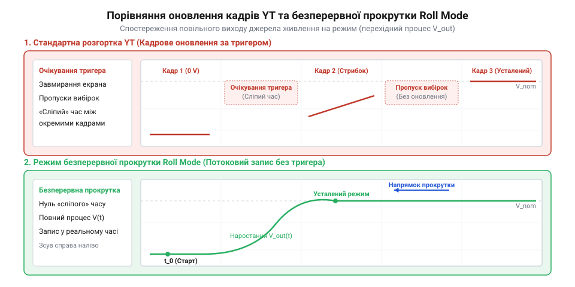

# Практичний моніторинг повільних перехідних процесів живлення у режимі Roll Mode

<preknowlist>
- [FNIRSI 2C53T](root:cat-hw-instruments/fnirsi-2c53t) — Базові навички керування портативним осцилографом, налаштування вхідних каналів та горизонтальної розгортки
</preknowlist>

## Проблема спостереження повільних процесів живлення

Спостереження перехідних процесів у колах живлення — таких як вихід джерела на режим після увімкнення чи повільний розряд літієвого акумулятора під навантаженням — вимагає реєстрації сигналу на проміжках часу від кількох секунд до десятків хвилин. Під час роботи у стандартному режимі розгортки (від позначення осі амплітуди Y та часу T; @@en|YT Sweep@@) цифровий осцилограф збирає вибірки у внутрішню пам'ять, чекає виконання умови тригера (від англ. *trigger* — спусковий гачок; @@en|trigger@@), а потім одночасно перемальовує весь кадр на екрані.

Коли тривалість розгортки становить `500 мс/поділ` або `1 с/поділ`, повне оновлення екрана з 10 поділок затримується на 5–10 секунд. Протягом цього часу екран залишається статичним, і розробник не бачить, що відбувається з напругою в поточний момент. Якщо рівень напруги живлення зростає плавно або коливається без чіткого перепаду, схема тригера (від англійського *trigger* — спусковий гачок; `@@en|trigger@@`) взагалі не спрацьовує, викликаючи замирання екрана та втрату важливих даних про просідання чи перерегулювання.

Математичним підґрунтям цієї втрати в режимі розгортки (від позначення осі амплітуди Y та часу T; `@@en|YT Sweep@@`) є виникнення тривалого сліпого часу (від англійського *dead time* — «сліпий час»; `@@en|dead time@@`) між послідовними кадрами. Повний цикл збору та відображення одного кадру `T_total` складається з трьох інтервалів: часу накопичення вибірок `T_acq`, часу цифрової обробки й побудови растра `T_proc` та часу очікування умов тригера `T_wait`. На повільних розгортках при фіксованій глибині пам'яті (від англійського *sample depth*; `@@en|sample depth@@`) `M` прилад змушений знижувати частоту дискретизації АЦП `f_s`, а тривалість активного накопичення `T_acq` визначається кількістю поділок `N_div` та часовим масштабом `T_div`:

```
T_acq = N_div · T_div                                   [час накопичення буфера кадру]
f_s = M ÷ T_acq                                         [зниження частоти дискретизації на повільній розгортці]
T_total = T_acq + T_proc + T_wait                       [повний період циклу кадру]
D_ratio = (T_proc + T_wait) ÷ (T_acq + T_proc + T_wait) [частка сліпого часу в циклі]
```

Оскільки на повільних розгортках `T_acq` становить 10 секунд, затримка обробки даних `T_proc` та вимушена пауза тригера `T_wait` додають від 2 до 5 секунд безповоротно втраченого часу на кожному циклі. У результаті коефіцієнт сліпого часу `D_ratio` сягає від `0.16` (16%) до `0.33` (33%), тобто до третини всього часу спостереження прилад залишається «сліпим» до імпульсних просідань чи перерегулювань напруги, які стаються під час обробки попереднього кадру.

Математичною причиною втрати даних у режимі @@en|YT Sweep@@ є виникнення тривалого сліпого часу (від англійського *dead time* — «сліпий час»; `@@en|dead time@@`) між кадрами. Після заповнення буфера вибірок тривалістю `T_acq` процес збору даних зупиняється для обробки та перемалювання осцилограми протягом часу `T_proc`. Коефіцієнт сліпого часу `D_ratio`, що визначає частку неспостережуваного сигналу, обчислюють за формулою:

```
D_ratio = T_proc ÷ (T_acq + T_proc)    [частка сліпого часу в циклі кадру]
```

На повільних розгортках, де `T_acq = 10 с`, затримка обробки й перезапуску тригера `T_proc` може сягати 2–5 секунд. У результаті `D_ratio` становить від 16% до 33%, тобто третина часової динаміки напруги залишається поза увагою вимірювального приладу.


*Порівняння збору даних у режимі розгортки YT Sweep та безперервного потоку Roll Mode при увімкненні живлення.*

Спроба виміряти повільний процес за допомогою цифрового мультиметра надає лише усереднені значення, приховуючи короткочасні імпульсні викиди. Для повноцінного моніторингу повільних процесів потрібен режим безперервного оновлення, який відображає кожне нове значення напруги одразу після оцифрування аналогово-цифровим перетворювачем (АЦП), зсуваючи застарілі вибірки ліворуч, подібно до паперового стрічкового самописця.

## Принцип роботи та налаштування Roll Mode

Режим безперервної прокрутки (від англ. *roll* — котити, прокручувати та *mode* — режим; @@en|Roll Mode@@) змінює алгоритм виведення даних з АЦП на екран. Замість очікування повного формування кадру осцилограф постійно записує нові вибірки у кільцевий буфер оперативної пам'яті. Застарілі точки плавно зміщуються вліво за межі дисплея, а найновіші дані з'являються біля правого краю екрана у реальному часі.

Прилади автоматично активують режим прокрутки (від англійського *roll* — котити та *mode* — режим; `@@en|Roll Mode@@`) при збільшенні масштабу горизонтальної розгортки до `50 мс/поділ` або повільніше (`100 мс/поділ`, `1 с/поділ`). При цьому система тригера вимикається в режим вільного ходу (від англійського *free run*; `@@en|Free Run@@`), а запис вибірок відбувається безперервно. Якщо напруга живлення плавно зростає при увімкненні, розробник одразу бачить траєкторію наростання. На якість візуалізації цієї низькочастотної кривої в режимі `@@en|Roll Mode@@` суттєво впливає вибір алгоритму обробки вибірок АЦП: режиму згладжування й усереднення (від англійського *averaging* — усереднення; `@@en|averaging@@`) або режиму пікового детектора (від англійського *peak detect* — виявлення піків; `@@en|Peak Detect@@`). При увімкненому згладжуванні осцилограф обчислює середнє значення сусідніх оцифрованих відліків перед виведенням на екран, що ефективно пригнічує високочастотну шумову смугу й робить лінію напруги тонкою та виразною. Однак таке усереднення маскує короткочасні вузькі викиди та високочастотні пульсації джерела. Натомість режим `@@en|Peak Detect@@` фіксує мінімальне `V_min` та максимальне `V_max` значення напруги на кожному інтервалі децимації, відображаючи реальний амплітудний розмах високочастотних завад. Хоча це розширює видиму шумову смугу осцилограми, піковий детектор гарантує виявлення короткочасних імпульсних просідань і сплесків напруги, які стаються під час повільного прокручування сигналу. Практичним прикладом компактного приладу з підтримкою цих масштабів і режимів обробки є [портативний осцилограф FNIRSI 2C53T](root:cat-hw-instruments/fnirsi-2c53t).

На якість візуалізації низькочастотної кривої в режимі `@@en|Roll Mode@@` суттєво впливає вибір алгоритму обробки вибірок АЦП: режиму згладжування й усереднення (від англійського *averaging* — усереднення; `@@en|averaging@@`) або режиму пікового детектора (від англійського *peak detect* — виявлення піків; `@@en|Peak Detect@@`). При увімкненому згладжуванні осцилограф обчислює середнє значення сусідніх оцифрованих відліків перед виведенням на екран, що ефективно пригнічує високочастотну шумову смугу й робить лінію напруги тонкою та виразною. Однак таке усереднення маскує короткочасні вузькі викиди та високочастотні пульсації джерела. Натомість режим `@@en|Peak Detect@@` фіксує мінімальне `V_min` та максимальне `V_max` значення напруги на кожному інтервалі децимації, відображаючи реальний амплітудний розмах високочастотних завад. Хоча це розширює видиму шумову смугу осцилограми, піковий детектор гарантує виявлення короткочасних імпульсних просідань і сплесків напруги, які стаються під час повільного прокручування сигналу.

Ключовим параметром при налаштуванні є глибина пам'яті вибірок (від англ. *sample* — відлік та *depth* — глибина; @@en|sample depth@@). Загальна тривалість спостережуваного часового вікна `T_window` визначається як добуток масштабу розгортки `T_div` на кількість горизонтальних поділок екрана `N_div` (зазвичай 10 або 12):

```
T_window = T_div × N_div
= 1 с/поділ × 10 поділок   [підстановка масштабу 1 с/поділ]
= 10 с                      [загальна тривалість екрана]
```

Для збереження високої частоти дискретизації `f_s` під час спостереження тривалих процесів необхідно обирати максимальну глибину пам'яті `N_mem`. Частота оцифрування пов'язана з часовим вікном виразом:

```
f_s = N_mem ÷ T_window
= 1000000 ÷ 10              [глибина 1 Мбіт вибірок на 10 секунд]
= 100 кВибірок/с           [частота дискретизації АЦП]
```

При малих значеннях `N_mem` осцилограф змушений знижувати частоту дискретизації, що може призвести до пропуску коротких вузьких піків просідання напруги. Докладніше про зв'язок обсягу часового буфера, частоти оцифрування та збереження дрібних деталей сигналу дивіться у статті про [глибину пам'яті та частоту дискретизації цифрових осцилографів](root:hw-sensing/oscilloscope-sample-depth-memory).

## Фіксація пускових кидків і розряду батареї

Оскільки у режимі @@en|Roll Mode@@ кільцевий буфер оновлюється беззупинно, вибірки завершеного перехідного процесу поступово витісняються новими даними і зникають з екрана. Щоб зберегти зафіксовану часову діаграму виходу джерела на режим або розряду акумулятора для подальшого детального аналізу, необхідно вчасно зупинити процес збору вибірок.

Для зупинки запису використовують два методи:
1. Ручне натискання кнопки **Stop** (від англ. *stop* — зупинити; @@en|Stop Mode@@): застосовується при спостереженні повільних процесів розряду батареї. Коли напруга досягає порогового значення відсічки, розробник натискає кнопку, і вміст екранного буфера заморожується.
2. Режим однократного запуску (від англ. *single* — один; @@en|Single Mode@@): прилад здійснює один повний прохід часового буфера заданої довжини `T_window` і автоматично переходить у стан зупинки, запобігаючи стиранню пускового кидка.

При вимірюванні пускового перехідного процесу блока живлення важливо подати напругу на досліджуване коло одразу після переведення осцилографа в стан очікування. Зафіксований фрагмент осцилограми дозволяє роздивитися амплітуду перерегулювання (англ. @@en|overshoot@@), просідання напруги (англ. @@en|undershoot@@) та загальну тривалість встановлення вихідного рівня.

## Курсорні вимірювання та розрахунок параметрів

Після зупинки запису в режимі @@en|Roll Mode@@ для отримання точних кількісних характеристик застосовують вимірювальні курсори. Горизонтальні курсори напруги `V1` та `V2` вимірюють амплітуду початкового кидка та усталене значення, а вертикальні часові курсори `T1` та `T2` фіксують тривалість перехідного процесу `Δt = T2 - T1`.

Час стабілізації живлення (від англ. *settling* — встановлення та *time* — час; @@en|settling time@@) обчислюють як інтервал від моменту подачі живлення `T1` до моменту `T2`, після якого напруга більше не виходить за межі 5% коридору від номінального значення `V_nom`.

Швидкість розряду акумуляторної батареї оцінюють за зміною напруги між двома часовими відліками `ΔV = V2 - V1` за інтервал `Δt`:

```
dV/dt = ΔV ÷ Δt
= (3.95 - 4.10) ÷ 60        [падіння 0.15 В за 60 секунд]
= -0.0025 В/с               [швидкість розряду акумулятора]
```

Нижче наведено програмні драйвери мовами C та C++ для автоматизованого розрахунку тривалості пускового процесів та розрахунку розряду акумулятора за масивами вибірок осцилографа:

:::tabs
@tab C
:::code proj-monitoring-power-supply-startup-transients/c/roll_analysis.h
:::code proj-monitoring-power-supply-startup-transients/c/roll_analysis.c
:::code proj-monitoring-power-supply-startup-transients/c/main.c

@tab C++
:::code proj-monitoring-power-supply-startup-transients/cpp/include/roll_mode_analyzer.hpp
:::code proj-monitoring-power-supply-startup-transients/cpp/src/roll_mode_analyzer.cpp
:::code proj-monitoring-power-supply-startup-transients/cpp/src/main.cpp
:::

Функція `calculate_transient_duration` сканує масив вибірок `roll_sample_t` у зворотному напрямку для знаходження останньої точки виходу за межі допустимого коридору `tolerance_pct`, а метод `calculateDischargedCapacity` обчислює віддану ємність (А·год) та енергію (Вт·год) методом чисельного інтегрування трапецій.
