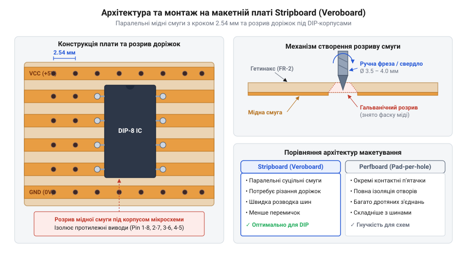

# Винахід Veroboard та еволюція безшаблонового макетування

<preknowlist>
- [Макетна плата (велика)](root:cat-hw-instruments/breadboard-large) — Базове розуміння принципів макетування схем та контактних шин.
</preknowlist>

## Криза навісного монтажу 1950-х років

У 1950-х роках електронна промисловість зіткнулася з гострим технологічним бар'єром під час створення нових пристроїв. Класичний навісний монтаж (англ. @@en|point-to-point wiring@@, об'ємний монтаж) розроблявся під громіздкі електронні лампи, які вимагали високої механічної міцності, високовольтної ізоляції та витримували значний нагрів. Компоненти припаювали безпосередньо до масивних керамічних стійок (англ. @@en|terminal strip@@, контактна планка) і металевих шасі. Однак поява перших плоских напівпровідникових триодів — транзисторів — радикально зменшила габарити елементів. Спроби збирати мініатюрні транзисторні схеми за допомогою гнучких дротів і жорстких стійок призводили до хаотичного «пташиного гнізда» із плутанини провідників. Будь-яка зміна номіналу резистора чи конденсатора в підсилювачі вимагала тривалого прогреву паяльником затиснутих контактів, що нерідко призводило до теплового пробою чутливих транзисторів.

Для лабораторних досліджень виготовлення індивідуальних друкованих плат (англ. @@en|printed circuit board@@, PCB) було занадто повільним і дорогим: хімічне травлення мідної фольги забирало дні, а кожен виправлений дріт вимагав створення нового фотошаблону. З іншого боку, збирання макета на керамічних стійках вимагало багатогодинної слюсарної обробки металевого шасі, клепання контактних планшетів та трудомісткого в'язання джгутів, через що собівартість одного дослідного екземпляра вимірювалася десятками фунтів стерлінгів у цінах 1950-х років. Перші перфоровані гетинаксові пластини без фольги скоротили цей процес у п'ять-сім разів: вони коштували копійки і дозволяли монтувати деталі у готову сітку отворів, однак усе ще вимагали ручного з'єднання кожної пари ніжок окремим дротом. Інженерам потрібен був універсальний плоский носій, який поєднував би механічну жорсткість друкованої плати зі швидкістю та гнучкістю безшаблонового монтажу.

Конструкція тогочасного шасі являла собою масивну сталеву або алюмінієву рамку, на якій штампували отвори під важкі трансформатори та керамічні панелі ламп, а вздовж внутрішніх стінок приклепували контактні планки (англ. @@en|terminal strip@@). Ці планки складалися з керамічних або текстолітових ізолюючих плашок із впресованими латунними або лудженими мідними люверсами та пелюстками для паяння. Радіодеталі висіли у тривимірному просторі між пелюстками стійок і виводами ламп, що забезпечувало відмінний відвід тепла для високовольтних кіл, однак для низьковольтних транзисторних схем така об'ємна геометрія створювала надмірні габарити, слабку вібростійкість та постійний ризик замикання сусідніх провідників.

## Винахід Veroboard та смугова революція 1961 року

Розв'язанням цієї кризи став винахід, здійснений у 1959 році в місті Саутгемптон (Велика Британія). Інженер Террі Фітцпатрік (англ. @@en|Terry Fitzpatrick@@), працюючи в компанії Vero Precision Engineering під керівництвом Джеффрі Вердона-Роу, запропонував принципово нову конструкцію макетної плати, яка отримала назву Veroboard (англ. @@en|Veroboard@@). Ідея полягала у виготовленні стандартизованої пластини з листового гетинаксу — паперово-смоляного ламінату (англ. @@en|synthetic resin bonded paper@@, SRBP), на один бік якого наклеювалися паралельні мідні смуги (англ. @@en|copper strip@@) з просвердленими крізь них матричними отворами.

*Геометрія Veroboard поєднує ізолюючу гетинаксову основу з паралельними мідними шинами та локальними розривами доріжок.*

Виводи радіодеталей вставлялися з гладкого текстолітового боку та припаювалися до суцільних мідних шин на звороті. Це одразу вирішило проблему підведення живлення й спільного провідника «заземлення»: паралельні доріжки слугували готовими електричними магістралями. Новий смуговий макетний матеріал, який згодом почали називати узагальненим терміном Stripboard (англ. @@en|Stripboard@@), скоротив час складання дослідного прототипу з кількох днів до однієї години. Під час лабораторних випробувань перших зразків розробники зіткнулися з проблемою термостійкості клейового з'єднання: тонка мідна фольга (англ. @@en|copper foil@@) завтовшки 18 мкм швидко відшаровувалася від гетинаксової основи при локальному перегріві під час повторного паяння та заміни деталей. Провівши серію експериментів із термостійкими смолами, інженери Vero обрали оптимальну товщину фольгування 35 мкм: вона забезпечувала належну теплоємність для рівномірного розподілу тепла паяльника та запобігала відшаруванню смуг навіть при багаторазовому перепаюванні вузлів.

## Стандартизація сітки 2.54 мм та поява корпусів DIP

Вирішальним поштовхом до масового поширення смугових плат стала стандартизація дюймової сітки отворів із кроком 2.54 мм (англ. @@en|0.1 inch grid@@, крок 0.1 дюйма). Коли в середині 1960-х років компанія Texas Instruments запровадила прямокутні корпуси мікросхем із двома рядами виводів (англ. @@en|Dual In-line Package@@, DIP), їхній крок ніжок точно відповідав стандарту Veroboard. Детальні геометричні стандарти й розташування ніжок описує окремий матеріал про [корпуси мікросхем DIP](root:hw-components/dip-package), які стали базовим стандартом для цифрових компонентів.

Однак встановлення мікросхеми DIP прямо на суцільні мідні смуги призводило до короткого замикання між протилежними ніжками корпусу. Для розв'язання цієї проблеми розробили спеціальне ручне свердло-фрезу (англ. @@en|track cutter@@, різчик доріжок). Обертанням фрези навколо потрібного отвору мідне покриття знімалося під кутом 45 градусів, утворюючи акуратний електричний розрив смуги. Геометричний розрахунок фрези базується на сітці отворів із кроком 2.54 мм: при ширині мідної доріжки близько 2.0 мм та діаметрі технологічного отвору 1.0 мм конус ріжучої кромки діаметром 3.5–4.0 мм гарантує повне зрізання мідного кільця навколо отвору, але не досягає осі сусідніх доріжок, запобігаючи пошкодженню паралельних кіл. Розрізання доріжки безпосередньо під корпусом DIP дозволило ізолювати виводи лівого та правого рядів мікросхеми, перетворивши смуговий носій на гнучку матрицю для мобільного цифрового макетування.

## Еволюція від Stripboard до точкових Perfboard

У ході розвитку схемотехніки паралельні мідні доріжки класичного Stripboard проявили певні обмеження: між сусідніми смугами виникала відчутна паразитна ємність, яка викривляла високочастотні аналогові сигнали, а складна топологія цифрових шин вимагала великої кількості механічних розрізів. Це зажадало створення точкових макетних плат, відомих як Perfboard (англ. @@en|Perfboard@@, точкова плата).

На відміну від смугових плат, Perfboard містить ізольовані квадратні або круглі мідні п'ятачки навколо кожного отвору без початкових зв'язків між ними. З'єднання між компонентами виконуються окремими перемичками з ізольованого дроту або краплями припаю. Під час вибору носія керуються частотою та топологією: смуговий Stripboard є ідеальним для низькочастотних аналогових і силових схем, де довгі паралельні шини прискорюють розведення живлення, але на частотах понад 1–5 МГц або при складних матричних зв'язках паразитна ємність доріжок та велика кількість розрізів ускладнюють монтаж. Натомість точковий Perfboard обирають для високочастотних аналогових кіл та високощільних цифрових блоків, оскільки ізольовані п'ятачки усувають паразити між шинами й дають повну свободу довільного трасування дрібними перемичками. Для попередньої перевірки схем без паяння інженери також застосовують [безпайкову макетну плату](root:cat-hw-instruments/breadboard-large), але саме пропаяний Stripboard та Perfboard надають кінцеву механічну надійність для лабораторних випробувань та експлуатації в умовах вібрацій.
