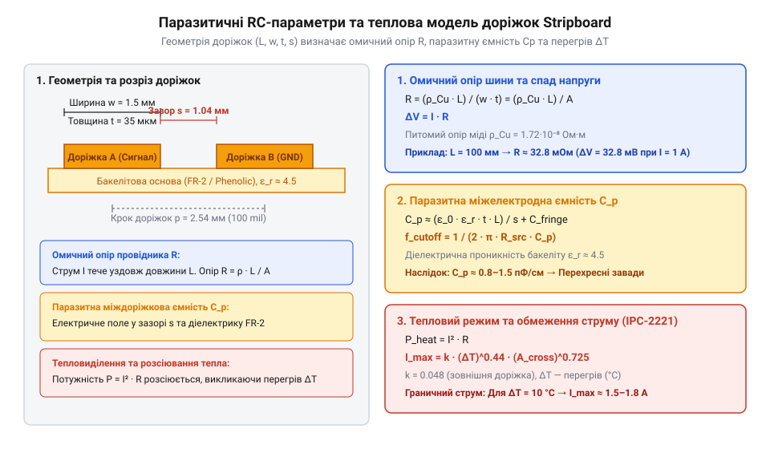

# Обчислення паразитної ємності та граничних струмів доріжок макетної плати

<preknowlist>
- [Макетна плата (велика)](root:cat-hw-instruments/breadboard-large) — розуміння геометрії та зв'язку доріжок макетної плати
</preknowlist>

## Фізичні обмеження мідних шин макетування

При складанні дослідних схем на макетних платах типу @@en|stripboard@@ (від англ. *strip* — смуга та *board* — плата) паралельні мідні доріжки часто вважають ідеальними провідниками з нульовим опором та відсутністю взаємного впливу. Проте реальне фольгування з електролітичної міді завтовшки 35 мкм має скінченну провідність, а вузький простір між сусідніми смугами створює між ними розподілений діелектричний зазор.

При проходженні струму живлення скінченний опір провідника спричиняє спад напруги вздовж шини та виділення тепла за законом Джоуля — Ленца. На відміну від безпаяльних [макетних плат великого розміру](root:cat-hw-instruments/breadboard-large), де контакти розраховані на малі струми, натурні макети на @@en|stripboard@@ часто живлять потужні силові вузли чи світлодіодні матриці. Без попереднього розрахунку паразитичних параметрів схеми розробник ризикує зіткнутися з нестабільністю опорних напруг, термічним деформуванням плати або перехресними завадами (англ. @@en|cross-talk@@, від *cross* — перехресний та *talk* — розмова, паразитне проникання сигналу між сусідніми лініями) на високих частотах. Крім того, геометричне розташування земляної шини відносно сигнальних провідників визначає розподілену індуктивність (від лат. *inductio* — наведення) струмового контуру. Якщо земляна доріжка віддалена від сигнальної лінії, площа утвореного ними контуру зростає, що пропорційно збільшує паразитну індуктивність і спричиняє імпульсні сплески напруги під час швидких змін струму (`dI/dt`). Прокладання ж земляної смуги в безпосередній близькості паралельно до сигнальних доріжок мінімізує площу контуру, суттєво знижуючи паразитну індуктивність та імпульсні завади.


*Модель паразитичних параметрів доріжок макетної плати завтовшки 35 мкм: опір провідника спричиняє спад напруги й нагрів, а міжелектродна ємність створює паразитний зв'язок на високих частотах.*

Представлена еквівалентна схема розкладає паразитні параметри доріжки на дві ключові складові: послідовний омичний опір мідного провідника та паралельну міжелектродну ємність діелектричного зазору. Послідовний опір залежить від питомого опору міді, товщини фольгування 35 мкм та геометрії шини, визначаючи втрати напруги й межі термічного перегріву. Паралельна ємність формується міжелектродним зазором підкладки й обумовлює реактивний струм витоку на високих частотах. Кількісний аналіз цих двох ефектів дозволяє обчислити граничні значення струму й частоти для безпечної експлуатації макета.

## Омичний опір і спад напруги доріжки

Омичний опір мідного провідника прямо пропорційний його довжині та обернено пропорційний площі поперечного перерізу. Стандартна макетна плата має крок між отворами 2.54 мм, а середня ширина суцільної мідної доріжки становить `w = 1.8` мм при товщині фольги `t = 35` мкм (0.035 мм).

Питомий електричний опір електролітичної міді при температурі 20 °C становить `ρ = 0.0175` Ом·мм²/м. Для обчислення повного опору шини `R` та спаду напруги `ΔV` при струмі навантаження `I` застосовують послідовний розрахунок геометрії та закону Ома.

Символи у формулах позначено так:
- `w` — ширина мідної доріжки (мм);
- `t` — товщина мідної фольги (мм);
- `S` — площа поперечного перерізу провідника (мм²);
- `L` — довжина доріжки (м);
- `ρ` — питомий опір міді (Ом·мм²/м);
- `R` — повний електричний опір провідника (Ом);
- `I` — струм навантаження (А);
- `ΔV` — спад напруги на довжині доріжки (В).

Обчислення площі перерізу, опору метра провідника та спаду напруги виконують за кроками:

S = w × t
= 1.8 × 0.035                          [підстановка ширини 1.8 мм та товщини 0.035 мм]
= 0.063 мм²                            [площа поперечного перерізу доріжки]

R = ρ × L ÷ S
= 0.0175 × L ÷ 0.063                   [підстановка питомого опору міді]
= 0.278 × L                            [опір одного метра доріжки в Омах]

ΔV = I × R                             [закон Ома для ділянки кола]

**Обчислення опору та спаду напруги для шини живлення завдовжки 15 см при струмі 1.5 А:**
```
L = 0.15 м
R = 0.278 × 0.15                       [множення питомого опору метра на довжину]
= 0.0417 Ом                            [повний опір шини 15 см]

ΔV = 1.5 × 0.0417                      [множення струму 1.5 А на опір 0.0417 Ом]
= 0.0625 В                             [спад напруги на шині]
```

Спад напруги 62.5 мВ на шині 15 см здатний змістити опорну напругу аналогово-цифрового перетворювача або викликати збій чутливих цифрових логічних рівнів 3.3 В. Проте при тривалому проходженні струму провідник нагрівається, а електричний опір міді зростає за температурним коефіцієнтом `α = 0.00393` 1/°C. Зміна опору `R(T)` та спаду напруги при нагріванні шини на `ΔT = 50` °C (до температури 70 °C) обчислюється так:

R(T) = R_20 × (1 + α × ΔT)
= 0.0417 × (1 + 0.00393 × 50)          [підстановка α = 0.00393 1/°C та ΔT = 50 °C]
= 0.0499 Ом                            [опір гарячої шини при 70 °C]

ΔV_hot = I × R(T)
= 1.5 × 0.0499                         [множення струму 1.5 А на опір 0.0499 Ом]
= 0.0749 В                             [спад напруги на нагрітій шині]

Таким чином, температурний розігрів шини збільшує спад напруги з 62.5 мВ до 74.9 мВ, що призводить до додаткового просідання шини живлення на 20% і поглиблює нестабільність чутливих аналогових кіл.

## Тепловий розрахунок струму за IPC-2221

Електрична енергія, що виділяється на опорі доріжки, перетворюється на тепло. Завдяки прямому контакту з повітрям та підкладкою плата розсіює тепло, проте при перевищенні допустимого струму температура міді зростає вище критичної межі. За міжнародним стандартом @@en|IPC-2221@@ (стандарт асоціації @@en|IPC@@, від англ. *Institute for Printed Circuits* — Інститут друкованих плат) граничний струм зовнішнього провідника обчислюють залежно від площі перерізу та дозволеного нагріву `ΔT`.

У формулі IPC-2221 використовуються такі величини:
- `I_max` — гранично допустимий тривалий струм (А);
- `ΔT` — дозволене перевищення температури провідника над довкіллям (°C);
- `A` — площа поперечного перерізу в квадратних мілах (mil²), де `1 мм² = 1550 mil²`;
- `k = 0.048` — емпіричний коефіцієнт для зовнішніх провідників на повітрі.

Порівняно з пружинними контактами [компактних макетних плат](root:cat-hw-instruments/breadboard-mini), паяне з'єднання на @@en|stripboard@@ витримує більший струм, проте обмеження визначається теплостійкістю клейового шару підкладки FR-4 або гетинаксу.

Розрахунок допустимого струму за IPC-2221 проводиться у квадратних мілах:

A = S × 1550                           [переведення площі перерізу з мм² у mil²]
I_max = 0.048 × (ΔT)⁰·⁴⁴ × A⁰·⁷²⁵      [емпірична формула IPC-2221]

**Обчислення граничного струму для доріжки 35 мкм шириною 1.8 мм при дозволеному нагріві ΔT = 10 °C:**
```
A = 0.063 × 1550                       [переведення 0.063 мм² у mil²]
= 97.65 mil²                           [площа поперечного перерізу]

(ΔT)⁰·⁴⁴ = 10⁰·⁴⁴
≈ 2.754                                [температурний множник для 10 °C]

A⁰·⁷²⁵ = 97.65⁰·⁷²⁵
≈ 27.68                                [геометричний множник площі]

I_max = 0.048 × 2.754 × 27.68          [обчислення граничного струму]
= 3.66 А                               [максимальний струм при ΔT = 10 °C]
```

При струмі 3.66 А доріжка нагрівається на 10 °C вище температури навколишнього середовища. Якщо збільшити дозволений нагрів до `ΔT = 30` °C, допустимий струм зростає до 5.92 А, однак нагрів понад 70–80 °C призводить до деградації сполучного лаку та відшарування мідної фольги від текстоліту.

## Паразитна ємність та перехресні завади

Дві суміжні паралельні доріжки @@en|stripboard@@ утворюють копланарну систему провідників, відокремлених повітряно-текстолітовим зазором. Ця геометрія формує міжлінійну паразитну ємність `C_p`, через яку високочастотна складова сигналу з однієї шини проникає в сусідню.

Для стандартного кроку 2.54 мм та ширини доріжки `w = 1.8` мм повітряний зазор становить `g = 2.54 - 1.8 = 0.74` мм. Питома паразитна ємність таких паралельних шин на підкладці FR-4 з відносною діелектричною проникністю `ε_r ≈ 4.5` становить приблизно `14.85` пФ на кожен метр довжини (`14.85` пФ/м).

Величини у розрахунку паразитного зв'язку:
- `C_p` — паразитна ємність між суміжними доріжками (пФ);
- `L` — довжина паралельної прокладки доріжок (м);
- `R_L` — опір навантаження або внутрішній опір джерела сигналу (Ом);
- `f_cut` — гранична частота, на якій реактивний опір ємності дорівнює `R_L` (Гц).

Граничну частоту `f_cut`, вище якої ємнісні перехресні завади стають критичними, визначають за формулою:

C_p = 14.85 × L                        [обчислення ємності за питомим значенням]
f_cut = 1 ÷ (2 × π × R_L × C_p)        [частота зрізу високочастотного фільтра]

**Обчислення паразитної ємності та граничної частоти для двох паралельних доріжок завдовжки 15 см при опорі R_L = 10 кОм:**
```
L = 0.15 м
C_p = 14.85 × 0.15                     [множення питомої ємності на довжину 15 см]
= 2.23 пФ                              [паразитна міжелектродна ємність]

f_cut = 1 ÷ (2 × 3.1416 × 10000 × 2.23 × 10⁻¹²) [підстановка R_L = 10 кОм та C_p = 2.23 пФ]
= 1 ÷ (1.401 × 10⁻⁷)                    [знаменник виразу]
= 7.14 × 10⁶ Гц = 7.14 МГц             [гранична частота перехресних завад]
```

На частотах вище 7.14 МГц реактивний опір паразитного конденсатора стає меншим за опір навантаження 10 кОм, викликаючи сильні викривлення фронтів цифрових імпульсів та проникання завад. Для високоомних кіл (`R_L = 100` кОм) гранична частота знижується до 714 кГц, що вимагає залишати між сигнальними лініями заземлену екранувальну доріжку.
