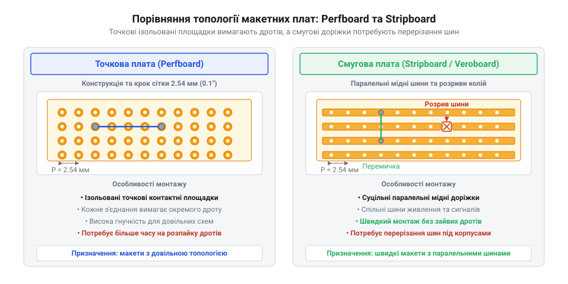
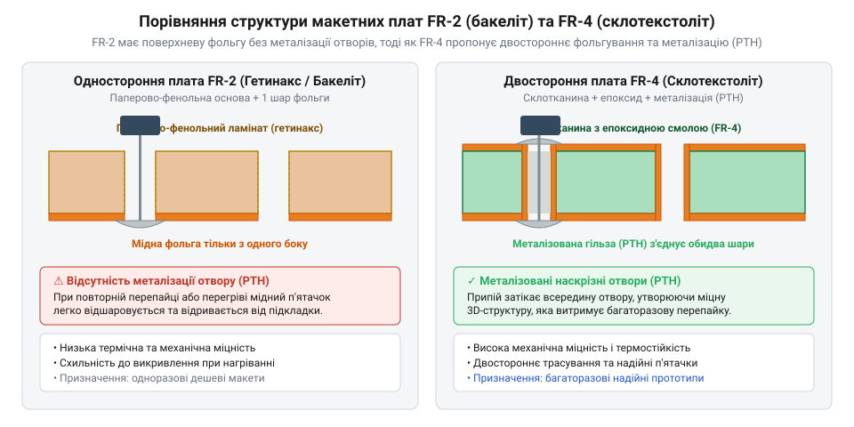
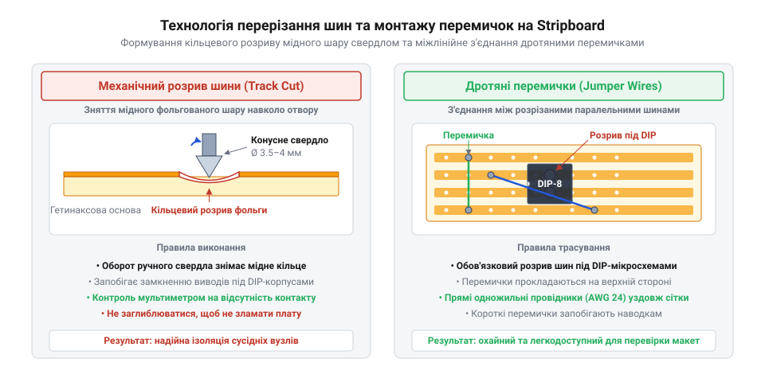

# Макетні плати під пайку (бакеліт, Stripboard)

<preknowlist>
- [Макетна плата (велика)](root:cat-hw-instruments/breadboard-large) — Розуміння загальної будови безпайкової макетної плати, сітки отворів 2.54 мм та з'єднання контактних груп.
</preknowlist>

## Обмеження безпайкових макеток та потреба в паяній основі

Швидке складання електронних схем на [безпайкових макетних платах](root:cat-hw-instruments/breadboard-large) чудово підходить для первинної перевірки ідеї. Проте пружинні контакти безпайкової макетки (від англійського @@en|solderless breadboard@@) розраховані виключно на тимчасове макетування. З часом внутрішні пружинні пелюстки окислюються та втрачають притискне зусилля, що призводить до самовільного збільшення перехідного опору контакту або випадкового обриву кіл при найменшій вібрації. Крім того, вивідні компоненти й з'єднувальні дроти тримаються у гніздах лише за рахунок тертя: один випадковий зачіп кабелю живлення здатний висмикнути ключовий провідник і зруйнувати макет.

Іншим критичним обмеженням безпайкових плат є паразитна ємність між суміжними контактними шинами та нестабільність перехідного опору. Паралельні металеві смуги, розділені стінками пластикового корпусу з @@en|ABS@@-пластику або полікарбонату, утворюють між собою плоский конденсатор. Величина цієї ємності прямо пропорційна відносній діелектричній проникності діелектрика підкладки, яка для поширених термопластів становить `3.0–3.5`, витворюючи між сусідніми шинами ємність порядку `2–5 pF`. У поєднанні з вихідним опором джерела сигналу `R` ця паразитна ємність `C` витворює інтегрувальний ланцюг низьких частот із граничною частотою `f = 1 / (2 × π × R × C)`. При високоомній лінії з опором `10 kΩ` паразитні `5 pF` обмежують смугу пропускання значенням близько `3.18 MHz` та затягують тривалість фронту імпульсу до `t = 2.2 × R × C ≈ 110 ns`, що викривляє цифрові сигнали й викликає взаємні завади. Крім того, при роботі з малими вимірювальними струмами та низькими напругами виявляється механізм деградації окислених пелюсток: тонша оксидна плівка завтовшки `1–10 nm` на поверхні контакту створює потенційний бар'єр. При мікрострумах та напругах нижче `100 mV` напруженість електричного поля виявляється недостатньою для електричного пробою (від англійського @@en|fritting@@, корінь @@en|frit@@ — спекатися) оксидного шару, через що мікроскопічні струмопровідні містки не формуються, а перехідний опір контакту зростає на кілька порядків, витворюючи хаотичні шуми або повністю розриваючи коло. Для створення довговічного пристрою, стійкого до механічних струсів, високих частот і паразитних наведень, схему необхідно перенести на жорстку паяну основу.

Паяні макетні плати займають проміжну нішу між чорновим макетом і серійним виробництвом. Вони дозволяють надійно зафіксувати компоненти за допомогою [техніки монтажу в отвори](root:cat-hw-instruments/through-hole-soldering-techniques) без значних витрат часу й коштів на [виготовлення друкованих плат](root:hw-pcb/pcb-design-and-fabrication-basics). Історичний перехід від об'ємного навісного монтажу до уніфікованих паяних плат детально висвітлено у [вставці про історію Veroboard](root:cat-hw-instruments/perfboard-and-stripboard/hist-veroboard-invention-and-prototyping-evolution.md).

Головна економічна й технологічна перевага макетної плати під пайку перед замовленням кастомної друкованої плати в одиничних примірниках чи малих серіях полягає у відсутності підготовчих етапів і нульовому часі очікування. Складання одиничного пристрою на макетці вимагає від кількох десятків хвилин до кількох годин безпосереднього монтажу й коштує лише декілька гривень за діелектричну підкладку. Натомість замовляти фабричне [виготовлення друкованих плат](root:hw-pcb/pcb-design-and-fabrication-basics) для одного-двох примірників вимагає трасування в CAD, а фіксовані витрати на підготовку виробництва (від англійського @@en|non-recurring engineering@@, скорочено @@en|NRE@@) разом із тривалою доставкою роблять цей шлях недоцільним. Тому для лабораторних дослідів, швидких випробувань та створення поодиноких вимірювальних стендів паяні макетні плати забезпечують найкоротший шлях від ідеї до готового пристрою.

## Точкові Perfboard проти смугових Stripboard

Конструктивно паяні макетні плати поділяють на два основних топологічних типи: точкові та смугові. Точкова макетна плата (від англійського @@en|perfboard@@ або @@en|pad-per-hole@@) являє собою матрицю ізольованих металевих отворів, де кожна контактна площадка повністю відокремлена від сусідніх. Така топологія надає повну свободу трасування: розробник довільно розміщує компоненти й з'єднує їхні виводи між собою за допомогою окремих тонких провідників або формування містків із припою між суміжними точками. Техніка паяного містка полягає у розігріві двох сусідніх площадочок паяльником та додаванні суцільної краплі припою, поверхневий натяг якого з'єднує рідку фазу припою в один суцільний електричний місток без потреби прокладати дріт. З точки зору трудомісткості точкові плати вимагають суттєво більших витрат часу: нарізання, зачищення та паяння окремої дротяної перемички або з'єднання точок припоєм для кожного зв'язку займає у кілька разів більше часу, ніж секундне розрізання суцільної мідної шини на смуговій платі. Точкові плати ідеально підходять для складних нерегулярних схем із високою щільністю монтажу, але вимагають великого обсягу ручної пайки.

Натомість смугова макетна плата (від англійського @@en|stripboard@@ або @@en|Veroboard@@) має суцільні паралельні мідні шини, що об'єднують цілі ряди отворів уздовж одного напрямку. Ця топологія повторює принцип зв'язку контактних груп безпайкової макетки, що спрощує підключення шин живлення та заземлення. Для формування окремих електричних вузлів суцільні мідні доріжки розрізають у потрібних місцях спеціальним різаком або конусним свердлом. Розподіл електричного струму та розрахунок паразитної ємності між суміжними смугами детально розглянуто у [вставці про паразити та струми stripboard](root:cat-hw-instruments/perfboard-and-stripboard/math-stripboard-parasitics-and-current-limits.md), а практичну методику збирання схем на таких платах показано у [проєкті перенесення схеми на stripboard](root:cat-hw-instruments/perfboard-and-stripboard/proj-transferring-circuit-from-breadboard-to-stripboard.md).

*Порівняння топології точкової макетної плати Perfboard та смугової плати Stripboard.*

Фізичні стандарти виготовлення макетних плат забезпечують їхню повну сумісність із більшістю вивідних електронних компонентів. Основним параметром геометрії є координатна сітка отворів із кроком `2.54 мм` (відповідно до англійського стандарту `100 mil`), що збігається зі стандартом відстані між виводами мікросхем у корпусах @@en|DIP@@. Діаметр технологічних отворів зазвичай становить `1.0 мм`, що дозволяє безперешкодно вставляти виводи резисторів, конденсаторів та штирьових роз'ємів. Струмопровідне фольгування виконують із міді завтовшки `35 мкм` (що відповідає специфікації `1 oz`), яка витримує робочий струм понад `1 A` на доріжку. Електрична міцність ізоляції підкладки забезпечує пробійну напругу понад `500 V`, проте максимальна робоча температура суттєво залежить від матеріалу: дешеві паперово-фенольні плати (FR-1/FR-2) витримують нагрівання лише до `105 °C`, тоді як склотекстоліт (FR-4) збереже стабільність при температурах до `130 °C`.

Окремим нюансом топологічного планування смугових плат є мінімізація індуктивності петель живлення. Якщо шину живлення `VCC` та шину заземлення `GND` розвести по протилежних краях плати, між ними утворюється великий замкнений контур, питома паразитна індуктивність якого досягає `5–10 nH` на кожен сантиметр довжини шини. При швидких перемиканнях логічних елементів мікросхем зі швидкістю наростання струму `di / dt ≈ 20 mA/ns` така індуктивність викликає імпульсне просідання напруги `ΔV = L × (di / dt)`, яке навіть на довжині петлі в кілька сантиметрів витворює завади амплітудою `0.5–1.0 V` та спричиняє хибні спрацьовування цифрових кіл. Для зниження паразитної індуктивності до `1–2 nH` на сантиметр шини `VCC` і `GND` прокладають на двох сусідніх паралельних доріжках: мінімальна відстань між ними зменшує площу контуру струму та забезпечує взаємну компенсацію магнітних полів. Додатково безпосередньо біля виводів живлення кожної мікросхеми встановлюють керамічні блокувальні конденсатори ємністю `0.1 μF` із найкоротшими виводами між доріжками `VCC` та `GND`, які слугують локальним джерелом високочастотного струму й замикають імпульсні кидки у локальній мікропетлі.

## Матеріали підкладки: бакеліт FR-2 та склотекстоліт FR-4

Вибір матеріалу підкладки макетної плати є вирішальним чинником її механічної міцності та довговічності при паянні. На ринку переважають два основних діелектричні матеріали: паперово-фенольний гетинакс (маркування @@en|FR-2@@ або @@en|FR-1@@, часом званий бакелітом) та склотекстоліт (маркування @@en|FR-4@@). Дешеві коричневі або жовті гетинаксові плати виготовляють із пресованого паперу, просоченого фенолоальдегідною смолою. Цей матеріал легко піддається механічній обробці й різанню, але має низьку термостійкість, підвищену крихкість та високу гігроскопічність: рівень відсоткового водопоглинання FR-2 сягає `0.75–1.30 %` від маси підкладки проти лише `0.05–0.10 %` у склотекстоліту FR-4. Через це паперова основа активно вбирає атмосферну вологу, спричиняючи падіння опору ізоляції між сусідніми доріжками у вологому середовищі й провокуючи небажані струми витоку у високоомних колах. Крім того, гетинакс має суттєві діелектричні втрати: коефіцієнт втрат `tg δ` для FR-2 на частоті `1 MHz` становить `0.035–0.050`, тоді як для FR-4 він не перевищує `0.015–0.020`, що запобігає поглинанню високочастотної енергії сигналів діелектриком. При тривалому дотику паяльника з температурою понад `320 °C` клейовий шар між гетинаксом і мідною фольгою руйнується, що призводить до відшарування та відриву контактних площадочок.

Натомість професійні макетні плати виготовляють зі склотекстоліту @@en|FR-4@@ — композитного матеріалу на основі кількох армуючих шарів тканого скловолокна, просоченого термореактивною епоксидною смолою. Переплетені склонитки сприймають на себе механічні напруження при вигині й ударах, а епоксидна матриця монолітно зв'язує їх у єдину структуру, що повністю запобігає утворенню тріщин та розшаруванню підкладки при механічній обробці. Склотекстоліт володіє високою термомеханічною жорсткістю та витримує багаторазове перепаювання компонентів без пошкодження фольги. Більшість платівок із FR-4 мають двостороннє фольгування з металізованими наскрізними отворами (від англійського @@en|plated-through hole@@, скорочено @@en|PTH@@). Металізована мідна втулка усередині кожного отвору механічно з'єднує верхню та нижню контактні площадки, утворюючи міцний замок, який унеможливлює відрив п'ятачка навіть при випаюванні масивних виводів.

Додатковою перевагою якісних склотекстолітових макетних плат є наявність білого шовкографічного маркування (від англійського @@en|silkscreen@@) координатних осей по краях та між контактними площадками. Буквено-цифрові позначки рядків і стовпчиків вздовж сітки отворів дозволяють миттєво знаходити потрібні координати вузлів згідно з принциповою схемою або кресленням топології. Це усуває потребу вручну підраховувати десятки дрібних отворів від краю плати, що суттєво прискорює монтаж і мінімізує ризик помилкового впаювання виводів компонента в сусідні доріжки.

*Порівняльний розріз односторонньої гетинаксової плати FR-2 та двостороннього склотекстоліту FR-4 із металізованими отворами.*

## Трасування, розрізання шин та монтаж перемичок

Успішне перенесення схеми на макетну плату під пайку починається з попереднього планування топології. При використанні смугових плат [безпайкові макетні плати](root:cat-hw-instruments/solderless-breadboard-prototyping) слугують наочною моделлю, але розміщення корпусів мікросхем вимагає обов'язкового розриву доріжок безпосередньо під корпусом. Мікросхему в корпусі @@en|DIP@@ встановлюють поперек напрямку суцільних смуг, після чого шину між протилежними рядами виводів перерізають, щоб усунути коротке замикання між виводами протилежних боків пристрою. Щоб запобігти помилковому зрізанню потрібних площадок, на мідні шини з боку фольги перманентним маркером попередньо наносять крапкові позначки у місцях майбутніх розривів та звіряють їх зі схемою з'єднань перед механічним свердлінням.

Для розрізання мідної шини застосовують спеціальний різак (від англійського @@en|spot face cutter@@) із центруючим штифтом або конусне свердло для металу діаметром `3.5–4.0 мм`. Свердло притискають до центрального отвору потрібної площадки й обертають вручну на 2–4 легких напівоберти: гострі кромки зрізають тонку мідну фольгу завтовшки `35 мкм` навколо отвору, залишаючи чистий кільцевий розрив діелектрика. Техніка контролю глибини ручного свердління вимагає візуального відстеження моменту появи суцільного кільця відкритої підкладки без заглиблення конуса у товщу діелектрика більше ніж на `0.1–0.2 мм`. Надмірний натиск або надто глибоке свердління утворює наскрізне стоншення чи мікротріщини, які суттєво послаблюють механічну міцність плати та піддають її ризику зламу при монтажі чи експлуатації. На відміну від конусного свердла, спеціальний різак із направляючим штифтом забезпечує суворо концентричний зріз фольги без зсуву осі, тоді як використання скальпеля чи меблевого різака вимагає виконання двох паралельних поперечних надрізів із подальшим зшкрібанням фольги, що підвищує трудомісткість і ризик зрізання сусідніх доріжок. Сигнальні зв'язки між віддаленими смугами прокладають на верхній стороні плати за допомогою ізольованих дротяних перемичок, кінці яких впаюють у відповідні отвори доріжок.

*Техніка розрізання мідних доріжок та прокладання дротяних перемичок на смуговій платі.*

Заключним етапом монтажу є ретельний візуальний та електричний контроль. Оскільки крок отворів `2.54 мм` є досить щільним, надлишок припою може утворювати тонкі волосяні містки (від англійського @@en|solder bridge@@) між сусідніми паралельними шинами. Після завершення [техніки монтажу в отвори](root:cat-hw-instruments/through-hole-soldering-techniques) плату очищають від залишків флюсу ізопропіловим спиртом та перевіряють відсутність міжшинових замикань за допомогою мультиметра в режимі прозвонки перед першим поданням живлення.

Після паяння на поверхні підкладки залишаються плівки каніфольного або активованого флюсу, які містять органічні кислоти й галогенні сполуки. З часом ці залишки поглинають вологу з повітря, викликаючи корозію мідних площадочок та утворюючи слабкі струмопровідні містки між сусідніми доріжками. Для їх усунення плату спочатку рясно змочують спеціальним флюсовидалячем або ізопропіловим спиртом та обробляють антистатичною щіткою, механічно видаляючи липкий нагар. Після цього плату промивають чистою порцією розчинника й повністю висушують стисненим повітрям чи в термошафі перед подачею напруги живлення.
