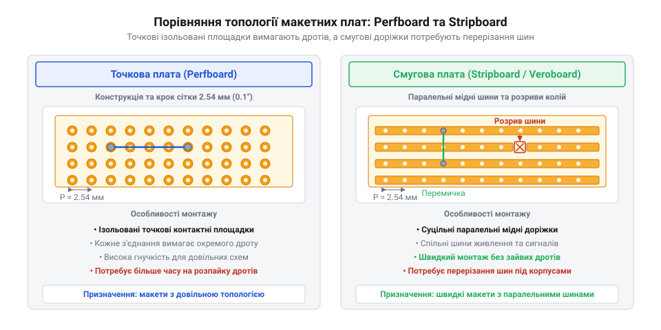
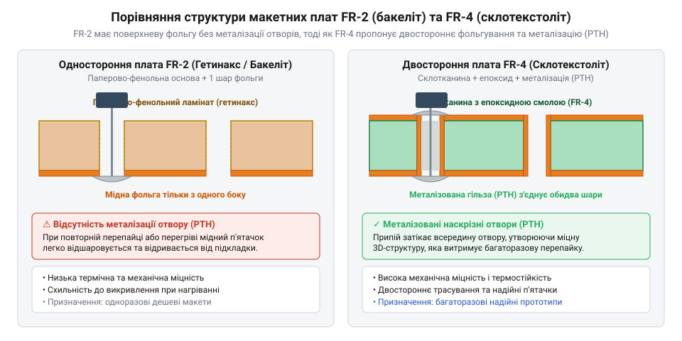
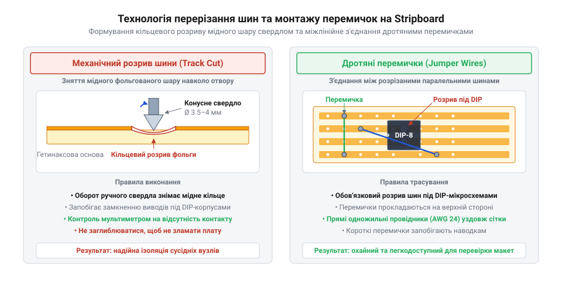

# Макетні плати під пайку (бакеліт, Stripboard)

<preknowlist>
- [Макетна плата (велика)](root:cat-hw-instruments/breadboard-large) — Розуміння загальної будови безпайкової макетної плати, сітки отворів 2.54 мм та принципу з'єднання контактних груп.
</preknowlist>

## Обмеження безпайкових плат і паяна основа

Пружинні контакти, які має [безпайкова макетна плата](root:cat-hw-instruments/breadboard-large), з часом послаблюють свій натиск через механічну втому металу та вібраційні навантаження. У мікрострумових колах на поверхні відкритих контактів утворюються плівки окислів (від грецького *oxys* — «кислий»), через що перехідний опір пружинного затискача зростає від початкових `50–100 мОм` до кількох Ом чи нестабільних розривів. Натомість при паянні припій утворює суцільну інтерметалічну диффузійну зону між мідною доріжкою та виводом деталі, зменшуючи перехідний опір до часток міліома (`0.1–0.5 мОм`), стійких до часу й струсів. Крім того, довгі паралельні контактні шини безпайкових плат утворюють паразитну ємність (від латинського *parasitus* — «дармоїд») `@@en|parasitic capacitance@@` величиною `2–5 пФ` між сусідніми лініями, яка на високих частотах завалює фронти цифрових сигналів і звужує смугу пропускання. Перехід на паяну основу макетної плати під пайку `@@en|prototyping board@@` усуває ці недоліки, забезпечуючи низькоомний і механічно нечутливий зв'язок зі стабільними електричними параметрами.

## Топології точкових Perfboard та смугових Stripboard

Конструктивно макетні плати під пайку виготовляють у двох основних топологіях (від грецького *topos* — «місце» та *logos* — «вчення»).

*Порівняння топологій точкових плат Perfboard та смугових плат Stripboard із сіткою отворів 2.54 мм.*

Точкові плати (від англійського *perforated board*) `@@en|Perfboard@@` містять сітку ізольованих круглих контактних площадок з кроком `2.54 мм` (`0.1 дюйма`), що відповідає стандарту виводів `DIP`-корпусів. З'єднання між елементами на них формують окремими дротами. Смугові плати (від англійського *stripboard* / *Veroboard*) `@@en|Stripboard@@` мають суцільні паралельні мідні доріжки вздовж усієї довжини, які об'єднують цілі ряди отворів. Товщина мідного фольгування зазвичай становить `35 мкм` (`1 oz/ft²`). Для мінімізації імпульсних завад та паразитної індуктивності петель шини живлення та заземлення розводять паралельно уздовж усієї плати, утворюючи низькоімпедансну мережу.

## Властивості матеріалів підкладки FR-2 та FR-4

Електрична та механічна надійність плати залежить від матеріалу діелектричної підкладки (від грецького *dia* — «через» та *elektron* — «бурштин»).

*Порівняння поперечного розрізу гетинаксу FR-2 та склотекстоліту FR-4 із металізованими отворами.*

Дешеві плати виготовляють із гетинаксу (від німецької торгової марки *Hetinax*) `@@en|FR-2@@` — фенол-паперового ламінату (від латинського *lamina* — «пластина»). Гетинакс має високе водопоглинання, тому під дією вологи опір ізоляції падає, а при перегріві паяльником мідні п'ятачки легко відшаровуються. Якісніші плати виготовляють зі склотекстоліту (від німецького *Glas* — «скло» та латинського *textilis* — «тканина») `@@en|FR-4@@` на основі епоксидної смоли та склотканини. Матеріал `FR-4` має низькі діелектричні втрати, високу термостійкість і оснащується металізованими наскрізними отворами (від англійського *plated-through hole*) `@@en|PTH@@`, які втричі збільшують міцність утримання виводів, а біла шовкографія прискорює монтаж.

## Трасування, розрізання доріжок та монтаж перемичок

При використанні плат `Stripboard` під корпуси мікросхем `DIP` мідні доріжки необхідно локально розрізати між протилежними рядами виводів.

*Схема розмітки, локального розрізання мідних шин та встановлення дротяних перемичок на Stripboard.*

Розрізання виконують конусним свердлом діаметром `3.5–4 мм` або спеціальним різаком `@@en|track cutter@@`, знімаючи мідний шар навколо отвору без пошкодження підкладки. Перехресні сигнальні зв'язки формують за допомогою ізольованих дротяних перемичок (від англійського *jumper wire*) `@@en|jumper wire@@`, прокладених на верхньому боці плати. Після завершення паяння залишки флюсу (від латинського *fluxus* — «потік») `@@en|flux@@` змивають ізопропіловим спиртом для запобігання корозії. Перед першим увімкненням обов'язково виконують перевірку цілісності кіл та відсутності замикань між сусідніми шинами.
