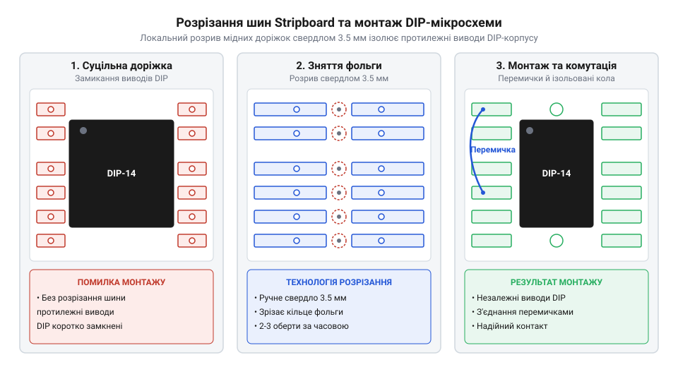

# Перенесення схеми з безпайкової макетки на Stripboard з розрізанням шин

<preknowlist>
- [Макетна плата (велика)](root:cat-hw-instruments/breadboard-large) — Розуміння внутрішнього з'єднання контактних груп безпайкової макетки.
</preknowlist>

## Планування топології та розміщення DIP-корпусів

Тимчасові прототипи на безпайкових дошках (від англійського *breadboard* — «макетна плата») [безпайкова макетна плата](root:cat-hw-instruments/breadboard-large) чутливі до вібрацій, тому створення довговічного пристрою вимагає перенесення схеми на макетну плату під пайку зі смуговою топологією (від грецького *topos* — «місце» та *logos* — «вчення») `@@en|stripboard@@`. На відміну від безпайкової макетки, де контактні групи розділені центральним каналом, плата `Stripboard` має суцільні мідні шини. Без попередньої підготовки розрізів прямокутний корпус мікросхеми `DIP` (від англійського *dual in-line package*) `@@en|DIP@@` виявився б повністю закороченим між протилежними виводами.

Процес перенесення починають із побудови графічної сітки (від англійського *layout grid*) `@@en|layout@@` на папері в клітинку або у спеціалізованому редакторі трасування. Стандартний крок сітки плати `Stripboard` становить 2.54 мм, що чітко відповідає дюймовій сітці виводів `DIP`-корпусів: крок між сусідніми ніжками становить 2.54 мм (1 клітинка сітки), а відстань між рядами для вузьких корпусів 7.62 мм дорівнює 3 крокам (для широких 15.24 мм — 6 крокам). Мікросхеми орієнтують перпендикулярно до напрямку мідних смуг так, щоб кожен вивід потрапляв на окрему доріжку, а розрізи шин прив'язують за координатами до отворів безпосередньо в проміжку між рядами виводів для ізоляції протилежних ніжок. Дискретні компоненти — резистори (від латинського *resistere* — «чинити опір») `@@en|resistor@@` та конденсатори (від латинського *condensare* — «ущільнювати») `@@en|capacitor@@` — розташовують паралельно або під прямим кутом до доріжок з урахуванням того самого кроку сітки. Оптимальне розставлення деталей із точним координатним прив'язуванням розрізів мінімізує кількість перехресних з'єднань і дозволяє використати самі доріжки плати замість довгих дротяних перемичок.

Окрему увагу при трасуванні сітки приділяють шинам живлення VCC та заземлення GND, які прокладають уздовж країв плати чи між блоками компонентів. Для зниження омичного опору та зменшення спаду напруги на довгих ділянках використовують дублювання паралельних смуг: дві сусідні мідні доріжки об'єднують у єдиний провідник за допомогою коротких перемичок. Крім того, створення замкненого контуру живлення шляхом зациклювання шин GND по периметру плати формує паралельні шляхи проходження струму, що мінімізує паразитну індуктивність та запобігає імпульсним просіданням напруги під час підключення навантаження.

## Локальне розрізання мідних шин свердлом

Щоб розділити електричні кола між протилежними рядами виводів `DIP`-корпусу чи перервати сигнальну лінію, мідну смугу необхідно локально розрізати.

*Схема розмітки та розрізання мідних шин плати Stripboard під корпусом DIP-мікросхеми.*

Для формування акуратного кільцевого розриву використовують спиральне свердло по металу діаметром `3.5 мм` або спеціальний конусний різак `@@en|track cutter@@`. Свердло прикладають конусною вершиною до монтажного отвору з боку фольги й обертають вручну на `2–3` оберти під помірним натиском. Завдяки того, що кут вершини свердла перевищує ширину доріжки, його різальна кромка плавно зрізає тонку мідну фольгу товщиною `35 мкм` навколо отвору, утворюючи конусну фаску та повний електричний розрив (від англійського *open circuit*) `@@en|open circuit@@`. Оскільки ручний оберт створює незначне осьове зусилля, кромка знімає лише пластичний шар міді та ковзає по твердій поверхні діелектрика, не пошкоджуючи паперово-фенольну основу гетинаксу `FR-2` (від англійського *flame retardant* `FR-2`). Застосовувати електродриль не рекомендовано: високі оберти миттєво прорізають фольгу, наскрізь просвердлюють гетинаксову основу `FR-2` або виривають сусідні контактні площадки.

Після механічної обробки зрізи очищають від мідної стружки та заусенців щіткою. Якість ізоляції обов'язково контролюють мультиметром (від латинського *multum* — «багато» та *metron* — «вимірювач») `@@en|multimeter@@` у режимі звукової прозвонки: опір між розділеними сегментами однієї доріжки має дорівнювати нескінченності (`overflow`).

Для виявлення дрібних волоскових заусенців та невидимих мікроскопічних перемичок міді, які можуть викликати паразитні витоки струму, додатково застосовують оптичний контроль. Плату оглядають під лупою з 10-кратним збільшенням, підсвічуючи її джерелом яскравого світла з протилежного боку на просвіт. Оскільки напівпрозорий діелектрик плати легко пропускає світло, повністю зачищена конусна фаска вирізняється чітким світлим кільцем навколо отвору, тоді як залишки недорізаної фольги чи мідні стружки утворюють темні контрастні силуети.

## Монтаж, паяння та встановлення перемичок

Монтаж компонентів на плату `Stripboard` виконують у суворому порядку від найнижчих деталей до найоб'ємніших. Спочатку встановлюють горизонтальні дротяні перемички (від англійського *jumper wire*) `@@en|jumper wire@@` із суцільного лудженого мідного дроту `AWG 24` або нульові резистори `0 Ом`. Перемички прокладають по верхньому діелектричному боці плати для з'єднання розрізаних шин живлення та обходу сигнальних ліній. Щоб деталі не випадали під час перевертання плати, їхні виводи з зворотного боку підгинають під кутом 45° вздовж мідної доріжки, що надійно фіксує корпус на гетинаксовій підкладці перед паянням. Після вигинання надлишкові кінці виводів підрізають кусачками під кутом 45° до поверхні плати, залишаючи кінчик завдовжки 1–1.5 мм, що запобігає відшаруванню мідного фольгування від зусилля різу та забезпечує формування акуратної конусної точки паяння.

Слідом монтують панельки під мікросхеми, дискретні резистори, діоди (від грецького *dis* — «двічі» та *hodos* — «шлях») `@@en|diode@@`, а в останню чергу — силові транзистори, електролітичні конденсатори та зовнішні роз'єми. Застосування роз'ємних DIP-панельок для мікросхем є обов'язковим: це повністю виключає вплив високої температури на чутливі кремнієві кристали, оскільки сам корпус мікросхеми встановлюють у панельку вже після завершення паяльних робіт. Для захисту чутливих p-n-переходів дискретних діодів і транзисторів від теплового пробою вивід припаюють із застосуванням тепловідвідного пінцета, затиснутого між корпусом деталі й паяльним п'ятачком. Паяння здійснюють паяльником із температурою тиснення `320–350 °C` та припоєм із вмістом каніфольного флюсу (від латинського *fluxus* — «потік») `@@en|flux@@`. Тривалість нагріву одного контакту не повинна перевищувати `2–3` секунд, щоб запобігти відшаруванню мідних доріжок від підкладки. Сформована паяна точка повинна мати форму гладкого блискучого конуса, який повністю заповнює отвір.

## Прозвонювання кіл та усунення коротких замикань

Перед першою подачею живлення зібраний модуль піддають комплексному контролю. Головним дефектом монтажу на платах `Stripboard` є мікроскопічні перемички з припою — паяльні містки (від англійського *solder bridge*) `@@en|solder bridge@@`, які виникають між сусідніми паралельними доріжками через надлишок флюсу чи припою та викликають коротке замикання (від англійського *short circuit*) `@@en|short circuit@@`. Для убезпечення напівпровідникових елементів від перегорання при прихованому замиканні перше включення здійснюють через лабораторне джерело живлення з жорстким обмеженням струму на рівні `50–100 мА`. За відсутності лабораторного приладу в шину живлення `VCC` послідовно вмикають захисний резистор опором `10–47 Ом`: вимірювання спаду напруги на ньому дозволяє переконатися у нормі споживаного струму спокою до моменту прямого підключення джерела.

Перевірку починають із відмивання залишків флюсу ізопропіловим спиртом за допомогою жорсткої щітки, після чого плату ретельно висушують. Потім мультиметр переводять у режим звукової прозвонки `@@en|continuity test@@` і почергово перевіряють відсутність електричного контакту між усіма сусідніми шинами живлення та сигнальними доріжками. Для гарантування відсутності паразитичних витоків струму опір ізоляції між суміжними ізольованими лініями вимірюють у режимі омметра, де критерієм норми є значення понад 10 МОм. У разі виявлення низького опору чи спрацьовування зумера локалізацію прихованого паяльного містка виконують покроковим вимірюванням опору вздовж доріжки між вузлами та оглядом міждворіжкового зазору на просвіт під лупою для знаходження точки з найнижчим опором. Після визначення місця замикання виявлений місток прорізають лезом скальпеля або видаляють надлишок припою за допомогою мідної заплітки `@@en|desoldering braid@@`. Переконавшись у відсутності замикань та цілісності всіх ліній, модуль вважають готовим до безпечного запуску.
