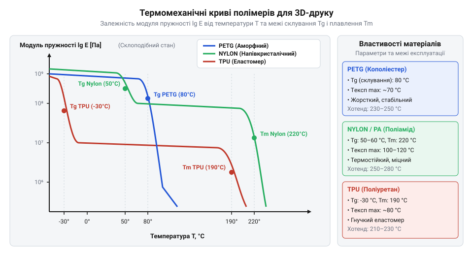
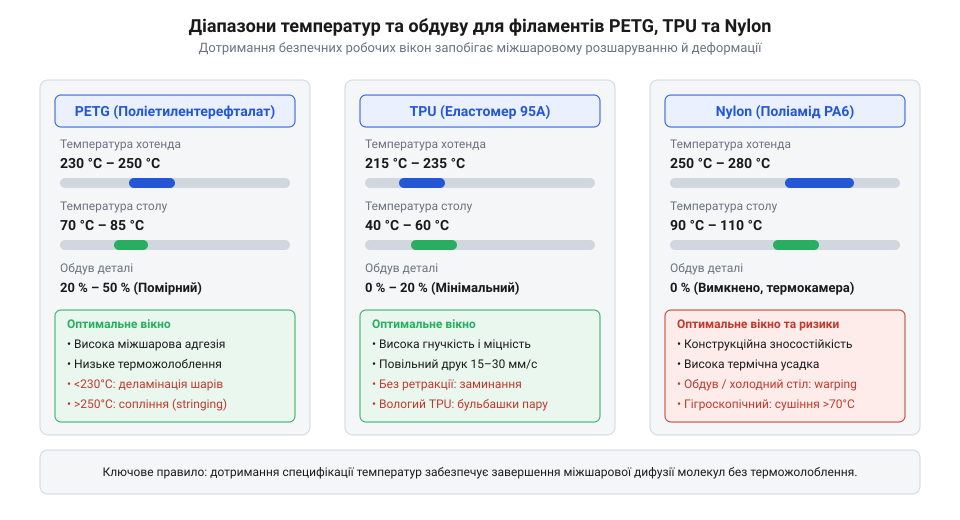

# Специфікація температурних режимів та фізико-механічних параметрів філаментів

<preknowlist>
- [3D-принтер](root:cat-hw-instruments/3d-printer) — принципи роботи FDM-екструдера, будова хотенда та налаштування температури друку
</preknowlist>

## Проблема вибору філаменту та термічної деструкції

При виготовленні захисних корпусів та механічних деталей для електроприладів вибір термопластичного матеріалу та налаштування температурних параметрів визначають довговічність виробу. Помилка у виборі пластику призводить до того, що зовні готова деталь руйнується при мінімальних робочих навантаженнях або деформується в процесі друку. Під час роботи нагрівального каскаду екструдера термопластична нитка поглинає теплоту, переходячи зі стану твердого склування у високоеластичний та в'язкоплинний розплав.

Якщо ж температура нагрівального вузла перевищує критичний поріг термічної деструкції (від грецького *therme* — «тепло» та латинського *degradatio* — «зниження», @@en|thermal degradation@@), надлишкова теплова енергія спричиняє розрив ковалентних зв'язків (@@en|covalent bonds@@) у костяку макромолекулярних ланцюгів полімеру. Утворені вільні радикали (@@en|free radicals@@) прискорюють розпад довголанцюгових молекул на низькомолекулярні фрагменти, що супроводжується стрімким падінням молекулярної маси розплаву. Усередині каналу сопла при цьому інтенсивно виділяються леткі гази піролізу, внаслідок чого екструдована нитка вкривається бульбашками, темніє та втрачає вихідну в'язкість. У результаті деталь дістає приховані мікропори та втрачає міжшарову адгезію (@@en|interlayer adhesion@@), що призводить до раптового крихкого розламування корпусу при навантаженнях, значно нижчих за розрахункові.

Якщо температура гарячого блоку обрана нижчою за допустиму межу, розплавлений полімер потрапляє на попередньо укладений шар із недостатньою кількістю залишкового тепла. В результаті міжшарова дифузія молекулярних ланцюгів не встигає завершитися, створюючи слабкі міжшарові межі. При висиханні та охолодженні у матеріалі виникають внутрішні механічні напруження. Якщо термічна усадка перевищує міцність міжшарового контакту, виникає міжшарове розшарування (від англійського *delamination*; @@en|delamination@@) або деформація кутів виробу — терможолоблення (від англійського *warping*; @@en|warping@@).

Невідповідність температури нагрівального столу додатково посилює відрив деталі від робочої поверхні. Недогріта платформа викликає швидку нерівномірну кристалізацію нижніх шарів, через що деталь вигинається дугою та скидається зі столу в процесі друку. Тому ще до початку моделювання корпусу розробник повинен чітко сформулювати експлуатаційні вимоги до виробу: діапазон робочих температур навколишнього середовища, ударні та статичні навантаження, хімічну агресивність середовища та контакт із вологою. Для уникнення браку при налаштуванні [параметрів друкарського 3D-принтера](root:cat-hw-instruments/3d-printer) потрібне строге дотримання специфікації фізико-механічних властивостей філаментів.

## Фізико-механічні параметри та методика їх вимірювання

Для оцінки придатності полімеру до конкретних умов експлуатації застосовують стандартні фізико-механічні показники, вказані у технічних паспортах виробників. Основними тепловими параметрами є температура склування (від англійського *glass transition temperature*; `@@en|glass transition temperature@@`, `T_g`) та температура плавлення (від англійського *melting temperature*; `@@en|melting temperature@@`, `T_m`). Температура склування `T_g` визначає поріг, вище якого аморфні ділянки полімеру втрачають жорсткість і переходять із крихкого склоподібного стану у високоеластичний. Експлуатувати деталь під навантаженням вище за `T_g` неможливо, оскільки корпус втрачає форму. Температура плавлення `T_m` властива напівкристалічним полімерам і позначає повний розпад кристалічної ґратки.

Однак реальна термостійкість друкованої деталі під механічним тиском визначається температурою прогину під навантаженням HDT (від англійського *heat deflection temperature*; `@@en|heat deflection temperature@@`), яку вимірюють за стандартами ISO 75 (`@@en|ISO 75@@`) або ASTM D648 (`@@en|ASTM D648@@`) при трьохточковому вигині зразка. Величина HDT критично залежить від нормованого вигинального напруження: за випробувального напруження `0.45 МПа` (ISO 75 Method B) матеріал зберігає форму при вищій температурі, ніж під силовим навантаженням `1.80 МПа` (ISO 75 Method A). Механізм цієї відмінності полягає в тому, що під впливом температури модуль пружності `E(T)` полімеру безперервно знижується. При вищому напруженні `1.80 МПа` нормований прогин бруска `0.25 мм` досягається значно раніше за температурою — коли модуль Юнга ще не встиг впасти до рівня, що відповідає навантаженню `0.45 МПа`. У випадку аморфного PETG (`@@en|PETG@@`) різниця між HDT при `0.45 МПа` (близько `70 °C`) та `1.80 МПа` (близько `64 °C`) становить лише `6 °C`, оскільки деформація обмежена температурою склування `T_g`. Натомість для напівкристалічного Nylon (`@@en|Nylon@@`) (PA6) кристаліти утримують каркас при низькому тиску `0.45 МПа`, забезпечуючи HDT аж до `160 °C`, але під силовим тиском `1.80 МПа` аморфний прошарок між кристалами швидко плинніє, через що HDT стрімко падає до `55–60 °C`.

Механічна міцність матеріалу характеризується межею міцності при розтягу (від латинського *tensilis* — «тягнути»; @@en|tensile strength@@, `σ_b`) та модулем пружності Юнга (від англійського *Young's modulus*; @@en|Young's modulus@@, `E`). Межа міцності `σ_b` вимірюється у мегапаскалях (МПа) за стандартами ISO 527 або ASTM D638 і показує максимальне розтягувальне напруження, яке витримує зразок до руйнування. Модуль Юнга `E` (в гігапаскалях, ГПа) характеризує жорсткість матеріалу: чим вище значення `E`, тим менше деформується деталь під дією прикладеної сили. Для еластомерних матеріалів важливим показником є відносне подовження при розриві (від англійського *elongation at break*; @@en|elongation at break@@, `%`), що показує здатність нитки деформуватися без розриву.

Твердість гнучких матеріалів вимірюють за шкалою Шора (від англійського *Shore hardness*; @@en|Shore hardness@@) відповідно до ISO 868 або ASTM D2240. Для м'яких еластомерів використовують шкалу Shore A (наприклад, 85A або 95A), а для більш жорстких пластиків — шкалу Shore D.

*Термомеханічні криві полімерів із позначенням межі експлуатаційної термостійкості T_g та плавлення T_m.*

Графік термомеханічного аналізу чітко показує, що при досягненні `T_g` модуль пружності стрімко падає. Тому інтерпретація даташиту вимагає порівняння параметрів не лише при кімнатній температурі 23 °C, а й із урахуванням температури розм'якшення Віка (@@en|Vicat softening temperature@@) або температури прогину під навантаженням HDT (від англійського *heat deflection temperature*; @@en|heat deflection temperature@@).

## Специфікація режимів друку PETG, TPU та Nylon

Практичний 3D-друк вимагає точного налаштування профілю слайсера відповідно до специфікації обраного філаменту. Основними інженерними матеріалами для виготовлення корпусів є поліетилентерефталат-гліколь (@@en|PETG@@), термопластичний поліуретан (@@en|TPU@@) та поліамід (@@en|Nylon@@). Кожен матеріал має власне технологічне вікно температур і швидкостей екструзії.

Нижче подано зведену специфікацію температурних та динамічних параметрів друку:

| Матеріал філаменту | Температура хотенда (°C) | Температура столу (°C) | Обдув деталі (%) | Швидкість друку (мм/с) | Швидкість ретракції (мм/с) |
| :--- | :--- | :--- | :--- | :--- | :--- |
| **PETG** | 230 – 250 | 70 – 85 | 20 – 50 | 40 – 60 | 30 – 45 |
| **TPU (95A)** | 215 – 235 | 40 – 60 | 0 – 20 | 15 – 30 | 0 – 15 |
| **Nylon (PA6/PA66)** | 250 – 280 | 90 – 110 | 0 (Вимкнено) | 30 – 50 | 25 – 40 |

Пластик @@en|PETG@@ відрізняється високою міжшаровою адгезією та помірною термостійкістю (`T_g ≈ 80 °C`). Він вимагає невеликого обдуву вентилятором (20–50%), оскільки надмірне охолодження знижує міцність зчеплення шарів. Гнучкий еластомер @@en|TPU@@ має високу в'язкість розплаву і потребує повільної екструзії (15–30 мм/с) з мінімальною або повністю вимкненою ретракцією, щоб запобігти зажовуванню нитки в подавальному механізмі. Конструкційний @@en|Nylon@@ володіє найвищою міцністю та зносостійкістю, проте схильний до сильної термічної усадки. Його друкують при високих температурах хотенда (250–280 °C) та столу (90–110 °C) без обдуву в закритій термокамері.

*Діапазони температур хотенда та столу для забезпечення максимальної міжшарової адгезії без деформації виробу.*

Наведена діаграма демонструє температурні коридори, у межах яких зберігається баланс між в'язкістю розплаву та міцністю зчеплення. Вихід за межі верхньої температури викликає деструкцію полімеру та утворення соплів (від англійського *stringing*; @@en|stringing@@), тоді як заниження температури призводить до неповного розплавлення й клацання екструдера.

## Гігроскопічність та технологічні границі сушіння

Головним ворогом якісного 3D-друку інженерними пластиками є гігроскопічність (від грецького *hygros* — «вологий» та *skopeo* — «спостерігаю»; @@en|hygroscopic@@) — здатність полімерних матеріалів поглинати водяну пару з повітря. Найбільш гігроскопічним є @@en|Nylon@@, який здатний поглинати до 1.5–3.0% води за масою протягом кількох годин зберігання у відкритому приміщенні. Еластомер @@en|TPU@@ та пластик @@en|PETG@@ також активно насичуються вологою.

Коли вологий філамент потрапляє у нагрівальний блок із температурою понад 200 °C, заглиблена вода миттєво перетворюється на пару з об'ємним розширенням у понад 1000 разів. Водяна пара викликає мікровибухи всередині сопла, що супроводжуються характерним потріскуванням, шипінням та виділенням бульбашок. Це призводить до трьох негативних наслідків:
1. Порушення суцільності струменя екструзії та виникнення раковин у стінках деталі.
2. Гідролітична деструкція (від грецького *hydor* — «вода» та *lysis* — «розпад»; @@en|hydrolysis@@), при якій молекули води під дією високої температури розривають довгі полімерні ланцюги, катастрофічно знижуючи механічну міцність виробу.
3. Втрата прозорості та утворення вираженого @@en|stringing@@ на поверхні.

Для відновлення властивостей нитки її необхідно піддавати висушуванню у спеціальних конвекційних або вакуумних сушильних камерах перед друком. Режими сушіння підбирають залежно від типу матеріалу та температури склування `T_g`:

- **PETG**: сушіння при температурі 60 – 65 °C протягом 4 – 6 годин.
- **TPU**: сушіння при температурі 55 – 60 °C протягом 5 – 8 годин.
- **Nylon**: сушіння при температурі 70 – 90 °C протягом 8 – 12 годин.

Температура сушіння повинна бути строго нижчою за `T_g` на 10–15 °C, інакше котушка розм'якне й витки пластику спечуться між собою. Під час тривалого друку гігроскопічними матеріалами (особливо @@en|Nylon@@ та @@en|TPU@@) котушку подають безпосередньо з герметичного сушильного боксу з силікагелем, забезпечуючи стабільну якість міжшарової адгезії та відсутність дефектів у корпусі приладу.
