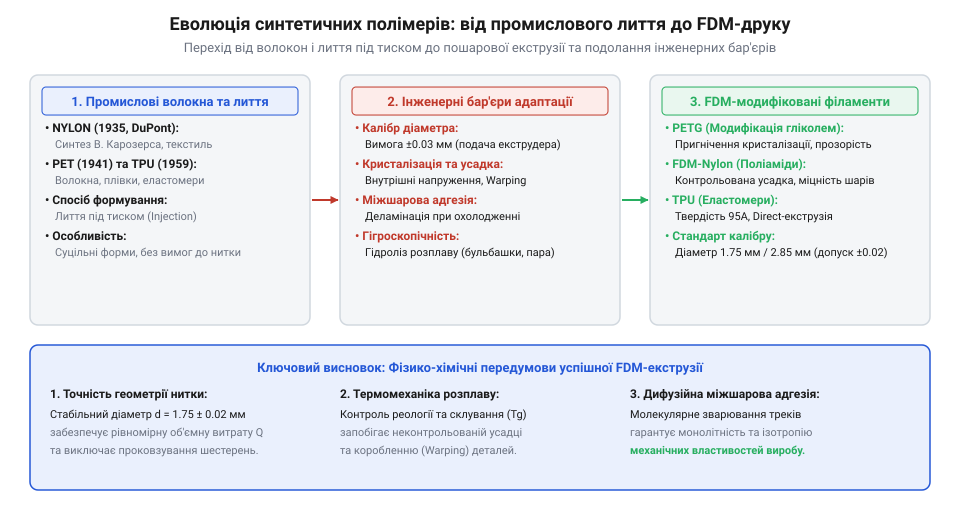

# Історія розробки синтетичних термопластів для інженерного FDM-друку

<preknowlist>
- [3D-принтер](root:cat-hw-instruments/3d-printer) — Розуміння базового принципу пошарового наплавлення пластикового філаменту (FDM/FFF) та будови екструдера.
</preknowlist>

## Обмеження натуральних матеріалів та винахід нейлону

Промисловий розвиток 1930-х років зіткнувся з вичерпанням можливостей натуральних матеріалів для ізоляції та виготовлення конструкційних елементів. Використання натурального шовку, природних смол та каучуку обмежувалося їхньою швидкою деградацією під дією вологи й озону, крихкістю при низьких температурах та нестабільністю властивостей у різних партіях сировини. Виробництво електротехнічних корпусів спиралося на фенолформальдегідні смоли (бакеліт), які хоч і володіли високою термостійкістю, але були крихкими й не піддавалися повторному розплавленню після формування.

Справжній хімічний прорив відбувся у 1930–1935 роках у лабораторіях американської компанії DuPont під керівництвом хіміка Воллеса Карозерса (англ. @@en|Wallace Carothers@@). Досліджуючи реакції поліконденсації (від грецького @@el|πολύς@@ — багато та латинського @@la|condensare@@ — ущільнювати), Карозерс синтезував перший у світі повністю штучний волокноутворювальний полімер — поліамід 66, який отримав комерційну назву нейлон (англ. @@en|Nylon 66@@, від грецького @@el|πολύς@@ — чисельний та хімічного суфікса @@en|amide@@). Поліконденсація між гексаметилендіаміном та адипіновою кислотою супроводжувалася відщепленням молекул води й зв'язуванням аміногруп із карбоксильними групами у лінійні макромолекули з амідними містками `-CO-NH-`. У промисловому автоклаві реакційну суміш спочатку нагрівали під тиском 1.8 МПа до температури 215–220 °C для запобігання випаровуванню діаміну, а потім плавно скидали тиск і піднімали температуру до 270–280 °C для видалення вологи та нарощування молекулярної маси. Паралельні молекулярні ланцюги утворили щільну сітку міжмолекулярних водневих зв'язків між атомами водню груп `-NH-` та киснем карбонільних груп `=O`, надаючи полімеру високу міцність на розрив, стійкість до стирання та температуру плавлення близько 260 °C. Винахід нейлону довів можливість цілеспрямованого конструювання синтетичних термопластів із наперед заданими механічними параметрами.

## Синтез еластомерів TPU та модифікація PETG

Польот інженерної думки 1950-х років вимагав створення матеріалів, що поєднують гнучкість каучуку з технологічністю термопластів. У 1959 році хіміки компанії BF Goodrich розробили термопластичний поліуретан (англ. @@en|thermoplastic polyurethane@@, TPU, від грецького @@el|πολύς@@ — багато та хімічного суфікса @@en|urethane@@). Структура TPU являє собою блок-сополімер, що складається з чергованих гнучких сегментів (поліефірних або поліестерних ланцюгів) та жорстких сегментів (діізоціанатів). Жорсткі домени виконують роль фізичних вузлів зшивки, які розпадаються при нагріванні, дозволяючи матеріалу текти, та відновлюються при охолодженні, забезпечуючи високу еластичність, ударну в'язкість та зносостійкість.

Паралельно розвивалася технологія ароматичних поліефірів. У 1941 році британські хіміки Джон Вінфілд та Джеймс Діксон патентують поліетилентерефталат (англ. @@en|polyethylene terephthalate@@, PET). Хоча PET володів високою міцністю, його висока здатність до кристалізації викликала помутніння та крихкість при охолодженні товстостінних виробів. Для усунення цього недоліку в молекулярну структуру ввели модифікатор — 1,4-циклогександиметанол (англ. @@en|1,4-cyclohexanedimethanol@@, CHDM), отримавши гліколь-модифікований поліетилентерефталат (англ. @@en|polyethylene terephthalate glycol-modified@@, PETG). Стереохімічний ефект заміщення частки молекул етиленгліколю на об'ємні циклогексанові кільця CHDM полягає у внесенні просторової асиметрії в основний макромолекулярний ланцюг. При оптимальній модифікації на рівні 30–35 молярних відсотків об'ємні радикали CHDM стерично перешкоджають щільному пакуванню сусідніх ланцюгів та блокують утворення впорядкованих кристалічних доменів. Завдяки пригніченню кристалізації PETG зберігає стабільну аморфну структуру, високу оптичну прозорість без утворення каламутних кристалітів та відсутність крихкості під час остигання, забезпечуючи знижену температуру переробки й ударну стійкість.

## Адаптація литтєвих термопластів під FDM-екструзію

Протягом десятиліть синтетичні термопласти розроблялися виключно для лиття під тиском (англ. @@en|injection molding@@, від латинського @@la|injectio@@ — впорскування), де розплав подається в закриту сталеву форму під тиском у сотні бар. Однак поява пошарового наплавлення матеріалів (англ. @@en|fused deposition modeling@@, FDM, від латинського @@la|fusio@@ — плавлення та @@la|depositio@@ — відкладення) на [3D-принтерах](root:cat-hw-instruments/3d-printer) висунула принципово нові вимоги до фізичних властивостей полімерів.

*Схема хронологічної адаптації термопластів відображає еволюцію матеріалів від ливарних гранул до каліброваного філаменту.*

Головним інженерним бар'єром переходу від гранул до нитки стала необхідність забезпечення суворого допуску діаметра філаменту (англ. @@en|filament@@, від латинського @@la|filum@@ — нитка) у межах ±0.02 мм. Коливання калібру нитки спричиняють неконтрольовану пульсацію об'ємної витрати розплаву через сопло екструдера, що призводить до дефекту недоліву або переливу пластику. Другою суттєвою перешкодою виявилася термічна усадка напівкристалічних полімерів. На відміну від лиття під тиском, де тиск компенсує зменшення об'єму при кристалізації, при вільному пошаровому осадженні нейлону чи поліпропілену об'ємна усадка сягає 1.5–3.0 %, викликаючи викривлення (англ. @@en|warping@@) та відшарування деталі від робочого столу. Третім фактором стала міжшарова адгезія: для міцного зварювання сусідніх ниток температура розплаву має підтримувати високу дифузію ланцюгів через межу розділу без термічної деструкції полімеру.

## Поточний стан та подолання міжшарової деламінації

Сучасний етап еволюції інженерних філаментів орієнтований на подолання анізотропії механічних властивостей та зниження міжшарової деламінації (англ. @@en|delamination@@, від латинського @@la|lamina@@ — пластина). Деламінація виникає через неповне взаємне проникнення макромолекул між суміжними шарами при швидкому охолодженні. Для вирішення цієї проблеми хіміки застосовують сополімеризацію та введення мікроскопічних наповнювачів — підрізаного вуглецевого або скловолокна. Армувальні волокна орієнтуються уздовж напрямку екструзії, підвищуючи модуль пружності деталі та суттєво знижуючи коефіцієнт термічного розширення, що мінімізує внутрішні напруження та деформацію.

Втім, поширені уявлення про абсолютну універсальність інженерних термопластів є хибними. Кожен матеріал має суворі компроміси й межі застосування:
- Нейлон володіє найвищою зносостійкістю та ударною міцністю, але володіє високою гігроскопічністю: всотування вологи до 8 % маси призводить до закипання води в соплі з утворенням пор, що вимагає обов'язкового сушіння при 70–80 °C перед друком.
- ТПУ забезпечує унікальну гнучкість та амортизацію, проте високий коефіцієнт тертя робить його подачу крізь довгі боуден-трубки проблематичною.
- ПЕТГ володіє низькою усадкою та стійкістю до лугів і кислот, але поступається полікарбонату та нейлону за теплостійкістю, розм'якшуючись при температурах вище 75 °C.

Свідомий вибір синтетичного термопласту для виготовлення корпусів та механічних вузлів вимагає точного зіставлення робочої температури, механічних навантажень та хімічного середовища експлуатації приладу.
