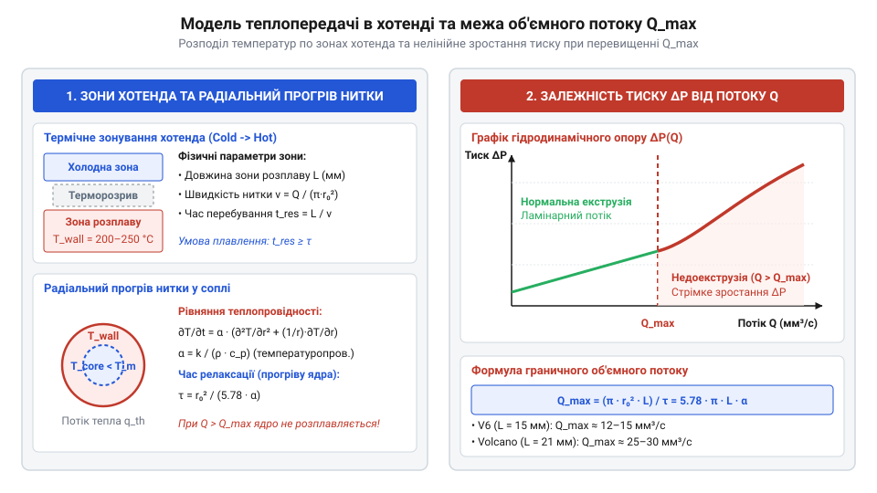

# Математичний розрахунок теплопередачі та об'ємного потоку філаменту в хотенді

<preknowlist>
- [3D-принтер](root:cat-hw-instruments/3d-printer) — принципи роботи екструдера, будова хотенда та механізм подачі нитки пластику
</preknowlist>

## Проблема термодинамічного ліміту екструзії

Під час високошвидкісного 3D-друку на [3D-принтер](root:cat-hw-instruments/3d-printer) подавальний механізм FDM (від англійського *fused deposition modeling* — «моделювання методом наплавлення»; `@@en|FDM@@`) заштовхує тверду нитку пластику в нагрівальний каскад. Екструдер (від латинського *extrudere* — «виштовхувати»; `@@en|extruder@@`) мусить безперервно подавати філамент (від латинського *filamentum* — «нитка»; `@@en|filament@@`) зі швидкістю, що пропорційна об'ємному потоку `Q`:

```
Q = v · w · h                            [об'ємна швидкість екструзії]
```

тут `v` — лінійна швидкість руху друкувальної голівки, `w` — ширина лінії екструзії, а `h` — висота шару.

Основне фізичне обмеження полягає в тому, що термопластичні полімери мають низьку теплопровідність `k ≈ 0.13–0.25 Вт/(м·К)`. Коли швидкість друку зростає, час перебування матеріалу в гарячій зоні сопла зменшується. Якщо тепловий потік від стінок нагрівача не встигає досягти осьового ядра нитки діаметром `1.75 мм` або `2.85 мм`, пластик потрапляє до вихідного отвору сопла напівтвердим. Це викликає стрибок динамічної в'язкості, різке зростання гідродинамічного опору та недоекструзію (від латинського *extrudere* — «виштовхувати»; `@@en|under-extrusion@@`), що проявляється пропусками кроків подавального двигуна та розшаруванням виробу.

Нелінійне зростання гідродинамічного тиску при продавлюванні непідготовленого пластику крізь звуження сопла описується рівнянням Пуазейля (від імені французького фізика Жана Леонара Марі Пуазейля; `@@fr|Poiseuille@@`) для ламінарного потоку в циліндричному капілярі. Перепад тиску `ΔP`, необхідний для продавлювання розплаву, розраховують за формулою:

```
ΔP = (128 · μ · L · Q) ÷ (π · d⁴)    [рівняння Пуазейля для капіляра сопла]
```

де `L` — довжина звуженого каналу сопла, `Q` — об'ємна швидкість екструзії, `d` — діаметр вихідного отвору, а `μ` — динамічна в'язкість (від грецького *дюнаміс* — «сила» та латинського *viscosus* — «в'язкий»; `@@en|dynamic viscosity@@`) розплавленого полімеру.

Однак у реальних термопластах динамічна в'язкість `μ` не є константою: вона одночасно залежить від абсолютної температури `T` та швидкості зсуву (від англійського *shear rate*; `@@en|shear rate@@`) `γ̇` шарів розплаву біля стінок сопла. Полімерні розплави належать до псевдопластичних неньютонівських рідин (від грецького *псеудос* — «неправдивий» та *пластікос* — «придатний для ліплення»; `@@en|pseudoplastic fluid@@`), де підвищення швидкості деформації орієнтує макромолекули вздовж течії та зменшує в'язкість, тоді як охолодження ядра стрімко її збільшує. Для комплексного опису цієї поведінки застосовують реологічний закон Арреніуса-Кросса (від імені шведського хіміка Сванте Арреніуса; `@@sv|Arrhenius@@` та дослідника Малкольма Кросса; `@@en|Cross model@@`). Детальніше про математичну модель в'язкопластичного потоку та розрахунок швидкостей зсуву читайте у статті про [реологію полімерних розплавів](root:ph-mechanics/rheology-of-polymer-melts).

Спочатку в'язкість `μ₀(T)` за нульової швидкості зсуву виражають через температурну залежність Арреніуса:

```
μ₀(T) = A · exp(Eₐ ÷ (R · T))        [закон Арреніуса для нульового зсуву]
```

тут `A` — предекспоненціальний константний множник, `Eₐ` — енергія активації в'язкого течіння (від німецького *Aktivierungsenergie*; `@@de|activation energy@@`), `R` — універсальна газова стала (`8.314 Дж/(моль·К)`), а `T` — абсолютна температура в кельвінах. Для врахування ефекту зсувного розрідження (від англійського *shear thinning*; `@@en|shear thinning@@`) в'язкість `μ₀(T)` підставляють у реологічне рівняння Кросса, виражаючи швидкість зсуву біля стінки кругового каналу через об'ємну швидкість `γ̇ = (8 · Q) ÷ (π · d³)`:

```
μ(T, γ̇) = μ₀(T) ÷ (1 + (λ · γ̇)ⁿ)                             [модель Кросса для псевдопластичного розплаву]
= (A · exp(Eₐ ÷ (R · T))) ÷ (1 + (λ · γ̇)ⁿ)                   [підстановка температурного закону Арреніуса]
= (A · exp(Eₐ ÷ (R · T))) ÷ (1 + (λ · (8 · Q) ÷ (π · d³))ⁿ)  [виведення залежності Арреніуса-Кросса від потоку]
```

де `λ` — реологічний час релаксації полімерних ланцюгів (від латинського *relaxatio* — «послаблення»; `@@en|relaxation time@@`), а `n` — безрозмірний індекс псевдопластичності.

Отримане рівняння показує фізичний механізм термодинамічної відмови екструдера: хоча високий об'ємний потік `Q` підвищує швидкість зсуву `γ̇` та дещо знижує в'язкість у знаменнику завдяки псевдопластичному розрідженню, скорочення часу перебування філаменту в соплі призводить до падіння температури `T` в чисельнику. Оскільки температурний множник `exp(Eₐ ÷ (R · T))` зростає експоненційно, в'язкість недогрітого полімерного ядра `μ(T, γ̇)` стрімко збільшується. При підстановці цієї в'язкості в рівняння Пуазейля необхідний протитиск `ΔP` моментально перевищує граничне притискне зусилля подавальних шестерень, через що механізм екструдера починає прокручуватися або зрізати нитку, перериваючи подачу матеріалу.

```
ΔP = (128 · μ · L · Q) ÷ (π · d⁴)    [рівняння Пуазейля для капіляра сопла]
```

де `μ` — динамічна в'язкість матеріалу, `L` — довжина звуженого каналу сопла, `Q` — об'ємна швидкість екструзії, а `d` — діаметр вихідного отвору. Оскільки динамічна в'язкість `μ` ненагрітого полімерного ядра зростає експоненційно зі зниженням температури, необхідний тиск `ΔP` стрімко перевищує граничне притискне зусилля подавальних шестерень. Як наслідок, механізм екструдера починає прокручуватися чи зрізати нитку, перериваючи подачу матеріалу.

## Математична модель прогріву полімеру

Для аналізу теплового стану нитки хотенд (від англійського *hot end* — «гарячий блок»; `@@en|hotend@@`) розглядають як циліндричний канал радіуса `r`, через який рухається полімерний стрижень. Процес радіальної теплопровідності (від латинського *conductio* — «приведення»; `@@en|thermal conductivity@@`) у циліндричних координатах без урахування внутрішніх джерел тепла описується рівнянням Фурьє:

```
∂T / ∂t = α · (∂²T / ∂r² + (1 / r) · ∂T / ∂r)   [диференціальне рівняння теплопровідності]
```

де `T` — температура полімеру у точці з радіальною координатою `r` в момент часу `t`, а `α` — коефіцієнт температуропровідності (від латинського *temperatura* — «належне змішування»; `@@en|thermal diffusivity@@`), який виражається через фізичні параметри матеріалу:

```
α = k / (ρ · c_p)                        [коефіцієнт температуропровідності]
```

тут `k` — теплопровідність, `ρ` — густина, а `c_p` — питома масова теплоємність полімеру.

Постійна часу радіального прогріву `τ` визначає часовий інтервал, необхідний для вирівнювання температури між поверхнею нитки та її центром. Точний аналітичний розв'язок диференціального рівняння радіальної теплопровідності для циліндричної нитки радіуса `r₀` при сталій температурі стінки `T_wall` отримують методом відокремлення змінних. Температурний профіль `T(r, t)` по радіусу описується нескінченним рядом через функції Бесселя першого роду нульового порядку `J₀` (від імені німецького математика та астронома Фрідріха Бесселя; `@@en|Bessel functions@@`):

```
T(r, t) = T_wall - (T_wall - T_0) · ∑ [ (2 / (μₙ · J₁(μₙ))) · J₀(μₙ · r / r₀) · exp(-μₙ² · α · t / r₀²) ]    [ряд Бесселя для прогріву нитки]
```

де `T_0` — початкова температура нитки, `α` — коефіцієнт температуропровідності, `J₁` — функція Бесселя першого порядку, а `μₙ` — власні числа, що є додатними коренями алгебричного рівняння `J₀(μₙ) = 0`. Для знаходження першого й панівного кореня `μ₁` функцію `J₀(μ)` розкладають у степеневий ряд за визначенням:

```
J₀(μ) = 1 - (μ² / 4) + (μ⁴ / 64) - (μ⁶ / 2304) + ...                   [степеневий розклад функції Бесселя J₀]
0 = 1 - (μ₁² / 4) + (μ₁⁴ / 64)                                         [умова нульового значення на межі]
μ₁² ÷ 4 - μ₁⁴ ÷ 64 = 1                                                 [перенесення змінних у ліву частину]
μ₁² ≈ 5.7831                                                           [числовий розв'язок для квадратного рівняння]
μ₁ = √5.7831 ≈ 2.4048                                                  [значення першого кореня рівняння Бесселя]
```

З геометричного боку значення `μ₁ ≈ 2.4048` має чіткий фізичний зміст циліндричної теплової хвилі (від латинського *radialis* — «променевий»; `@@en|radial wave@@`). У циліндричній системі координат збіжна теплова хвиля, яка поширюється від нагрітої зовнішньої межі `r = r₀` до осьового центру `r = 0`, формує стоячий просторовий профіль. Оскільки на стінці нитки `r = r₀` відносна різниця температур дорівнює нулю, аргумент функції Бесселя `μ₁ · (r / r₀)` на межі мусить точно влучати у перший вузол стоячої хвилі `μ₁`. Безрозмірна величина `μ₁ ≈ 2.4048` показує просторову частоту першої фундаментальної моди (від латинського *modus* — «міра» або «форма»; `@@en|fundamental mode@@`), яка описує найповільніше згасаючий радіальний градієнт температури.

Оскільки вищі гармоніки `μ₂ ≈ 5.5201` та `μ₃ ≈ 8.6537` згасають у часі експоненційно швидше завдяки множникам `exp(-μₙ² · α · t / r₀²)`, підсумкова швидкість вирівнювання температури в центрі нитки `r = 0` визначається саме першим показником `μ₁² ≈ 5.7831`. Це дає строге обґрунтування виразу для постійної часу теплової релаксації `τ`:

```
τ = r₀² / (μ₁² · α)                      [характерний час прогріву з першого кореня]
  = r₀² / (5.783 · α)                    [підстановка квадрата кореня μ₁² ≈ 5.783]
  ≈ (r₀² · ρ · c_p) / (5.783 · k)        [вираження через фізичні параметри полімеру]
```

де `r₀` — радіус нитки, `ρ` — густина, `c_p` — питома теплоємність, а `k` — теплопровідність пластику.

```
T(r, t) = T_wall - (T_wall - T_0) · ∑ [ (2 / (μₙ · J₁(μₙ))) · J₀(μₙ · r / r₀) · exp(-μₙ² · α · t / r₀²) ]
```

де `μₙ` — корені рівняння `J₀(μₙ) = 0` (зокрема перший корінь `μ₁ ≈ 2.4048`), `J₁` — функція Бесселя першого порядку, `T_0` — початкова температура нитки, а `α` — температуропровідність. Оскільки вищі члени ряду згасають експоненційно, швидкість прогріву ядра філаменту (`r = 0`) визначається першою гармонікою з коефіцієнтом `μ₁² ≈ 5.783`. Це дає строге обґрунтування аналітичного виразу для постійної часу теплової релаксації `τ = r₀² / (μ₁² · α) ≈ r₀² / (5.78 · α)`.

```
τ = r² / α                               [характерний час радіального прогріву]
  = (r² · ρ · c_p) / k                   [підстановка температуропровідності]
```

Фактичний час перебування полімеру `t_res` у зоні розплаву довжиною `L` залежить від лінійної швидкості подачі `v_in` або об'ємного потоку `Q`:

```
t_res = L / v_in                         [час перебування в зоні розплаву]
      = (π · r² · L) / Q                 [вираження через об'єм зони нагріву]
```

Для повного фазового переходу та рівномірного розплавлення виконується умова `t_res ≥ τ`. Якщо `t_res < τ`, температура ядра нитки залишається нижчою за температуру склування або плавлення, що робить повну екструзію термодинамічно неможливою.

## Розрахунок граничного об'ємного потоку

Максимальний об'ємний потік `Q_max` обмежується потужністю теплового потоку, який нагрівальний блок здатен передати пластику через контактну площу зони розплаву.


*Схема розділення зон хотенда (холодна зона, терморозрив, зона розплаву) з розподілом температури вглиб нитки та графіком залежності тиску екструзії від об'ємного потоку; з неї видно межу теплового насичення Q_max.*

Для нагріву об'ємного потоку `Q` від початкової температури `T_0` до робочої температури екструзії `T_m` вимагається теплова потужність `P_th`:

```
P_th = Q · ρ · (c_p · (T_m - T_0) + ΔH_m)   [баланс теплової потужності]
```

де `ΔH_m` — питома теплота плавлення кристалічної фази.

Прирівнюючи час перебування матеріалу `t_res` до часу прогріву `τ`, дістають граничне значення об'ємного потоку `Q_max` (в мм³/с):

Однак у реальній конструкції сопла теплопередача суттєво прискорюється в його носовій частині завдяки звуженню каналу від вхідного діаметра нитки `1.75 мм` до діаметра вихідного отвору `0.4 мм`. Характеристичний час радіального прогріву циліндричного шару `τ` квадратично залежить від поточного радіуса каналу `r`:

```
τ = r² / α                             [залежність часу прогріву від радіуса]
```

де `α` — температуропровідність полімеру. Зменшення радіуса розплаву `r` із `0.875 мм` до `0.2 мм` на конусному зрізі скорочує необхідний час теплового проникнення `τ` майже у 19 разів (оскільки `(0.875 / 0.2)² ≈ 19.1`). Завдяки такому стисненню залишкове напівтверде ядро нитки миттєво прогрівається до однорідної температури безпосередньо перед виходом із капіляра.

```
Q_max = (π · r² · L) / τ                 [умова граничного об'ємного потоку]
      = π · L · α                        [вираження через температуропровідність]
```

Звідси гранично припустима швидкість друку `v_max` для обраної ширини `w` та висоти шару `h` обчислюється як:

```
v_max = Q_max / (w · h)                  [гранична швидкість друку]
```

Для стандартного хотенда V6 довжина зони розплаву становить `L ≈ 15 мм`, що для PLA-пластику (`α ≈ 0.058 мм²/с`) дає граничний потік `Q_max ≈ 12–15 мм³/с`. Використання видовженого блоку Volcano (`L ≈ 21 мм`) збільшує `Q_max` до `25–30 мм³/с`.

## Дифузійна модель сушіння філаменту

Більшість технічних термопластів є гігроскопічними (від грецького *hygros* — «вологий» та *skopeo* — «спостерігаю»; `@@en|hygroscopic@@`) матеріалами, які поглинають водяну пару з повітря. При нагріванні у хотенді заглиблена вода миттєво закипає, викликаючи гідролітичну деструкцію полімеру, утворення бульбашок та зниження міцності міжшарової адгезії.

Перенос вологи у твердому філаменті циліндричного перерізу описується другим законом дифузії (від латинського *diffusio* — «поширення»; `@@en|diffusion@@`) Фіка:

```
∂C / ∂t = D(T) · (∂²C / ∂r² + (1 / r) · ∂C / ∂r)   [другий закон Фіка для циліндра]
```

де `C` — локальна концентрація вологи, а `D(T)` — коефіцієнт дифузії вологи, який експоненціально залежить від абсолютної температури `T` за рівнянням Арреніуса:

```
D(T) = D_0 · e^(-E_a / (R · T))          [температурна залежність коефіцієнта дифузії]
```

тут `D_0` — предекспоненціальний множник, `E_a` — енергія активації дифузії, `R = 8.314 Дж/(моль·К)` — універсальна газова стала, а `T` — температура в Кельвінах.

Характерний час висушування нитки `t_dry` до безпечної залишкової вологості (менше `0.02 %`) обчислюють за наближеною формулою:

```
t_dry = r² / (π² · D(T))                 [характерний час сушіння нитки]
```

При зберіганні філаменту на відкритому повітрі за кімнатної температури `T_amb ≈ 293 К` (20 °C) та відносної вологості `50 %` початкова швидкість поглинання вологи `J_abs` описується наближеним розв'язком рівняння Фіка для малих проміжків часу:

```
J_abs = ((2 · C_sat) / r) · √(D(T_amb) / (π · t))   [гранична швидкість поглинання вологи з повітря]
```

де `C_sat` — рівноважна концентрація вологостійкості матеріалу при `50 %` відносній вологості. Оскільки коефіцієнт дифузії при кімнатній температурі `D(T_amb)` на два-три порядки менший, ніж при температурі сушіння `70 °C`, поглинання вологи поверхневим шаром розгортається з високою початковою швидкістю. Для гігроскопічного нейлону критичний поріг вологості `0.02 %` досягається вже через `4–6` годин відкритого перебування в приміщенні, що вимагає друку безпосередньо з герметичного сушильного боксу.

```
t_dry = r² / (π² · D(T))                 [характерний час сушіння нитки]
```

Оскільки час сушіння квадратично залежить від радіуса `r`, нитка діаметром `2.85 мм` потребує у `2.65` раза довшої термообробки порівняно з ниткою `1.75 мм` за одинакової температури сушильної камери.
