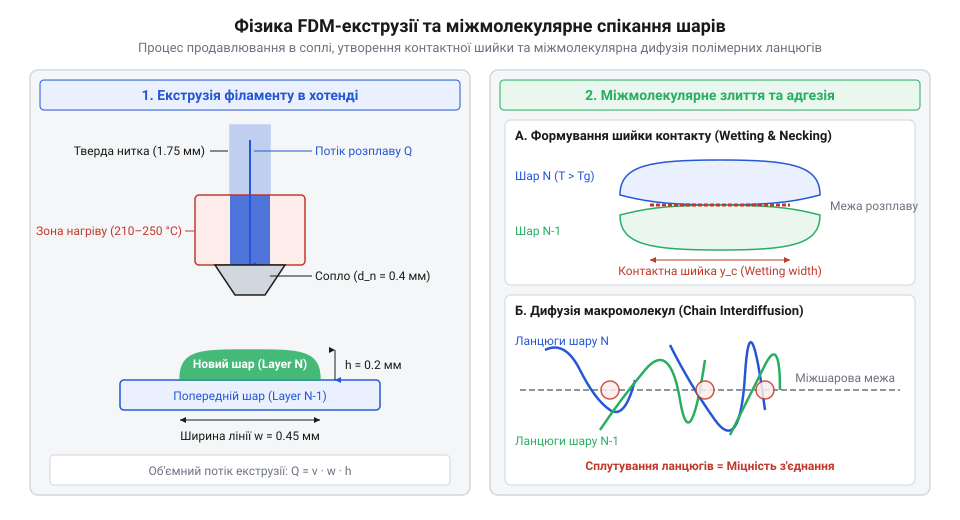
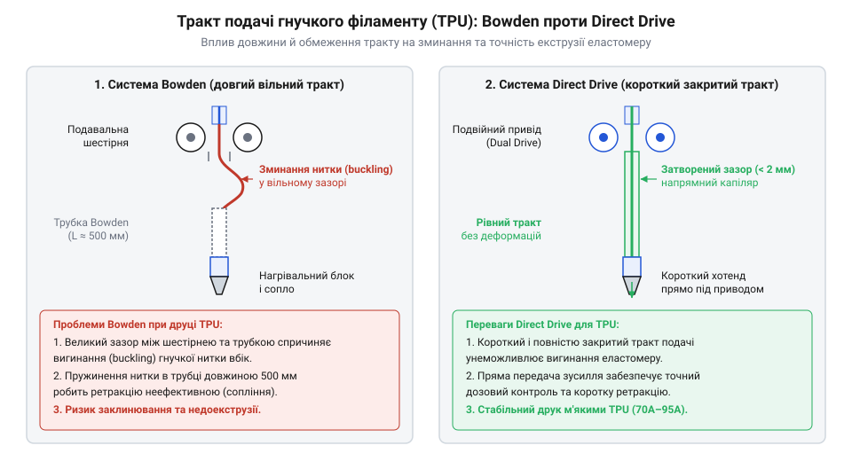
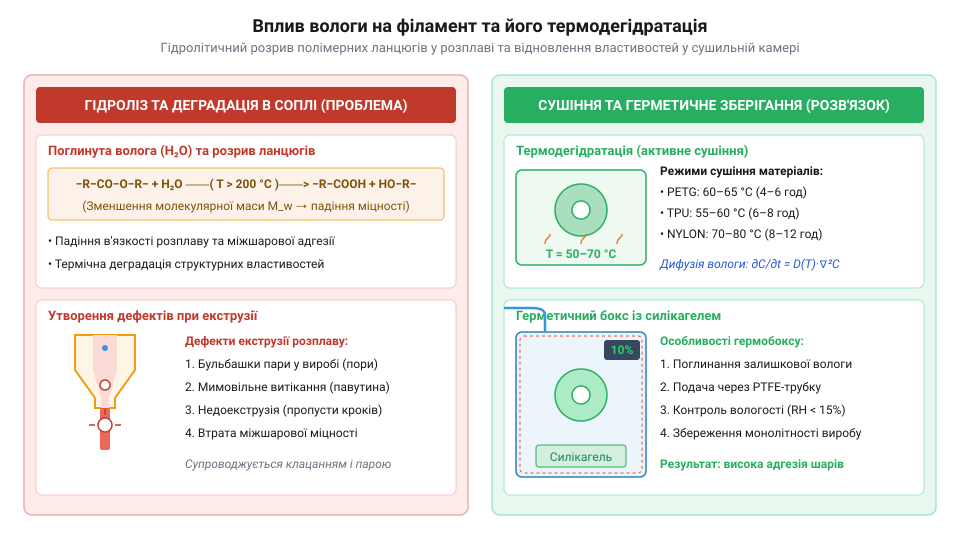

# Філаменти для друку (NYLON, TPU, PETG)

<preknowlist>
- [3D-принтер](root:cat-hw-instruments/3d-printer) — Загальні принципи FDM-друку, будова хотенда, нагрівального столу та базові правила безпеки.
</preknowlist>

## Фізика FDM-екструзії та вибір матеріалу

При виготовленні корпусів та механічних вузлів електронних пристроїв виникає потреба створення деталей із різними фізичними характеристиками — від жорстких та хімічно стійких стінок до гнучких амортизувальних прокладок і зносостійких втулок. У технології моделювання методом наплавлення (англ. @@en|FDM@@ — акронім від @@en|Fused Deposition Modeling@@), або друку ниткою розплавленого пластику (англ. @@en|FFF@@ від @@en|Fused Filament Fabrication@@), тверда полімерна нитка діаметром `1.75 мм` або `2.85 мм` проштовхується механізмом подачі в нагріту зону екструдера — хотенд. Підвищення швидкості подачі збільшує гідродинамічний тиск розплаву в соплі та створює радіальний температурний градієнт по перетину нитки, де зовнішній шар пластику вже досягає в'язкотекучого стану, тоді як його ядро лишається твердим.

У хотенді термопласт нагрівається вище температури склування (англ. @@en|glass transition temperature@@, `T_g`) та температури плавлення (`T_m`), переходячи у стан в'язкотекучого розплаву. Час перебування (резиденції) полімеру в зоні нагріву безпосередньо визначає температурну рівномірність екструзії: занадто короткий інтервал створює радіальні градієнти в'язкості потоку, тоді як занадто довгий час спричиняє термодеструкцію макромолекул. Під тиском твердої нитки розплавлений матеріал видавлюється через каліброване сопло (типово `0.4 мм`) і пошарово укладається на друкарську платформу. Міцність готового виробу визначається міжшаровою адгезією (англ. @@en|interlayer adhesion@@) — термічним спіканням сусідніх ниток, під час якого макромолекули полімеру дифундують через межу контакту, створюючи нові міжмолекулярні зв'язки. Підвищення температури сопла збільшує кінетичну енергію макромолекул та знижує в'язкість розплаву, що розширює контактну площу й поглиблює взаємну дифузію полімерних ланцюгів до моменту охолодження деталі нижче `T_g`.

*Фізичні основи FDM-екструзії: потік розплаву через сопло хотенда та термічне спікання сусідніх полімерних ниток.*

Конструкційні пластики суттєво відрізняються своєю молекулярною будовою:
- Модифікований поліетилентерефталат з добавкою гліколю (англ. @@en|PETG@@ — від @@en|Polyethylene Terephthalate Glycol@@) є аморфно-кристалічним кополімером із високою ударною міцністю, прозорістю та низькою термоусадкою;
- Термопластичний поліуретан (англ. @@en|TPU@@ — від @@en|Thermoplastic Polyurethane@@) належить до блокових кополімерів із чергуванням жорстких і гнучких сегментів, що забезпечує високу еластичність та здатність до зворотної деформації;
- Поліамід (англ. @@en|NYLON@@ — назва родини синтетичних поліамідів) складається з напівкристалічних макромолекул з інтенсивними водневими зв'язками, що дає виняткову механічну зносостійкість, але робить нитку сильно гігроскопічною.

Історичні віхи створення цих полімерних матеріалів та еволюція їхнього застосування в 3D-друку розкриті в окремій [історії розвитку синтетичних термопластів](root:cat-hw-instruments/printing-filaments/hist-synthetic-polymers-history.md). Для розрахунку теплових процесів у зоні розплаву та граничної швидкості подачі дивіться [математичний розрахунок об'ємного потоку](root:cat-hw-instruments/printing-filaments/math-heat-transfer-and-volumetric-flow.md). Загальні числові критерії міцності та температур наведено у [специфікації температурних режимів](root:cat-hw-instruments/printing-filaments/api-filament-thermal-and-mechanical-specifications.md) матеріалів. Друк відбувається на приладі типу [3D-принтер](root:cat-hw-instruments/3d-printer), кінематику якого висвітлено у матеріалі про [конструкцію та кінематику FDM 3D-принтерів](root:cat-hw-instruments/fdm-3d-printer-mechanics-and-kinematics).

## PETG: міцність, прозорість та хімічна стійкість

Поліетилентерефталат-гліколь (PETG) розроблено шляхом введення молекул циклогександіметанолу у базовий ланцюг PET. Ця модифікація запобігає кристалізації матеріалу при охолодженні, завдяки чому нитка лишається аморфною, прозорою та не крихкою. PETG поєднує легкість друку стандартним PLA із високими механічними характеристиками ABS, але без виділення токсичних парів і без значної термоусадки.

Ударна в'язкість PETG досягає `8–10 кДж/м²`, що робить корпуси з нього стійкими до падінь та механічних ударів. Завдяки широкому температурному вікну екструзії (`230–250 °C`) розплав має низьку в'язкість і добре змочує попередній шар. Це створює майже монолітне міжшарове зчеплення, тому міцність деталей при розтягу вздовж осі Z становить до `80–90%` від міцності уздовж монолітної нитки в площині XY. Анізотропія міцності виникає через те, що у площині XY навантаження сприймають суцільні ковалентні зв'язки орієнтованого макромолекулярного ланцюга, тоді як вздовж осі Z міцність залежить виключно від ступеня термічної дифузії та міжмолекулярного зачеплення на межі контакта двох шарів.

Стіл підігрівають до `70–80 °C` для запобігання відшаруванню кутів деталі (англ. @@en|warping@@). Вентилятор обдуву моделі вмикають лише на `20–50%` потужності: надмірне охолодження погіршує міжшарову адгезію, хоч і покращує друк мостиків. Через високу тягучість та поверхневий натяг розплаву PETG схильний до утворення тонких павутинок і соплів (англ. @@en|stringing@@), коли капілярний ефект витягує нитку під час холостих переміщень сопла. Ретрація компенсує цей ефект шляхом створення негативного тиску в термобар'єрі, тому швидкість ретракції налаштовують у межах `40–45 мм/с` при довжині відкатника `1–2 мм` для прямого приводу та `4–6 мм` для боуден-систем.

Хімічна стійкість PETG до спиртів, слабких кислот, лугів та мастил робить його ідеальним для захисних кожухів вимірювальних приладів. Проте за одночасної дії агресивних середовищ і механічних навантажень залишкові внутрішні напруги шарів прискорюють екологічне розтріскування: поверхневі мікротріщини стають концентраторами напружень, крізь які хімічні агенти проникають углиб матеріалу, викликаючи крихке руйнування деталі. При розробці приладових коробок слід враховувати технологічні проміжки, про що детально описано у статті про [проєктування корпусів для електронних приладів](root:cat-hw-instruments/enclosure-design-for-electronics). Покрокова методика підготовки моделі міститься у [практичному проєкті друку корпусу](root:cat-hw-instruments/printing-filaments/proj-filament-drying-and-test-print-calibration.md).

## TPU: еластичність та віброгасіння еластомерів

Термопластичний поліуретан (TPU) належить до класу еластомерів, що сполучають властивості вулканізованої ґуми та легкооброблюваного пластику. Жорсткість TPU вимірюється за шкалою Шора (англ. @@en|Shore hardness@@) у категоріях A та D. Для 3D-друку найчастіше застосовують філаменти з твердістю від `85A` (м'який, подібний до автомобільної шини) до `95A` (напівжорсткий, схожий на підошву взуття).

Молекулярна структура TPU складається з гнучких поліефірних або поліестерних сегментів, що забезпечують подовження при розриві до `400–600%`, та жорстких уретанових блоків, що відповідають за механічну міцність і термостійкість. Співвідношення цих блоків у кополімері визначає динамічний модуль пружності: збільшення частки жорстких уретанових сегментів підвищує опір деформації та модуль зсуву, тоді як переважання гнучких сегментів посилює віброгасіння. Під дією зовнішнього навантаження гнучкі ланцюги випрямляються, а після зняття напруження повертаються у вихідний стан, забезпечуючи відмінне віброгасіння та амортизацію.

*Порівняння приводів подачі для гнучких філаментів: ризик зминання TPU в боуден-трубці проти прямого розвантаження у Direct Drive.*

Головною складністю друку TPU є низька поздовжня жорсткість нитки: при проштовхуванні в екструдер вона легко зминається та вилазить через щілини у механізмі подачі. З цієї причини для гнучких еластомерів краще використовувати екструдери прямої подачі (англ. @@en|Direct Drive@@) з коротким і повністю закритим трактом від подавальних шестерень до термобар'єра. Для запобігання замиканню нитки геометрія термобар'єра повинна забезпечувати зазор менше `0.2 мм` між подавальними шестернями та входом у фторопластовий канал, а профіль подвійних шестерень має містити дрібнозубчасті радіусні канавки, які рівномірно охоплюють нитку й утримують її без деформації поперечного перерізу. Екструзію ведуть при температурі сопла `215–235 °C`, нагріві столу `50–60 °C` та зниженій швидкості друку `15–30 мм/с`, а ретракцію вимикають або зменшують до мінімуму (`0.5–1 мм`), щоб не викликати замикання нитки.

Завдяки масло- та бензостійкості TPU є незамінним матеріалом для виготовлення еластичних ущільнювальних манжет, кабельних гермовводів, захисних бамперів переносних мультиметрів та віброізоляційних ніжок. У віброізоляційних елементах TPU діє за механізмом зсувного демпфування: високочастотні коливання спричиняють циклічний зсув гнучких сегментів макромолекул, де внутрішнє тертя між ланцюгами перетворює кінетичну енергію механічних вібрацій на теплову, розсіюючи резонансні коливання приладу.

## NYLON: конструкційна міцність та зносостійкість

Коли приладовий корпус чи робочий вузол піддається постійним механічним ударам, зсувним навантаженням або тертю, базова пластикова деталь швидше зношується або тріскається по міжшарових межах. Поліамід (від грец. @@lat|poly@@ — багато та франц. @@lat|amide@@ — амид, сполука з аміногрупою), відомий під торговою маркою @@en|NYLON@@, розв'язує цю проблему завдяки гнучким полімерним ланцюгам із високим ступенем орієнтації. Висока межа міцності на розрив (понад 70 МПа) та низький коефіцієнт тертя роблять @@en|NYLON@@ ідеальним матеріалом для друку рухомих шестерень, втулок, підшипників ковзання та силових кронштейнів. При сухому терті ковзання поліамід виявляє ефект самозмащування: під впливом фрикційного нагріву поверхневий мікрошар полімеру пластифікується й формує тонку плівку переносу на контртілі, що знижує коефіцієнт тертя з `0.35–0.40` до `0.15–0.20` та стабілізує абразивне зношування вузла. Опис еволюції створення цього матеріалу детальніше висвітлено в [історії розробки термопластів](root:cat-hw-instruments/printing-filaments/hist-synthetic-polymers-history.md).

Кристалічна структура поліаміду забезпечує робочу термостійкість готових деталей понад 100 °C, проте ця ж особливість створює значне технологічне випробування під час FDM-друку. При охолодженні від температури екструзії 250–280 °C до кімнатної пластик демонструє виражену об'ємну усадку (явище @@en|warping@@), через яку деталі жолобляться й відриваються від робочого столу разом із покриттям. Викривлення виникає внаслідок градієнта температур між гарячою платформою та охолодженими верхніми шарами: швидкіша кристалізація верхніх рівнів формує згинальний момент та високі внутрішні термонапруги по всій висоті виробу. Запобігти деформації допомагає поєднання високотемпературних адгезивів на основі @@en|PVP@@ чи @@en|PEI@@-пластин із підігрівом столу до 100–110 °C та використанням закритої термокамери з температурою середовища 50–70 °C. Для розрахунку теплових втрат та подачі розплаву застосовують [математичну модель теплопередачі](root:cat-hw-instruments/printing-filaments/math-heat-transfer-and-volumetric-flow.md).

Завдяки поєднанню високої в'язкості й стійкості до мастил та палива, поліамідні деталі використовують при [проєктуванні корпусів приладів](root:cat-hw-instruments/enclosure-design-for-electronics), які працюють в агресивних експлуатаційних умовах. Для зняття внутрішніх залишкових напруг та максимізації міжшарової міцності готові деталі піддають відпалюванню в термошафі при температурі `80–100 °C` протягом `2–4 годин` з наступним повільним охолодженням разом із піччю.

## Гігроскопічність, сушіння та правила зберігання

Основною слабкою стороною поліамідів та інших інженерних матеріалів є висока гігроскопічність (від грец. @@lat|hygros@@ — вологий та @@lat|skopeo@@ — спостерігати), тобто здатність активних амідних груп молекулярного ланцюга активно поглинати водяну пару з атмосферного повітря. Навіть за кілька годин перебування на відкритому повітрі нитка накопичує до 3–5 % води від власної маси. Коли вологий філамент потрапляє в хотенд [сучасного FDM 3D-принтера](root:cat-hw-instruments/3d-printer) при температурі понад 240 °C, накопичена вода миттєво закипає, спричиняючи мікровибухи пари всередині сопла.

Гідроліз розплавленого полімеру розриває довгі молекулярні ланцюги, що різко зменшує міжмолекулярну масу термопласту. Висока температура в хотенді виступає каталізатором кінетики термохімічного розщеплення: молекули вологи здійснюють нуклеофільну атаку на полярні амідні зв'язки, деградуючи високомолекулярні ланцюги до коротких фрагментів за лічені секунди перебування розплаву в соплі. В результаті друкована деталь покривається кавернами, з сопла виділяється пара й характерне тріскотіння, а міжшарова адгезія падає у 2–3 рази, роблячи корпус крихким.

*Фізика поглинання вологи та зневоднення: пароутворення у гарячому соплі та зберігання нитки у герметичному боксі.*

Для відновлення первинних властивостей матеріалу застосовують примусову дегідратацію нитки в сушильних камерах або дегідраторах. Сушіння спирається на градієнт концентрації та термічну дифузію: теплове збудження вибиває молекули води із зачеплення з амідними групами ядра монофіламенту діаметром `1.75 мм`, виштовхуючи їх до поверхні, звідки вони випаровуються в сухе гаряче повітря. Для @@en|PETG@@ нормальний режим становить 60–65 °C протягом 4–6 годин, тоді як для @@en|NYLON@@ потрібна температура 70–80 °C тривалістю від 8 до 12 годин. Після сушіння філамент необхідно одразу перемістити в герметичний бокс із силікагелем або друкувати безпосередньо з закритої сушильної ємності. Водночас після друку повторне поглинання рівноважної вологи повітря (до `1.5–2%`) діє як пластифікатор готового нейлону: зв'язана вода підвищує рухливість ланцюгів та ударну в'язкість деталі. Практичні кроки підготовки нитки показано в [практичному проєкті сушіння](root:cat-hw-instruments/printing-filaments/proj-filament-drying-and-test-print-calibration.md), а повні температурні допуски зібрано в [специфікації температурних режимів](root:cat-hw-instruments/printing-filaments/api-filament-thermal-and-mechanical-specifications.md).

Використання сухих ниток у поєднанні з оптимізованою [кінематикою 3D-принтерів](root:cat-hw-instruments/fdm-3d-printer-mechanics-and-kinematics) гарантує монолітність структури та розрахункову міцність надрукованих приладових корпусів.
