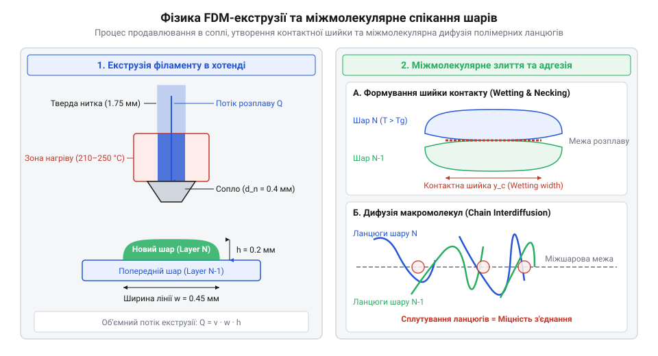
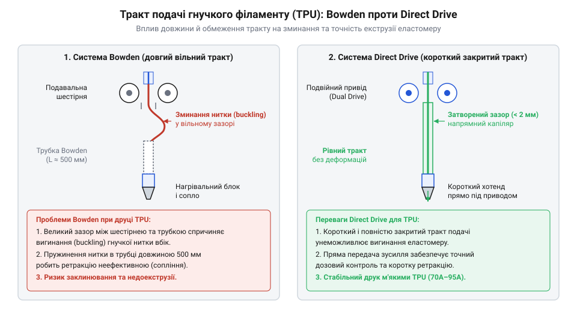
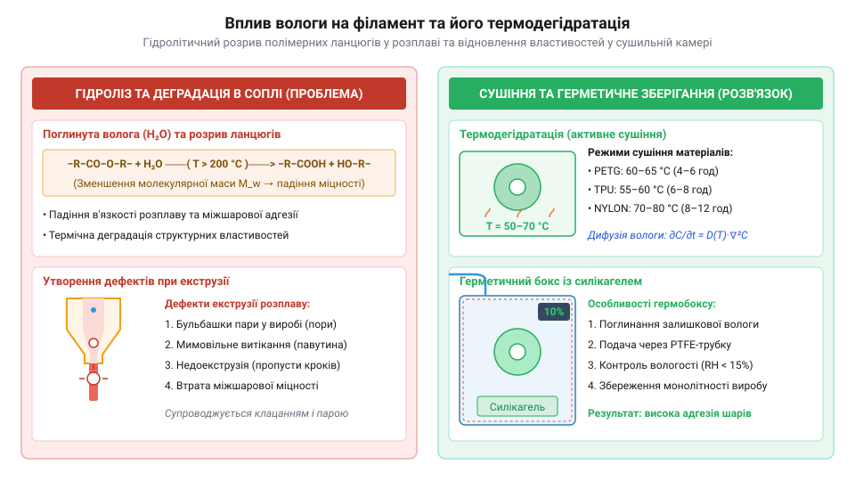

# Філаменти для друку (NYLON, TPU, PETG)

<preknowlist>
- [3D-принтер](root:cat-hw-instruments/3d-printer) — Загальні принципи FDM-друку, будова хотенда та нагрівального столу.
</preknowlist>

## Фізика FDM-екструзії та міжшарова адгезія

При виготовленні приладових корпусів і механічних вузлів під час друку на [3D-принтері](root:cat-hw-instruments/3d-printer) за технологією FDM (від англійського *fused deposition modeling* — «моделювання методом наплавлення»; @@en|FDM@@) тверда полімерна нитка проштовхується в нагріту зону екструдера — хотенд. У хотенді термопласт нагрівається вище температури склування `T_g` та температури плавлення `T_m`, переходячи у стан в'язкотекучого розплаву. Якщо час перебування полімеру в зоні нагріву занадто короткий, виникає радіальний температурний градієнт: зовнішній шар розплавляється, а ядро нитки лишається твердим, що різко підвищує тиск у соплі та спричиняє недоекструзію.

Під тиском подачі розплавлений пластик видавлюється через сопло й пошарово укладається на платформу. Міцність готового виробу визначається міжшаровою адгезією (від латинського *adhaesio* — прилипання; @@en|adhesion@@) — термічним спіканням сусідніх ниток, під час якого макромолекули дифундують через межу контакту до моменту охолодження деталі нижче `T_g`. Швидкість і глибина такого спікання напряму залежать від темпу охолодження розплаву: надмірне обдування деталі вентилятором прискорює падіння температури й заморожує рухливість полімерних ланцюгів ще до того, як вони встигнуть переплестися, що різко погіршує міжшарову міцність.

*Фізичні основи FDM-екструзії: потік розплаву через сопло хотенда та термічне спікання сусідніх полімерних ниток.*

## Особливості застосування PETG та TPU

Для ударостійких і хімічно стійких корпусів застосовують аморфний кополімер PETG (від англійського *polyethylene terephthalate glycol* — «поліетилентерефталат-гліколь»; @@en|PETG@@). Завдяки широкому температурному вікну екструзії (`230–250 °C`) розплав @@en|PETG@@ має низьку в'язкість, добре змочує попередній шар і забезпечує високу міцність вздовж осі Z. Для зменшення утворення павутинок на холостих переходах налаштовують ретракцію (від латинського *retractio* — відтягування назад; @@en|retraction@@).

Коли виріб вимагає амортизації та віброгасіння, обирають еластомер TPU (від англійського *thermoplastic polyurethane* — «термопластичний поліуретан»; @@en|TPU@@) із твердістю за Шором `85A–95A`. Через низьку поздовжня жорсткість гнучка нитка @@en|TPU@@ легко зминається в довгому каналі, тому для її подачі використовують екструдери прямої подачі Direct Drive із повністю закритим трактом.

*Порівняння приводів подачі для гнучких філаментів: ризик зминання TPU в боуден-трубці проти прямого розвантаження у Direct Drive.*

## Властивості NYLON та захист від вологи

Для високонавантажених вузлів тертя та шестерень використовують поліамід NYLON (від англійського *nylon* — торгова назва синтетичних поліамідів; @@en|NYLON@@). Напівкристалічна структура @@en|NYLON@@ забезпечує ефект самозмащування та низький коефіцієнт тертя (`0.15–0.20`), проте висока термоусадка вимагає підігріву столу до `100–110 °C` і закритої камери.

Головною проблемою поліамідів є гігроскопічність (від грецького *hygros* — вологий та *skopeo* — спостерігаю; @@en|hygroscopic@@) — здатність активно поглинати воду з повітря. У гарячому соплі при температурі понад `240 °C` вода викликає гідроліз (від грецького *hydor* — вода та *lysis* — розщеплення; @@en|hydrolysis@@), розриваючи макромолекулярні ланцюги й зменшуючи міжшарову міцність виробу в 2–3 рази. Перед друком нитку піддають примусовій дегідратації в сушильній камері при `70–80 °C` протягом 8–12 годин.

*Фізика поглинання вологи та зневоднення: пароутворення у гарячому соплі та зберігання нитки у герметичному боксі.*
