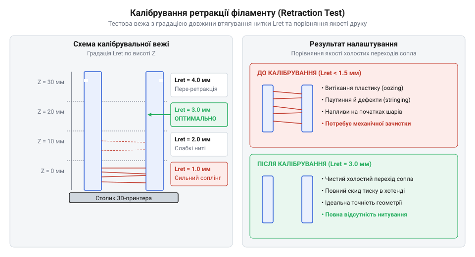

# Практичний проєкт сушіння, калібрування ретракції та друку захисного корпусу

<preknowlist>
- [3D-принтер](root:cat-hw-instruments/3d-printer) — принципи роботи FDM-екструдера, налаштування температури столу та сопла
</preknowlist>

## Проблема дефектів друку гігроскопічними пластиками

Виготовлення вологозахищеного корпусу електронного приладу вимагає монолітності пластикових стінок та щільного прилягання еластомерних прокладок. Однак при друку конструкційними матеріалами на [екструдері 3D-принтера](root:cat-hw-instruments/3d-printer) деталі часто втрачають герметичність, вкриваються порожнинами й кавернами. Головною причиною цих дефектів є вологонасичення нитки та некоректно налаштоване відтягування пластику.

Синтетичні полімери, такі як @@en|PETG@@ (поліетилентерефталат-гліколь) та еластичний @@en|TPU@@ (термопластичний поліуретан), мають високу @@en|гігроскопічність@@ (від грецького *hygros* — вологий та *skopeo* — спостерігати/розглядати). Полярні групи в молекулярних ланцюгах цих матеріалів активно притягують молекули води з навколишнього повітря. Коли вологий філамент потрапляє в @@en|хотенд@@ (від англійського *hot end* — гарячий край), розігрітий до температури 220–240 °C, закипання води спричиняє два руйнівні процеси:

1. **Вибухове пароутворення**: Вражена волога миттєво перетворюється на пару з великим питомим об'ємом. Пара розриває розплав полімеру всередині сопла з характерним тріском («поппінгом»), утворюючи мікроскопічні бульбашки й раковини. Розширюючись на виході із сопла, пара виштовхує надлишок пластику під час холостих переходів друкуючої голівки, формуючи витоки та @@en|нитування@@ (або @@en|соплінг@@, від англійського *string* — нитка).
2. **@@en|Гідролітична деструкція@@** (від грецьких слів *hydor* — вода та *lysis* — розпад): Під дією високої температури молекули води хімічно розщеплюють довгі полімерні ланцюги на коротші фрагменти. Полімер втрачає молекулярну масу, через що міжшарова адгезія деталей падає у кілька разів, а корпус стає крихким.

Утворення наскрізних мікропор у стінках деталей з @@en|PETG@@ унеможливлює створення герметичного оболонкового захисту. Для досягнення розрахункової міцності та вологостійкості виробу філамент необхідно піддати глибокому зневодненню, а також відкалібрувати параметри подачі нитки.

Отже, технологічні вимоги до підготовки сировини зводяться до двох критичних умов: вилучення зв'язаної вологи з об'єму матеріалу без деформації котушки та підбору прецизійного режиму @@en|ретракції@@ (від латинського *retractio* — відтягування). Ліквідація витоків пластику та парових мікропорожнин запевняє цілісність міжшарових меж, перетворюючи пухку напівпрозору структуру @@en|PETG@@ на суцільний вологонепроникний бар'єр.

Прикладну вагомість ліквідації вибухового пароутворення легко виявити за якістю зовнішньої поверхні та світлопропусканням виробу. Локальні мікровибухи пари на зрізі сопла виштовхують неконтрольовані краплі розплаву, через що поверхнева шорсткість стінок зростає у кілька разів, перешкоджаючи щільному приляганню сальника. Водночас мільйони застряглих парових мікробульбашок діють як світлорозсіювальні центри: замість глянцевої прозорої структури висушеного @@en|PETG@@ вологий пластик формує мутну, молочно-білу деталь із наскрізною капілярною сіткою.

## Підготовка та термосушіння гігроскопічних філаментів

Звичайне витримування котушки у сухому приміщенні не здатне видалити зв'язану вологу з товщі полімеру. Для відновлення первинних властивостей матеріалу застосовують активне сушіння у спеціалізованій термокамері з примусовою циркуляцією повітря.

Процес висушування ґрунтується на нагріванні нитки, що надає молекулам вологи теплову енергію для розриву водневих зв'язків із полімерними ланцюгами. Нагрівання сушильної камери знижує відносну вологість повітря, створюючи перепад парціального тиску водяної пари між насиченою вологою товщею пластику та сухим середовищем камери. Цей градієнт тиску є головною рушійною силою дифузії, яка витискає молекули води з внутрішніх шарів до поверхні нитки, звідки вони виносяться потоком гарячого повітря. Головним обмеженням при виборі сушильного режиму є @@en|температура склування@@ (англ. @@en|Glass Transition Temperature@@, `T_g`) — межа, за якою аморфний полімер переходить із твердого стану у високоеластичний. Якщо температура сушіння досягне або перевищить `T_g`, витки філаменту на котушці розм'якшуються, злипаються між собою та деформуються під дією натягу.

Технологічні параметри сушіння встановлюють залежно від типу полімеру:
- **@@en|PETG@@**: температура сушіння 60–65 °C, тривалість 4–6 годин (температура склування `T_g ≈ 75 °C`).
- **@@en|TPU@@**: температура сушіння 50–55 °C, тривалість 6–8 годин (температура склування `T_g ≈ −50…−30 °C`).

Для контролю ефективності зневоднення у камері сушарки використовують @@en|гігрометр@@ (від грецьких *hygros* — вологий та *metron* — міра). Сушіння вважається завершеним, коли відносна вологість повітря всередині закритої камери опускається нижче 15–20%. Для запобігання повторному вологонасиченню під час тривалого друку котушку @@en|TPU@@ подають безпосередньо з герметичного боксу з силікагелем.

## Калібрування коефіцієнта екструзії та ретракції

Висушений пластик гарантує відсутність парових бульбашок, проте геометрія та щільність виробу залежать від точного налаштування об'єму видавлювання та контролю витоків пластику.

Першим кроком виконують калібрування @@en|коефіцієнта екструзії@@ (англ. @@en|Flow Ratio@@ або @@en|Extrusion Multiplier@@, від латинського *multiplicare* — примножувати). Цей параметр задає множник кількості кроків двигуна екструдера на одиницю довжини шляху. Для вимірювання друкують одностінний калібрувальний куб у режимі вази зі заданою розрахунковою товщиною стінки (наприклад, `W_target = 0.45 мм` для сопла діаметром `0.4 мм`).

Після охолодження вимірюють фактичну товщину стінки `W_measured` штангенциркулем у чотирьох точках та обчислюють середнє значення. Новий коефіцієнт обчислюють за пропорцією:

Flow_new = Flow_old × (W_target ÷ W_measured)
= 1.00 × (0.45 ÷ 0.50)      [ділення цільової товщини на виміряну]
= 0.90                      [отримано відкоригований коефіцієнт екструзії]

Другим кроком є усунення витоків рідкого полімеру за допомогою ретракції. @@en|Ретракція@@ (від латинського *retractio* — відтягування) полягає у швидкому зворотному ходу нитки перед холостим переміщенням голівки, що створює розрядження у melting-зоні сопла.

Для підбору відстані та швидкості втягування друкують спеціальну калібрувальну вежу.

*Калібрувальна вежа ретракції показує зміну ступеня нитування залежно від довжини втягування нитки, що дозволяє визначити оптимальну точку безвитокового друку.*

Зміна параметрів по ярусах висоти Z реалізується за допомогою динамічних команд G-code у прошивці принтера:

:::code proj-filament-drying-and-test-print-calibration/gcode/retraction_tower.gcode 46-86

Команда `M207` задає довжину втягування `S` (мм) та швидкість `F` (мм/хв). Команди `G10` та `G11` виконують відповідно ретракцію та відновлення подачі. Візуальний огляд надрукованої вежі дозволяє визначити мінімальну довжину ретракції, за якої @@en|соплінг@@ повністю зникає без ризику забивання хотенда.

## Друк вологозахищеного корпусу та сальника

Опанувавши підготовку нитки та калібрування подачі, переходять до безпосереднього друку деталей вологозахищеного вузла: жорсткого корпусу з @@en|PETG@@ та еластичного сальника з @@en|TPU@@.

Для несучих половинок корпусу в слайсері встановлюють параметри, що забезпечують монолітність міжшарових з'єднань:
- **Висота шару**: 0.20 мм (оптимальне співвідношення швидкості та адгезії).
- **Кількість периметрів**: не менше 3–4 контурів для виключення наскрізних капілярів.
- **Перекриття периметрів і заповнення**: 18–20% для усунення мікрощілин на межах з'єднання.
- **Температурний режим**: сопло 235–240 °C, стіл 75–80 °C, обдув деталі мінімальний (20–30%), щоб запобігти викривленню кутів і розшаруванню.

При друку герметизуючого сальника з @@en|TPU@@ враховують високу гнучкість нитки. На відміну від жорстких пластиків, м'який філамент у @@en|боуден-екструдері@@ (від імені винахідника Ernest Monnington Bowden) здатний згинатися всередині довгої напрямної трубки. Тому друк здійснюють на [3D-принтері з директ-екструдером](root:cat-hw-instruments/3d-printer) (англ. @@en|директ-екструдер@@, від *direct* — прямий), де подавальні шестерні розташовані безпосередньо над хотендом. Швидкість друку знижують до 20–25 мм/с, а ретракцію вимикають або зменшують до 0.5 мм, щоб уникнути намотування еластомеру на подавальний ролик.

Після завершення друку сальник із @@en|TPU@@ вкладають у спеціальний паз нижньої півкорпусної деталі з @@en|PETG@@. При затягуванні з'єднувальних ґвинтів M3 еластомер рівномірно деформується на 20–25% своєї товщини, перекриваючи мікрошорсткість поверхонь і створюючи вологонепроникний бар'єр за стандартом IP67.
