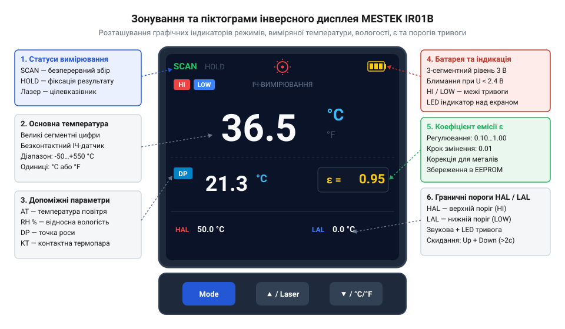
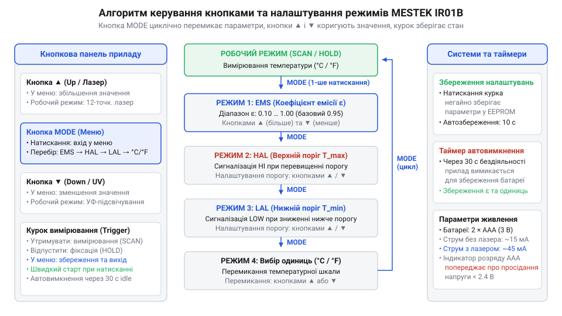

# Залізний інтерфейс, дисплей та органи керування MESTEK IR01B

<preknowlist>
- [Штангенциркуль](root:cat-hw-instruments/vernier-caliper) — Навички вимірювання лінійних розмірів об'єктів для контролю перекриття оптичної плями пірометра.
</preknowlist>

## Конструкція та ергономіка MESTEK IR01B

Інфрачервоний пірометр MESTEK IR01B виконано в компактному пластиковому корпусі пістолетного типу (від англійського *pistol grip*; `@@en|pistol grip@@`), розрахованому на утримання однією рукою. На передній торець приладу виведено оптичну лінзу приймача інфрачервоного випромінювання, довкола якої розташовано 12 світлодіодів кругового лазерного цілевказівника (від англійського *circular laser pointer*; `@@en|circular laser pointer@@`). Така геометрична конфігурація лазерних променів будує на досліджуваній поверхні світлове кільце, яке наочно позначає межі вимірювальної плями з оптичною роздільністю `12:1` у діапазоні безконтактного вимірювання від `-50 °C` до `+550 °C`. Оптичний приймач оптимізований під спектральний діапазон (від англійського *spectral response*; `@@en|spectral response@@`) `8–14 мкм`, що відповідає вікну прозорості атмосфери для довгохвильового інфрачервоного випромінювання, а час відгуку датчика (від англійського *response time*; `@@en|response time@@`) не перевищує `500 мс` (0.5 с для фіксації 95 % значення), що визначає фізичні межі швидкодії при зчитуванні динамічних теплових процесів. Поруч із лазерним блоком інтегровано додатковий ультрафіолетовий світлодіод підсвічування (від англійського *ultraviolet LED*; `@@en|UV LED@@`) та вікно датчика температури й вологості навколишнього повітря. Ультрафіолетове випромінювання з довжиною хвилі `365–395 нм` призначене для виявлення витоків хладагенту в кондиціонерах та холодильних магістралях: воно змушує світитися люмінесцентні маркери й флуоресцентні барвники (`@@en|fluorescent dye@@`), додані в системну оливу, уможливлюючи візуальну локалізацію мікротріщин під тиском. У нижньому торці рукоятки розміщено захищений гумовою заглушкою стандартний двопіновий мініатюрний роз'єм термопари (від англійського *thermocouple socket*; `@@en|thermocouple socket@@`) для підключення контактного зонда K-типу, що забезпечує додатковий контактний вимір температури в діапазоні від `-40 °C` до `+500 °C` для калібрування чи контролю складних поверхонь.

Під рукояткою розміщено механічний тригер вимикача (від англійського *trigger switch*; `@@en|trigger switch@@`), натискання якого вмикає прилад та активує безперервне зчитування температури. У нижній частині рукоятки міститься відсік елементів живлення та захищений гумовою заглушкою роз'єм для підключення зовнішньої контактної термопари K-типу (від англійського *thermocouple socket*; `@@en|thermocouple socket@@`). На задній панелі над рукояткою розташовано інверсний кольоровий рідкокристалічний дисплей і панель із трьох гумових кнопок керування. Перед початком роботи габарити цільової поверхні перевіряють вимірювальними інструментами, наприклад, застосовуючи [штангенциркуль](root:cat-hw-instruments/vernier-caliper) для контролю точних розмірів деталей.

## Інверсний кольоровий дисплей та піктограми

Виведення вимірювальної інформації здійснюється на кольоровий рідкокристалічний дисплей із високим контрастом інверсної матриці (від англійського *inverse LCD display*; `@@en|inverse LCD display@@`), де світлі цифри й символи відображаються на темному тлі. Екран розділено на кілька функціональних зон із фіксованим розташуванням графічних індикаторів. Зокрема, у допоміжному цифровому рядку відображаються показники відносної вологості (від англійського *relative humidity*; `@@en|relative humidity@@`, `RH %`) та розрахованої температури точки роси (від англійського *dew point*; `@@en|dew point@@`, `DP`). Розрахунок `DP` виконується мікроконтролером за даними навколишньої температури `AT` та вологості `RH %`, після чого прилад обчислює температурний перепад `ΔT = T_поверхні - DP`. Якщо `ΔT > 5 °C`, поверхня є сухою й ризик відсутній (індикатор світиться зеленим). У разі звуження інтервалу до `0 °C < ΔT ≤ 5 °C` вмикається жовтий попереджувальний світлосигнал про близькість конденсації, а при `ΔT ≤ 0 °C`, коли температура поверхні дорівнює або є нижчою за точку роси, спалахує червоний індикатор і лунає зумер. Над дисплеєм розташовано триколірний світлодіодний індикатор тривоги (від англійського *LED alarm indicator*; `@@en|LED alarm indicator@@`), який дублює графічні символи світловим сигналом і в звичайних режимах вимірювання температури: зелений колір свідчить про перебування у безпечних межах, жовтий попереджає про наближення до межі, а червоний спалахує при виході значення за встановлені пороги `HAL` або `LAL` разом із переривчастим звуковим зумером.

*Розташування елементів та піктограм на інверсному дисплеї MESTEK IR01B.*

У верхній частині дисплея відображається поточний статус вимірювання: текстова піктограма `SCAN` свідчить про утримання тригера та безперервний збір даних, а статус `HOLD` з'являється після відпускання тригера, заморожуючи останній виміряний результат на екрані. Поруч розташовано символи активного лазерного цілевказівника та індикатор стану трьохсегментної батареї живлення.

Центральну частину екрана займає великий цифровий індикатор основної виміряної температури інфрачервоного датчика з одиницями вимірювання `°C` або `°F`. Нижній додатковий цифровий рядок показує допоміжні параметри: температуру навколишнього повітря (`AT`), відносну вологість (`RH %`), температуру точки роси (`DP`) або значення контактної термопари (`KT`). У правому кутку додатково виводиться числове значення налаштованого коефіцієнта випромінювальної здатності `ε`, а верхня та нижня шкали відображають встановлені межі порогових тривог `HI` (High Alarm) та `LOW` (Low Alarm).

## Органи керування та меню налаштувань

Керування режимами MESTEK IR01B здійснюється трьома кнопками, розташованими безпосередньо під дисплеєм. Ця панель забезпечує не лише навігацію параметрами, але й швидке регулювання коефіцієнта випромінювальної здатності (від латинського *emissio* — випускання; `@@en|emissivity@@`, `ε`) для усунення похибок при вимірюванні блискучих металевих поверхонь. Поліровані метали (алюміній, мідь, нержавіюча сталь) мають низьку емісивність (`ε < 0.2`) та високу відбивальну здатність, через що пірометр без калібрування фіксує відбиту температуру фону замість власної температури деталі. Для точно калібрувальної корекції розробник вимірює еталонну температуру поверхні контактною термопарою K-типу або наклеює чорну матову стрічку (`ε ≈ 0.95`), після чого кнопками панелі змінює коефіцієнт `ε` в меню приладу до збігу показів інфрачервоного датчика з еталоном. Крім коригування `ε`, ця сама кнопкова панель дає змогу оперативно керувати верхнім (`HAL`) та нижнім (`LAL`) порогами тривоги: для швидкого скидання випадково змінених чи крайніх параметрів порогів до заводських налаштувань у відповідному пункті меню застосовують одночасне утримання кнопок **Up** та **Down** (понад 2 секунди), що миттєво повертає межі `HAL` і `LAL` до стандартних значень без тривалого покрокового прокручування всього діапазону температур.

1. Кнопка **Mode** (від англійського *mode switch*; `@@en|Mode button@@`): коротким натисканням у робочому режимі перемикає нижній додатковий рядок дисплея між параметрами `AT`, `RH`, `DP` та `KT`. У режимі `KT` (від англійського *K-type thermocouple*; `@@en|K-type thermocouple@@`) мікроконтролер опитує роз'єм термопари, виводячи на нижній екран контактну температуру паралельно з інфрачервоним безконтактним значенням на основному дисплеї, що дає змогу порівнювати показники наочно; якщо зонд не підключено або виявлено обрив кола, замість температури виводиться прочерк `----`. Тривале натискання кнопки (понад 2 секунди) переводить прилад у меню конфігурації.
2. Кнопка **Up / Laser** (`@@en|Up button@@`): у режимі вимірювання вмикає або вимикає кільцевий лазерний цілевказівник, а всередині меню збільшує вибране числове значення.
3. Кнопка **Down / °C/°F** (`@@en|Down button@@`): у робочому режимі перемикає одиниці вимірювання між градусами Цельсія (`°C`) та Фаренгейта (`°F`), а в меню зменшує настроювані параметри.

*Схема навігації у меню налаштувань пірометра MESTEK IR01B.*

Послідовне перемикання пунктів меню меню при тривалому утриманні кнопок виконується за алгоритмом:
* Перший пункт — налаштування коефіцієнта емісивності `ε`: на дисплеї блимає значення в діапазоні від `0.10` до `1.00`. Кнопками **Up** та **Down** установлюють необхідне значення з кроком `0.01`.
* Другий пункт — налаштування верхньої межі тривоги `HAL`: кнопками змінюють порогове значення температури, при перевищенні якого прилад подає звуковий сигнал і світлову індикацію.
* Третій пункт — налаштування нижньої межі тривоги `LAL`: задається мінімально припустима температура поверхні.

Вихід із меню та збереження параметрів у внутрішню енергонезалежну пам'ять здійснюється повторним коротким натисканням кнопки **Mode** або натисканням вимірювального тригера.

## Параметри живлення та енергоефективність

Прилад живиться від двох стандартних лужних елементів типу AAA з сумарною номінальною напругою `3 В` DC (від англійського *AAA battery*; `@@en|AAA battery@@`). Вбудований мікроконтролер постійно контролює рівень напруги живлення через внутрішній аналогово-цифровий перетворювач. Однак у міру розряджання батарей їхній внутрішній опір (від англійського *internal resistance*; `@@en|internal resistance@@`, `R_in`) суттєво зростає. Під час увімкнення кругового лазерного цілевказівника струм споживання миттєво зростає до `45–60 мА`, що на зношених елементах викликає імпульсне просідання напруги живлення `ΔV = I · R_in`. Це короткочасне падіння напруги порушує стабільність опорної напруги АЦП і викликає пульсації виміряного сигналу інфрачервоного датчика: крива залежності вимірювальної похибки (від англійського *measurement error*; `@@en|measurement error@@`, `ΔT`) від напруги живлення має виражений нелінійний характер, де в стабільному діапазоні `2.4–3.0 В` похибка утримується в межах паспортних `±1.5 °C`, але при імпульсному просіданні напруги нижче `2.4 В` демонструє експоненційне зростання до `±5 °C` і більше безпосередньо перед спрацьовуванням автовимкнення, оскільки вимірювальний тракт оцифровує сигнал від деградованої опорної напруги. Через таке стрімке зниження точності виснажені елементи з високим внутрішнім опором підлягають своєчасній заміні.

Енергоспоживання приладу залежить від активних периферійних модулів:
* Режим очікування (після автовимкнення): струм споживання `I_idle < 5 мкА`, що забезпечує збереження заряду батарей протягом понад 12 місяців бездіяльності.
* Режим вимірювання `SCAN` із вимкненим лазером та підсвічуванням: струм споживання становить `I_scan ≈ 15–20 мА`.
* Режим вимірювання `SCAN` з активним кільцевим лазером та UV-підсвічуванням: струм споживання зростає до `I_laser ≈ 45–60 мА`.

Для збереження ресурсу елементів живлення у приладі реалізовано автоматичне вимкнення (від англійського *auto power off*; `@@en|auto power off@@`). Якщо протягом 30 секунд після відпускання вимірювального тригера не було натиснуто жодної кнопки, таймер бездіяльності автоматично вимикає дисплей та переводить мікроконтролер у режим глибокого сну. Коли напруга живлення знижується нижче порогу `2.4 В ± 0.1 В`, на дисплеї починає блимати піктограма розрядженої батареї, сигналізуючи про необхідність заміни елементів для запобігання похибкам вимірювального тракту.
