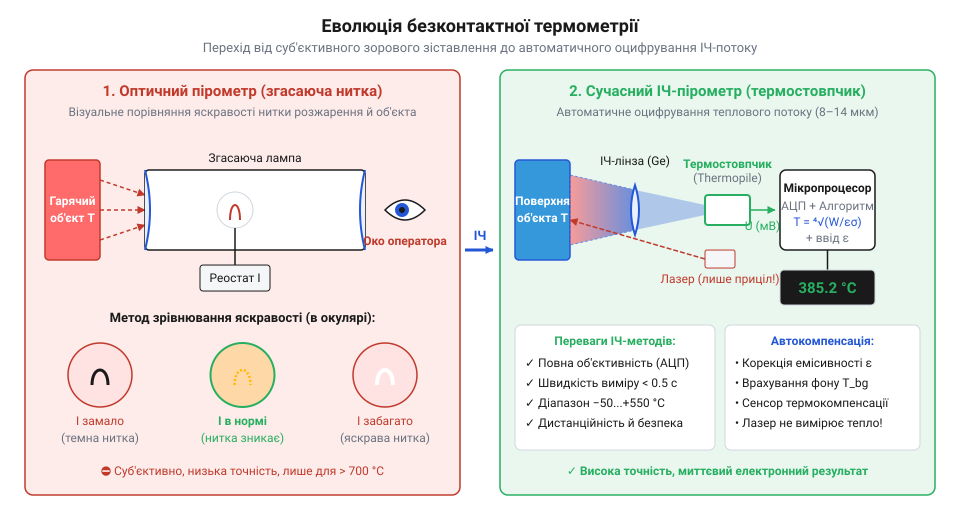

# Історія розвитку інфрачервоної пірометрії

## Обмеження контактного вимірювання високих температур

У високотемпературних промислових процесах — таких як виплавка сталі при температурах понад 1500 °C, варіння скла або литво кольорових металів — класичні контактні вимірювачі швидко досягають своїх фізичних меж. Використання рідинних, терморезистивних або термоелектричних датчиків занурювального типу наражається на три фундаментальні бар'єри.

Перший бар'єр полягає у фізичному й хімічному руйнуванні первинного перетворювача. Агресивні розплави металів і шлаків, окиснювальне газове середовище та високі температури розплавляють захисні чохли, спричиняють дифузію домішок у матеріал термоелектродів термопар та змінюють їхні калібрувальні характеристики. Другий бар'єр зумовлений ефектом теплового навантаження: для вимірювання температури датчик мусить увійти у теплову рівновагу з об'єктом, проте при контакті з малогабаритними або маломасивними тілами масивний сенсор відбирає значну кількість тепла, спотворюючи реальне температурне поле. Третій бар'єр стосується безпеки оператора та механічних обмежень, адже прямому контакту заважають швидкий рух деталей на конвеєрі або високі електричні потенціали.

Виникає фізичне протиріччя: точний вимір вимагає термодинамічної рівноваги між сенсором і об'єктом, але досягнення цієї рівноваги руйнує вимірювач або спотворює стан об'єкта. Осмислення цього протиріччя сформувало історичний запит на вимірювання температури без безпосереднього механічного чи теплового контакту — шляхом реєстрації власного електромагнітного випромінювання нагрітих тіл, що поклало початок @@el|пірометрії@@ (грец. *pyr* — вогонь, *metreo* — вимірювати).

## Відкриття ІЧ-випромінювання та закони випромінювання

Фундамент безконтактної термометрії було закладено у 1800 році, коли англійський астроном Вільям Гершель (William Herschel) досліджував нагрівальний ефект різних кольорів сонячного світла. Пропускаючи сонячні промені крізь скляну призму, він отримував @@la|спектр@@ (лат. *spectrum* — бачення, образ) і розміщував чутливі ртутні термометри у різних його ділянках. Наполігши на вимірюванні температури за межею червоного краю видимого світла, Гершель виявив найінтенсивніше нагрівання там, де людське око не бачило жодного сяйва. Це невидиме проміння отримало назву @@la|інфрачервоне@@ (лат. *infra* — нижче).

Перехід від емпіричного спостереження до математично строгого розрахунку відбувся завдяки серії фундаментальних фізичних відкриттів XIX століття. У 1859–1860 роках німецький фізик Густав Кірхгоф (Gustav Kirchhoff) ввів концепцію @@de|абсолютно чорне тіло@@ — ідеалізованого об'єкта, який повністю поглинає все падаюче випромінювання незалежно від довжини хвилі. Кірхгоф довів, що відношення випромінювальної здатності тіла до його поглинальної здатності є універсальною функцією температури й довжини хвилі.

У 1879 році Йозеф Стефан (Josef Stefan) експериментально, а в 1884 році Людвіґ Больцман (Ludwig Boltzmann) теоретично вивели закон, який пов'язав інтегральну випромінювальну здатність чорного тіла з його термодинамічною температурою:

Загальна енергетична світимість абсолютно чорного тіла пропорційна четвертому степеню його термодинамічної температури:
E = σ · T⁴
= σ · T · T · T · T      [піднесення абсолютної температури в кельвінах до 4-го степеня]

де `E` — повна густина потоку випромінювання, `σ` — стала Стефана — Больцмана, `T` — термодинамічна температура об'єкта у кельвінах.

Завершальний крок зробив у 1900 році Макс Планк (Max Planck), сформулювавши закон спектрального розподілу випромінювання. Рівняння Планка показало, що спектральна густина енергії випромінювання однозначно визначається температурою тіла та довжиною хвилі. Це дало змогу обчислювати температуру об'єкта за величиною теплового потоку у фіксованому спектральному діапазоні.

## Оптичні пірометри з ниткою розжарення

У 1901 році німецькі дослідники Людвіґ Гольборн (Ludwig Holborn) та Геннінг Курльбаум (Henning Kurlbaum) сконструювали перший промисловий візуальний оптичний @@de|пірометр@@ з ниткою розжарення, що зникає. Прилад дозволив вимірювати температуру гарячих об'єктів у металургійних печах без занурення будь-яких датчиків.

Оператор направляв зорову трубу приладу на розжарене тіло, всередині якої на тлі фокусованого зображення об'єкта розміщувалася калібрована електрична лампа розжарення. Змінюючи струм через нитку лампи за допомогою реостата, оператор регулював її яскравість доти, доки нитка не зливалася з кольором і яскравістю випромінювального тла («зникала»). За показами вбудованого амперметра, шкала якого була заздалегідь градуйована за випромінюванням абсолютно чорного тіла, знаходили температуру.

*Конструктивний перехід від суб'єктивного фотометричного порівняння до автоматичного перетворення інфрачервоного випромінювання напівпровідниковим сенсором.*

Оптичні пірометри мали серйозні конструктивні й експлуатаційні обмеження. Вимірювання базувалося на суб'єктивному фотометричному зіставленні яскравості людським оком, що вносило похибку через втому оператора чи особливості кольоросприйняття. Крім того, прилад працював виключно у видимому спектрі, що обмежувало нижню межу вимірювань температурою близько 700 °C, коли тіло починає світитися у видимому діапазоні. Прилад не міг формувати електричний сигнал для автоматичного контролю технологічного процесу.

## Сучасні напівпровідникові термостовпчики та цілепокажчики

Розвиток напівпровідникової мікроелектроніки у другій половині XX століття дозволив відмовитися від фотометричного порівняння на користь прямого оцифрування інфрачервоного потоку. Сучасні цифрові пірометри будуються на основі термостовпчиків (англ. @@en|thermopile@@, від грец. *therme* — тепло та лат. *pila* — стовп) — мікроелектромеханічних матриць послідовно з'єднаних мініатюрних термопар.

Оптична система приладу з фокусувальною лінзою з германію чи селеніду цинку (матеріалів, прозорих для довжин хвиль 8–14 мкм) спрямовує інфрачервоне випромінювання об'єкта на приймальну площадку термостовпчика. Поглинаючи теплове випромінювання, гарячі спаї термопар нагріваються відносно холодних спаїв, розташованих на масивному кремнієвому кристалі, створюючи термо-ЕРС. Вбудований датчик температури навколишнього середовища вимірює власну температуру корпусу, а мікроконтролер обчислює підсумкову температуру об'єкта з урахуванням налаштованого коефіцієнта випромінювальної здатності (англ. @@en|emissivity@@).

У практичній експлуатації пірометрів існує два поширених міфи. Перший міф стверджує, що пірометр «випромінює промінь» для зондування поверхні. Насправді прилад є повністю пасивним приймачем, який лише реєструє теплову енергію, що випромінюється самим об'єктом. Другий міф пов'язаний з лазерним цілепокажчиком: користувачі часто вважають, що лазер вимірює температуру. На відміну від спеціалізованого обладнання, де аналізується профіль випромінювання за допомогою [профілометра лазерного пучка](root:cat-hw-instruments/beam-profiler), лазер у пірометрі є лише візуальним орієнтиром для оператора і взагалі не бере участі в оцінці теплового потоку.

Важливим параметром сучасного приладу є оптична роздільна здатність, або показник витання (англ. @@en|distance-to-spot ratio@@, `D:S`). Вона визначає відношення відстані від приладу до об'єкта `D` до діаметра плями вимірювання `S`. Якщо показник становить `12:1`, то на відстані 120 см від пірометра пляма збору ІЧ-випромінювання матиме діаметр 10 см. Для отримання достовірних результатів вимірюваний об'єкт повинен повністю перекривати цю пляму, інакше в оптичний тракт потрапить випромінювання фону.
