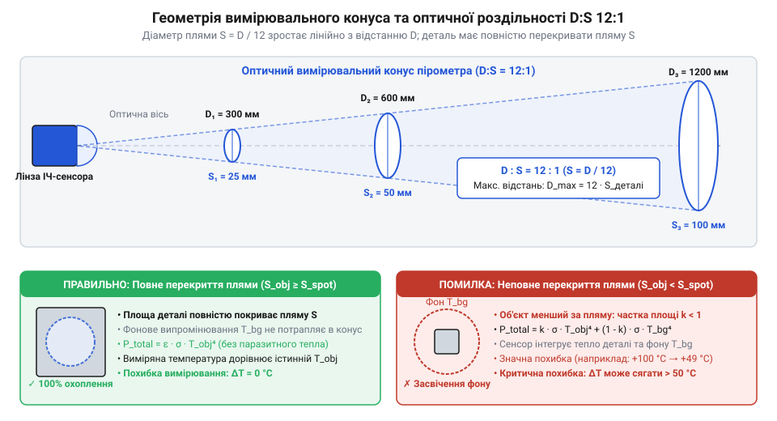

# Математика інфрачервоного випромінювання та геометрія оптичної плями

## Фізична проблема безконтактного вимірювання температури

Визначення температури об'єктів шляхом прямого контактного дотику за допомогою термопар чи терморезисторів має суттєві фізичні обмеження. Контактний датчик вимагає часу для досягнення теплової рівноваги з досліджуваним тілом, відбирає частину його теплової енергії та може пошкодити крихкі чи стерильні поверхні. Головним джерелом систематичної похибки тут є теплофізичний механізм конвективного охолодження: струмені навколишнього повітря постійно відводять тепло від вимірювального спаю термопари та її металевих виводів швидше, ніж воно надходить шляхом теплопровідності через обмежену площу дотику з поверхнею. Через цей температурний перепад спай не досягає реальної температури об'єкта. Крім того, контактний вимір неможливий для рухомих механізмів, деталей під високою електричною напругою або агресивних хімічних середовищ. Альтернативним розв'язком є безконтактне вимірювання (від грецького *pyr* — вогонь та *metron* — вимірювання; `@@en|pyrometry@@`), яке ґрунтується на реєстрації власного теплового випромінювання поверхні.

Будь-яке тіло з температурою, вищою за абсолютний нуль (`0 К`), випромінює електромагнітні хвилі в інфрачервоному діапазоні (від латинського *infra* — нижче та *red* — червоний; `@@en|infrared radiation@@`). Однак під час поширення в повітряному середовищі частина цього випромінювання інтенсивно поглинається молекулами водяної пари `H₂O` та вуглекислого газу `CO₂`. Молекулярний механізм цього загасання полягає в резонансному поглинанні фотонів: кванти інфрачервоного випромінювання збігаються з власними коливально-обертальними модами молекул `H₂O` (в областях близько `2.7 мкм` та `6.3 мкм`) і `CO₂` (смуги `4.3 мкм` та `15 мкм`), перетворюючи енергію випромінювання на тепловий рух газу. Для наземних вимірювальних приладів існує спектральне вікно прозорості атмосфери (від англійського *atmospheric window*; `@@en|atmospheric window@@`) у діапазоні довжин хвиль від `8` до `14 мкм`, де фундаментальні резонансні частоти `H₂O` та `CO₂` відсутні. У цій області атмосфера залишається майже повністю прозорою, що дозволяє уловлювати фотони теплового потоку без суттєвого загасання на відстані в кілька метрів.

## Закони теплового випромінювання та спектральне вікно

Для математичного опису випромінювальної спроможності введено еталонне поняття абсолютно чорного тіла (від німецького *абсолютно чорне тіло*; `@@en|black body@@`) — об'єкта, який повністю поглинає все падаюче випромінювання незалежно від довжини хвилі та випромінює максимально можливий потік енергії при даній температурі. Спектральний розподіл цього випромінювання описується законом Планка (від прізвища німецького фізика Макса Планка; `@@en|Planck's law@@`), який задає густину потоку для кожної довжини хвилі `λ`. Математичний зв'язок полягає в тому, що повна інтегральна енергетична світимість `M` виникає як результат інтегрування спектральної густини Планка по всьому діапазону від `λ = 0` до `∞`. Сумування випромінювання на всіх довжинах хвиль дає залежність від четвертого степеня абсолютної температури, яку визначає закон Стефана — Больцмана (від прізвищ австрійських фізиків Йозефа Стефана та Людвіга Больцмана; `@@en|Stefan-Boltzmann law@@`):

```
M = σ · T⁴                                       [закон Стефана — Больцмана]
```

де `σ` — стала Стефана — Больцмана (`σ ≈ 5.670374 × 10⁻⁸ Вт/(м² · К⁴)`), а `T` — абсолютна температура поверхні в кельвінах (`К`). При підвищенні температури тіла вдвічі загальний потік випромінюваної енергії зростає у 16 разів.

**Обчислення енергетичної світимості при кімнатній температурі:** при температурі поверхні `T = 300 К` (приблизно `26.85 °C`) інтегральний потік розраховують підстановкою значення `σ`:

```
M = 5.670374 × 10⁻⁸ × 300⁴                      [підстановка абсолютної температури]
= 5.670374 × 10⁻⁸ × 8.1 × 10⁹                   [обчислення 300⁴ = 8 100 000 000]
≈ 459.3 Вт/м²                                   [інтегральна світимість одиниці площі]
```

Розподіл енергії за спектром описується законом зсуву Віна (від прізвища німецького фізика Вільгельма Віна; `@@en|Wien's displacement law@@`), який пов'язує довжину хвилі `λ_max`, на яку припадає максимум спектральної густини випромінювання, з температурою `T`:

```
λ_max = b ÷ T                                   [закон зсуву Віна]
```

де `b` — стала зсуву Віна (`b ≈ 2897.77 мкм · К`).

**Обчислення пікової довжини хвилі для кімнатної температури:** для об'єкта з температурою `T = 300 К`:

```
λ_max = 2897.77 ÷ 300                           [підстановка температури 300 К]
≈ 9.66 мкм                                      [довжина хвилі максимальної інтенсивності]
```

Отриманий максимум `9.66 мкм` потрапляє точно в центр атмосферного вікна прозорості `8–14 мкм`. Це пояснює, чому оптичні датчики загальнопромислових пірометрів для кімнатних та середньотемпературних об'єктів проектують під чутливість саме в цьому довгохвильовому спектральному інтервалі. Однак при підвищенні температури тіла згідно із законом Віна відбувається спектральний зсув максимуму в напрямку коротших довжин хвиль: для розпеченого об'єкта при `T = 1000 К` (близько `727 °C`) пік випромінювання зсувається до `λ_max ≈ 2.9 мкм` у ближній інфрачервоний діапазон. Через цей ефект для високотемпературних вимірювань металів чи розплавів оптику пірометрів переналаштовують на короткохвильові спектральні вікна (`1.6–3.9 мкм`), де зосереджена основна енергія теплового потоку гарячих тіл.

## Геометрія вимірювального конуса та оптична пляма

Оптична система пірометра фокусує інфрачервоне випромінювання від досліджуваного об'єкта на чутливий елемент датчика. Оскільки оптична лінза має фіксований кут огляду, зона спостереження утворює конус, який розширюється в міру віддалення від приладу. Однак у ближній зоні спостереження геометрія вимірювального конуса відхиляється від лінійної через скінченну апертуру (вхідний діаметр) оптичної лінзи `d_лінзи`. Безпосередньо біля об'єктива приладу (`D = 0`) діаметр вимірювальної плями не дорівнює нулю, а визначається розміром самої лінзи, через що підсумковий діаметр плями описується сумою `S = d_лінзи + D ÷ k_DS`. У дальній зоні вклад апертури стає знехтовно малим, але на малих відстанях ця нелінійність не дозволяє вимірювати деталі, менші за діаметр вхідного вікна пірометра. Ключовою характеристикою геометричної роздільності в дальній зоні залишається коефіцієнт оптичного підсилення або показник візерунка (від англійського *distance-to-spot ratio*; `@@en|distance-to-spot ratio@@`, `D:S`).

Співвідношення `D:S` визначає пропорцію між відстані `D` від лінзи пірометра до поверхні та діаметром `S` вимірювальної плями на цій поверхні:

```
S = D ÷ k_DS                                    [залежність діаметра плями від відстані]
```

де `k_DS` — числовий коефіцієнт оптичної роздільності приладу (наприклад, `12` для специфікації `12:1`).

**Обчислення діаметра плями для відстані 1.2 метра:** при вимірюванні з відстані `D = 1200 мм` пірометром з роздільністю `D:S = 12:1` розмір плями становить:

```
S = 1200 ÷ 12                                   [підстановка відстані 1200 мм]
= 100 мм                                        [діаметр плями на поверхні]
```


*Геометрія вимірювального конуса пірометра за співвідношенням D:S 12:1.*

Для отримання достовірного результату площа досліджуваного об'єкта повинна повністю перекривати вимірювальну пляму `S`. Крім того, важливо враховувати кут нахилу приладу: якщо вісь пірометра відхиляється від нормалі до поверхні на кут `θ`, вимірювальна пляма деформується з кругової на еліптичну. Мала вісь еліпса дорівнює `S_мала = S`, а велика вісь подовжується за формулою `S_велика = S ÷ cos θ`, що збільшує підсумкову площу плями в `1 ÷ cos θ` разів. Наприклад, при нахилі під кутом `θ = 60°` (`cos 60° = 0.5`) довжина плями подвоюється (`S_велика = 2 · S`), через що пляма може вийти за межі деталі. Якщо об'єкт стає меншим за розширену пляму, сенсор фіксує усереднений тепловий потік від об'єкта та навколишнього фону, що призводить до викривлення показників температури. Перед проведенням вимірювань лінійні габарити цільової поверхні перевіряють інструментами, наприклад, застосовуючи [штангенциркуль](root:cat-hw-instruments/vernier-caliper) для контролю точних розмірів деталей.

## Компенсація випромінювальної здатності та фонового відбиття

Реальні фізичні тіла відрізняються від абсолютно чорного тіла й випромінюють меншу кількість енергії при тій самій температурі. Відношення випромінювальної здатності реального тіла до випромінюваності чорного тіла називається коефіцієнтом випромінювальної здатності або емісивністю (від латинського *emissio* — випускання; `@@en|emissivity@@`, `ε`). Значення `ε` лежить у межах `0 < ε ≤ 1`. При відхиленні оптичної осі пірометра від нормалі до поверхні на кут понад 45°–60° направлена емісивність (`@@en|directional emissivity@@`) стрімко спадає через зростання дзеркального відбиття, що занижує виміряну температуру. Також емісивність істотно залежить від співвідношення висоти мікрошорсткостей поверхні `R_a` та довжини хвилі випромінювання `λ` (8–14 мкм). Якщо мікрошорсткість значно менша за довжину хвилі (`R_a << λ`), поверхня поводиться як оптично гладка та має низьку емісивність. Коли ж висота мікрошорсткостей досягає або перевищує довжину хвилі (`R_a ≥ λ`), у мікрозаглибинах виникає ефект порожнини (`@@en|cavity effect@@`): випромінювання зазнає багаторазових внутрішніх відбиттів, кожне з яких додатково поглинає енергію, піднімаючи ефективну емісивність ближче до одиниці.

Сумарна густина енергетичного потоку `W_total`, що надходить до оптичного датчика від непрозорого сірого тіла, складається з власного випромінювання поверхні з температурою `T` та відбитого випромінювання навколишнього фону з температурою `T_bg`:

```
W_total = ε · σ · T⁴ + (1 - ε) · σ · T_bg⁴       [сумарна енергетична світимість сірого тіла]
```

де `(1 - ε)` дорівнює коефіцієнту відбиття поверхні `ρ` згідно із законом Кірхгофа для непрозорих тіл (`ε + ρ = 1`).

Для знаходження дійсної температури об'єкта `T` виконаємо покрокове алгебричне перетворення виразу сумарної світимості:

```
W_total - (1 - ε) · σ · T_bg⁴ = ε · σ · T⁴       [віднімання фонової складової від відбиття]
(W_total - (1 - ε) · σ · T_bg⁴) ÷ (ε · σ) = T⁴   [ізоляція четвертого степеня температури]
T = ⁴√((W_total - (1 - ε) · σ · T_bg⁴) ÷ (ε · σ)) [добування кореня 4-го степеня]
```

Для поверхонь із низькою емісивністю (наприклад, полірованого алюмінію з `ε ≈ 0.05`) фонова складова `(1 - ε) · σ · T_bg⁴` переважає власне теплове випромінювання об'єкта. Щоб точна компенсація була можливою, потрібно знати реальне значення еквівалентної фонової температури `T_bg`. На практиці її вимірюють за допомогою експериментального відбивача: зім'яту й потім розправлену листкову алюмінієву фольгу з високим коефіцієнтом відбиття (`ρ ≈ 0.95`) розміщують на досліджуваній поверхні. Оскільки власне випромінювання фольги нехтовно мале (`ε ≈ 0.05`), вона працює як дифузне дзеркало для навколишніх джерел тепла. Навівши пірометр на фольгу з налаштуванням `ε = 1.0`, отримують дійсне значення `T_bg`, яке потім вводять у мікроконтролер приладу разом із коефіцієнтом `ε` об'єкта для точного автоматичного розрахунку його власної температури. У таких умовах без правильного визначення `T_bg` та введення емісивності розраховане значення міститиме неприпустимо високу похибку.
